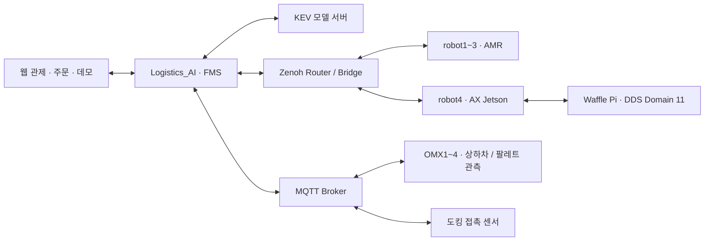

# Logistics_AI

**LOGIFLOW · 주문부터 운반·상하차·재고 보충까지 연결하는 AI 기반 물류 관제 시스템**

여러 로봇의 독립 기능을 하나의 물류 작업으로 이어주는 FMS 저장소다. 웹에서 주문을 등록하고, AMR의 이동과 OMX의 상하차 결과를 받아 다음 작업을 연결한다. KEV 기반 AI 판단과 알고리즘 방식, 실제 장비와 시뮬레이션을 같은 관제 화면에서 선택한다.

현재 프로젝트에서 사용하는 관제 코드는 **이 `Logistics_AI` 저장소**다. 별도 `Logistics_FMS` 저장소를 합치는 정리는 수행하지 않았다.

[개요](#1-프로젝트-개요) · [기능](#2-주요-기능) · [연결](#3-시스템-연결) · [환경](#4-실행-환경) · [구조](#5-저장소-구조) · [설치](#6-설치-및-환경-설정) · [사용](#7-사용-방법) · [운영](#8-설정과-운영-시-참고) · [점검](#9-확인-및-점검) · [문서](#10-관련-문서와-저장소) · [브랜치](#11-브랜치와-문서-기준)

## 1. 프로젝트 개요

물류 흐름은 개별 로봇이 움직이는 것만으로 완성되지 않는다. 주문 배정, 작업 위치 도착, 상하차 완료, 다음 목적지 이동이 서로 맞아야 한다. 이 저장소는 장비 상태와 실제 응답을 모아 그 흐름을 관리한다.

| 구분 | 담당 범위 |
|---|---|
| 웹 관제 | 지도·주문·장비 상태·수동 제어·데모 화면 |
| 백엔드 | 주문 단계, 배차, 경로·점유·예약, 명령과 결과 처리 |
| AI 연동 | KEV 경로 선택·배차·다중 로봇 교통 판단 |
| 장비 연동 | AMR 3대, OMX 4대, WAF 재고 보충 로봇 |

일반 주문은 **주문 등록 → AMR 배정 → 픽업대 이동 → OMX 상차 → 작업대 이동 → OMX 하차 → 스테이션 복귀** 순서로 진행한다. 재고 보충은 품목별 버튼에서 별도 WAF 액션으로 요청한다.

## 2. 주요 기능

- **주문 관리:** A/B/C/D 주문 등록, 대기열·진행 단계·결과 표시, 취소와 복귀 요청.
- **로봇 관제:** AMR 위치·방향·경로·배터리·연결 상태와 개별 로봇 상세 패널.
- **AI·알고리즘 모드:** 실제/시뮬레이션과 AI/알고리즘 선택. 기본 시작은 실제·AI이며 KEV 기본 모델은 `kev-0.8b`다.
- **다중 로봇 흐름:** 그래프 경로, 점유·예약, KEV MAPF 및 교통 복구 연동.
- **OMX 연동:** MQTT 접수·진행·결과, 로봇팔 상태, A/B/C/D 팔레트의 있음·비었음·확인 불가 표시.
- **WAF 수동 보충:** A=1, B=2, C=3, D=4 목적지로 액션 전송, 단계 피드백·취소·재요청 처리.
- **운영 화면:** 데모 하위 탭, API별 통신 관측, Zenoh·MQTT 상태, 장비 서비스 관리와 FMS 웹 재시작.
- **로컬 지도 보기:** 로봇의 지도 발행 없이 PC의 YAML/PGM으로 RViz 실행.

데모 화면도 기존 API를 호출한다. 실행 가능한 항목과 조회만 가능한 항목을 구분하며, 탭 이동 자체는 진행 중인 작업을 취소하지 않는다.

## 3. 시스템 연결



| 연결 | 인터페이스 |
|---|---|
| 웹 ↔ 백엔드 | HTTP API, WebSocket |
| FMS ↔ AMR | Zenoh를 통한 `/robot1`~`/robot3` ROS 토픽·액션 |
| FMS ↔ OMX | `omxN/command`, `ack`, `progress`, `result`, `status`, OMX1·2의 `stock` |
| FMS ↔ WAF | `/robot4/pallet_replace` 액션, 배터리·위치·단계 피드백 |
| Waffle ↔ AX Jetson | CycloneDDS, Domain 11, SUBNET. Pi에서 Zenoh를 실행하지 않는다. |

WAF는 일반 배송 로봇의 경로 생성 대상으로 편입하지 않는다. FMS는 보충 액션을 보내고 상태를 받으며, WAF 자체의 Nav2·정렬·리프트 시퀀스가 실제 작업을 수행한다.

## 4. 실행 환경

| 항목 | 구성 |
|---|---|
| 메인 PC | Ubuntu 24.04, ROS 2 Jazzy |
| 백엔드 | Python, FastAPI, Pydantic, paho-mqtt |
| 프런트엔드 | React 19, TypeScript, Vite |
| AI 서버 | KEV 별도 소스·모델, 선택 모델에 맞는 GPU·메모리 환경 |
| 통신 | CycloneDDS, Zenoh 1.9.0, Mosquitto MQTT |
| 실행 관리 | 호스트의 백엔드·프런트엔드·Bridge·KEV, Docker Compose의 Router·Broker |
| FMS ROS 기본값 | Domain 15 / CycloneDDS / LOCALHOST |

PC의 IP, 장비별 시리얼·센서 보정, AI·ACT 가중치는 각 장비 환경에 맞춰 준비한다. 서브모듈을 받는 것만으로 모델이나 현장 설정까지 설치되지는 않는다.

## 5. 저장소 구조

```text
Logistics_AI/                    # 현장 폴더명 예: ~/AX_Logistics
├── backend/app/                 # API, 주문·AI·교통·ROS/MQTT 연동
├── backend/simulation/          # 시뮬레이션·모델 비교 도구
├── frontend/                    # 웹 관제·주문·데모 화면
├── robots_ws/
│   ├── Logistics_AMR/           # AMR 서브모듈
│   ├── Logistics_WAF/           # WAF 서브모듈
│   └── shellscript/             # 환경·실행 명령 서브모듈
├── omx_ws/Logistics_OMX/         # OMX 서브모듈
├── maps/ · routes/              # 지도·경로 그래프
├── infra/                       # Zenoh Router·MQTT Broker 구성
├── scripts/                     # 설치·SSH·RViz 실행 보조
├── tests/                       # API·주문·연동 회귀 검증
├── doc/ · docs/                 # 설계·운영·검증 기록
├── .env.example                 # 로컬 설정 양식
└── start_fms.sh · stop_fms.sh    # FMS 시작·종료
```

## 6. 설치 및 환경 설정

### 새 PC에서 받기

```bash
git clone --branch dev --recurse-submodules \
  https://github.com/E1I6-Logistics/Logistics_AI.git ~/AX_Logistics
cd ~/AX_Logistics
git submodule status
```

서브모듈은 부모 저장소가 기록한 **정확한 커밋**으로 받는다. 현재 검토 기준은 네 서브모듈 모두 `dev`이며, 재현할 때는 `git submodule update --init --recursive`를 사용한다. `--remote`는 고정된 조합 대신 원격의 다음 변경을 가져오는 명령이다.

### 설치와 인터페이스 준비

다음은 새 메인 PC의 설치 순서다. 설치기는 시스템 패키지·Python·Node·ROS 작업공간을 준비한다.

```bash
cd ~/AX_Logistics
# 현재 설치기는 AMR 작업공간의 dev 브랜치를 확인한다.
git -C robots_ws/Logistics_AMR switch dev
bash scripts/setup.sh main
source ~/.bashrc
```

WAF 보충 기능을 사용하려면 메인 PC에도 액션 메시지 타입을 빌드한다. 로봇 구동부나 비전 서버를 FMS PC에서 함께 시작하는 절차는 아니다.

```bash
source /opt/ros/jazzy/setup.bash
cd ~/AX_Logistics/robots_ws/Logistics_WAF
colcon build --packages-select waffle_interfaces
```

공유 설정 양식은 `.env.example`, 현장 값은 Git에서 제외된 `.env`다. 설치기가 생성한 파일이 있으면 내용을 확인한다. `start_fms.sh`는 이미 셸에 설정된 값을 우선하고, AMR 환경 뒤에 WAF 인터페이스 환경만 추가한다.

| 설정 | 용도 |
|---|---|
| `FMS_ROBOT_MODE`, `FMS_OPERATION_MODE` | 실제/시뮬레이션, AI/알고리즘 시작 모드 |
| `FMS_MAP_YAML`, `FMS_ROUTE_GRAPH` | 지도와 경로 그래프 |
| `FMS_ROS_WS_SETUP`, `FMS_WAF_WS_SETUP` | 빌드된 ROS 작업공간·WAF 인터페이스 |
| `FMS_KEV_DIR`, `FMS_KEV_RUN`, `FMS_KEV_ENABLED` | KEV 소스·모델·실행 여부 |
| `FMS_MQTT_BROKER_IP`, `FMS_MQTT_BROKER_PORT` | 백엔드의 MQTT 연결 주소 |
| `FMS_WAF_ACTION_NAME` | 보충 액션 주소. 기본 우선순위는 `/robot4/pallet_replace`다. |

KEV 소스 기본 경로는 `~/AX_Logistics`의 형제 폴더인 `~/kev`, 모델 기본값은 `jaredpalmer/kev-0.8b@v1.0`이다. 학습 가중치와 GPU 환경 준비는 별도다.

## 7. 사용 방법

시작과 종료는 상황에 맞게 **각각** 실행한다.

```bash
cd ~/AX_Logistics
./start_fms.sh
```

| 용도 | 명령·접속 |
|---|---|
| 관제 웹 | `http://<FMS_PC_IP>:5173/` |
| 백엔드 상태 | `http://<FMS_PC_IP>:8000/health` |
| API 문서 | `http://<FMS_PC_IP>:8000/docs` |
| 종료 | `./stop_fms.sh` |
| Router·Broker를 유지하며 FMS 종료 | `FMS_KEEP_TRANSPORT=1 ./stop_fms.sh` |
| PC 저장 지도로 RViz 열기 | `./rviz_fms` |

1. 웹에서 실제/시뮬레이션과 AI/알고리즘 모드를 확인한다.
2. 로봇·OMX의 연결과 준비 상태를 확인한다.
3. A/B/C/D 주문을 등록하고 AMR 이동·상하차·복귀 단계를 확인한다.
4. 재고 보충은 해당 품목의 **재고 보충** 버튼으로 별도 요청한다.
5. WAF 상세에서 단계·결과·취소를 확인한다. 취소 완료 후에는 새 요청을 등록할 수 있다.

FMS 재시작 전 보충 기록만 남은 경우에는 실제 작업 종료를 확인한 뒤 **이전 작업 종료 확인·기록 정리**를 사용한다. 기록 정리 자체가 로봇을 이동시키거나 이전 작업을 재전송하지는 않는다.

## 8. 설정과 운영 시 참고

- **연속 운용 정책:** 현재 시작 스크립트는 `FMS_CONTINUOUS_RUN=1`을 기본으로 한다. 일시적인 위치·연결·이동 실패는 기존 Action 종료와 상태 회복을 확인한 뒤 재시도한다. 긴급 정지·취소·점유 검사가 사라진 구성은 아니다.
- **속도 설정:** `FMS_REAL_NAVIGATION_SPEED_MPS`는 FMS의 시간 예측에 사용하는 기준값이다. 실기체의 속도 제어와 Nav2 파라미터는 AMR/WAF 작업공간에서 확인한다.
- **장비 관리:** OMX 서비스 재시작은 SSH 설정과 장치 준비가 필요하다. FMS 웹 재시작 버튼은 기존 stop/start 스크립트를 실행하므로 사용 시점을 구분한다.
- **재고 관측:** `PRESENT`, `EMPTY`, `UNKNOWN`은 OMX가 측정해 보낸 관측 상태다. 보충 액션 성공만으로 팔레트 재고 값을 강제로 바꾸지 않는다.
- **상하차 결과:** OMX의 동작 사이클 완료와 실제 물품 전달 성공은 서로 다른 정보다. 수신한 결과·검증 범위를 그대로 확인한다.
- **로컬 데이터:** `.env`, 로그, 모델, 장치 설정은 현장 자료다. 저장소를 갱신하면서 다른 장비의 값으로 덮어쓰지 않는다.

## 9. 확인 및 점검

다음은 상태 조회 명령이다. 로봇 이동 목표를 보내지 않는다.

```bash
curl -s http://127.0.0.1:8000/health
curl -s http://127.0.0.1:8000/api/connections
curl -s http://127.0.0.1:8000/api/replenishment
```

FMS의 ROS 환경에서 `ros2 action info /robot4/pallet_replace`로 보충 서버를 확인한다. 내부 DDS 환경의 AX Jetson에서는 `/pallet_replace`를 조회한다.

| 증상 | 확인 위치 |
|---|---|
| 웹/API 실행 실패 | `logs/frontend.log`, `logs/backend.log` |
| AMR·WAF가 보이지 않음 | `logs/zenoh_bridge.log`, Router 주소, Bridge·Domain·namespace |
| OMX가 동시에 깜빡임 | MQTT 연결 로그와 Broker 재시작 여부 |
| 팔레트 확인 불가 | OMX 관측 이유, 홈 상태, ROI·빈 기준·카메라 연결 |
| 보충 후 재요청 차단 | WAF 종료 결과, 취소 상태, 재시작 전 작업 기록 |
| KEV 준비 실패 | `logs/kev.log`, 모델 경로·GPU·Python 환경 |

개발 검증은 `tests/`, 프런트엔드 타입 검사·빌드는 `frontend/package.json`의 스크립트를 사용한다. 시뮬레이션 시나리오와 실기체 작업 시험은 분리한다. 이번 정리는 문서·Git 참조 점검이며 새로운 실물 성능 검증을 뜻하지 않는다.

## 10. 관련 문서와 저장소

| 문서 | 내용 |
|---|---|
| [데모 콘솔](doc/demo-console.md) | 실행 항목, 취소, 관측 정보 |
| [KEV MAPF 구조](docs/kev_mapf_flowchart.md) | 배차·경로·교통 판단 흐름 |
| [연속 운용 정책](doc/continuous-run.md) | 재시도 대상과 유지되는 조건 |
| [OMX 상태 연동](docs/omx-status.md) | 팔레트 수신, SSH, 장비 관리 |
| [정리 전 운영 안내](docs/README_REFERENCE.md) | 기존 상세 설명과 이력 보존 |
| [이번 dev 정리 기준](docs/DEV_REVIEW.md) | 기준 브랜치와 서브모듈 고정 버전 |

연결 저장소: [AMR](https://github.com/E1I6-Logistics/Logistics_AMR/tree/dev) · [WAF](https://github.com/E1I6-Logistics/Logistics_WAF/tree/dev) · [OMX](https://github.com/E1I6-Logistics/Logistics_OMX/tree/dev) · [shellscript](https://github.com/E1I6-Logistics/shellscript/tree/dev) · [전체 프로젝트 소개](https://github.com/E1I6-Logistics)

## 11. 브랜치와 문서 기준

2026-11-07 정리 기준은 최근 사용한 원격 `feat/fms-continuous-run`의 `6d5bf76`이다. 그 실행 코드를 유지한 채 README와 서브모듈 참조를 `dev`에 정리한다. **`main` 반영은 최종 검토·이미지 추가 후 별도로 진행한다.**

실행 코드·파라미터·설치 스크립트는 이번 문서 정리에서 수정하지 않는다. 변경한 Git 연결 정보와 각 서브모듈 커밋은 [dev 검토 기록](docs/DEV_REVIEW.md)에 남긴다.
