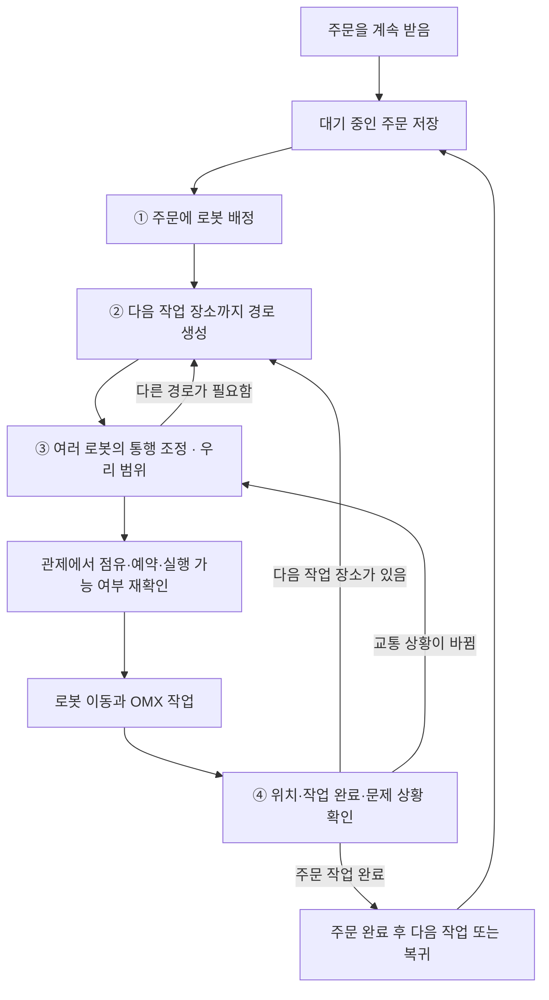

# 전체 물류 흐름과 KEV 교통조정: 설계와 목표

정리일: 2026-10-24 · v0.13 · `Logistics_AI/woozoo`. 초기 실험의 코드 기준은 `e6899d4`이며, 기능 공유 정리는 `3e26822` 이후 작업 파일을 기준으로 한다.

**기능을 실행하려면 [일반 주문 연결과 실행 설정](order-traffic-integration.md), 확인한 결과와 남은 범위는 [전체 비교 결과](experiments/order-traffic-results-and-coverage-20261024.md)를 함께 읽는다.** 개인 채팅 인수인계는 로컬에 보관한다.

**이 문서부터 읽으면 된다.** 전체 목표, 현재 되는 것, 앞으로 만들 것을 함께 정리했다.
아래의 ‘목표·설계 제안’은 구현하고 검증할 방향이다. 정지 상태 비교에 더해 일반 주문의 새 출발 요청과 동적 우회 생성을 연결했다. 일반 주문의 KEV·코드 선택 비교와 단계별 취소 후 재개를 가상 관제에서 확인했다. 전체 로봇의 주행 중 공동 경로 변경과 반복 성능 검증은 남아 있다.
이전의 초기 검토안은 로컬에 보관한다. 기능 공유의 기준은 이 문서와 현재 구현·검증 결과다.

**이번에 정한 진행 방향:** 먼저 **평균 이동 완료 시간(실행 기준)** 최소를 검증하고, 장기 대기 보호 규칙은 다음 단계에 추가한다.
3대로 시작하되 로봇 수가 늘어날 수 있게 설계한다. 여러 단계 양보의 KEV 확장은 아래 2026-10-22 진단 기준 미달로 중단했다. 이후 사용자 승인으로 대기·우회 전략 순서의 별도 비교와 일반 주문의 새 요청 하나에 대한 순서 제안을 추가했다. 일반 주문의 기본 선택 설정은 기존 KEV이며, 현재 별도 시뮬 화면에서는 시험 정책을 바꿀 수 있다. 최신 비교 범위와 결과는 2절을 따른다.
2026-10-20: 확장 구조 중 **다음 검사 동작 제안·실패 피드백·한도 있는 탐색**을 별도 정지 상태 시험에 구현했다.
첫 유효 계획을 찾는 단계이며 아래의 최적 시간 탐색·일반 주문 연결 전체를 구현한 것은 아니다. [구현·비교 결과](experiments/kev-guided-recovery-20261020.md).
2026-10-21: 기능 확장보다 **KEV를 쓸 성능 근거를 확인하는 것**을 우선한다. [대표 상황 5개·입력 부족 대조 1개와 비교 조건 초안](experiments/kev-mapf-benchmark-plan-20261021.md)을 준비했고 코드로 실행 가능성을 확인했다. 운영상 양보 위치·정차 허용 조건을 검토하기 전이며 이 새 묶음의 실제 KEV 비교는 아직 하지 않았다.

2026-10-22: 별도 다중 양보 시험에 지도 거리·이동 예상 시간을 추가했다. 코드와 KEV에 같은 계산값을 제공한다. 실제 모델 전후 비교에서 두 대 양보의 KEV 단독 미해결은 그대로였고, 우회가 있는 한 상황에서는 같은 최종 경로를 찾는 모델 호출이 줄었다. 일반 주문·실기체 연결 범위는 그대로다. [변경과 결과](experiments/kev-mapf-recovery-motion-input-20261022.md).

같은 날 [짧은 입력 48회 진단](experiments/kev-mapf-concise-probe-20261022.md)도 사전 기준에 미달해 추가 모델 시험을 중단했다. 현 모델·입력에서 여러 단계 양보 순서를 더 맡길 근거가 부족하다. 실제 교통조정은 코드로 안정성을 확보하고 KEV는 비교 시험으로 보존하는 방향을 권한다. 운영 기본값과 일반 주문 연결 범위를 이번 진단으로 변경하지 않았다.

2026-10-23: 사용자가 승인한 [코드 탐색·KEV 전략 탐색·jhlee 전략 비교](experiments/traffic-strategy-three-way-20261023.md)를 별도 구현·실행했다. 이번에는 양보 이동을 제외하고 현재 노드 대기·기본 경로·동적 우회만 공통으로 허용했다. 경로를 만들기 전 KEV가 로봇·회피 구간을 제안하고 코드가 구체화·검사하며, 한도 안에서 찾은 완성 계획의 시간을 비교한다. 정상 4상황에서 코드 4/4·새 KEV 탐색 4/4·jhlee 2/4 완료, 출발 불가 대조는 모두 정지했다. 새 KEV 탐색은 세 대 출발에서 코드보다 느린 계획을 찾았다. 이 한 번의 결과에서 성능 이점을 얻지 못했으므로 추가 모델 시험·운영 기본값 변경은 하지 않는다. 이전 다중 양보 실험을 재개하거나 일반 주문에 새 탐색기를 연결한 것은 아니다.

사용자 승인 후속으로 같은 5상황의 **총 호출 상한만 제거하고 공통 판단 시간 10초는 유지**한 비교도 한 번 실행했다. 정상 완료 수는 그대로였으며 새 KEV의 세 대 출발 예상 평균은 20.143초·25회 호출, 코드는 19.327초였다. jhlee는 9회 호출로 제안을 완성했지만 예약 검사에서 탈락했다. 최초의 8회 상한 결과와 구분한다. 전체 자동 검사 299개가 통과했고 운영 연결·기본값은 변경하지 않았다.

2026-10-22 추가: [기능 동작·성능 증거와 코드 기준 12건 검증](experiments/kev-mapf-evidence-status-20261022.md)을 정리했다. 새 모델 호출 없이 12건·27개를 작업·복귀까지 완료하고 기존 설정·위치를 복원했다. 일반 주문 연속 처리는 확인됐지만 KEV의 코드 대비 일관된 성능 이점은 확인되지 않았으며, KEV 경로 생성도 별도 실패 기록이 있다.

2026-10-22 추가 검증: [예약 대기 중 취소·통로 해제·같은 로봇 재사용](experiments/reservation-wait-cancellation-20261022.md)을 확인했다. 최초 관측 도구 오류 뒤 대기 한도로 실패한 주문도 보존하고, 수정 재시험의 취소 1건·정상 완료 1건과 구분했다. 실행 코드 수정 없이 원래 설정·위치를 복원했다.

2026-10-22 추가 검증: [출발 대기 60초 한도와 명시적 재시도](experiments/order-timeout-retry-20261022.md). 새 주문 1건이 기본 한도 뒤 실패하고 홈에서 복귀 완료 처리됐으며, 통로를 비운 뒤 명시적 재시도로 R2가 작업·복귀까지 완료했다. 실패 이력과 기존 15건은 보존했다. 홈 밖에서 복귀 경로가 막히는 180초 한도 시험과는 구분한다.

## 1. 우리 목표를 한 문장으로

> **주문이 계속 들어와도 로봇과 작업대가 서로 길을 막아 멈추지 않고, 오래 밀리는 주문을 줄이면서, 같은 시간에 더 많은 물품을 처리한다.**

이것을 전체 시스템의 목표로 제안한다. 로봇이 많이 움직이거나 KEV를 많이 호출하는 것 자체가 목표는 아니다.

**AI 도입 검토의 목표:** KEV를 쓰면 무조건 좋아진다고 가정하지 않는다. 코드 방식과 비교해 해결률·계획 품질·판단 비용·운영과 유지보수 부담 중 무엇이 좋아지거나 나빠지는지 확인하고 도입 여부를 정한다.

앞으로 검토할 [KEV 활용 아이디어 여섯 가지](kev-logistics-ai-ideas-20261023.md)는 별도 브레인스토밍 문서에 보관한다. 배차로 길 비우기·출발량 조절·운영 방식 선택·재계획 범위 선택·시험 상황 선택·학습을 다루며, 구현 계획이나 성능이 확인된 기능으로 분류하지 않는다.

### 전체 시스템의 유지보수 관점

AI로 일부 판단 규칙을 줄일 수 있어도 모델 버전·입력 형식·지시문·오류·응답 시간·품질 변화를 관리해야 한다. 코드 줄 수가 줄었다는 이유로 전체 유지보수가 쉬워졌다고 판단하지 않는다. [ML 운영 검사와 모니터링 연구](https://research.google/pubs/the-ml-test-score-a-rubric-for-ml-production-readiness-and-technical-debt-reduction/)도 모델 운영에 별도 검사와 관측이 필요함을 다룬다.

교통 입력·출력 형식을 명확히 하고 판단기를 교체할 수 있게 분리하며, 예약·점유 검사와 이동 허가는 공통으로 유지한다. 이 분리의 효과는 코드와 AI 양쪽에 적용된다. 모델 교체 뒤 같은 입력·검사 묶음으로 회귀를 확인할 수 있어야 한다. 현재처럼 모델 오류·한도를 기록하고 완성 검사를 통과하지 못한 계획을 실행하지 않는 경계도 유지한다.

별도 정지 배치의 코드·KEV 전략·jhlee 비교는 한 컴퓨터에서 입력 사본·예약표·가상 로봇 저장소를 매번 만들어 순서대로 실행한다. 일반 주문에서는 코드 선택·기존 KEV 최종 선택·새 KEV 전략 순서 중 한 방식을 화면에서 고를 수 있게 연결했다. 이 세 방식의 동일 주문 비교도 방식마다 새 시뮬 서버를 사용하며 AI 두 방식은 한 KEV 서버를 공유한다. 세 판단기가 같은 주문·로봇을 동시에 제어하지 않으며, jhlee를 일반 주문에 연결한 것은 아니다.

네가 맡은 교통조정의 당장 목표는 다음과 같다.

> **실행 가능 검사를 통과한 방법들 중에서 평균 이동 완료 시간(실행 기준)을 줄인다. 특정 로봇만 오래 기다리지 않게 하는 보호 규칙은 이후 단계에 추가한다.**

여기서 ‘완료’는 **이번에 요청한 목적지까지의 이동 완료**다. 픽업과 작업대를 모두 거친 **주문 완료**와 구분한다.
이 목표가 실제 물품 처리량도 높이는지는 이후 연속 주문 시험에서 확인한다.
첫 검증에서는 [5.2절의 정의](#traffic-time-metrics)를 주 기준으로 고정한다. 최장 대기는 함께 기록하되, 일정 시간 이상 기다리면 우선시키는 규칙은 이후 별도로 검증한다.

## 2. 지금 어디까지 되어 있나

**최신(2026-10-24):** [보통 주문·중간 폭증 비교](experiments/order-traffic-ordinary-burst-20261024.md)를 사용자 관제와 분리한 코드·지도 223개 파일의 사본에서 완료했다. 주문표 두 개에 단일 픽업대 8건·두 픽업대 4건을 섞어 보통 접수/중간 9건 폭증을 기존 알고리즘과 우리 AI로 비교했다. 8회·96건·300개 모두 작업·복귀 완료, 주문·복귀·모델 오류 0, 점유 표본 5,103회 중복 없음. 모델 요청/응답 85/85회, 관련 검사 307개 통과. 사용자 관제는 별도로 계속 사용할 수 있었고 시험 서버는 종료했다.

평균 주문 시간은 기존/우리 AI 순으로 보통42 18.80/19.09초·보통137 19.00/19.31초·폭증42 36.33/37.34초·폭증137 39.70/35.98초였다. 일관된 속도 이점은 없었다. AI가 빨랐던 폭증137은 7번 주문 배차 로봇·8번 주문 작업대가 달라졌고 이 선택들은 코드가 맡는다. AI의 160회 이동 결정·190회 검사 묶음 모두 준비 전략을 전부 시도해 KEV의 탐색 절감도 확인되지 않았다. 다른 기능 시험과 컴퓨터 자원을 공유한 초기 비교이므로 최종 성능 우위로 확정하지 않는다.

**2026-10-24 비교 대상 확정:** 먼저 화면의 **시뮬·알고리즘(기존 관제)**과 **시뮬·AI(우리 KEV 교통조정)**를 같은 주문·지도·출발 위치로 비교한다. 검증 뒤 실제·알고리즘과 실제·AI를 실기체에서 비교한다. 지금은 시뮬 시험 단계이며, 실기체 전환은 별도 작업이다. 우리 AI 시험은 A* 경로＋`KEV_STRATEGY_ORDER` 설정을 사용한다. AI 버튼만 누르면 이 설정이 항상 보장되는 것은 아니다.

기존 시뮬·알고리즘도 경로 계산·예약·점유 제어를 사용한다. 이전의 `MIN_EXPECTED_TIME` 비교군은 **우리 추가 교통조정 안에서 코드로 선택한 조건**이며 화면의 기존 알고리즘 모드와 다르다. 아래 내부 비교의 결과를 최종 두 모드 비교 결과로 대체하지 않는다. [비교 조건과 실행 기록](experiments/order-traffic-native-mode-comparison-20261024.md).

첫 두 모드 비교는 혼합 12건씩 모두 작업·홈 복귀 완료, 실패 0, 점유 표본 1,232회 중복 없음이었다. 평균 주문 시간은 기존 54.25초·우리 AI 50.39초, 최종 홈 복귀까지 141.25초·128.79초, 모델 요청은 0·19회였다. 한 쌍의 전체 흐름 결과이며 AI 판단 단독 효과는 미입증이다. 기존 화면 모드가 전후 AI→알고리즘으로 바뀌어 전체 도구 상태는 `STOPPED_REVIEW_REQUIRED`를 유지했다. 기존 주문·위치·시나리오는 보존됐고 시험 도구는 화면에 조회만 했다. 관련 검사 301개 통과, 실제 로봇 검증은 아직 하지 않았다.

최신 [같은 전략 흐름의 세 조건 대조](experiments/order-traffic-ranking-ablation-20261023.md): 두 픽업대 방문 12건씩을 새 KEV·고정 순서·고정 순서＋지난 응답 평균 대기로 실행했다. 36건 모두 작업·복귀 완료, 실패·복귀 오류·모델 오류 0, 점유 표본 1,821회 중복 없음. 평균 주문 시간은 50.48·54.15·50.37초, 홈 복귀까지 128.79·141.37·128.67초였다. 실제 모델 요청은 새 KEV의 19회뿐이다. 대기 대조군도 6번 주문을 R2에 배차해 빠른 흐름을 재현했고, 새 KEV와 모든 배차 로봇·47/48개 경로가 같았다. 이번 장면의 AI 전략 판단 이점 근거는 부족하다. 조건당 한 번의 진단으로 종료했고, 인공 대기·운영 정책 변경은 하지 않았다. 관련 검사 293개 통과.

[저장 로그 분기 분석](experiments/order-traffic-load-review-20261023.md): 새 운행·모델 호출 없이 여섯 주문표를 분석했다. 혼합·빠른 접수 네 비교는 6번 주문의 배차가 첫 분기였고, 코드 시험은 홈 N2의 R3·새 KEV 시험은 N3의 R2에 배차했다. 작업대는 모든 운행에서 N3으로 같았다. 이전 작업대 변화 설명을 정정한다. 새 KEV 이동 264회 모두 준비된 전략을 시도하고 코드의 최소 예상 시간 규칙으로 최종 선택해 탐색 절감 근거는 없었다. 분석 관련 검사 19개 통과, 원문 49개 보존. 이후 위의 별도 운행 대조를 완료했다.

[연속 주문 부하 비교](experiments/order-traffic-load-comparison-20261023.md): A/B 집중·두 픽업대 혼합·빠른 공급의 두 주문표씩을 코드 선택과 새 KEV 전략 순서로 실행했다. 12회 운행·총 144건 모두 작업·복귀 완료, 실패·복귀 오류·모델 오류 0, 모델 요청/응답 116/116, 점유 표본 7,233회 중복 없음. A/B는 코드가 조금 빨랐고 혼합·빠른 공급은 새 KEV가 빨랐다. 후자는 배차 로봇과 적용 경로가 달라졌으므로 전략 판단의 단독 효과와 구분한다. 기존 화면·주문·관제 실행 코드 유지, 관련 자동 검사 281개 통과.

현재 진행 방향: 사용자 결정으로 jhlee와의 추가 비교를 보류하고 우리 방식의 연결·연속 동작에 집중한다. [우리 새 KEV의 무작위 연속 주문 점검](experiments/our-strategy-continuous-validation-20261023.md)에서 12건·33개를 작업·홈 복귀까지 모두 완료했다. 전체 작업 끝 113.10초·복귀까지 123.74초, 실패·복귀 오류·모델 오류 0, 실제 모델 요청/응답 19/19, 점유 표본 237회 중복 없음. 이 운행 시험에서는 기존 화면·주문과 제품 코드를 유지했다. 이 결과를 MAPF의 본질에 더 가깝다거나 KEV의 성능 우수성이 확인됐다는 결론으로 쓰지 않는다.

후속 [공급 중지 후 완료·복귀 표시 수정](experiments/order-stream-stop-status-fix-20261023.md): 공급이 끝난 뒤에도 상태 조회 시 해당 주문의 최신 완료·복귀 건수를 집계한다. 저장된 12건 결과로 API를 재확인했고 관련 검사 272개를 통과했다. 기존 완료 6건과 로봇 위치를 보존해 화면용 시뮬 백엔드에도 반영했다. 교통조정·배차 규칙 변경이나 새 12건 운행 시험은 아니다.

최신 [jhlee 일반 주문 연결·동일 주문 비교](experiments/jhlee-order-integration-20261023.md): 고정 원본의 주문 게이트·엔진을 별도 시뮬 서버에 연결하고 A*의 점유 회피 입력을 보존했다. 단독·동시 두 건 연결은 완료했지만, 최종 6건 비교는 코드 6/6·우리 새 KEV 6/6·jhlee 2/6 완료 뒤 주문 1건 대기 한도 실패로 종료했다. jhlee는 같은 BLOCKED 판단을 반복해 모델 요청 시도 348회·응답 347회를 기록했다. 호출 수 엄격 대조도 1회 불일치여서 완전 통과로 표시하지 않는다. 앞선 두 연결 도구 누락과 수정 결과를 모두 보존했다. 일반 관제·프런트에는 jhlee를 추가하지 않았고 실제 로봇은 움직이지 않았다. 관련 자동 검사 270개 통과는 모델 성능 시험 횟수와 별개다.

최신 [일반 주문 세 방식 비교](experiments/order-traffic-policy-comparison-20261023.md): 같은 6건·8개를 코드 선택·기존 KEV 최종 선택·새 KEV 전략 순서로 한 번씩 처리했다. 셋 다 작업·복귀 완료, 적용 경로 기록은 같았다. 전체 작업 끝은 53.41·53.33·54.14초, 모델 호출은 0·1·9회였다. 새 방식의 9회 중 8회는 검사 뒤 유효 경로가 하나만 남아, 이번 작은 주문표에서 새 방식의 이점을 확인하지 못했다. 총 870회 점유 표본에서 중복 없음, 관련 검사 256개 통과. 반복 성능·지속 처리량·실기체 검증과 구분한다.

최신 [일반 주문 전략 순서 연결](experiments/order-traffic-strategy-integration-20261023.md): 시뮬·AI에서 기존 KEV 선택·코드 선택·새 KEV 전략 순서를 화면에서 고를 수 있다. 새 방식은 기존 예약을 유지한 **새 이동 요청 하나**에 적용하며, 정지 배치의 여러 로봇 DFS와 구분한다. 별도 시뮬 전용 서버에서 일반 주문 API로 6건·8개를 공급해 작업·복귀 모두 완료, 전략 호출 9회·관측 288회 중복 점유 없음. 기존 방식 대비 성능 개선 시험은 아니다. 관련 검사 251개·타입 검사·빌드 통과.

최근 별도 실험: [같은 가상 상태에서 KEV 확률 순서 재사용](experiments/traffic-strategy-probability-order-20261023.md). 5장면에서 기존 KEV와 최종 계획이 같으면서 호출 합계 30회→11회, 세 대 출발 판단 약 5.67초→1.72초로 줄었다. 코드 대비 계획 품질 개선은 확인하지 못했으며 일반 주문의 판단기·화면·실기체에는 적용하지 않았다.

후속 [새 네 장면](experiments/traffic-strategy-probability-new-cases-20261023.md)도 같은 최종 계획을 유지하며 호출 합계 51회→15회, 판단 시간 합계 약 10.89초→2.93초로 줄었다. 복귀·요청 순서 변경·실패 후 우회·제한된 우회를 확인한 정지 배치 시험이며, 일반 주문·기존 예약 연결은 별도 작업이다.

| 항목 | 현재 상태 |
| --- | --- |
| 주문 등록·대기열·자동 배차 | 기존 관제에 있음 |
| A* 경로 생성 | 있음 |
| KEV 경로 생성 | 있음. 연속 주문 시험에서 일부 경로 생성 실패를 확인한 상태 |
| 우리 교통조정: 입력 합치기 → 여러 방법 만들기 → 검사 → KEV 선택 → 이동 | 정지 상태 시험과 일반 주문의 새 이동 요청에 각각 연결. 두 흐름의 적용 범위는 다름 |
| KEV에 후보별 예상 완료 시간·대기 시간 제공 | 정지 상태 시험은 거리÷0.2m/s와 순차 실행 기준. 일반 주문은 기존 예약 대기도 포함. 회전·실물 정지 시간의 정밀 예측은 아님 |
| 로봇별 실제 단계 시작·도착과 판단 시간 기록 | 교통조정 시나리오에 추가함. 중단·미완료도 기록 |
| 시간이 더 적게 드는 방법을 골랐는지 성능 비교 | 정지 상태 6상황의 1차 비교 완료. 실제 KEV는 예상 최솟값과 7/15회 일치. 우수성 미확인 |
| KEV가 전략·우선 대상을 먼저 제안하고 코드가 계획을 만드는 구조 | 정지 배치의 여러 로봇 전략 탐색은 별도 비교로 유지. 일반 주문에는 새 요청 하나의 경로 전략 순서 제안만 선택 가능하게 연결. 기존 로봇의 재계획·다중 양보는 포함하지 않으며 코드 대비 우수성은 미확인 |
| 일반 주문에 새 교통조정을 자동 연결 | 시뮬·AI의 새 출발 요청 연결. 기존 경로·동적 우회 중 선택. 설정으로 켜고 끌 수 있음 |
| 일반 주문의 연속 관제 시험 | 2026-10-21: 같은 18건·57개를 KEV·코드 방식으로 각각 처리. 총 36건 완료. 이번 한 쌍에서는 코드가 약 3.35초 빨랐으며 일반적인 우열은 미확정 |
| 주문 취소 후 뒤 주문 재개 | 미배차·픽업 대기·픽업 작업·픽업 이동·작업대 이동·작업대 작업에 더해, 예약할 경로를 기다리는 중 취소·통로 해제 후 과거 주문 재출발 방지·같은 로봇 재사용을 확인. 취소 복귀는 기존 알고리즘 기능. 실물 적재 물품 처리는 별도 규칙 필요 |
| 이동 중 로봇·기존 예약 반영 | 다른 로봇의 실행·예약은 유지하며 새 정지 요청을 검사·추가. 이동 중 로봇의 경로를 바꾸는 기능은 아직 없음 |
| 기존 경로 생성기에 우회 요청 | A*/AI 공통 요청에 회피 노드·물리 통로 전달. AI 경로 생성 실패는 그대로 기록하며 A*로 몰래 대체하지 않음 |
| jhlee가 구한 충돌 정보·대기 위치를 직접 받는 연결 | 최신 jhlee는 입력 제공뿐 아니라 별도 교통 판단 엔진을 포함해 책임이 겹침. 엔진은 격리 비교했으며 실제 병합·게이트 연결은 팀과 맞춰야 함 |
| 우리 새 교통조정의 실기체 검증 | 아직 하지 않음 |

**현재 시나리오 성공은 ‘선택을 받아 실행하는 연결이 된다’는 뜻이다. KEV가 기존 방식보다 우수하다는 뜻은 아니다.**

연속 주문의 실제 관제 기록과 발견한 문제는 [2026-10-20 무작위 주문 시험](experiments/random-order-run-20261020.md)에 정리했다.
해당 시험은 A* 경로 + KEV 교통조정 한 방식의 관측이며, 처리량 개선을 입증한 대조 시험은 아니다.
후속 [동일 주문 18건씩 비교](experiments/continuous-order-validation-20261021.md)와
[단계별 취소·복귀·뒤 주문 재개](experiments/order-cancellation-followup-20261021.md) 결과를 별도로 남겼다.
선택 1건의 [후속 원인 진단](experiments/order-traffic-selection-diagnosis-20261020.md)에서는 지시문·표시 순서 민감성을 확인했다.
짧은 표현도 다른 저장 사례에서 오류가 남아 운영 선택 방식은 유지했다. 숫자 최솟값 선택이 항상 보장된다고 가정하지 않는다.

## 3. 전체 물류 흐름

아래는 **목표로 하는 전체 연결 구조**다. ③은 일반 주문의 새 출발 요청에 연결했다. 주행 중 로봇의 계획까지 바꾸는 모니터링 되먹임은 아직 남아 있다.



주문 하나를 예로 들면 다음과 같다.

1. A와 C가 필요한 주문을 등록한다.
2. 대기열에 저장하고, 일할 수 있는 로봇이 있으면 배정한다.
3. A를 받으러 OMX1에 간다.
4. C를 받으러 OMX2에 간다.
5. 비어 있는 출고 작업대로 가서 작업한다.
6. 출고 작업이 완료되면 주문을 완료 처리한다.
7. 로봇은 다음 주문을 받거나 대기 장소로 복귀한다.

현재 코드의 작업 장소와 범위:

| 항목 | 현재 기준 |
| --- | --- |
| 로봇 | 3대 |
| A·B 픽업 | OMX1, 5번 노드 |
| C·D 픽업 | OMX2, 6번 노드 |
| 두 픽업대가 모두 필요한 주문 | OMX1 → OMX2 순서 유지 |
| 출고 작업대 | 3번 또는 4번 노드 |
| 주문 수량 | A+B+C+D 합계 1~5개 |
| 주문 확인 | 기존 관제의 약 0.1초 주기 유지 |
| 픽업대 차례 | 이번 픽업대의 앞선 요청과 실제 점유가 해제될 때까지 대기. 앞 주문 전체 완료·복귀는 기다리지 않음 |
| 주문 완료와 복귀 | 주문은 출고 작업 완료로 끝나며, 복귀는 별도로 진행 |

주문을 확인하는 0.1초마다 KEV를 호출한다는 뜻은 아니다. 로봇 가용 상태·작업 순서 등 기존 조건을 확인하는 주기다.
현재 배차는 일할 수 있는 상태를 먼저 검사하고, 대기 로봇을 우선한 뒤 로봇 ID 순서를 사용한다.
가까운 로봇·배터리가 많은 로봇을 고르는 개선은 현재 정책으로 표시하지 않는다.

2026-10-20 수정: A 주문과 B 주문처럼 같은 OMX1을 쓰더라도, 앞 로봇이 N5에서 실제로 떠나면 뒤 로봇은 이동 요청을 시작할 수 있다.
출발·N5 진입 시점은 기존 통로 예약과 교통조정 검사를 따른다. 앞 로봇의 출고 작업 완료나 충전 위치 복귀가 조건은 아니다.
OMX1→OMX2 주문도 각 픽업대에 접근할 때 차례를 확인한다. 아직 OMX1에 있는 동안 미래의 OMX2를 독점하지 않는다.

## 4. 네 단계와 우리 역할

| 단계 | 쉬운 설명 | 우리 작업과의 관계 |
| --- | --- | --- |
| ① 배차 | 어떤 주문을 어느 로봇이 맡을지 정함 | 이번에는 기존 방식 유지 |
| ② 경로 생성 | 그 로봇이 어느 길로 갈지 만듦 | 우선 A*로 분리 시험. KEV 경로가 준비되면 같은 형식으로 연결 |
| **③ 교통조정** | 여러 로봇이 같은 길을 쓸 때 누가 기다리고, 비켜주고, 돌아갈지 정함 | **네가 맡은 범위** |
| ④ 상태 확인·다시 판단 | 도착·통로 해제·경로 변경·문제 상황을 확인함 | 다음 순서를 실행하거나 필요할 때 ②·③에 다시 요청 |

네 단계에 모두 KEV를 적용하는 것은 전체 적용 방향이다. 현재 관제의 AI 버튼을 켰다고 네 단계가 전부 KEV로 바뀌는 상태는 아니다.
경로를 다시 만드는 것은 별도 다섯 번째 단계가 아니라 **②를 다시 사용하는 것**이다.

### 일반 주문 연결의 현재 범위

`dispatch_order_route()`에서 경로를 얻은 뒤 `order_traffic_service`로 전달한다.
이 서비스는 다른 로봇의 실제 점유·경로·예약·보호 자원을 복사해 검사하고, 공유 노드·통로를 피하는 경로를 기존 생성기에 요청한다.
여러 경로가 예약 가능하면 KEV가 선택하고, 적용 직전에 최신 점유·예약으로 다시 검사한다.
판단 중 기존 예약을 해제하지 않으며, 새 요청 로봇의 예약만 추가한다.
예약할 수 있는 경로가 없으면 현재 노드에서 0.25초 간격으로 재검사한다. 기본 60초 한도 후 실패로 기록하며 전역적으로 해가 없다는 뜻은 아니다.

**이 연결은 여러 로봇의 통과 순서를 통째로 다시 정하는 정지 상태 JointAction 시험과 다르다.**
이미 주행 중인 계획을 고정한 채 새 이동 요청 하나의 경로를 조정한다. 이 서비스가 교통 해결을 위해 다른 주행 로봇을 자동 취소·양보시키거나 전체 우선순위를 변경하지는 않는다.
사용자가 주문을 취소하면 별도의 기존 취소·정지·알고리즘 복귀 기능이 동작한다. 이동 중 취소도 가상 관제에서 확인했으며, KEV가 여러 로봇의 복구 계획을 만든 결과와 구분한다.
후보 목표는 `MIN_NEW_REQUEST_COMPLETION_WITH_EXISTING_PLANS_FIXED`다.
새 요청의 목적지까지 예약 대기를 포함한 예상 완료 시간을 비교하며, 다른 로봇의 계획이 고정된 범위의 비교다.
기존 정지 상태 시험의 다중 요청 평균 시간·7/15 결과와 직접 같은 성능 지표로 합치지 않는다.

운용 설정·화면 확인·남은 범위: [일반 주문 교통조정 안내](order-traffic-integration.md).

실제 로봇 주행은 Nav2와 BT가 담당한다. 현재 FMS의 ROS 코드에는 경유 자세 목록을 `NavigateThroughPoses`로 보내는 연결이 있다.
우리 교통조정은 어느 경로·순서를 실행할지 제안하고, 기존 관제가 실행 직전에 다시 확인한다.
실기체에서 로봇 크기·통로 폭·정지 거리까지 만족하는지는 별도 검증해야 한다.

<a id="traffic-resource-terms"></a>

### 지도·점유·이동에서 쓰는 말

| 용어 | 이 프로젝트에서의 뜻 |
| --- | --- |
| 노드 | 지도에 ID와 좌표가 있는 지점. 예: 7번 노드 |
| 유향 엣지 | 한 노드에서 다른 노드로 이동할 수 있는 방향별 연결. 7→11과 11→7의 존재 여부를 각각 확인 |
| 물리 엣지 | 두 노드 사이의 같은 통로. 반대 방향끼리도 동시에 한 대만 허용 |
| 경로 | 이번 목적지까지 방문할 노드의 순서. 경로에 노드가 포함됐다는 것만으로 현재 점유 중인 것은 아님 |
| 실제 점유 | 로봇이 지금 차지하고 있는 노드 또는 물리 엣지 |
| 예약 | 앞으로 자원을 사용할 계획의 시간 구간. 실제 점유·실행 직전 허가와 함께 확인 |
| 공유 자원 | 여러 로봇의 경로에서 함께 쓰는 노드·물리 엣지. 경로가 겹친다는 것만으로 동시 충돌이 확정되지는 않음 |
| 대기 노드 | 지도·운영 설정에서 정차를 허용한 노드. 좌표 하나를 임의로 대기 위치로 만들지 않음 |
| 이번 목적지 | 현재 이동 요청이 끝나는 노드. 다음 픽업대일 수도 있으며 주문 전체의 마지막 목적지와 구분 |

앞 담당자가 말하는 ‘충돌 노드·엣지’가 잠재적인 경로 겹침인지, 시간·점유까지 확인한 충돌인지는 입력 계약에 명시한다.
현재 작은 시험은 정지 상태의 실제 점유와 제공 경로로 검사한다. 시간대별 충돌을 모두 예측하는 기능이 있다고 해석하지 않는다.

## 5. 목표는 두 수준으로 잡는다

### 5.1 전체 시스템: 같은 시간에 완료한 물품과 주문

**주 지표 제안: 같은 시간 동안 완료한 물품 개수.**

주문당 수량이 1~5개로 다르므로 완료한 주문 수만 보면 작은 주문을 많이 끝내는 방식이 유리해질 수 있다.
다음 항목을 함께 기록한다.

| 기록할 것 | 쉬운 뜻 |
| --- | --- |
| 완료 물품 개수 ÷ 시험 시간 | 실제로 얼마나 많은 물품을 처리했는가 |
| 완료 주문 수 ÷ 시험 시간 | 얼마나 많은 주문을 끝냈는가 |
| 주문 접수부터 완료까지의 평균 시간 | 주문자가 평균적으로 얼마나 기다리는가 |
| 가장 오래 대기 중인 주문과 가장 늦게 끝난 주문의 시간 | 일부 주문만 계속 밀리는가 |
| 실패·취소·복구 건수와 남은 대기 주문 수 | 완료 수만 높이고 문제 주문을 남겨 두지는 않았는가 |

완료한 주문에 포함된 A/B/C/D 수량을 물품 수로 센다. 물건을 집었거나 로봇이 목적지에 도착한 것만으로 주문 완료 수를 늘리지 않는다.
출고 작업 성공이 주문 완료 기준이며, 복귀 완료는 따로 기록한다.

연속 물류 로봇 연구에서도 새 작업이 계속 들어오는 상황의 처리량을 별도로 평가한다.
따라서 작은 교통 시험의 시간이 줄었다는 것만으로 전체 처리량이 늘었다고 결론내리지 않는다.
[연속 물류 이동 연구, AAAI 2021](https://jiaoyangli.me/files/2021-AAAI-2.pdf)

<a id="traffic-time-metrics"></a>

### 5.2 교통조정의 시간 기준: 두 평균을 구분한다

**후보 선택의 주 기준은 ‘평균 이동 완료 시간(실행 기준)’이다.**
**준비·KEV 판단을 포함한 전체 처리 성능은 ‘평균 요청 처리 시간(판단 포함)’으로 함께 확인한다.**
문서·결과표에서는 ‘평균 시간’만 쓰지 않고 어느 기준인지 표시한다. 두 평균의 대상은 동일한 이동 요청 로봇 집합이다.

#### A. 평균 이동 완료 시간(실행 기준): 후보를 고르는 기준

한 조정안의 **실행 시작을 공통 0초**로 놓고, 각 로봇이 이번 목적지에 도착할 때까지의 시간을 평균 낸다.
본인이 실제로 움직인 시간뿐 아니라 앞 로봇의 차례를 기다린 시간도 포함한다. 공통 준비·판단 시간과 입력 수집 전 대기는 제외한다.

```text
로봇별 이동 완료 시간 = 목적지 도착 확인 시각 - 조정안 실행 시작 시각
평균 이동 완료 시간 = 로봇별 이동 완료 시간의 합 ÷ 이동 요청 로봇 수
```

예: R1은 이동에 5초, R2는 15초가 필요하고 한 대씩 보낸다. 준비·단계 전환 지연은 없다고 가정한다.

| 실행 순서 | R1 도착 시각, 실행 기준 | R2 도착 시각, 실행 기준 | 평균 이동 완료 시간 | 모든 동작 완료 시간 |
| --- | --- | --- | --- | --- |
| R1 → R2 | 5초 | 20초 | **12.5초** | 20초 |
| R2 → R1 | 20초 | 15초 | **17.5초** | 20초 |

전부 끝나는 시각은 같아도 첫 방법은 한 대가 일을 더 빨리 끝내므로 평균이 짧다.
각자의 순수 이동 시간 5초·15초만 평균 내는 계산과는 다르다.
**모든 동작 완료 시간**은 실행 시작부터 마지막 필수 단계가 끝날 때까지다. 양보 지원 로봇의 복귀가 있으면 그 복귀도 포함한다.
평균 이동 완료 시간과 모든 동작 완료 시간은 서로 다른 지표다.

#### B. 평균 요청 처리 시간(판단 포함): 준비·추론 비용까지 평가

각 로봇의 **이동 요청 접수부터 목적지 도착까지**를 평균 낸다. 주문 접수부터 주문 완료까지의 시간과는 별개다.
요청 후 대기, 경로·후보 준비, 사전 검사, KEV 선택, 차례 대기와 실제 이동 단계가 포함된다.

```text
로봇별 요청 처리 시간 = 목적지 도착 확인 시각 - 해당 로봇의 이동 요청 접수 시각
평균 요청 처리 시간 = 로봇별 요청 처리 시간의 합 ÷ 이동 요청 로봇 수
```

위 예에서 두 로봇이 동시에 요청하고 실행 전 준비·판단에 2초가 걸렸다면, 평균 요청 처리 시간은 각각 14.5초와 19.5초다.
후보 선택이 좋아도 판단 자체가 오래 걸릴 수 있으므로 실행 기준 평균만으로 시스템 전체가 빨라졌다고 판단하지 않는다.

**현재 기록의 한계:** 시나리오는 요청 수집 시각을 공통으로 기록하고, 로봇별 입력의 `waiting_seconds`를 이전 대기로 더한다.
즉, 현재 요청 처리 시간은 ‘요청 수집 후 관측 시간 + 제공받은 이전 대기’다.
그 이전 대기가 시험값이면 실제 과거 요청 시각을 측정한 값으로 부르지 않는다. 일반 주문의 실제 이동 요청 시각 연결은 아직 남아 있다.

#### C. 평균에 넣는 로봇과 미완료 처리

- **이동 요청 로봇:** 이번 입력에서 출발 노드와 목적지가 다른 로봇. 현재 구현은 `current_node != node`로 구분한다.
- **정차 로봇:** 원래 이동할 일이 없는 로봇. 평균에 0초로 넣지 않는다. 점유 검사에서는 계속 포함한다.
- **양보 지원 로봇:** 정차 로봇이 길을 비켜주는 경우, 이동 요청 평균의 분모를 늘리지 않는다. 양보·복귀의 단계 시간과 경로 거리는 별도 기록한다.
- **도착:** 이번 원래 목적지에서 이동이 끝났다고 실행기가 확인한 시점. 통과 노드 도달이나 임시 양보 노드 도달은 해당 요청 완료가 아니다.
- **미완료:** 이동 요청 중 한 대라도 도착하지 못하면 해당 시험의 평균은 미확정(`null`)으로 남긴다. 미완료를 0초나 성공으로 바꾸지 않는다.
- 방식끼리 비교할 때 원래 이동 요청 집합을 고정한다. 어려운 요청을 평균에서 빼거나 정차 로봇을 추가해 평균을 낮추지 않는다.

현재 시험의 도착 확인은 가상 로봇의 위치·IDLE·활성 이동 종료를 관측한 시점이다. 실기체의 도착·정렬 완료 기준은 실제 실행기와 별도로 맞춰야 한다.

#### D. 예상·관측·시계를 구분한다

| 구분 | 뜻과 사용 범위 |
| --- | --- |
| 예상 값 | 실행 전 경로·속도로 계산한 예측. 실제로 시간을 잰 값이 아님 |
| 관측 값 | 실행 중 시작·도착을 확인해 계산한 값. 어떤 시계인지 반드시 표시 |
| 가상 시계 | 시뮬레이션 내부에서 진행시킨 시간. 빠르게 실행하는 CLI의 완료 시간은 이것 |
| 실제 경과 시계 | `monotonic()`으로 잰 프로세스 경과 시간. 가상 로봇을 이 시계로 재도 실기체 실측은 아님 |
| 경로 거리 | 현재 시간 예상은 지도 노드 좌표 사이 직선거리의 합. 실기체 주행 궤적의 길이나 일반적인 경로 비용과 구분 |

현재 예상은 경로 거리÷0.2m/s와 순차 실행을 사용해 차례 대기까지 계산한다. 회전·추론·추가 예약 정지·확인 지연은 예측하지 않는다.
실제 이동 단계 시간에는 주행 중 예약 정지도 포함된다. 바퀴가 움직인 시간과 예약 정지 시간은 아직 분리 측정하지 않는다.
가상 완료 시간과 실제 KEV 요청 지연을 단순 합산해 실제 경과 시계로 측정한 완료 시간처럼 표시하지 않는다.

#### D.1 여러 대 양보 탐색 중의 거리·시간 정보

완성된 조정안의 예상 시간과 **아직 순서를 찾는 도중의 계산값**을 구분한다. `recovery_motion_estimates=true`인 별도 시험에서 다음 정보를 코드와 KEV에 함께 제공한다.

- **이번 이동 거리·시간:** 제공된 경로의 지도 좌표 사이 거리를 더하고 0.2m/s로 나눈 값이다. 예를 들어 R2의 N11→N6은 약 0.38m, 이동만 약 1.89초다.
- **이미 검토한 이동의 누적 시간:** 지금까지 고른 가상 순서를 실제로 실행했다고 가정한 시각이다. 계산 중 실제 로봇이 움직인 것은 아니다.
- **목적지 도착 시간의 낙관적인 최소 예상값:** 이번 이동 뒤 남은 로봇이 각자 제공받은 가장 짧은 남은 경로로 곧바로 출발한다고 가정한다. 다른 로봇이 먼저 비켜줘야 하는 시간과 이후 서로 차례를 기다리는 시간을 무시한다. 이미 도착한 원래 이동 요청의 시각은 유지한다.
- **복귀까지의 최소 예상값:** 이번 이동 이후 필요한 남은 이동 시간을 순서대로 더한다. 정차 로봇의 양보 후 복귀도 포함하지만 제약으로 생길 추가 지연은 무시한다.

이때 평균의 대상은 처음부터 이동을 요청한 로봇뿐이다. 길을 비켜주기만 하는 정차 로봇을 평균의 분모에 추가하지 않는다. 도착 시각을 알 수 없으면 `null`이며 0초로 채우지 않는다.

**낙관적인 최소 예상값은 실행 가능한 전체 계획의 도착 예정 시각이 아니다.** 예를 들어 R1의 직접 이동이 숫자로는 짧아도 R2·R3가 길을 막고 있으면 당장 실행할 수 없다. 누가 길을 막는지에 대한 관계 정보와 기존 예약 검사를 계속 적용한다. 회전·예약 정지·모델 응답 시간도 이 계산에 없다. KEV에 지도 전체 연결표나 상세 예약 시간표를 새로 제공한 것은 아니다.

현재 활성화한 범위는 관제의 ‘두 대 양보’ 비교 세 항목이다. 같은 거리·시간 정보를 주되 코드 방식은 고정 규칙으로 다음 검사 동작을 고르고 KEV 방식은 모델이 고른다. 둘 다 한도 안에서 **처음 찾은 완성 계획**을 실행하며 전체 최단 시간 계획을 보장하지 않는다. 일반 주문의 후보 시간 계산은 기존 구현을 유지한다.

#### E. 코드·로그 필드와 정의의 대응

관제 결과는 `coordination` 아래, 격리 CLI 결과는 각 실행 결과 아래의 필드를 읽는다.

| 필드 | 문서에서 쓸 이름과 주의 |
| --- | --- |
| `candidate_estimates.<후보 ID>.mean_goal_completion_seconds` | **예상 평균 이동 완료 시간(실행 기준)**. 현재 KEV의 주 선택 기준 |
| `actual_metrics.mean_goal_completion_seconds` | **관측 평균 이동 완료 시간(실행 기준)**. 모든 이동 요청 완료 때 확정 |
| `actual_metrics.mean_request_to_goal_seconds` | **평균 요청 처리 시간(판단 포함)**. 현재는 제공된 이전 대기 값이 포함됨 |
| `actual_metrics.setup_seconds` | 요청 수집부터 실행 시작까지의 준비 시간. 경로 준비·검사·선택 포함 |
| `actual_metrics.selection_seconds` | 선택 함수 요청부터 응답까지의 시간. 준비 시간의 일부이므로 두 값을 다시 더하지 않음 |
| `candidate_estimates.<후보 ID>.all_steps_completion_seconds` | 모든 단계가 끝날 때까지의 예상 시간. 양보 지원 로봇의 복귀도 포함 |
| `actual_metrics.execution_elapsed_seconds` | 보고 시점까지의 실행 경과. 실행 중에는 완료 시간이 아니며, 종료 후 확인 비용도 포함될 수 있음 |
| `dependency_facts.offered_moves.<이동 ID>.estimated_motion` | 탐색 중 이번 이동의 거리·시간과 낙관적인 도착 시간 계산. 완성 후보의 시간과 구분 |
| `dependency_facts.motion_estimation` | 속도·시간 원점·제외한 지연·낙관적 계산의 가정 |
| `actual_metrics.clock` | `WALL_MONOTONIC` 또는 `VIRTUAL_SIMULATION`. 숫자를 비교할 때 함께 확인 |

관측한 모든 단계 완료 시각은 마지막 단계의 완료 시각으로 확인한다. 현재 `steps.completed_seconds`는 요청 수집 기준이므로 실행 기준으로 바꿀 때 `setup_seconds`를 뺀다.
정확한 모든 단계 완료 시각을 보고 시점의 `execution_elapsed_seconds`와 혼용하지 않는다.
평균과 별도로 모든 단계 완료 시간·최장 대기·양보 복귀·총 경로 거리를 기록하되 첫 검증의 주 목표는 평균 이동 완료 시간으로 유지한다.

물류 작업 연구에는 작업 접수부터 완료까지의 평균을 평가하는 접근도 있다. 위 B는 그 생각을 현재 이동 요청 범위에 맞춰 적용한 것이다.
주문 전체의 평가와 이번 목적지 이동의 평가는 구분한다. [픽업·배송 작업 연구, AAMAS 2017](https://jiaoyangli.me/files/2017-AAMAS.pdf)

### 5.3 반드시 지킬 조건과 보조 목표

**안전 조건은 시간과 맞바꾸는 점수로 두지 않는다.**

- 노드에는 동시에 한 대만 허용한다.
- 같은 물리 엣지는 방향이 반대여도 동시에 한 대만 허용한다.
- 확인된 점유·예약을 지키고, 최신 위치를 확인한 뒤 실행한다.
- 실행 불가능한 후보는 KEV에 보내기 전에 제외한다. 모델이 선택해도 실행 직전에 다시 검사한다.

위 후보 제외는 **현재 완성 조정안 선택 방식**의 순서다. 확장안의 전략 제안은 완성 계획이 아니므로 제안 후 구체화·사전 검사를 통과해야 한다.

그 조건을 만족한 방법끼리 평균 이동 완료 시간(실행 기준)과 오래 기다림을 비교한다.
시간 차이가 작을 때는 불필요한 이동·경로 변경·정지와 재출발이 적은 방법을 보조 기준으로 삼는 것을 제안한다.
급한 주문·마감·배터리 기준은 팀의 실제 운영 조건이 정해진 뒤 추가한다.
이동 거리는 에너지 낭비를 살피는 보조값이지 실제 배터리 소모량 그 자체는 아니다.

<a id="traffic-wait-terms"></a>

### 5.4 대기 시간과 대기 유지 결정은 구분한다

| 용어 | 정의와 현재 측정 범위 |
| --- | --- |
| 이전 대기 | 입력 수집 전에 이미 기다린 시간. `waiting_seconds`로 받으며 현재 시나리오의 0초·격리 사례의 30초 등은 시험값 |
| 출발 차례 대기 | 실행 시작부터 해당 로봇의 **첫 이동 단계를 요청**할 때까지. 실제 바퀴가 움직이기 시작한 시각과는 다를 수 있음 |
| 주행 중 예약 정지 | 이동 요청 후 통행 허가 등을 기다리며 멈춘 시간. 현재는 단계 시간에 포함되며 별도 분리하지 않음 |
| 대기 유지 | 새 이동을 요청하지 않고 현재 점유를 유지하는 결정. 결정 자체는 ‘몇 초 대기’라는 기간이 아님 |
| 장기 대기 보호 | 특정 요청이 계속 밀리지 않도록 우선권 등을 주는 운영 규칙. 현재 동률 참고 기준만 있으며 별도 보호 규칙은 이후 단계 |

`actual_metrics.max_turn_wait_seconds`는 실행 기준의 가장 긴 **첫 이동 요청 전 차례 대기**다.
`max_request_to_first_step_seconds`는 그 준비·차례 대기에 입력의 이전 대기도 포함한다. 아직 첫 이동 요청이 없으면 보고 시점까지를 센다.
이 값들은 이동 도중의 모든 정지나 여러 번 양보하며 기다린 총 시간을 측정한 값이 아니다.
평균이 좋아졌다는 것만으로 장기 대기가 방지됐다고 판단하지 않는다.

## 6. 우리 교통조정의 입력과 출력

<a id="traffic-decision-terms"></a>

### 상황·전략·조정안·선택 방식의 구분

| 용어 | 뜻 |
| --- | --- |
| 교통 상황 | 같은 시점의 경로·로봇 상태·공유 자원·대기 위치를 묶은 입력 |
| 조정 전략 | 어느 로봇을 우선하고 통과·우회·양보 중 무엇을 시도할지. 구체적인 계획과 실행 승인은 아직 없음 |
| 교통조정안 | 구체적인 경로와 실행 순서가 있는 `JointAction` |
| 후보 | 선택지 하나라는 일반 표현. 현재는 완성 조정안 후보, 확장안에서는 전략 후보인지 명시 |
| 선택 방식 | 후보 중 하나를 고르는 기준·주체. 예: 요청 순서 / 계산값 비교 / KEV |
| 선택 결과 | 어느 후보를 골랐는지에 대한 결정. 실행 직전 최신 점유·예약 검사와 별개 |
| 우선 대상 | 이번 교통 계획에서 먼저 고려할 로봇. 주문을 어떤 로봇에 배정하는 배차 우선순위와 구분 |
| 시험 1회 | 한 상황에 한 선택 방식을 적용해 선택·실행 또는 보류를 확인한 한 번. 주문 1건이나 KEV 호출 1회와 같지 않음 |

예를 들어 ‘R2가 길을 막음’이라는 상황에 ‘R2 양보’와 ‘R1 우회’라는 조정안 후보 두 개가 있어도, 선택 방식은 세 가지일 수 있다.
‘선택 방식 3개’라는 말로 그 상황의 후보도 3개라고 해석하지 않는다.
양보는 지원 이동이며, 필요한 복귀를 포함해 조정안이 실행 가능해야 한다. 우회는 이번 원래 목적지를 유지하며 경로를 바꾸는 동작이다.

### 들어오는 것

| 정보 | 어디서 받아야 하는가 |
| --- | --- |
| 로봇별 출발·목적지·예정 경로 | 경로 생성 결과. 실제 현재 위치는 관제 상태와 대조 |
| 함께 사용하는 노드·엣지와 관련 로봇 | 앞 담당자의 충돌 분석 부분. jhlee와 연결 시 맞출 정보 |
| 대기해도 되는 노드 | 지도·검증된 운영 설정과 앞 담당자의 분석 |
| 실제 로봇 위치·점유·진행 상태·이미 잡힌 예약 | 같은 시점의 관제 상태 |
| 요청 순서·요청 시각·실제 대기 시간 | 관제의 요청 기록. 현재 시험은 순서와 0초라는 시험값 사용 |
| 지도 버전·입력 수집 시각·요청 식별자 | 서로 다른 시점의 데이터를 섞지 않기 위한 정보. 추가 설계 필요 |

현재 입력 어댑터는 **경로 결과와 전체 가상 로봇 상태를 합치고, 빠진 값·서로 맞지 않는 값·지원 범위를 검사**한다.
조정안을 만드는 함수나 KEV를 호출하는 함수는 아니다.
현재 시험에는 지도와 대기 허용 노드 등이 이미 제공되며, jhlee가 만든 충돌 분석 결과를 직접 받는 연결은 아직 없다.

팀원에게서 실제로 받아 올 형식은 병합할 때 정한다. 형식이 정해지면 입력을 맞추는 부분을 연결하고, 그 뒤의 후보 생성·검사·선택은 재사용하는 방향이다.

### 안에서 하는 일

```text
경로 + 관제 상태 + 공유 지점·대기 위치
  → 입력을 같은 형식으로 정리
  → 코드가 가능한 방법들을 만듦
  → 복사한 상태에서 예약·점유·이동 가능 여부 검사
  → 후보별 예상 거리·차례 대기·완료 시간 계산 [추가함]
  → 한 후보면 그대로 사용, 여러 후보면 선택기로 전달
  → 선택 후 실제 상태가 바뀌지 않았는지 확인
  → 기존 관제로 이동 요청
```

현재 후보는 ‘통과 순서 바꾸기’, ‘제공된 다른 경로로 가기’, ‘비켜준 뒤 돌아오기’ 등이다.
모든 로봇의 모든 행동 조합을 나열하는 방식은 아니다. 현재는 시험에 들어온 로봇들을 대상으로 제한된 후보를 만든다.
큰 지도에서는 같은 노드·엣지를 함께 쓰는 관련 로봇들만 묶어 가까운 구간을 조정하고, 상황이 바뀌면 다시 판단하는 방향을 제안한다.
이 묶음을 자동으로 만들고 이동 중에도 갱신하는 연결은 앞으로 추가할 부분이다.
사전 검사는 기존 `TrafficManager`를 복사한 상태에 적용한다.
검사 통과는 현재 시험 조건에서 실행 가능하다는 뜻이며, 실물 안전성이나 모든 가능한 해를 찾았다는 증명은 아니다.

현재는 남은 후보가 여러 개일 때 한 번의 선택 요청으로 하나를 고른다. 후보가 하나라면 KEV를 호출하지 않는다.
이후 상황이 바뀌어 다시 판단하면 별도 요청이 생길 수 있으므로, 주문 한 건 전체가 항상 KEV 한 번으로 끝나는 것은 아니다.

### 나가는 것

출력은 여러 로봇의 행동을 묶은 **실행 순서 하나**다. 코드에서는 `JointAction`이라고 부른다.

예: ‘R2가 길을 막고 서 있을 때’

- 방법 A: R2가 7번에서 5번으로 비켜줌 → R1이 11번으로 감 → R2가 7번으로 돌아옴.
- 방법 B: R2는 그대로 있음 → R1이 다른 길로 11번에 감.

이 정지 상태 JointAction 시험은 한 단계가 해당 목적지까지 끝나야 다음 단계가 시작된다.
일반 주문 연결은 별도다. 앞 로봇이 픽업 노드를 비우면 뒤 주문의 이동을 요청하고 실제 통행은 예약기로 검사하므로, 앞 주문의 작업·홈 복귀 전체를 기다리지 않는다.
제공한 후보 중 진행 가능한 방법이 없으면 전원 대기를 유지하고 문제를 알린다.
이는 어떤 우회나 양보를 찾아도 절대로 해결할 수 없다는 뜻은 아니다.

<a id="traffic-decision-outcomes"></a>

### 대기 유지 결정과 실행 결과의 뜻

| 표현 | 구분 | 뜻 |
| --- | --- | --- |
| `HOLD_ALL` | 선택된 조정안 ID | 새 이동을 요청하지 않고 현재 점유를 유지. 대기 기간이나 해결 완료를 뜻하지 않음 |
| `COMPLETED` | 교통 시험 결과 | 원래 목적지와 양보 복귀 등 필요한 실행 단계를 완료. 주문 전체 완료와는 다른 범위 |
| `HELD` | 교통 시험 결과 | 진행 가능한 조정안도 있지만 대기 유지를 선택. 현재는 명시적으로 허용한 실험에서만 가능 |
| `UNRESOLVED` | 교통 시험 결과 | 현재 제공·탐색한 후보로 실행 가능한 이동을 찾지 못함. 모든 우회·양보 가능성을 소진했다는 증명은 아님 |
| `FAILED` | 시험 상태 | 잘못된 입력·호출 오류·시간 초과·상태 변경 등으로 시험을 정상 완료하지 못함. 실패 사유를 따로 기록 |
| `INTERRUPTED` | 시간 기록의 결과 표시 | 실행 도중 중단돼 미완료가 남음. 관제 시험 상태는 `failed`로 표시될 수 있음 |

현재의 진행 불가 대조 시험은 `HOLD_ALL`로 이동 단계 없이 즉시 `UNRESOLVED`를 반환한다.
한동안 기다렸다가 통로가 비면 다시 출발하는 시험은 아니다. 보류 후 상태 변경에 따른 재판단·재개는 확장 연결 과제다.
‘시나리오 실행 종료’, ‘이번 이동 완료’, ‘주문 완료’를 같은 완료로 표시하지 않는다.

### 확장 설계: KEV가 해결 방향을 먼저 제안한다

**기존 방식은 ‘완성된 계획 선택’, 확장안은 ‘어떤 계획을 만들어 볼지 제안’이다.**

2026-10-20 구현 범위: 공급한 진행·양보·복귀 경로에서 KEV가 다음 검사 동작을 선택하고 코드가 검사한다.
같은 DFS 탐색에서 코드 순서와 KEV 제안 순서를 비교했다. 두 로봇 양보 사례는 둘 다 13회 검사로 해결했고,
KEV는 모델 8회 호출로 계획 시간이 더 걸렸다. [실제 요청·비교·관제 확인](experiments/kev-guided-recovery-20261020.md).
현재 시험은 첫 유효 계획에서 종료한다. 아래의 평균 시간 최적 계획 선택·자동 관련 로봇 묶기·실시간 재판단은 목표 설계다.

‘이미 만든 후보의 가능·불가를 KEV가 판정’하는 제안은 이 확장안과 별개다. 현재 입력에는 상세 예약 시간표가 없고 판정 정확도도 평가하지 않았다. [2026-10-20 역할 검토와 후속 진단](experiments/order-traffic-followup-20261020.md)은 검사 유지와 전략·검사 순서 제안의 별도 실험을 권고한다. 검토 의견이며 확장 구현이나 최종 팀 합의로 표시하지 않는다.

| 구분 | 기존 완성 후보 선택 | 목표로 하는 확장안 |
| --- | --- | --- |
| KEV를 부르는 시점 | 여러 계획을 모두 만들고 사전 검사·시간 계산을 마친 뒤 | 구체적인 계획을 만들기 전 |
| KEV가 선택하는 것 | 완성된 실행 순서 하나 | 우선 대상 로봇과 해결 전략 하나 |
| 예 | ‘R2 이동 후 R1 이동’이라는 완성 계획 선택 | ‘R2를 우선해서 통과시키는 계획부터 만들어 보자’ 선택 |
| 코드의 역할 | 모든 후보 생성·검사 후 선택 결과 실행 | 제안에 맞는 계획 생성·검사, 탐색한 유효 계획 비교, 실행 직전 확인 |
| 실패를 다루는 방법 | 가능한 후보가 없으면 즉시 보류 | 제안 실패 이유를 기록하고 남은 전략 검토. 한도 내 해결 못 하면 보류 |
| 확인할 효과 | 제공된 숫자 기준을 잘 따르는가 | 좋은 해결책을 먼저 찾거나, 만들고 검사할 계획 수를 줄이는가 |

용어는 위의 [상황·전략·조정안·선택 방식 정의](#traffic-decision-terms)를 따른다.

초기 전략 종류는 기존 동작을 재사용한다.

| 전략 | KEV 제안 예 | 코드가 구체화할 내용 |
| --- | --- | --- |
| 먼저 통과 | R2를 우선해서 계획 | R2 우선 순서와 나머지 로봇의 대기·이동 순서 구성 |
| 우회 | R1이 7번을 피하는 계획 시도 | 경로 생성 부분에 회피 조건을 전달하고 결과 검증 |
| 양보 | R2를 허용된 대기 노드 5번으로 이동시키는 계획 시도 | 양보 경로·다른 로봇 통과·필요한 복귀 경로 구성 |

KEV는 코드가 만든 **허용된 전략 ID 목록**에서 고른다. 로봇 ID·대기 노드·회피 자원을 자유 텍스트로 만들어 보내지 않는다.
이때의 목록은 지도 존재 여부·대기 허용 여부 같은 기본 조건으로 걸러진 ‘시도할 전략’ 목록이다.
아직 전체 경로와 예약이 검증된 후보 목록은 아니므로, 전략 선택 후에도 계획 생성 실패·사전 검사 실패가 발생할 수 있다.

목표 흐름:

```text
전체 관제 상태와 경로 수집
  → 코드가 같은 자원을 사용하는 관련 로봇들을 묶음
  → 코드가 그 묶음에서 시도할 전략 ID 목록과 간단한 상황 설명 구성
  → KEV가 우선 대상·전략을 제안
  → 코드가 구체적 경로와 교통조정안을 생성
  → 코드가 기존 TrafficManager로 사전 검사
       ├─ 실패: 이유를 기록하고, 남은 전략을 한도 안에서 검토
       └─ 통과: 발견한 유효 계획과 예상 시간 기록
  → 정해진 계획 생성 횟수·시간 한도 안에서 탐색
  → 탐색한 유효 계획 중 예상 평균 이동 완료 시간(실행 기준)이 가장 짧은 계획 채택
  → 최신 상태·점유·예약 재검사 후 실행
  → 도착·통로 해제·상태 변경 이벤트가 있으면 필요한 범위 재판단
```

계획을 실행하는 마지막 단계는 기존 관제의 점유·예약 검사를 통과해야 한다.
유효 계획이 하나도 없으면 현재 위치를 유지하고, 입력 변경이나 자원 해제를 기다리는 상태로 보류한다.
‘검색 한도 소진’, ‘제공된 경로 없음’, ‘검사 실패’를 구분한다. 보류를 전체 문제의 해결 불가능 증명으로 표시하지 않는다.
같은 상태에서 실패한 전략을 끝없이 재요청하지 않는다. 한도는 설정으로 관리하고 측정해 정한다.
실행 중 재판단과 보류 후 재개는 아직 구현하지 않은 별도 연결 작업이다.

**KEV가 지목한 계획을 반드시 최종 실행한다는 뜻은 아니다.** KEV는 탐색할 방향을 제안하고, 코드는 실제로 발견한 유효 계획 중에서 주 목표에 맞게 고른다.
제안 기록과 최종 실행 계획을 따로 남겨 모델 제안의 효과를 확인한다. 일반 코드가 바꾼 최종 결과를 KEV의 직접 선택 성공으로 세지 않는다.
기존의 ‘완성된 계획 중 KEV가 직접 고르는 방식’도 비교용으로 유지한다.

#### 평균 이동 완료 시간 목표와 검증 순서

1. **먼저 현재 방식의 입력 정리·목표 준수 검증.** 후보를 동일하게 두고 KEV용 설명을 간단하게 정리한다. 실행 기준의 예상 평균 최솟값 준수와 이름·표시 순서 영향을 기존 및 새 상황으로 확인한다.
2. **확장안은 별도 실험으로 추가.** 같은 전략 목록에서 KEV가 탐색 순서를 정한 경우와 일반 규칙으로 정한 경우를 같은 계획 생성 한도로 비교한다.
3. **작은 문제의 전부 검토한 결과와 대조.** 시험용으로 모든 허용 전략을 구체화·검사한 결과를 기준으로 써서, 한도 때문에 더 좋은 계획을 놓쳤는지 확인한다. 이 기준은 모든 가능한 MAPF 해의 최적값을 의미하지 않는다.
4. **장기 대기 보호는 이후 추가.** 첫 실험에 새로운 우선권 규칙을 동시에 넣지 않는다. 대기 시간은 계속 기록한다.

확장안에서 아직 만들지 않은 계획의 정확한 완료 시간은 모른다. KEV에 그 값을 이미 아는 것처럼 제공하지 않는다.
학습용 정답·평가 기준은 별도의 계획 생성과 시뮬레이션 결과로 만든다. 입력에는 정답 후보 ID를 넣지 않는다.
주 지표는 계속 **평균 이동 완료 시간(실행 기준)**이다. 평균 요청 처리 시간(판단 포함), 후보 생성·검사 횟수, 판단·계획 시간, 가장 긴 대기, 실패·보류 횟수를 함께 본다.
계획 수가 줄어도 추론 비용 때문에 총 판단 시간이 늘 수 있으므로 둘 다 기록한다.
단순한 숫자 비교보다 어려운 역할이므로 현재 0.8B가 잘할 것이라고 가정하지 않는다. 학습·모델 변경 여부는 별도 검증 결과로 정한다.

**이 구조만으로 KEV의 가치가 보장되지는 않는다.** 일반 규칙과 같은 계획 생성 한도로 비교했을 때 좋은 계획을 더 먼저 찾거나,
비슷한 평균 이동 완료 시간을 더 적은 계획 생성·검사로 달성하는지 확인한다. 실제 추론 비용까지 포함한 판단·계획 시간과 요청 처리 시간도 함께 비교한다.
모든 전략을 결국 다 구체화·검사한다면, 탐색 순서를 바꾼 것만으로 최종 최솟값이나 전체 계산량이 개선되는 것은 아니다.
현재 3대에서 경로 계산이 충분히 싸다면 KEV가 전체 판단 시간을 늘릴 수 있다. 로봇 수 증가만으로 이점이 생긴다고 가정하지 않는다.
현재 비교의 약 0.0002~0.0003초는 일반 코드의 **완성 후보 선택 함수** 시간이다. 경로 생성·사전 검사까지 포함한 총 계획 시간으로 해석하지 않는다.

#### 4대 이상으로 늘릴 때의 구조

- 입력은 `robot1/2/3` 고정 필드가 아닌 로봇 목록과 ID 매핑을 사용한다.
- 전체가 10대여도 같은 자원을 쓰는 2대가 관련되면 그 묶음을 중심으로 판단한다.
- **다른 로봇의 점유·예약을 삭제하지 않는다.** 묶음 밖의 로봇과 정차 로봇도 경로를 막거나 양보 대상이 될 수 있다. 필요한 관련 로봇을 포함해 묶음을 갱신한다.
- 서로 다른 묶음에서 만들어진 계획도 최종 승인 시 같은 전역 점유·예약 상태와 대조한다. 공유 자원이 생기면 묶음을 합치거나 재판단한다.
- 로봇 수가 늘었다고 모든 로봇의 행동 조합·통과 순열을 한꺼번에 나열하지 않는다. 전략·우선 대상 중심으로 필요한 계획을 만든다.
- 모든 로봇이 같은 병목에 연결되면 묶음도 커진다. 로봇 일부를 임의로 제외해 독립적인 문제처럼 처리하지 않는다.
- 먼저 3대에서 검증하고, 4대·8대 등 별도 지도·상황으로 늘려 입력 크기·계획 수·판단 시간·평균 이동 완료 시간·미완료를 측정한다. 현재 시험 성공을 큰 규모의 성능 보장으로 해석하지 않는다.

현재 입력 계약은 로봇 목록을 사용하지만, 관제의 가상 로봇 배치·시험 데이터와 실행 연결은 3대 기준이다.
입력 필드가 가변이라고 현재 관제에서 4대 이상 시험까지 완료된 것은 아니다.

#### 재사용할 부분과 추가할 부분

| 구분 | 범위 |
| --- | --- |
| 재사용 | 입력 검증, 전체 점유·예약 상태, KEV API 클라이언트, 기존 후보 생성 동작, 사전 검사, 시간 기록, 실행 전 상태 확인 |
| 추가 | 관련 로봇 묶음, 전략 ID 목록, KEV용 상황 요약, 전략 하나를 구체화하는 함수, 실패 피드백과 시도 한도, 제안과 최종 실행 구분 기록 |
| 일부 연결 | 일반 주문의 새 정지 요청, 다른 로봇의 실행·예약 보존, 준비 경로가 막히면 주기적 재검사 |
| 남은 연결 | 이동 중 로봇의 계획 변경, 사건 기반 재판단, 여러 요청의 공동 우선순위 변경, 4대 이상 운영 시뮬레이션 |

현재 `TrafficSituation`은 생성 시 `_build_plans()`에서 모든 현재 후보를 만들어 검사한다.
확장 실험에서는 입력 검증과 ‘전략 하나를 구체화·검사’하는 부분을 나눠야 실제로 계획 생성 일을 줄였는지 잴 수 있다.
완성된 후보를 모두 만들어 놓고 KEV 호출 위치만 앞에 옮긴 것을 탐색 절감으로 표시하지 않는다.
기존 정지 상태 시나리오의 우회·양보 경로는 입력으로 공급한다. 일반 주문 연결에서는 `traffic_route_provider`를 통해 우회 경로를 동적으로 요청한다.
`plan_route()`와 `preview_llm_route()`에 선택적인 `blocked_nodes`·`blocked_edges`를 추가했다. 원본 지도는 바꾸지 않고 요청용 사본에 회피 조건을 적용한다. 양보 경로의 동적 생성은 아직 없다.
배차·OMX 방문 순서·주문 API·Nav2 실행 방식을 이번 설계 때문에 함께 바꾸지 않는다. jhlee 연결은 추후 병합 때 맞춘다.

## 7. KEV에게 적용할 선택 기준: 제안

현재 KEV 지시문은 **예상 평균 이동 완료 시간(실행 기준) 최소를 최우선**으로 명시한다.
완전히 같은 값이면 최장 차례 대기, 총 거리, 요청 순서를 참고한다. 장기 대기를 막는 상한 규칙은 아직 없다.
후보별 예상 시간·거리를 계산해 KEV에 전달하는 기능은 추가했다.
**일반 코드와 첫 비교를 마쳤으며, KEV가 예상 최소 후보를 일관되게 고르지는 않았다. 장기 대기 보호와 실제 물류 운영 비교는 남아 있다.**

현재 시간 우선 기준에 더해, 장기 대기 보호까지 포함해 검토할 방향은 다음과 같다. 아래 2번과 근접한 시간의 판단 기준은 아직 구현하지 않았다.

1. 실행 가능 검사를 통과한 후보만 선택 대상으로 둔다.
2. 너무 오래 기다린 이동 요청이 있으면, 그 요청을 진행시킬 수 있는 후보를 우선 검토한다.
3. 그 범위에서 예상 평균 이동 완료 시간(실행 기준)이 짧은 방법을 우선한다.
4. 시간 차이가 작으면 추가 이동과 불필요한 경로 변경이 적은 방법을 고른다.
5. 실행 가능한 방법이 없거나 입력이 달라졌으면 보류하고 상황을 다시 수집한다.

‘너무 오래’와 ‘시간 차이가 작다’의 숫자는 아직 정하지 않는다. 기준 시험의 시간과 변동 폭을 측정한 뒤 정한다.
오래 기다렸더라도 안전 검사를 통과한 방법이 있을 때 진행한다.
과거 대기 시간을 단순히 평균에 더하기만 해서는 장기 대기 보호가 되지 않으므로, 별도 우선 검토 규칙과 실제 대기 기록이 필요하다.

시간 예상은 처음에는 시뮬레이션 설정 속도와 그래프 거리를 사용한다. 현재 가상 로봇 속도는 0.2m/s다.
현재 예상은 순차 실행의 차례 대기를 포함하고, 추론·회전·추가 예약 지연은 제외한다.
판단·준비 시간과 단계별 관측 시간을 따로 기록해 예상 오차를 확인한다. 예약 정지 시간의 분리와 예측 보정은 이후 작업이다.
실기체에서는 설정한 최고 속도를 실제 평균 속도로 간주하지 않고 구간별 실측으로 보정한다.
예상 시간은 후보 비교에 쓰고, 실제 통행 허가는 확인된 점유·예약·도착과 통과 이벤트로 판단한다.

**KEV를 쓰는 이유도 검증해야 한다.** 계산한 숫자 중 최솟값만 고르는 것이 전부라면 일반 코드로도 할 수 있다.
같은 후보를 두고 일반 코드와 KEV를 비교해서 KEV가 실제로 이점을 주는지 확인한다.
이점이 확인되지 않은 상태에서 ‘KEV라서 더 좋다’고 결론내리지 않는다.

## 8. 어떻게 비교하고 무엇을 기록하나

### 같은 조건에서 세 가지 선택 방식 비교

| 선택 방식 | 하는 일 |
| --- | --- |
| 요청 순서 방식 | 먼저 요청한 로봇의 진행을 우선하는 실행 가능한 후보 선택 |
| 계산값 비교 방식 | 예상 평균 이동 완료 시간(실행 기준)이 가장 짧은 후보 선택 |
| KEV 방식 | 같은 상황·후보·비교값을 보고 KEV가 선택 |

세 방식 모두 같은 입력, 후보 생성기, 실행 가능 검사, 이동 속도, 실제 실행기를 사용한다.
정지 상태의 작은 비교는 미리 제공한 경로로 실행했다. 첫 비교 결과 (`logs/traffic-joint-actions/selection-comparison-20261019.md`, 로컬 보관)에서 확인한다.
먼저 작은 교통 상황에서 비교하고, 이후 일반 주문에 연결해 같은 주문 목록과 등록 시각으로 비교한다.
전체 비교의 첫 단계에서는 경로 생성도 양쪽 모두 A*로 고정해 **교통조정 선택의 차이만** 본다.
일반 주문에서 A* 경로 + 새 KEV 교통조정을 조합하는 연결은 구현했다. 같은 주문 목록·등록 일정의 첫 관제 비교도 마쳤다. 8건짜리 주문표 두 종류를 KEV·계산 방식으로 각 한 번 실행했고, 총 32건·112개를 처리했다. 한 주문표는 KEV, 다른 주문표는 계산 방식이 빨랐으며 반복 변동과 우수성은 아직 확인하지 못했다. [일반 주문 비교 결과](experiments/order-traffic-policy-comparison-20261020.md).
KEV 경로 생성은 담당자가 수정·검증한 뒤 별도로 연결해 영향을 비교한다.

기록할 내용:

- 시험 이름·지도 버전·로봇 상태·주문 목록과 등록 시각.
- 제안한 후보, 제외한 후보와 이유, 남은 후보별 예상 시간·거리.
- 선택 방식·모델 버전·선택한 방법·KEV 요청 횟수와 응답 시간.
- 로봇별 요청·이동 시작·도착 시각, 양보 후 복귀 시각.
- 실제 대기·완료 시간, 이동 거리, 정지·다시 계획한 횟수.
- 주문별 접수·픽업 작업·출고 작업·완료·실패 시각.
- 시험 종료 때 남은 주문, 실패한 주문, 가장 오래 밀린 주문.

완료한 주문만 골라 평균을 내고 나머지를 숨기지 않는다.
한 번의 성공으로 판단하지 않고 주문량·품목 구성·반복 실행을 바꿔 확인한다.
모델이 답을 고르는 데 쓴 시간도 실제 성능에 포함한다.

## 9. 앞으로 구현할 순서

| 순서 | 할 일 | 끝났다고 판단할 기준 |
| --- | --- | --- |
| 완료 | 정지한 가상 로봇의 기본 동작과 두 방법 비교 시험 | 여러 후보 생성 → 실제 KEV 선택 → 선택한 동작으로 완료. 현재 확인함 |
| 완료 | 후보별 예상 값과 로봇별 실제 시간 기록 | 교통조정 시나리오에 추가함. 실제 단계 시간에는 주행 중 예약 정지도 포함 |
| 완료 | 요청 순서·계산값 비교·KEV의 작은 1차 비교 | 54회 실행. 이동 45회 완료, 진행 불가 9회 유지. KEV 예상 최솟값 일치 7/15 |
| 일부 완료·추가 검증 | 현재 방식의 입력 정리와 평균 이동 완료 시간 최소 검증 | 표현·순서 민감성 진단 완료. 일부 오류가 남아 운영 선택은 유지. 새 상황 검증 필요 |
| 완료 | 일반 주문의 실제 KEV 입력·응답 원문 기록 | 2026-10-20 10:18 반영. 기존 이력 42건 복원, 일반 주문 6건의 실제 KEV 호출 5회 원문 대조. [기록 확인 결과](experiments/selection-capture-live-20261020.md) |
| 첫 비교 완료·반복 필요 | 같은 일반 주문표로 KEV 선택과 코드의 예상 최소 시간 선택 비교 | 2026-10-20의 32건·112개에 더해, 21일 같은 18건씩 총 36건·114개 완료. 모델의 우수성 미확인. [최근 비교 결과](experiments/continuous-order-validation-20261021.md) |
| 다중 양보 중단·경로 전략 순서는 별도 연결 | 전략·우선 대상 제안으로 KEV 역할 확장 | 다중 양보 48회 진단 기준 미달 유지. 이후 승인된 대기·우회 전략 순서와 일반 주문 새 요청 하나의 순서 제안을 연결·비교. 같은 일반 주문에서 0·1·9회 호출, 새 방식 이점 미확인. 기존 로봇의 공동 재계획은 포함하지 않음 |
| 입력·비교 기준 준비, 운영 검토 필요 | 우리 지도에서 대표 막힘 상황 확정 | 이동 5상황과 입력 부족 대조 1상황을 코드로 확인. 현재 관제·일반 주문은 유지. 양보 위치·정차 가정을 확인한 뒤 새 KEV 비교 진행. [시험 초안](experiments/kev-mapf-benchmark-plan-20261021.md) |
| 첫 비교 완료·장기 대기는 별도 | 확장안 비교와 장기 대기 보호 | 여러 단계 양보는 중단 상태. 대기·우회 순서 제안은 사용자 승인으로 별도·일반 주문 비교까지 수행했으나 코드 대비 이점 미확인. 장기 대기 보호 필요성과 효과는 별도 검토 |
| 일부 완료 | 이동 중인 로봇·예약 반영 | 기존 실행·예약을 유지하며 새 정지 요청 추가. 기존 주행 경로 변경은 이후 |
| 연결·첫 연속 비교 완료 | 일반 주문 흐름과 동적 우회 연결 | 새 출발 시 검사·KEV 선택·예약 적용. 같은 주문표의 첫 연속 비교 완료. 부하·반복·공정성 검증은 추가 필요 |
| 가상 관제 확인 완료 | 단계별 주문 취소와 재개 | 대기·픽업·작업대에서 취소 후 복귀·뒤 주문 진행을 확인. 연결 끊김·복귀 장기 막힘·실제 물품 처리는 이후. [단계별 취소](experiments/order-cancellation-followup-20261021.md), [예약 대기 취소·재사용](experiments/reservation-wait-cancellation-20261022.md) |
| 가상 관제 확인 완료 | 출발 대기 한도·실패 후 재시도 | 약 60.04초 대기 후 실패·홈 복귀 처리, 길 해제 후 자동 재출발 없음, 명시적 재시도 시 R2 완료·이력 보존. 실제 복귀 경로 장기 차단은 별도. [한도·재시도 시험](experiments/order-timeout-retry-20261022.md) |
| 다음 5 | 팀원 입력과 KEV 경로 생성 연결 | 같은 지도·노드 ID·출발/목적지·상태 시점을 확인하고 기존 시험 재통과 |
| 다음 6 | 실기체 시연 | 실제 위치·정지·Nav2·OMX 완료 확인과 오류·복구까지 검증 |

전체 주문 배차 방식과 OMX 방문 순서를 한꺼번에 바꾸지 않는다.
먼저 교통조정의 효과를 분리해 확인하고, 배차·작업대 선택 개선은 팀의 해당 담당 범위로 진행한다.
jhlee 병합·입력 연결은 사용자가 정한 대로 추후 함께 맞춘다.

## 10. 문서와 코드 찾아보기

| 알고 싶은 것 | 볼 곳 |
| --- | --- |
| 전체 흐름과 목표 | 이 문서 |
| 현재 구현된 파일과 아직 안 된 연결 | [KEV-MAPF 구현 현황](kev-mapf-implementation-map.md) |
| 화면에서 어떤 시험을 고를지 | [교통조정 시험 안내](traffic-joint-action-test.md) |
| 일반 주문 공급과 중지 | [주문 시험 안내](order-scenario-test.md) |
| 기존 점유·예약·허가 코드 | [TrafficManager 설명](traffic_manager.md) |
| 현재 배차·설비 예약 구현 | [주문 관리자](../backend/app/services/order_manager.py), [설비 관리자](../backend/app/services/workstation_manager.py) |

현재 우리 코드의 책임은 다음과 같이 나뉜다.

| 파일 | 하는 일 |
| --- | --- |
| `backend/app/services/traffic_situation_adapter.py` | 경로와 관제 상태를 합치고 입력을 검사 |
| `backend/app/services/traffic_joint_actions.py` | 후보 생성·사전 검사·선택 요청 |
| `backend/app/services/traffic_metrics.py` | 후보별 예상 거리·시간과 실행 중 관측 시간 계산 |
| `backend/simulation/traffic_selection_comparison.py` | 같은 입력의 요청 순서·계산값 비교·실제 KEV 선택을 격리 실행 |
| `backend/simulation/traffic_joint_action_scenario.py` | 관제 시험의 경로 준비·실행·상태 재확인 |
| `backend/app/services/route_selector/kev_selector.py` | 켜져 있는 KEV 서버에 요청 |
| `backend/app/services/traffic_manager.py` | 기존 점유·예약·구간 진입 검사 |
| `tests/traffic_scenarios.json` | 지도 시험 상황과 제공 경로 정의 |

처음 제공한 `01_KEV_4Stage_FMS_Design_v1.1.md`는 2026-10-13 기준의 네 단계 전체 방향을 담은 초기 설계다.
이 문서는 그 방향과 현재 `woozoo`의 구현·시험을 구분해 설명한 안내다.
현재 교통조정은 ‘이미 만들어진 경로에 대해 통행 방법을 선택’하는 구조이며, 모든 로봇의 최적 경로를 한 번에 찾는 전용 MAPF 알고리즘으로 검증한 것은 아니다.
