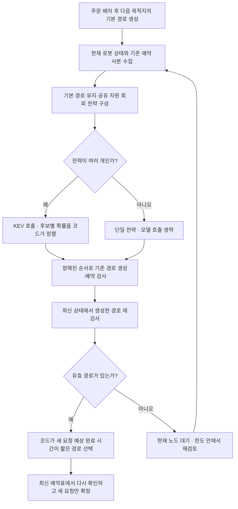

# 일반 주문에 KEV 경로 전략 순서 제안 연결

2026-10-23. 사용자 승인으로 시뮬·AI의 일반 주문에 선택 가능한 새 방식을 추가하고, 기존 관제 화면·주문 API를 재사용하는 시뮬 전용 서버에서 연속 주문을 확인했다. 실기체 연결과 전체 로봇의 재계획은 포함하지 않는다.

## 무엇이 연결됐나

이전 [정지 배치 시험](traffic-strategy-probability-new-cases-20261023.md)은 여러 로봇의 이동 순서·우회를 함께 탐색했다. 새 연결은 **다른 로봇의 기존 주행·예약을 유지하며, 새로 이동을 요청한 로봇 하나의 경로 전략을 제안**하는 방식이다. 움직이는 로봇을 IDLE로 바꾸거나 예약을 비워 이전 시험기에 넣지 않는다.

| 구분 | 정지 배치 비교 | 이번 일반 주문 연결 |
| --- | --- | --- |
| 입력 | 정지한 전체 로봇, 활성 예약 없음 | 새 요청 로봇은 노드에 정지, 다른 로봇은 이동·예약 가능 |
| KEV 선택 | 다음 로봇과 기본 경로·우회 전략 | 새 요청 하나의 기본 경로·어느 자원을 피할지 |
| 코드 검사 | 여러 단계의 완성 계획 검사 | 기존 주행을 보존한 새 경로의 예약 검사 |
| 코드 최종 선택 기준 | 이동 요청 로봇들의 예상 평균 도착 시간 | 검사한 경로 중 새 요청의 예상 완료 시간 최소 |
| 실행 | 완성 계획을 한 대씩 실행 | 최신 예약표에 새 요청만 추가, 여러 로봇 동시 주행 가능 |

기존 일반 주문은 이미 만든 유효 경로 중 하나를 KEV에 보통 한 번 물었다. 따라서 이전의 **25회→8회 절감이 일반 주문에도 그대로 적용된다고 주장하지 않는다.** 새 방식은 전략을 생성 전에 제안하는 역할을 연결한 것이다. 유효 경로가 하나뿐인 상황에서도 전략 후보가 여럿이면 모델 호출이 추가될 수 있다.

## 새 방식의 흐름



모델은 지도 연결·거리, 새 요청의 출발·목적지·기본 경로, 다른 로봇의 점유·남은 경로·목적지, 보호 자원, 최근 검사 결과를 받는다. 상세 예약 시간표를 모델에게 판정시키지 않는다. 실제 예약 검사는 코드가 수행한다.

모델 응답이 같은 위치·경로·예약·보호 자원 사본에 대한 것일 때만 다음 재검토에서 순서를 재사용한다. 상태가 바뀌면 새 순서를 요청한다. 한 번의 순서로 경로들을 생성하는 동안 다른 로봇이 움직일 수 있으므로, **순서는 실행 허가로 사용하지 않고 각 경로와 최종 예약 확정은 최신 상태로 다시 확인**한다.

시간 한도 내 생성한 유효 경로 중 좋은 경로를 고른다. 작은 지도에서 허용한 우회 두 개를 모두 검사하게 되면 전략의 순서가 최종 경로에 미치는 영향은 작을 수 있다. KEV의 물류 성능 기여는 별도 비교가 필요하다.

## 선택·복구 방법

일반 주문 시나리오 아래의 **교통조정** 선택창에 세 가지가 있다.

| 화면 선택지 | 설정값 | 역할 |
| --- | --- | --- |
| 기존 · 만든 경로 중 KEV 선택 | `KEV` | 경로 생성·검사 뒤 모델 선택 |
| 코드 · 예상 시간이 짧은 경로 | `MIN_EXPECTED_TIME` | 기존 경로 후보를 코드로 비교 |
| 새 방식 · KEV가 전략 순서 제안 | `KEV_STRATEGY_ORDER` | 전략 제안 → 경로 생성·검사 → 코드 최종 선택 |

변경 API는 `PUT /api/mode/order-traffic`, 입력은 `{"selection_policy":"KEV_STRATEGY_ORDER"}`다. 교통조정이 활성화된 시뮬·AI에서만 허용한다. 진행 주문·대기 주문·복귀·복구·시나리오가 없고 모든 가상 로봇이 노드에서 IDLE이어야 한다. 실행 중에는 바꾸지 않는다. 기존 두 방식으로 되돌릴 수 있다.

선택은 해당 백엔드 프로세스에서만 유지한다. 파일이나 `.env`를 자동 수정하지 않는다. 기존 서버의 기본값도 그대로이며, 새 방식은 환경 설정 또는 위 선택으로 명시해야 한다.

기본 한도는 기존 전체 대기 60초, 한 차례 전략 질문·경로 생성 10초, 우회 경로 생성 최대 2개를 사용한다. 새 전략 호출 상한은 **새 이동 요청당 8회**이며 `FMS_TRAFFIC_STRATEGY_CALL_LIMIT`로 1~32를 지정한다. 정지 배치 비교의 ‘총 모델 호출 상한 없음’ 조건과 다르다. 상태 변화가 잦거나 막힘이 길면 한도에 도달할 수 있으며 실패를 기록한다. 무한 재질문이나 숨은 다른 방식 대체는 하지 않는다.

## 실제 연속 주문 시험

이번에는 기존 일반 관제 프로세스가 꺼져 있었다. 기존 API 라우터·가상 로봇 이동기·주문 관리자를 재사용하는 **별도 시뮬 전용 서버**를 8000 포트에서 시작했다. 프런트엔드는 기존 5173 화면, 모델은 시험용 8012를 사용했다. 기존 관제의 이력을 복원하거나 삭제한 것이 아니라 별도 메모리 상태에서 시험한 것이다. 화면에 시뮬 전용 표시가 있으며 실기체 모드 전환은 서버가 409로 거부한다. ROS·MQTT 시작 함수는 실행하지 않는다.

기본 경로와 우회는 A*, 교통조정은 새 KEV 전략 순서 방식이다. 시뮬 속도 0.2m/s와 기본 작업 시간 1.5초를 사용했다. 모델은 캐시된 `jaredpalmer/kev-0.8b@v1.0`, CUDA / torch / bfloat16, temperature 2.3510958125672174, prefix cache 꺼짐이다.

| 등록 예정 시각 | 주문 |
| --- | --- |
| 0초 | A 1개, C 1개를 서로 다른 주문으로 등록 |
| 2초 | B 1개 |
| 4초 | D 1개 |
| 6초 | A 1개 + C 1개 |
| 8초 | B 1개 + D 1개 |

공급은 일반 `POST /api/orders`를 사용했다. 시험 도구는 `simulation_preview=true`와 빈 주문 목록을 확인한 뒤에만 등록하며 시험 주문을 삭제하지 않는다.

| 확인 항목 | 결과 |
| --- | --- |
| 주문·수량 | 6건·8개 |
| 작업과 홈 복귀 | 6건 모두 완료 |
| 관측 종료까지 | 약 64.12초. 등록·작업·복귀를 포함한 한 번의 동작 확인 |
| 새 이동 요청 적용 | 픽업 8회 + 작업대 6회 + 복귀 6회 = 20회 |
| KEV 전략 호출 | 9회. 나머지 11회 이동은 단일 전략이라 호출 생략 |
| 중복 점유 | 노드·물리 엣지 288회 관측에서 0회 |
| 동시 이동 | 최대 3대가 NAVIGATING/MOVING 상태로 관측됨 |
| 연속 처리 | 앞 주문이 진행 중인 동안 뒤 주문의 배차·처리를 관측 |
| 방식 전환 | 모두 끝난 뒤 화면에서 코드 방식으로 변경 → 새 방식으로 복원 확인 |
| 실기체 모드 | 409 거부 후 시뮬·AI 유지 |

64.12초와 9회는 이번 연결 시험의 결과다. 기존 KEV·코드와 같은 주문을 비교한 성능 결과가 아니므로 처리량 개선이나 호출 절감으로 해석하지 않는다. 288회 표본은 관측 시점의 중복이 없었다는 뜻이며 모든 물리 안전 조건의 증명이 아니다.

기록 위치: `logs/live-strategy-preview/20261023/`. `continuous-orders-once/report.json`, `observations.jsonl`, `order-traffic/decisions.jsonl`, 모델 질문·응답 `selection-inferences.jsonl`, 소스 사본·해시, 모드 경계 확인, 화면 PNG를 보관했다. 로그는 Git 제외 대상이다. 실패했던 첫 서버 시작 로그도 남겼다. 처음에는 일반 서버 모듈 import가 로봇 메시지 패키지를 요구해 시작에 실패했고, 통신 초기화가 없는 별도 시뮬 진입점으로 바꾼 뒤 시험했다.

## 코드와 검증

- [일반 주문 진입점](../../backend/app/services/order_traffic_service.py): 기존 기본 흐름 보존, 새 선택 방식 분기.
- [새 요청의 전략 순서](../../backend/app/services/order_traffic_strategy.py): 모델 확률 검증·동일 상태 재사용·경로 생성·최신 예약 검사.
- [설정 API](../../backend/app/routers/mode.py): 시뮬·AI와 작업 없음 확인 후 프로세스 내 설정 변경.
- [시뮬 전용 서버](../../backend/simulation/order_traffic_preview.py): 운영 시작 함수 없이 기존 API·주문·가상 이동 재사용.
- [연속 주문 관측](../../tests/order_traffic_strategy_smoke.py): 별도 시험 서버 확인, 주문 공급과 점유 관측.
- [연결 검사](../../tests/test_order_traffic_strategy.py): 전략 제안이 경로 생성보다 먼저인지, 다른 로봇의 예약 보존, 실패 경로 제외, 취소·지도·모드·위치 변화 거부, 같은 상태 재사용, 바뀐 상태 재질문·호출 상한, API 변경 조건.

최종 관련 회귀 검사 **251개 통과, 기존 경고 4개**. 프런트 타입 검사·빌드도 통과했다. 별도 모델 평가 도구의 기존 지도 입력 오류는 이번에 수정하지 않았으며 프로젝트 전체 검사 통과로 표현하지 않는다.

## 다시 실행할 때

일반 관제 시작은 기존 `start_fms.sh`를 사용한다. 해당 서버에서 새 방식을 시험하려면 시뮬·AI와 A* 연결 설정을 명시한다. 전체 관제 구조를 바꿀 필요는 없다.

별도 화면 시험만 필요하면 아래 진입점을 사용한다. **8000·5173 포트에 다른 관제가 실행 중이면 먼저 중복 실행하지 않는다.** 기존 주문을 이 별도 서버로 옮기지 않는다.

```bash
cd ~/dev/Logistics_AI
PYTHONNOUSERSITE=1 \
FMS_ROBOT_MODE=simulation \
FMS_ORDER_TRAFFIC_ENABLED=1 \
FMS_ORDER_ROUTE_SOURCE=EXISTING_SHORTEST_PATH \
FMS_TRAFFIC_SELECTION_POLICY=KEV_STRATEGY_ORDER \
KEV_HOST=http://127.0.0.1:8012 \
~/venv/robot/bin/python -m uvicorn backend.simulation.order_traffic_preview:app \
  --host 0.0.0.0 --port 8000
```

KEV 서버와 프런트는 별도 실행이 필요하다. 이번 실행의 PID는 같은 기록 폴더의 `backend.pid`, `frontend.pid`, `kev.pid`에 저장했다. PID는 이후 재사용될 수 있으므로 종료할 때 명령 인자까지 확인한다. 시험 상태·기록은 보존하고 운영 `logs/backend.pid` 등은 덮어쓰지 않았다.

## 다음에 확인할 것

이번 문서의 시험은 **연결과 연속 동작** 확인이다. 후속 [같은 일반 주문 세 방식 비교](order-traffic-policy-comparison-20261023.md)를 별도로 완료했다. 6건·8개를 각각 한 번씩 실행해 모두 작업·복귀 완료, 전체 작업 끝은 코드 53.41초·기존 KEV 53.33초·새 방식 54.14초였다. 적용 경로 기록은 같았고 모델 호출은 0·1·9회였다. 새 방식의 9회 중 8회는 검사 뒤 유효 경로가 하나만 남아 이번 작은 후보 수에서 이점을 확인하지 못했다. 이 문서의 앞선 연결 기록을 후속 비교 수치로 덮어쓰지 않는다.

후속 검토에서는 판단할 여지가 있는 상황과 같은 생성·검사 예산을 먼저 정하고, 계획 품질·실제 주문 완료·판단 비용을 분리한다. 한 번의 결과로 우열을 정하거나 모델 호출을 자동으로 추가하지 않는다.

여러 로봇의 기존 예약을 풀어 함께 다시 계획하는 기능, 정차 로봇을 비켜줬다가 복귀시키는 자동 복구, 실기체의 ArUco·작업 시작 구분은 이번 연결에 추가하지 않았다.
