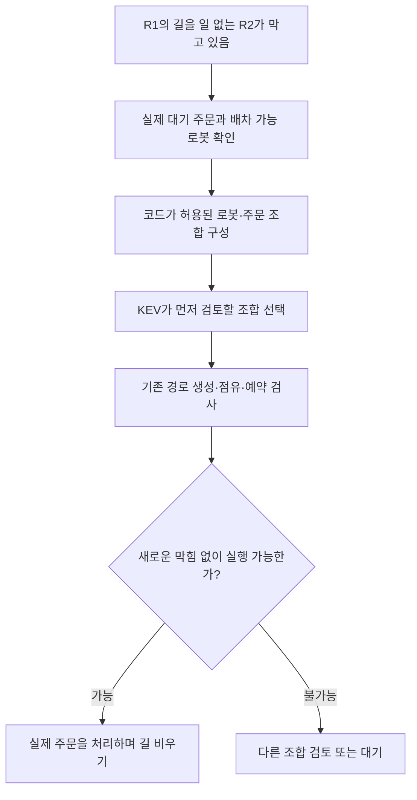

# KEV를 물류 문제 해결에 활용하는 여섯 가지 아이디어

정리일: 2026-10-23

**나중에 다시 검토하기 위한 브레인스토밍 보관 문서다. 구현 계획이나 적용 결정이 아니다.** 이 문서 작성으로 코드를 변경하거나 모델을 호출하거나 관제·실기체를 실행하지 않았다.

## 1. 우리가 확인하려는 것

전체 목표는 **주문이 계속 들어와도 로봇과 작업대가 서로 막히지 않고 물류 작업을 이어가는 것**이다.

KEV를 넣으면 무조건 성능이 좋아진다고 가정하지 않는다. 코드 방식과 비교해 해결률·처리량·대기 시간·판단 비용·유지보수 부담이 어떻게 달라지는지 보고 도입 여부를 정한다. 모델을 많이 호출하거나 더 많은 결정을 맡기는 것 자체는 목표가 아니다.

기존에는 다음 두 역할을 시험했다.

- 코드가 생성·검사한 조정안 중 KEV가 하나를 선택하는 역할.
- KEV가 먼저 시험할 전략을 제안하고, 코드가 경로를 생성·검사하는 역할.

제한된 시험에서 코드보다 일관되게 좋은 결과는 확인하지 못했다. [기존 세 방식 비교와 실제 결과](experiments/traffic-strategy-three-way-20261023.md)를 참고한다. 아래 아이디어에 대한 성능 검증을 이미 했다는 뜻은 아니다.

우리처럼 작업이 끝나면 다음 목적지가 계속 생기는 문제는 연구에서 다루는 연속 작업 환경과도 관련이 있다. [연속 목적지를 처리하는 MAPF 연구](https://ojs.aaai.org/index.php/AAAI/article/view/17344)는 이 배경을 설명한다. 해당 연구가 KEV의 성능을 검증한 것은 아니다.

## 2. 아이디어를 한눈에 보기

| 아이디어 | KEV에게 맡겨 볼 선택 | 관련 담당 범위 | 현재 위치 |
| --- | --- | --- | --- |
| ① 일을 맡겨 길 비우기 | 어느 로봇에게 어떤 대기 주문을 줄까? | 배차 + 교통조정 | 새 검토 아이디어 |
| ② 출발량 조절 | 지금 추가 출발할까, 다음 작업 완료까지 기다릴까? | 배차 + 교통조정 + 모니터링 | 새 검토 아이디어 |
| ③ 교통 운영 방식 선택 | 평상시·픽업 혼잡 완화·작업대 비우기 중 무엇을 적용할까? | 교통조정 + 모니터링 | 새 검토 아이디어 |
| ④ 다시 계획할 로봇 범위 선택 | 새 요청만 볼까, 관련된 다른 로봇까지 함께 볼까? | 교통조정 + 경로 생성 | 이전에 방향을 언급했지만 이 역할은 미적용 |
| ⑤ 어려운 시험 상황 선택 | 현재 정책의 약점을 드러낼 주문 패턴은 무엇일까? | 시뮬레이션·검증 | 새 검토 아이디어 |
| ⑥ 시뮬 결과로 판단 학습 | 우리 물류 상황에서 좋은 선택을 학습할 수 있을까? | 학습·평가 | 장기 검토 아이디어 |

이 순서는 아이디어 번호이며 확정된 개발 순서가 아니다.

## 3. ① 양보 이동 대신 필요한 일을 맡겨 길 비우기

### 어떤 상황인가

R1이 N7을 지나야 하는데, R2가 N7에서 맡은 일 없이 정차해 있다고 가정한다. 동시에 OMX2의 N6를 방문해야 하는 주문이 대기 중이다.

단순 양보는 R2를 다른 곳으로 보낸 뒤 원래 자리로 복귀시키는 방법이다. 여기서는 **R2에게 실제 대기 주문을 맡겨 떠나게 하는 방법**을 검토한다. 주문 처리와 길 비우기를 한 이동으로 함께 달성하려는 아이디어다.



### 무엇을 주고 무엇을 받나

- 입력 후보: 배차 가능한 로봇, 실제 PENDING 주문, 현재 점유, 목적지, 공유 자원, 기존 주행 계획.
- KEV 선택 예: “R2에게 N6 방문 주문을 맡기는 조합부터 검토”.
- 코드 담당: 주문·로봇 적합성, 배차 권한, 경로 생성, 다른 로봇에 미치는 영향, 최종 예약·실행 검사.

### 어떻게 가치를 확인하나

기존 배차 순서, 가까운 로봇 우선, 길 비우기 효과를 반영한 코드 규칙과 비교한다. 같은 주문에서 처리량·길이 막힌 시간·작업 없는 이동 거리를 함께 본다.

N7 정차는 설명용 가정이다. 연속 주문에서 자연스럽게 자주 관측된 상황으로 표현하지 않는다. 실제 대기 주문이 없거나 R2가 아직 다른 주문을 처리 중이면 이 방법을 사용할 수 없다. 배차 담당과의 책임 합의가 필요하다.

## 4. ② 로봇이 있어도 지금 출발시킬지 선택하기

### 어떤 상황인가

OMX1에 작업이 몰렸는데 다음 주문들도 대부분 N5를 방문한다. 배차 가능한 로봇을 계속 보내면 픽업대 주변의 대기가 다른 통로까지 번질 수 있다.

KEV에게 **“한 대 더 출발” 또는 “현재 작업이 끝나는 이벤트까지 잠시 보류”**를 선택하게 하는 아이디어다. 물류 흐름에 들어가는 로봇 수를 조절한다.

### 무엇을 주고 무엇을 받나

- 입력 후보: 픽업대·작업대 점유와 작업 상태, 대기 주문의 방문 장소, 앞선 요청 수, 로봇 위치, 누적 대기 시간.
- KEV 선택 예: “OMX1 추가 출발은 보류하고 OMX2 방문 요청은 검토”.
- 코드 담당: 대기 허용 위치, 재검토 이벤트, 최대 보류 시간, 오래 기다린 주문 보호, 실제 출발 가능성 검사.

### 어떻게 가치를 확인하나

즉시 배차하는 방식과 “픽업대 대기가 일정 수 이상이면 추가 출발 보류” 같은 단순 코드 규칙을 비교한다. 같은 시간에 완료한 물품 수, 주문 처리 시간, 최장 대기 시간을 본다. 로봇 가동률이 낮아지는 것만으로 개선이라고 판단하지 않는다.

보류하는 위치가 작업대나 다른 로봇의 길을 막으면 안 된다. 정상 복귀 중 재배차와 실패·취소 후 복구 복귀도 구분해야 한다. 로봇 3대에서는 효과가 작거나 없을 수 있다.

## 5. ③ 잠시 적용할 교통 운영 방식을 선택하기

### 어떤 상황인가

각 로봇의 작은 행동을 매번 질문하는 대신, 상황이 바뀔 때 적용할 운영 방식을 KEV가 선택한다.

| 운영 방식 예시 | 코드가 적용할 내용 |
| --- | --- |
| 평상시 | 기존 배차·경로 정책 사용 |
| OMX1 혼잡 완화 | N5 방문 요청의 추가 출발 조절 |
| 작업대 비우기 우선 | 작업을 끝낸 로봇의 출발을 우선 검토 |
| 복귀 흐름 우선 | 혼잡 구간을 쓰는 복귀 요청을 우선 검토 |

KEV에는 자원별 대기·작업 상태와 최근 혼잡 변화를 주고, 미리 정의한 운영 방식 하나를 받는다. 코드는 우선순위나 경로 비용을 적용하되 노드·물리 엣지의 용량, 예약 검사와 이동 허가는 유지한다.

### 어떻게 가치를 확인하나

대기열 길이나 작업대 점유에 따라 같은 운영 방식을 고르는 코드 규칙과 비교한다. 주문 처리량·대기 시간·모델 호출 수·운영 방식 전환 횟수를 함께 본다.

운영 방식이 자꾸 바뀌면 경로와 우선순위가 흔들릴 수 있다. 전환·유지 조건을 정하고, 이미 실행 중인 예약을 임의로 바꾸지 않아야 한다. 구체적인 조건은 아직 정하지 않았다.

경로 비용을 조정해 연속 교통 흐름을 유도하는 [그래프 최적화 연구](https://www.ijcai.org/proceedings/2024/35)가 있다. 위 운영 방식 선택은 그 연구를 그대로 구현한 것이 아니라 우리 시스템에 적용해 볼 별도 제안이다.

## 6. ④ 막혔을 때 다시 계획할 로봇 범위를 선택하기

### 어떤 상황인가

현재 일반 주문 연결은 다른 로봇의 주행·예약을 유지하며 새 요청을 조정한다. 그 범위에서 해법이 없으면 관련된 기존 계획 일부를 다시 검토해야 할 수 있다.

예를 들어 새 R3 요청만 조정해서 풀리지 않을 때 다음 범위를 후보로 둘 수 있다.

- R1·R3의 계획을 함께 검토.
- R2·R3의 계획을 함께 검토.
- 세 로봇 전체의 계획을 검토.

KEV는 **어느 범위부터 다시 계획할지** 선택한다. 코드는 선택한 범위의 경로·실행 순서를 만들고 검사한다. 새로운 계획이 검증되기 전에 기존 예약을 해제하거나 움직이는 로봇의 계획을 바꾸지 않는다.

### 어떻게 가치를 확인하나

충돌에 연결된 로봇을 코드로 묶는 방식, 작은 문제에서 가능한 범위를 직접 검토하는 방식과 비교한다. 해결률·좋은 계획을 찾는 시간·수정한 로봇 수·기존 주행에 추가한 지연을 본다.

로봇이 늘어날 때 유망한 가설이지만 세 대에서는 코드가 직접 검토하는 편이 더 간단할 수 있다. 학습 모델이 재계획 대상을 고르는 [탐색 유도 연구](https://proceedings.iclr.cc/paper_files/paper/2024/hash/d41f8403e9bb5141bc2c81fad7658185-Abstract-Conference.html)와 관련이 있다. 그 연구의 전용 모델 성과를 현재 KEV의 성과로 해석하지 않는다.

## 7. ⑤ KEV를 어려운 시험 상황을 고르는 역할로 사용하기

### 어떤 상황인가

코드가 실행 가능한 주문 패턴을 준비하고 KEV에게 “현재 정책의 약점을 드러낼 가능성이 큰 패턴”을 고르게 한다.

선택지 예시는 다음과 같다.

- OMX1 방문 주문을 연속 공급.
- 두 픽업대를 모두 방문하는 주문 공급.
- 작업대가 바쁜 동안 복귀와 새 주문이 겹치게 공급.

KEV가 주문·로봇 ID나 고장 조건을 자유롭게 만들어 내도록 맡기는 것이 아니라, 코드가 준비한 유효한 시험 선택지에서 고르게 한다. 실행은 격리 시뮬레이션에서 수행한다.

### 어떻게 가치를 확인하나

같은 시험 횟수·실행 시간의 무작위 공급, 시험 종류를 골고루 선택하는 코드 방식과 비교한다. 서로 다른 원인의 막힘·장기 대기·처리량 저하를 얼마나 빨리 찾는지 본다. 같은 실패를 반복해서 발견한 횟수를 새로운 문제 수로 세지 않는다.

실시간 판단 성능과 다른 역할이며, 현재의 시뮬레이션·주문 공급·기록 도구를 활용할 여지가 있다. 기존 관제 이력이나 실기체에 시험용 고장을 주입하는 아이디어가 아니다.

## 8. ⑥ 시뮬 결과로 우리 물류에 맞는 판단을 학습시키기

### 어떤 상황인가

같은 상황에서 여러 허용 방법을 별도 가상 상태로 실행하고 대기·완료 결과를 기록한다. 그 결과로 “이 상황에서는 어느 선택이 좋았는가”라는 학습 자료를 만드는 방향이다.

```text
같은 상황에서 여러 방법 실행
→ 결과와 실패 이유 기록
→ 목표에 맞는 좋은 선택 표시
→ 우리 상황에 맞춘 모델 학습·평가
```

먼저 일관된 목표와 충분한 자료가 필요하다. 한도 안에서 찾은 최선의 선택을 모든 가능한 해법 중 최적이라고 표시하면 안 된다. KEV의 학습 지원 방식과 비용도 별도로 확인해야 한다.

비슷한 장면이 학습·평가 양쪽에 섞이지 않도록 분리하고, 로봇 ID·주문 순서·혼잡 조건을 바꿔도 판단이 유지되는지 확인한다. 코드 방식과 학습 전 모델을 비교 대상으로 둔다.

**반복해서 질문한다고 저절로 학습되는 것은 아니다.** 비용이 큰 장기 아이디어이며, 현재 우선 적용 대상으로 정한 것이 아니다.

## 9. 공통으로 지킬 비교 기준

| 보고 싶은 것 | 확인할 내용 |
| --- | --- |
| 물류 처리량 | 같은 시간 동안 완료한 물품 수·주문 수. 주문 수량과 도착 패턴도 동일하게 맞춤 |
| 주문 처리 시간 | 주문 접수부터 작업대 작업 완료까지. 로봇 홈 복귀 시간은 별도로 기록 |
| 대기 편중 | 평균뿐 아니라 가장 오래 기다린 주문·로봇도 확인 |
| 막힘 해결 | 주어진 한도에서 완성 계획을 찾았는지, 부분 계획을 실행하지 않았는지 확인 |
| 판단 비용 | 실제 판단 시간·모델 호출·검사·경로 생성 횟수를 기록 |
| 운영 부담 | 필요한 모델·입력·규칙 관리, 오류 원인 추적과 설정 복구의 어려움을 함께 검토 |

AI와 코드에 같은 입력·허용 행동·안전 검사를 제공한다. 비용 조건도 사전에 정한다. 동일 호출 상한과 동일 시간 상한은 서로 다른 비교이므로 구분한다. AI에게만 새 기능을 주고 좋아졌다고 결론 내리지 않는다.

안전 규칙·실행 가능성 검사·최종 이동 허가는 코드와 FMS가 맡는다. KEV의 확신도만으로 이를 생략하지 않는다. 호출·시간·재시도 한도와 미해결 처리는 실제 시험을 결정할 때 정한다.

## 10. 어떤 방향부터 논의할까

다음은 대화에서 제안한 검토 관점이며 사용자와 확정한 개발 순서가 아니다.

- **전체 물류 흐름:** ① 실제 주문을 맡겨 길 비우기. 배차와 교통조정을 함께 보는 아이디어.
- **사용자의 MAPF 담당 범위:** ④ 다시 계획할 로봇 범위 선택. 기존 경로 생성·예약 검사와 연결해 검토.
- **현재 도구로 별도 가치를 확인:** ⑤ 어려운 시험 상황 선택. 실시간 교통 판단과 다른 역할을 평가.
- **큰 범위의 후속 후보:** ② 출발량 조절, ③ 운영 방식 선택.
- **자료·비용 검토가 선행될 후보:** ⑥ 학습.

다음에 이 문서를 다시 볼 때는 아이디어 하나를 고르고 **실제 발생할 상황인가 → 단순 코드로 얼마나 풀리는가 → KEV에게 맡길 선택은 무엇인가 → 무엇이 좋아지면 의미가 있는가**부터 확인하면 된다.

관련 문서: [전체 설계와 목표](continuous-order-traffic-design.md), [현재 구현 범위](kev-mapf-implementation-map.md), [기존 세 방식 비교 결과](experiments/traffic-strategy-three-way-20261023.md).
