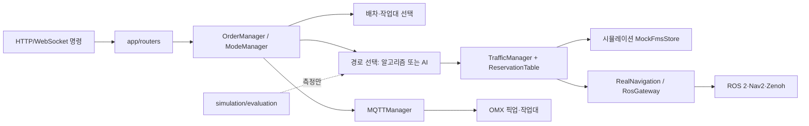
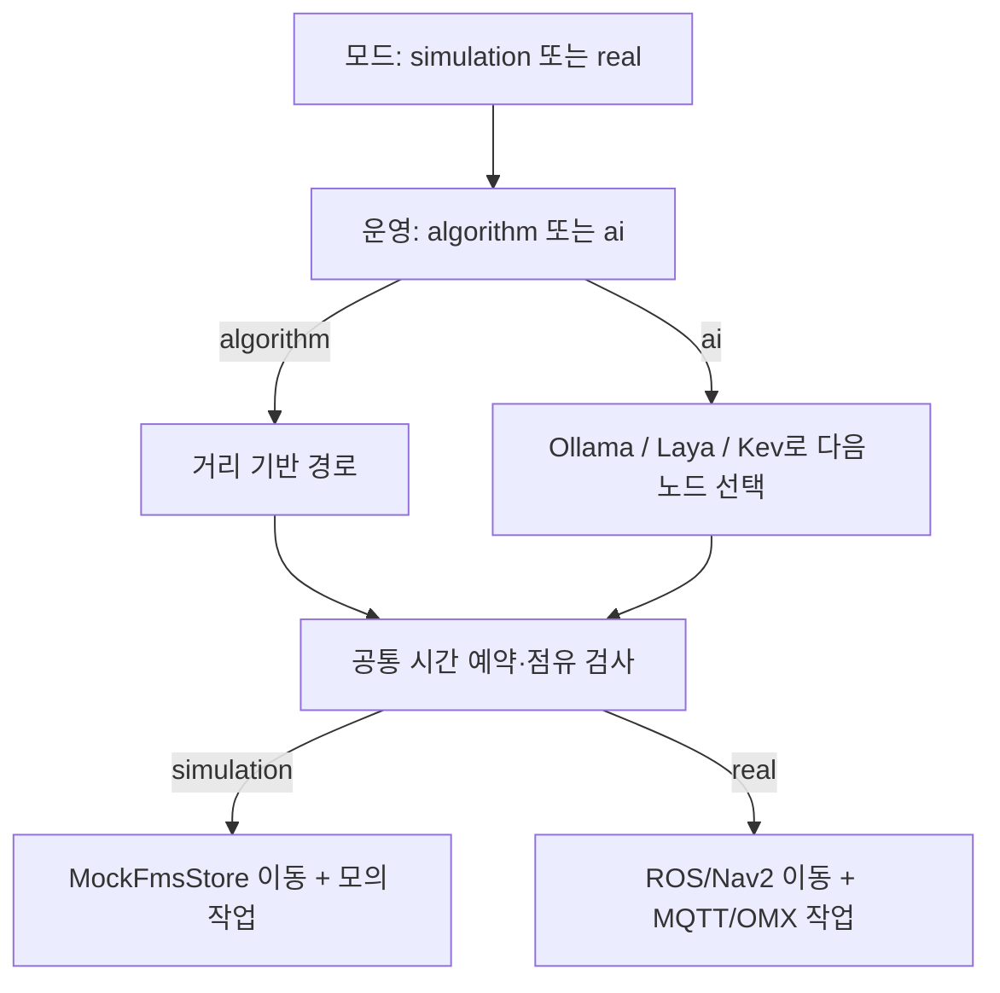
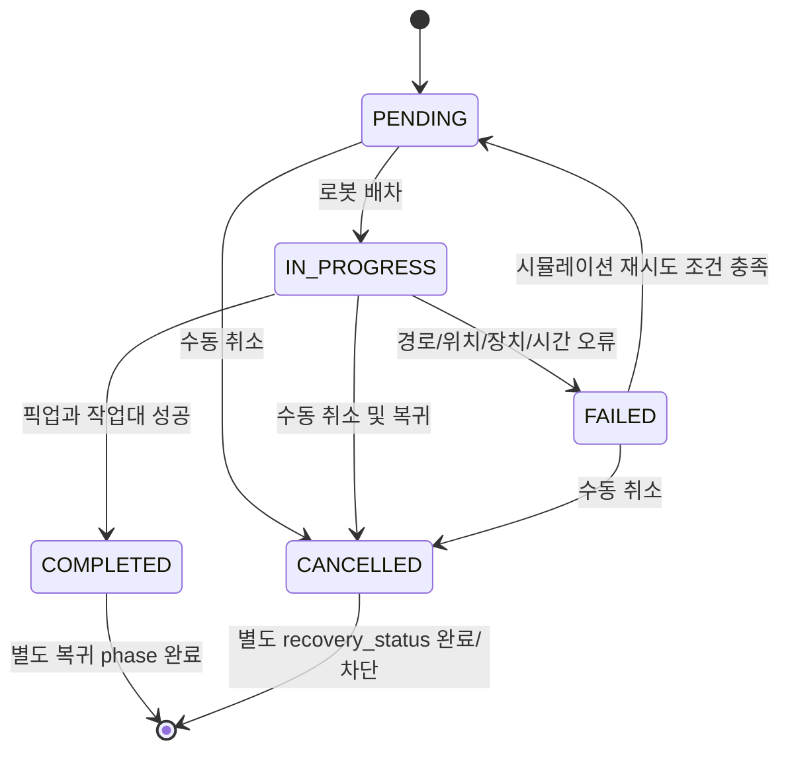
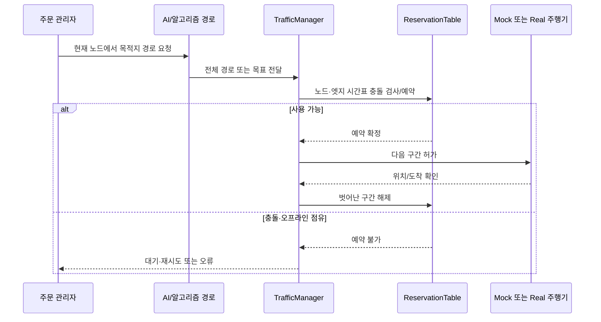
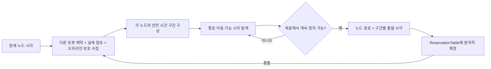
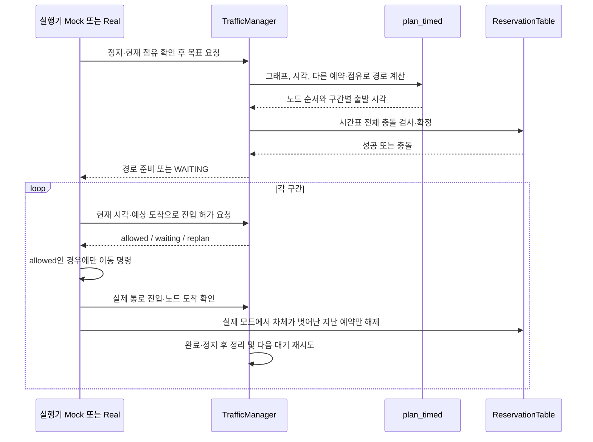
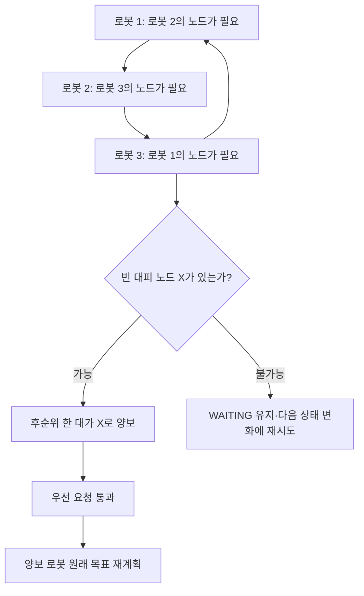

# AX_Logistics 코드 구조와 실행 흐름

> 기준: 이 저장소의 현재 작업 트리를 정적으로 읽어 정리한 문서. 프런트엔드 구현과 별도 저장소인 `robots_ws/Logistics_AMR` 내부는 범위에서 제외한다. `backend/simulation`은 백엔드 **안**에 있으며 삭제 가능한 임시 폴더가 아니다. 함수의 실제 구현은 파일 경로와 뒤의 함수 색인을 함께 보자.

## 1. 전체 구조

```text
AX_Logistics/
├── backend/
│   ├── __init__.py                 루트 .env 로드
│   ├── requirements.txt            백엔드 의존성
│   ├── app/
│   │   ├── config.py, main.py      환경 설정, API/주기 작업 시작점
│   │   ├── models/                 로봇·OMX 상태 객체
│   │   ├── schemas/                API 입력 및 로봇 ID 형식
│   │   ├── routers/                HTTP/WebSocket 경계
│   │   ├── services/               주문·배차·경로·예약·통신·시나리오
│   │   │   ├── llm_providers/      전체 경로 생성 모델 제공자
│   │   │   └── route_selector/     단계별 다음 노드 선택 모델
│   │   └── ros2/                   실제 로봇 ROS 동작과 게이트웨이
│   └── simulation/
│       ├── evaluation/             오프라인 경로/모델 평가와 설정 JSON
│       ├── simulators/             독립 ROS·Zenoh 모의 로봇 도구
│       ├── scenarios.py            모의 시나리오의 초기 위치 배치
│       └── services/, route_selector/, llm_providers/
│                                  기존 import를 보존하는 연결 모듈
├── maps/                         지도 PGM/PNG/YAML
├── routes/                       주행 그래프 및 평가 그래프 GeoJSON
├── infra/                        Docker Compose, Mosquitto 설정
├── omx_ws/                       OMX 장치 측 MQTT 실행 코드
├── scripts/                      메인/로봇 설치 및 환경 확인
├── tests/                        단위·통합 테스트, 평가 샘플, 수동 OMX 도구
├── tools/diagnostics/            Zenoh 관측 도구
├── doc/                          주제별 기술 문서와 이 안내서
├── robots_ws/                    별도 로봇 ROS 작업 공간
├── frontend/                     화면 코드: 이 문서에서는 설명 생략
├── .env, .env.example             실제 환경 값 / 공유 가능한 설정 양식
├── .gitignore, README.md
└── start_fms.sh, stop_fms.sh      개발 스택 시작/정지
```

`logs/`, `__pycache__/`, `node_modules/`, ROS의 `build/`, `install/`, `log/`와 MQTT DB는 실행 중 생성되는 데이터다. `backend/simulation/services` 등의 짧은 모듈은 중복 구현이 아니라 `backend/app/services`를 가리키는 호환 경로다. 주문 시뮬레이션의 주 실행기는 `backend/app/services/mock_data.py`와 `simulation_order_runner.py`이며, `backend/simulation/simulators`는 별도로 실행하는 ROS/Zenoh 모의 장치다.



### 루트·자산·운영 파일

| 경로 | 역할 |
|---|---|
| `README.md` | 설치, 실행, 사용법의 첫 진입점 |
| `.env` / `.env.example` | 실제 실행 값 / 동일 키의 배포용 예시. `backend/__init__.py`가 루트 `.env`를 읽고 시작 스크립트도 읽는다 |
| `.gitignore` | 비밀 값, 로그, 빌드 산출물, 로컬 런타임 데이터 제외 |
| `start_fms.sh` / `stop_fms.sh` | Docker Zenoh·MQTT와 호스트 ROS bridge·FastAPI·Vite·Kev의 시작, 상태 확인, 소유 프로세스 종료 |
| `maps/logitle_map.{pgm,png,yaml}` | 점유 격자 원본, 화면용 이미지, 해상도·원점 정보 |
| `routes/test.geojson` | 현재 `config.py`의 기본 주행 그래프. `logitle_route_grid.geojson`, `local_comparison_compact.geojson`, 나머지 `test*.geojson`은 다른 지도·비교·시험에 사용 가능한 그래프 |
| `infra/docker-compose.yml`, `infra/docker-compose.example.yml` | 로컬 컨테이너 구성과 예시. `infra/mosquitto/config/mosquitto.conf`는 MQTT 브로커 설정 |
| `scripts/setup.sh`, `scripts/verify_env.sh` | 역할별 설치 실행과 설치 결과 점검 |
| `scripts/main/install_main.sh`, `bashrc_main.conf`, `requirements.txt` | 메인 PC의 Python/ROS/환경 구성 |
| `scripts/robot/install_robot.sh`, `bashrc_robot.conf`, `requirements.txt` | 로봇 PC의 Python/ROS/환경 구성 |
| `omx_ws/run_omx_mqtt.sh`, `omx_mqtt_client.py` | OMX 측 MQTT 실행기. 주문을 장치의 A/B 명령으로 변환하고 로컬 재고 상태 파일을 감시하여 ack/progress/result 발행. omx2의 C/D는 장치 로컬 A/B로 변환; omx3/4 하차 동작은 현재 미구현 상태 |
| `tools/diagnostics/zenoh_monitor.py` | Zenoh 트래픽·연결 진단용 관측 도구 |
| `doc/*.md` | 운영, ROS/Zenoh, 교통, 실주행, AI 평가에 관한 상세 문서 |

자산·기술 문서의 개별 파일도 다음과 같다. 그래프 이름만 보고 운영 중이라고 판단하지 말고 `FMS_ROUTE_GRAPH` 값을 확인해야 한다.

| 파일 | 읽는 곳 또는 용도 |
|---|---|
| `maps/logitle_map.yaml` / `maps/logitle_map.pgm` / `maps/logitle_map.png` | 지도 원점·해상도와 점유 격자 원본 / 변환·제공용 이미지 |
| `routes/test.geojson` | 현재 설정의 기본 운영 그래프이자 교통 시나리오가 요구하는 그래프 |
| `routes/logitle_route_grid.geojson` | 다른 주행 격자 그래프 |
| `routes/test1.geojson`, `test2.geojson`, `test3.geojson`, `test_int.geojson` | 그래프 처리·경로 실험 자료 |
| `routes/test_benchmark_v1.geojson`, `test_compact_graph.geojson`, `local_comparison_compact.geojson` | 모델 평가와 compact 그래프 비교 자료 |
| `doc/backend-control-customization-guide.md` | 관제 제어 변경 안내 |
| `doc/llm-route-generation-benchmark.md` | 경로 생성 모델 평가 방법 |
| `doc/real_navigation_policy.md` | 실제 주행 정책·제약 |
| `doc/ros2-zenoh-guide.md` | ROS 2와 Zenoh 연결 |
| `doc/traffic_manager.md`, `doc/traffic_scenarios.md` | 공통 교통 관리자와 시나리오 설명 |
| `tests/traffic_scenarios.json`, `tests/traffic_scenarios.py` | 교통 실험 정의와 실행기 |
| `tests/mock/llm_responses.json`, `tests/mock/route_graph.geojson` | 모델·그래프 테스트 입력 |

## 2. 백엔드 파일별 책임

### 진입·API·상태

| 파일 (`backend/app/` 기준) | 역할과 주요 함수/메서드 |
|---|---|
| `config.py` | 지도/그래프 경로, CORS, MQTT, 실제 위치·주행 허용오차, 시간 제한 등 환경 값을 읽고 검증 |
| `main.py` | `lifespan`: 지도·그래프·MQTT·ROS 초기화/종료. `run_mock_simulation`: 0.1초 주문 tick, 모의 이동·텔레메트리. `run_real_navigation`: 실제 주행 tick. `root`, `health`: 기본 응답 |
| `models/robot.py` | `RobotState`, `NavigationType`, `Robot`: 연결·자세·배터리·주문·정지 상태 보관과 변경 |
| `models/omx.py` | `OMX`: 장치 상태, 현재 job, ack/progress/result, 연결 감시, 명령 발행 |
| `schemas/order.py` | `OrderItems`, `CreateOrderRequest`: A/B/C/D 수량, 주문명, 모드, 모델 입력 형식 |
| `schemas/command.py` | 좌표/노드 목표, LLM 미리보기, 정지 요청 검증 |
| `schemas/robot.py` | `normalize_robot_id`, `to_ui_robot_id`: 내부·표시 로봇 ID 변환 |
| `routers/orders.py` | 주문 생성/목록/실패 재시도/취소. 목록에 작업대와 픽업대 현황 포함 |
| `routers/mode.py` | 4개 모드 선택의 HTTP 경계. 활동 중인 주문·복귀·실제 주행 등을 확인하고 충돌 시 409 |
| `routers/commands.py` | 수동 목표, AI 경로 미리보기, 충전소 이동, 정지/긴급정지 해제, 가까운 노드 복귀 |
| `routers/robots.py`, `routers/omx.py` | 모드별 로봇 스냅샷과 OMX 상태 조회 |
| `routers/map.py` | 지도 메타데이터/이미지/경로 그래프/노드 조회 |
| `routers/connections.py` | Zenoh·MQTT 등 연결 정보 조회 |
| `routers/scenarios.py` | 교통 시나리오 목록, 실행, 상태 조회 |
| `routers/websocket.py` | 관제 텔레메트리 WebSocket 및 수동 속도 명령 WebSocket |
| `services/websocket_manager.py` | 접속자 등록/해제/전체 송신 |

`backend/app/__init__.py`, 각 `models/`, `routers/`, `ros2/`, `schemas/`, `services/`의 `__init__.py`는 Python 패키지 표식 또는 모듈 공개용이다. `backend/__init__.py`는 루트 `.env`를 `override=False`로 읽으므로 이미 셸에 있는 값이 우선한다.

### 주문·주행·교통

| 파일 (`backend/app/services/` 기준) | 역할과 주요 함수/메서드 |
|---|---|
| `mode_service.py` | `RobotModeManager`가 `simulation/real`과 `algorithm/ai`를 관리. `feature_engine`이 기능별 구현 선택 |
| `order_manager.py` | `OrderManager`의 `create_order`, `tick`, `retry_order`, `cancel_order`, `fail`, `on_mqtt_result`가 주문 생명주기 전체를 관리. `_tick_real`, `_move_real`, `_tick_real_returns`, `_return_real`이 실제 주문을 진행 |
| `order_dispatcher.py` | `available_robots`: 연결, 명확한 노드 위치, 유효한 pose, 유휴/복귀 상태, 다른 주문 점유를 보고 후보 우선순위 생성 |
| `simulation_order_runner.py` | `SimulationOrderRunner.run`: 픽업→작업대→귀환. `_wait_for_pickup_turn`으로 동일 픽업 선행 주문 대기. `_move`는 주행과 양보 후 재요청, `_work`는 작업 위치 검증, `recover`는 실패/취소 후 안전 복귀 |
| `workstation_manager.py` | `choose`, `release`, `status`, `pickup_status`: N3/N4의 예약과 실제 점유, 픽업대 상태 관리 |
| `order_route_dispatcher.py` | `dispatch_order_route`: 모드별 AI/알고리즘 경로를 구한 뒤 동일한 시뮬레이션/실제 주행기로 전달. 추론 중 주문·지도·위치 변경을 재확인 |
| `mock_data.py` | `MockFmsStore`: 인프로세스 로봇 상태, 목표 요청/정지/속도 명령, 시뮬레이션 시간 전진과 스냅샷 |
| `fleet_manager.py` | 실제 로봇 등록·해제·조회·목록의 중앙 저장소 |
| `route_graph.py` | GeoJSON 로드, 노드/엣지 조회, 현재 노드 판정과 가장 가까운 노드 찾기 |
| `map_service.py` | YAML/PGM 지도 로드, 월드↔픽셀 변환, PNG 변환 |
| `pathfinding.py` | `DistanceAStar.plan`: 기본 거리 기반 A*. `plan_timed`: 예약 시간을 고려한 안전 시간대 탐색 |
| `reservation.py` | 노드/양방향 공유 엣지 자원 키, 겹침 검사, 원자적 예약 교체/해제, 경로의 시간표 생성 |
| `occupancy.py` | 현재 위치의 노드/엣지 점유 자원 판정 |
| `traffic_manager.py` | `TrafficManager`: 시간표 예약, 대기·재시도·교착 양보, 점유 확인 후 예약 해제, 오프라인 자원 보호, 구간별 주행 허가 |
| `real_navigation.py` | `RealNavigation`: 교통 허가를 ROS의 구간 실행으로 연결. 위치·연결·결과 확인, 정지/취소, 재계획, 도착 확인, 자원 해제 |
| `scenario_service.py` | `ScenarioManager`: 시나리오 사전 조건, 실행·중단·상태, 주문/수동 명령과의 상호 배제 |
| `command_service.py` | 모드별 수동 목표·정지 명령 분기 |
| `mqtt_manager.py` | MQTT 연결 유지, OMX별 job 발행/취소, 중복 결과 억제, 결과 콜백 연결 |
| `zenoh_connection_manager.py` | Zenoh REST에서 원격 세션/로봇 route 검색, 마지막 성공 관측 기록 |

### ROS·AI

| 파일 | 역할과 주요 함수/메서드 |
|---|---|
| `backend/app/ros2/fms_ros_node.py` | 실제 ROS 2 노드. AMCL pose·배터리 구독, `cmd_vel` 발행, `FollowWaypoints`·정밀 도킹·Aruco 정렬 action 전송/취소 및 결과/피드백 수신 |
| `backend/app/ros2/ros_gateway.py` | `RosGateway`: ROS 노드와 백엔드 상태 접착. Zenoh 연결 동기화, 명령 검증, 주행 시작/진행, 기존 Nav2·OMX 작업 정지 후 전환, 긴급정지·충전·최근접 노드 처리 |
| `backend/app/services/route_service.py` | 그래프 입력/가중치, 코드 기준 최단 경로, AI용 compact 그래프, 경로 유효성·거리·기준 경로 비교 |
| `backend/app/services/iterative_route_policy.py` | 다음에 선택 가능한 인접 노드와 방문/역행 제약 구성 |
| `backend/app/services/iterative_route_runner.py` | 모델이 고른 다음 노드를 반복하여 전체 경로 생성, 예외 처리와 무작위 기준 경로 |
| `backend/app/services/llm_route_preview.py` | AI 경로 선택 실행, 유효한 연결·거리·기준 경로와의 결과 검증 |
| `backend/app/services/route_model_catalog.py` | 사용 가능한 selector/model 목록과 설정 검증. 평가 JSON을 운영용 카탈로그로 읽음 |
| `backend/app/services/route_selector/registry.py` | selector 인터페이스와 `ollama/laya/kev` 인스턴스 선택 |
| `backend/app/services/route_selector/ollama_selector.py` | Ollama에 후보 노드 선택을 요청하고 구조화 응답·실행 메타데이터를 처리 |
| `backend/app/services/route_selector/laya_selector.py` | 로컬 Laya 에이전트 로드·GPU 상태 확인·후보 선택·자원 해제 |
| `backend/app/services/route_selector/kev_selector.py` | Kev HTTP 서버 모델/체크포인트 확인, `/v1/systemone` 선택 요청·응답 처리 |
| `backend/app/services/llm_providers/base.py`, `registry.py` | 전체 경로 생성을 위한 공통 인터페이스/입력 구성, 제공자 선택 |
| `backend/app/services/llm_providers/openai_provider.py`, `anthropic_provider.py`, `ollama_provider.py` | 각 외부/로컬 모델에 그래프를 주고 전체 최단 경로 응답을 받는 제공자. 주 사용처는 오프라인 비교 평가이며 라이브 주문의 단계별 selector와 구분 |

## 3. 네 가지 모드와 전체 시나리오

두 축은 `mode`(물리 실행 환경)와 `operation_mode`(기능별 구현 선택)다. AI 운영 모드에서도 현재 AI가 맡는 기능은 **경로 선택**뿐이다. 로봇 배차·작업대 선정·예약·안전 검사는 네 모드 모두 알고리즘이다.

| 모드 | 주문 이동 주체 | 경로 결정 | 픽업/작업 완료 판정 |
|---|---|---|---|
| 시뮬레이션 + 알고리즘 | `MockFmsStore` | 거리/예약 경로 탐색 | 위치 확인 뒤 설정된 모의 작업 시간 |
| 시뮬레이션 + AI | `MockFmsStore` | selector의 다음 노드 반복 선택, 고정 경로를 예약기에 전달 | 위치 확인 뒤 모의 작업 시간 |
| 실제 + 알고리즘 | ROS/ Nav2, OMX | 거리/예약 경로 탐색 | 실제 위치·ROS 결과·MQTT job 결과 |
| 실제 + AI | ROS/ Nav2, OMX | selector의 다음 노드 반복 선택, 고정 경로를 예약기에 전달 | 실제 위치·ROS 결과·MQTT job 결과 |



1. `POST /api/orders`가 A/B/C/D 정수, 총합 1~5, 현재 운영 모드와 AI 모델을 확인한다. 내부 UUID와 표시용 `ORDER-###`을 가진 `PENDING` 주문이 생성된다. A/B는 N5, C/D는 N6 픽업이 필요하다.
2. `main.run_mock_simulation`의 공통 주문 tick이 연결·위치·점유가 안전한 로봇을 기다린다. 가용 로봇이 없으면 `PENDING` 유지다. 재시도 주문은 가능하면 이전 로봇보다 다른 로봇을 고른다. `IN_PROGRESS`가 되면 주문 정보가 로봇에 붙는다.
3. 픽업 이동: 알고리즘 또는 AI가 경로를 결정한다. 공통 교통 관리자가 각 노드·엣지의 시간 슬롯을 예약하고 구간 진입을 허가한다. 시뮬레이션에서는 같은 픽업대로 가는 선행 주문을 기다린다.
4. 픽업 작업: 시뮬레이션은 위치를 고정하고 지연 뒤 성공을 확인한다. 실제는 로봇이 해당 노드에 도착해 대기한 상태에서 OMX에 job을 보내고 MQTT 결과가 해당 주문/장치/노드와 일치할 때만 다음 단계로 넘어간다. 두 픽업대가 필요하면 순서대로 반복한다.
5. 작업대: N3/N4의 임시 할당·실제 점유가 풀릴 때까지 `WAITING_WORKSTATION`. 작업대 이동/작업 후 `COMPLETED`; 복귀 중에는 `phase=RETURNING`이며 각 로봇의 담당 스테이션 N0/N1/N2로 이동한다. 새 주문 배차 때 완료 후 복귀는 안전한 위치에서 중단하고 새 주문을 시작할 수 있다.
6. `DELETE /api/orders/{order_id}`는 수동 취소. 미배정 주문은 바로 `CANCELLED`; 배정된 로봇은 현 작업 정지 확인 후 적재 여부와 관계없이 알고리즘 경로로 스테이션 복귀. `recovery_status`로 `PENDING → RETURNING → RETURNED` 또는 `BLOCKED/STOPPED`를 기록한다.



모드 변경은 단순 화면 표시 전환이 아니다. 시나리오가 실행 중이거나 주문/복귀/모의 주행/실제 Nav2·OMX 작업이 살아 있으면 `routers/mode.py`가 전환을 거절한다. 서버 시작 시 `ROBOT_MODE`와 초기 알고리즘 운영 모드를 사용한다.

## 4. 경로·트래픽 알고리즘의 핵심

1. **그래프:** `routes/*.geojson`의 노드와 연결을 읽는다. `route_service.plan_route`는 그래프의 가중치 또는 거리/비용을 이용해 코드 기준 경로를 만든다. 실제 교통 예약을 동반하는 이동은 `pathfinding.DistanceAStar`가 담당한다. 둘의 목적과 가중치 처리 위치가 다르므로 수정할 때 함께 비교한다.
2. **시간 예약:** `ReservationTable`은 노드와 방향을 공유하는 물리 엣지를 자원으로 본다. `build_schedule`이 엣지 통과 시간, 노드 점유 시간, 안전 여유를 만든다. 예약의 겹침은 원자적으로 검사하고 충돌하면 커밋하지 않는다. 목표 노드는 이동이 끝난 뒤에도 점유된다.
3. **시간 인식 A\*:** `DistanceAStar.plan_timed`는 단순 최단 거리만이 아니라 그 시각에 통과 가능한 안전 시간대를 찾는다. 충돌하는 구간에는 대기한다. 현재 엣지 위에 있는 로봇과 AI가 지정한 고정 경로도 별도로 처리한다.
4. **교착·오프라인:** `TrafficManager`는 예약 대기열을 재시도하고, 서로 막으면 비어 있는 노드로 양보하는 계획을 검토한다. 오프라인 로봇이 차지한 자원은 보호하고 점유가 실제로 해제됐음이 확인될 때 예약을 제거한다. 예약 시간 초과나 위치 불확실성에는 계속 통과시키지 않고 대기/재계획/오류로 전환한다.
5. **AI 경로:** `iterative_route_policy`가 인접 후보를 제한하고 `iterative_route_runner`가 모델 응답으로 한 노드씩 진행한다. 같은 방향 엣지 재사용 금지, 노드 방문 제한, 막힌 경우 제한적 역행, 최대 단계/시간 제한이 있다. `llm_route_preview`는 최종 경로 연결과 거리를 검증한다. 이후에도 `order_route_dispatcher`가 이 **고정 경로**를 공통 예약기에 넘기므로 AI 모드가 교통 안전을 우회하지 않는다.
6. **실제 구간 실행:** `RealNavigation`이 예약 허가를 한 구간씩 ROS action으로 전달한다. 위치 보고, 도착 판정, 정지/취소 결과를 받은 뒤 점유를 옮기고 지나온 예약을 해제한다. `RosGateway`가 ROS/OMX의 기존 작업을 중단 확인한 후 새 명령으로 전환한다.



## 5. 상태 변화·예외 대응

| 상황 | 코드의 처리 | 운영상 관찰할 값 |
|---|---|---|
| 가용 로봇 없음, 위치 불명/오래된 pose, 기존 주문/복구 중 | 배차하지 않고 `PENDING` 유지; 다음 0.1초 tick에서 재확인 | 주문 상태, 로봇 연결·점유·pose |
| 동일 픽업대 선행 주문 또는 N3/N4가 차 있음 | 시뮬레이션은 `WAITING_PICKUP`, 두 모드는 `WAITING_WORKSTATION`에서 대기 | 픽업/작업대 현황 API |
| 그래프 단절, 잘못된 AI 응답/모델 연결, 이동 중 현재 위치 변경 | 경로 검증 예외. 진행 주문은 `FAILED`와 `error`, `failed_phase`, 시각·로봇 상태 기록 | 주문의 `failures`, 백엔드 로그 |
| 예약 충돌, 도착 지연, 상대 로봇 단절 | 예약 대기·재계획/양보; 확인되지 않은 점유는 유지 | 교통 대기, 로봇 점유 노드/엣지 |
| 실제 OMX 실패/결과 불일치 | 실패 결과는 `FAILED`; 주문·작업대·노드·로봇 상태가 맞지 않는 늦은 결과는 무시 | MQTT job ID, OMX state/result, 주문 phase |
| 시뮬레이션 주문 실패 | 이동 정지, 작업대 해제. 복구가 가능하면 `recovering`으로 스테이션 복귀; 불가하면 `BLOCKED` | `recovery_status`, `recovery_error` |
| 실제 주문 실패 | 작업대 해제, 로봇 `PAUSED`. 적재/OMX 결과 확인 후 새 주문 등록 필요 | `robot.state`, 주문 `error` |
| 주문 수동 취소 | 작업 정지 후 복귀; 복귀 중 배차에서 로봇 제외. 정지/위치/연결 문제면 `BLOCKED/STOPPED` | `CANCELLED`, `recovery_status` |
| 완료 후 복귀 실패 | 주문 `COMPLETED`는 유지하고 `return_error`를 기록 | `phase`, `return_error` |
| 모드 변경 중 작업 존재 | HTTP 409 거절. 기존 실제 주행 tick은 화면 모드와 무관하게 계속 관리 | `/api/mode`, 활성 주문/ROS 상태 |
| 시나리오 중 수동 명령·주문 | 시나리오 관리자가 충돌 작업을 거절 | 시나리오 상태/응답 오류 |

실패 주문이 자동으로 다른 로봇에 옮겨지는 정책은 없다. 시뮬레이션에서는 복구 완료 뒤 `retry`를 호출해야 `PENDING`으로 돌아가며, 재시도 때 다른 로봇을 우선한다. 실제 주문은 물품 및 OMX 상태 확인 후 새 주문을 등록하도록 되어 있다. `MQTTManager.cancel_job`은 늦은 FMS 결과를 무효화하는 처리이며 물리 장치의 강제 취소와 동일하지 않다.

**현재 실제 장치 흐름의 제한:** `RosGateway.NODE_OMX_MAP`은 N3/N4를 `omx3`/`omx4`로 매핑하고 작업대 도착 시 MQTT job을 전송한다. 그러나 이 저장소의 `omx_ws/omx_mqtt_client.py`는 `execute_unload`가 비어 있고 `on_command`가 omx3/4 job을 `ack=False`로 즉시 거절한다. 해당 클라이언트를 그대로 작업대 장치에 사용한다면 실제 모드의 작업대 단계는 완료될 수 없다. 외부에 별도 구현된 작업대 클라이언트가 있는지는 이 저장소만으로 확인할 수 없다.

## 6. 시나리오와 평가 도구

`ScenarioManager`는 `tests/traffic_scenarios.json`의 8개 상황을 실행한다: `bottleneck`, `head_on`, `cycle`, `cycle_reverse_order`, `central_head_on`, `junction_contention`, `swap_with_crossing`, `central_cycle`. 지정한 `routes/test.geojson`, 로봇 수/초기 위치/유휴 상태, 다른 주문·복귀가 없는지를 확인한다. 모의 모드에서는 `backend/simulation/scenarios.py`가 초기 배치를 준비하고, 실제 모드에서는 물리 로봇이 그 위치에 있어야 한다. 시한은 모의 30초, 실제 180초이며 시간 초과는 해당 실험의 미완료 판정이다.

| 파일 (`backend/simulation/evaluation/` 기준) | 용도 |
|---|---|
| `cli.py` | `compare`, `build-compact`, `summarize` 명령. 그래프 경로 이탈·입력 그래프 불일치 방지 |
| `comparison.py`, `summary.py` | 코드 경로와 LLM 전체 경로의 유효성·거리·일치 비교, JSONL 기록과 요약 |
| `benchmark.py`, `v2_benchmark.py` | 경로 생성 반복 실험과 설정 행렬 실행, 환경/결과 기록 |
| `graph_path.py`, `graph_retrieval.py` | 평가 그래프 결정, 질문에 필요한 부분 그래프 추출과 정답 포함률 |
| `iterative_chain.py` | 단계별 선택 정책을 평가용으로 실행/기록 |
| `selector_all_routes_benchmark.py` | 후보 전체 경로 중 선택의 정확도·시간 실험 |
| `selector_iterative_route_benchmark.py` | 단계별 selector의 문제 생성, 모델 사전 확인, 성능 집계 |
| `selector_latency_benchmark.py` | 선택 질문 유형별 응답 지연 분포 |
| `selector_question_types_benchmark.py` | 다양한 선택/차단 상황의 정답률·지연 비교 |
| `compare_strategy_results.py` | 여러 전략 실험 결과 비교 |
| `device_metadata.py` | 실험 장치·모델·Git 메타데이터 수집 |
| `route_generation_benchmark*.json`, `route_generation_v2_matrix.json` | 반복 실험 조건 |
| `selector_iterative_benchmark.json` | 단계별 selector 실험 설정이자 운영 모델 카탈로그의 입력 |
| `deepseek_r1_thinking_*_diagnostic.json` | 특정 모델 응답 진단 자료 |

`backend/simulation/simulators/mock_fleet.py`는 Zenoh 목표 수신·모의 이동·ROS pose/텔레메트리 및 선택적 LLM 비교를 위한 독립 실행 도구다. `mock_robot.py`는 단일 목표 수신 예시다. 둘은 `MockFmsStore`의 주문 주기 작업과 별개다. `tests/test_*.py`는 주문, 예약, 경로, AI 선택 및 평가 CLI의 자동 검증이며 `tests/fixtures.py`, `tests/mock/*`, `tests/traffic_scenarios.py`는 입력/보조 코드, `tests/manual_omx_*`는 장치 프로토콜 수동 시험 도구다.

## 7. 파일별 함수 색인

아래 색인은 현재 Python 소스의 함수/메서드 이름을 파일별로 나열한다. 앞 절의 책임 설명과 같이 읽으면 호출 위치를 찾기 쉽다. `_`로 시작하는 함수는 내부 보조 함수다. 각 함수의 계약과 예외는 해당 파일의 구현을 기준으로 한다.

| 파일 | 함수·메서드 (소스 순서) |
|---|---|
| `backend/app/config.py` | 함수 없음: 기존 경로를 실제 구현으로 연결하는 모듈 |
| `backend/app/main.py` | `lifespan`, `root`, `health`, `run_mock_simulation`, `run_real_navigation` |
| `backend/app/models/omx.py` | `OMX.__init__`, `OMX.send_command`, `OMX.update_status`, `OMX.update_ack`, `OMX.update_progress`, `OMX.update_result`, `OMX.check_connection`, `OMX._publish` |
| `backend/app/models/robot.py` | `Robot.__init__`, `Robot.set_connected`, `Robot.set_state`, `Robot.pause`, `Robot.update_pose`, `Robot.assign_order`, `Robot.clear_order`, `Robot.update_battery` |
| `backend/app/ros2/fms_ros_node.py` | `_navigation_locked`, `FmsRosNode.__init__`, `FmsRosNode.register_robot`, `FmsRosNode.is_registered`, `FmsRosNode._quaternion_to_yaw`, `FmsRosNode.publish_cmd_vel`, `FmsRosNode.send_follow_waypoints_goal`, `FmsRosNode._navigation_error`, `FmsRosNode._on_follow_waypoints_goal_response`, `FmsRosNode._query_navigation_result`, `FmsRosNode.reconcile_navigation_results`, `FmsRosNode._on_follow_waypoints_result`, `FmsRosNode._on_follow_waypoints_feedback`, `FmsRosNode.cancel_follow_waypoints`, `FmsRosNode._on_follow_waypoints_cancel`, `FmsRosNode.has_active_auxiliary`, `FmsRosNode.cancel_auxiliary`, `FmsRosNode._send_auxiliary_cancel`, `FmsRosNode._on_auxiliary_cancel`, `FmsRosNode._finish_auxiliary`, `FmsRosNode.send_precision_dock`, `FmsRosNode._on_precision_dock_goal_response`, `FmsRosNode._on_precision_dock_result`, `FmsRosNode.send_aruco_align`, `FmsRosNode._on_aruco_align_goal_response`, `FmsRosNode._on_aruco_align_result`, `FmsRosNode._on_amcl_pose`, `FmsRosNode._on_battery_state`, `main` |
| `backend/app/ros2/ros_gateway.py` | `simplify_waypoint_nodes`, `_navigation_locked`, `RosGateway.__init__`, `RosGateway.set_ros_node`, `RosGateway._on_segment_result`, `RosGateway.advance_navigation`, `RosGateway.sync_connected_robots`, `RosGateway._resolve_robot_id`, `RosGateway._validate_navigation_request`, `RosGateway._on_omx_terminal`, `RosGateway._stop_before_navigation`, `RosGateway.cancel_current_work`, `RosGateway.cmd_vel`, `RosGateway.emergency_stop`, `RosGateway.emergency_stop_all`, `RosGateway.emergency_release`, `RosGateway.emergency_release_all`, `RosGateway.navigation_active`, `RosGateway.navigate_to_node`, `RosGateway.navigate_to_charging_station`, `RosGateway._start_navigation`, `RosGateway.on_navigation_result`, `RosGateway.return_to_nearest_node`, `RosGateway.on_precision_dock_result`, `RosGateway.on_aruco_align_result` |
| `backend/app/routers/commands.py` | `route_models`, `_preview_start_node`, `llm_route_preview`, `send_coordinate_goal`, `send_node_goal`, `charging_station`, `stop_robot`, `stop_all_robots`, `emergency_release`, `emergency_release_all`, `return_nearest_node` |
| `backend/app/routers/connections.py` | `get_connections` |
| `backend/app/routers/map.py` | `get_map_info`, `get_map_image`, `get_route_graph`, `get_route_nodes` |
| `backend/app/routers/mode.py` | `_snapshot`, `get_mode`, `set_mode` |
| `backend/app/routers/omx.py` | `get_omx_devices` |
| `backend/app/routers/orders.py` | `create_order`, `list_orders`, `retry_order`, `cancel_order` |
| `backend/app/routers/robots.py` | `fetch_robots` |
| `backend/app/routers/scenarios.py` | `list_scenarios`, `run_scenario`, `scenario_status` |
| `backend/app/routers/websocket.py` | `dashboard_websocket`, `cmd_vel_websocket` |
| `backend/app/schemas/command.py` | `GoalNodeRequest.require_llm_model` |
| `backend/app/schemas/order.py` | 함수 없음: 기존 경로를 실제 구현으로 연결하는 모듈 |
| `backend/app/schemas/robot.py` | `normalize_robot_id`, `to_ui_robot_id` |
| `backend/app/services/command_service.py` | `navigate_to_node`, `stop_robot` |
| `backend/app/services/fleet_manager.py` | `FleetManager.__init__`, `FleetManager.register_robot`, `FleetManager.disconnect_robot`, `FleetManager.get_robot`, `FleetManager.get_all_robots`, `FleetManager.is_registered` |
| `backend/app/services/iterative_route_policy.py` | `next_node_options`, `next_node_state` |
| `backend/app/services/iterative_route_runner.py` | `_random_path_baseline`, `run_selected_route` |
| `backend/app/services/llm_providers/anthropic_provider.py` | `AnthropicPathProvider.__init__`, `AnthropicPathProvider.compute_shortest_path` |
| `backend/app/services/llm_providers/base.py` | `LLMPathProvider.compute_shortest_path`, `LLMPathProvider._require_env`, `LLMPathProvider.build_llm_input`, `LLMPathProvider.instructions_for_graph` |
| `backend/app/services/llm_providers/ollama_provider.py` | `OllamaPathProvider.__init__`, `OllamaPathProvider._response_diagnostics`, `OllamaPathProvider.request_structured`, `OllamaPathProvider.compute_shortest_path` |
| `backend/app/services/llm_providers/openai_provider.py` | `OpenAIPathProvider.__init__`, `OpenAIPathProvider.compute_shortest_path` |
| `backend/app/services/llm_providers/registry.py` | `get_provider` |
| `backend/app/services/llm_route_preview.py` | `_validated_result`, `preview_llm_route` |
| `backend/app/services/map_service.py` | `load_map_metadata`, `get_public_map_info`, `get_world_bounds`, `world_to_pixel`, `pgm_to_png_bytes` |
| `backend/app/services/mock_data.py` | `MockFmsStore.__init__`, `MockFmsStore.reset`, `MockFmsStore._get_robot`, `MockFmsStore.advance_simulation`, `MockFmsStore._snapshot`, `MockFmsStore.robot_snapshots`, `MockFmsStore.robot_snapshot`, `MockFmsStore.connections`, `MockFmsStore._command_response`, `MockFmsStore.navigate_to_node`, `MockFmsStore.navigate_to_pose`, `MockFmsStore.stop_robot`, `MockFmsStore.cmd_vel`, `MockFmsStore.advance_mock_robot` |
| `backend/app/services/mode_service.py` | `feature_engine`, `RobotModeManager.__init__`, `RobotModeManager._validate`, `RobotModeManager.mode`, `RobotModeManager.operation_mode`, `RobotModeManager.set_mode` |
| `backend/app/services/mqtt_manager.py` | `MQTTManager.__init__`, `MQTTManager.start`, `MQTTManager.stop`, `MQTTManager._on_connect`, `MQTTManager._on_message`, `MQTTManager.send_job`, `MQTTManager.cancel_job`, `MQTTManager.has_active_job`, `MQTTManager.get_omx`, `MQTTManager.get_all_omx`, `MQTTManager.set_result_callback`, `MQTTManager._connection_loop` |
| `backend/app/services/occupancy.py` | `locate_occupancy`, `occupied_resource` |
| `backend/app/services/order_dispatcher.py` | `available_robots` |
| `backend/app/services/order_manager.py` | `OrderManager.__init__`, `OrderManager.get_pickup_nodes`, `OrderManager.create_order`, `OrderManager.public_order`, `OrderManager.retry_order`, `OrderManager.list_orders`, `OrderManager.get_order`, `OrderManager.is_current`, `OrderManager.set_phase`, `OrderManager.cancel_order`, `OrderManager._cancel_return_ready`, `OrderManager.cancel_robot`, `OrderManager.tick`, `OrderManager._start_after_return_stop`, `OrderManager._tick_real`, `OrderManager._move_real`, `OrderManager._tick_real_returns`, `OrderManager._return_real`, `OrderManager.fail`, `OrderManager.on_mqtt_result` |
| `backend/app/services/order_route_dispatcher.py` | `dispatch_order_route` |
| `backend/app/services/pathfinding.py` | `PathResult.to_dict`, `DistanceAStar.__init__`, `DistanceAStar.plan`, `DistanceAStar.plan_timed` |
| `backend/app/services/real_navigation.py` | `measured_distance`, `RealNavigation.__init__`, `RealNavigation._docked_station`, `RealNavigation._closest_route_edge`, `RealNavigation.is_active`, `RealNavigation._sync`, `RealNavigation._pause`, `RealNavigation.stop`, `RealNavigation.cancel_after_stop`, `RealNavigation._clear_cancelled`, `RealNavigation.request`, `RealNavigation._ending_concessions`, `RealNavigation._publish`, `RealNavigation._replan_after_stop`, `RealNavigation.on_feedback`, `RealNavigation._next_segment_reason`, `RealNavigation._advance_pose`, `RealNavigation._wait_at_node`, `RealNavigation._release_cleared_reservations`, `RealNavigation.tick`, `RealNavigation._tick`, `RealNavigation._send`, `RealNavigation.on_execution_error`, `RealNavigation.on_result`, `RealNavigation._check_arrival` |
| `backend/app/services/reservation.py` | `node_key`, `edge_key`, `Reservation.__post_init__`, `overlaps`, `ReservationTable.__init__`, `ReservationTable.try_commit`, `ReservationTable.snapshot`, `ReservationTable.replace_request`, `ReservationTable.release_request`, `ReservationTable.release_cleared_segments`, `build_schedule` |
| `backend/app/services/route_graph.py` | `load_route_graph`, `_node_features`, `get_node`, `list_nodes`, `find_edge_ids`, `locate_current_node`, `find_nearest_node` |
| `backend/app/services/route_model_catalog.py` | `enabled_route_models`, `require_enabled_model`, `enabled_model_configuration` |
| `backend/app/services/route_selector/kev_selector.py` | `_environment_flag`, `KevSelector.__init__`, `KevSelector._headers`, `KevSelector._ensure_runtime`, `KevSelector.decide`, `KevSelector.select_choice`, `KevSelector.evaluate_score`, `KevSelector.evaluate_noul`, `KevSelector.select_route`, `KevSelector.release`, `KevSelector._answer`, `KevSelector._metadata`, `KevSelector._http_get`, `KevSelector._http_post`, `KevSelector._request` |
| `backend/app/services/route_selector/laya_selector.py` | `_environment_flag`, `LayaSelector.__init__`, `LayaSelector._load_laya_agent`, `LayaSelector._ensure_agent`, `LayaSelector.decide`, `LayaSelector.select_choice`, `LayaSelector.evaluate_score`, `LayaSelector.evaluate_noul`, `LayaSelector.select_route`, `LayaSelector.release`, `LayaSelector._close_agent`, `LayaSelector._answer`, `LayaSelector._metadata` |
| `backend/app/services/route_selector/ollama_selector.py` | `OllamaSelector.__init__`, `OllamaSelector.select_choice`, `OllamaSelector.select_route`, `OllamaSelector.release`, `OllamaSelector._runtime_metadata`, `_nanoseconds_to_seconds` |
| `backend/app/services/route_selector/registry.py` | `RouteSelector.select_route`, `get_selector`, `get_provider` |
| `backend/app/services/route_service.py` | `load_route_graph`, `node_lookup`, `_resolve_edge_weight`, `build_route_inputs`, `plan_route`, `_model_weight`, `build_compact_route_graph`, `build_compact_adjacency_graph`, `compact_graph_edges`, `get_available_edges`, `build_edge_weight_lookup`, `validate_and_calculate_path_distance`, `compare_path_metrics` |
| `backend/app/services/scenario_service.py` | `load_config`, `robot_states`, `ScenarioManager.__init__`, `ScenarioManager.active`, `ScenarioManager.status`, `ScenarioManager.ensure_available`, `ScenarioManager.protect_command`, `ScenarioManager.start`, `ScenarioManager._run`, `ScenarioManager.interrupt`, `ScenarioManager.shutdown` |
| `backend/app/services/simulation_order_runner.py` | `SimulationOrderRunner.__init__`, `SimulationOrderRunner.start`, `SimulationOrderRunner.start_recovery`, `SimulationOrderRunner.recover`, `SimulationOrderRunner.shutdown`, `SimulationOrderRunner._wait_for_pickup_turn`, `SimulationOrderRunner._move`, `SimulationOrderRunner._work`, `SimulationOrderRunner.run` |
| `backend/app/services/traffic_manager.py` | `TrafficManager.__init__`, `TrafficManager.protect_resources`, `TrafficManager.clear_protected_resources`, `TrafficManager.is_resource_protected`, `TrafficManager.reset_after_stop`, `TrafficManager.has_active_requests`, `TrafficManager.request_navigation_after_stop`, `TrafficManager.cancel_navigation_after_stop`, `TrafficManager.wait_for_reservation_after_stop`, `TrafficManager.retry_waiting`, `TrafficManager.confirm_node_arrival`, `TrafficManager.confirm_edge_occupancy`, `TrafficManager.validate_manual_velocity`, `TrafficManager.is_resource_blocked`, `TrafficManager._validate_time`, `TrafficManager.check_segment_permission`, `TrafficManager._release_schedule`, `TrafficManager._wait_for_reservation`, `TrafficManager._try_schedule`, `TrafficManager._finish_route`, `TrafficManager._planning_copy`, `TrafficManager._resolve_deadlock`, `TrafficManager._retry_waiting` |
| `backend/app/services/websocket_manager.py` | `ConnectionManager.__init__`, `ConnectionManager.connect`, `ConnectionManager.disconnect`, `ConnectionManager.broadcast` |
| `backend/app/services/workstation_manager.py` | `WorkstationManager.__init__`, `WorkstationManager._occupied`, `WorkstationManager.choose`, `WorkstationManager.release`, `WorkstationManager.status`, `WorkstationManager.pickup_status` |
| `backend/app/services/zenoh_connection_manager.py` | `ZenohConnectionManager.__init__`, `ZenohConnectionManager.last_successful`, `ZenohConnectionManager._get_json`, `ZenohConnectionManager._get_sessions`, `ZenohConnectionManager._get_robot_routes`, `ZenohConnectionManager.connections` |
| `backend/simulation/evaluation/benchmark.py` | `_utc_now`, `_sha256_bytes`, `_json_dump`, `_append_jsonl`, `_read_jsonl`, `_git`, `_command_output`, `_runtime_metadata`, `_ollama_device_metadata`, `load_and_validate_config`, `_default_provider_factory`, `_is_timeout`, `_compute_model_answer`, `_run_trial`, `_rate`, `_mean_optional`, `write_exports`, `_write_csv`, `run_benchmark`, `main` |
| `backend/simulation/evaluation/cli.py` | `selected_provider_config`, `validate_selected_llm_graph`, `route_file`, `run_compare`, `run_build_compact`, `run_summarize`, `build_parser`, `main` |
| `backend/simulation/evaluation/compare_strategy_results.py` | `_spec`, `_load`, `_generation_rows`, `_selector_row`, `main` |
| `backend/simulation/evaluation/comparison.py` | `resolve_llm_route_graph_path`, `request_llm_shortest_path`, `_input_metrics`, `_is_timeout_error`, `_append_result`, `compare_path_with_llm` |
| `backend/simulation/evaluation/device_metadata.py` | `_device_kind`, `git_metadata`, `selector_device_metadata`, `ollama_model_device_metadata` |
| `backend/simulation/evaluation/graph_path.py` | `resolve_graph_path` |
| `backend/simulation/evaluation/graph_retrieval.py` | `_reachable`, `retrieve_path_relevant_graph`, `full_graph_metadata`, `ground_truth_coverage` |
| `backend/simulation/evaluation/iterative_chain.py` | `IterativeRouteError.__init__`, `_RecordingSelector.__init__`, `_RecordingSelector.select_choice`, `run_iterative_chain` |
| `backend/simulation/evaluation/selector_all_routes_benchmark.py` | `_utc_now`, `_json_dump`, `_append_jsonl`, `_percentile`, `_latency`, `enumerate_all_simple_paths`, `_prepare`, `_build_request`, `_option_diagnostics`, `_run_trial`, `_summarize`, `_write_csv`, `run_benchmark`, `main` |
| `backend/simulation/evaluation/selector_iterative_route_benchmark.py` | `_utc_now`, `_json_dump`, `_append_jsonl`, `_percentile`, `_stats`, `_generate_random_cases`, `_generate_all_pairs`, `_prepare`, `_summarize`, `_safe_name`, `default_output_path`, `default_matrix_output_path`, `_resolve_model_specs`, `load_iterative_config`, `_build_configured_ollama_selector`, `_selector_model_configuration`, `_preflight_selector`, `run_benchmark`, `run_configured_benchmarks`, `main` |
| `backend/simulation/evaluation/selector_latency_benchmark.py` | `_configured_route_cases`, `_five_shortest_simple_paths`, `_route_question_data`, `_base_questions`, `_positioned_candidates`, `build_test_cases`, `_utc_now`, `_append_jsonl`, `_json_dump`, `_percentile`, `_latency_stats`, `_summarize_trials`, `_write_csv`, `run_latency_benchmark`, `_default_output`, `main` |
| `backend/simulation/evaluation/selector_question_types_benchmark.py` | `_blocked_route_state`, `_utc_now`, `_percentile`, `_stats`, `_summarize`, `_call_case`, `run_question_types_benchmark`, `main` |
| `backend/simulation/evaluation/summary.py` | `_metric_value`, `_rate`, `summarize`, `write_summary`, `main` |
| `backend/simulation/evaluation/v2_benchmark.py` | `_sha256_json`, `_write_json`, `resolve_experiment_configs`, `main` |
| `backend/simulation/llm_providers/anthropic_provider.py` | 함수 없음: 기존 경로를 실제 구현으로 연결하는 모듈 |
| `backend/simulation/llm_providers/base.py` | 함수 없음: 기존 경로를 실제 구현으로 연결하는 모듈 |
| `backend/simulation/llm_providers/ollama_provider.py` | 함수 없음: 기존 경로를 실제 구현으로 연결하는 모듈 |
| `backend/simulation/llm_providers/openai_provider.py` | 함수 없음: 기존 경로를 실제 구현으로 연결하는 모듈 |
| `backend/simulation/llm_providers/registry.py` | 함수 없음: 기존 경로를 실제 구현으로 연결하는 모듈 |
| `backend/simulation/route_selector/kev_selector.py` | 함수 없음: 기존 경로를 실제 구현으로 연결하는 모듈 |
| `backend/simulation/route_selector/laya_selector.py` | 함수 없음: 기존 경로를 실제 구현으로 연결하는 모듈 |
| `backend/simulation/route_selector/ollama_selector.py` | 함수 없음: 기존 경로를 실제 구현으로 연결하는 모듈 |
| `backend/simulation/route_selector/registry.py` | 함수 없음: 기존 경로를 실제 구현으로 연결하는 모듈 |
| `backend/simulation/scenarios.py` | `placement`, `prepare` |
| `backend/simulation/services/iterative_route_policy.py` | 함수 없음: 기존 경로를 실제 구현으로 연결하는 모듈 |
| `backend/simulation/services/iterative_route_runner.py` | 함수 없음: 기존 경로를 실제 구현으로 연결하는 모듈 |
| `backend/simulation/services/route_service.py` | 함수 없음: 기존 경로를 실제 구현으로 연결하는 모듈 |
| `backend/simulation/simulators/mock_fleet.py` | `plan_node_path`, `parse_route_arguments`, `dispatch_goal_command`, `parse_goal_payload`, `FleetSimulatorNode.__init__`, `FleetSimulatorNode.build_robot_states`, `FleetSimulatorNode.compare_route_with_llm`, `FleetSimulatorNode.advance_robot`, `FleetSimulatorNode.robot_pose`, `FleetSimulatorNode.find_nearest_point_id`, `FleetSimulatorNode.update_robot_goal`, `FleetSimulatorNode.on_zenoh_goal_received`, `FleetSimulatorNode.publish_telemetry_callback`, `FleetSimulatorNode.destroy_node`, `main` |
| `backend/simulation/simulators/mock_robot.py` | `on_goal_received`, `main` |
| `omx_ws/omx_mqtt_client.py` | `publish`, `send_status`, `send_ack`, `send_progress`, `send_result`, `make_orders`, `elapsed`, `execute_orders`, `execute_unload`, `run_job`, `on_command`, `on_connect`, `on_disconnect`, `on_message`, `main` |
| `tools/diagnostics/zenoh_monitor.py` | `listener` |
| `tests/fixtures.py` | `load_graph`, `load_responses`, `route_inputs` |
| `tests/manual_omx_client.py` | `publish`, `send_status`, `send_ack`, `send_progress`, `send_result`, `on_command`, `on_connect`, `on_message` |
| `tests/manual_omx_server.py` | `on_result` |
| `tests/test_evaluation_cli.py` | `EvaluationCliTest.test_parser_selects_compare_command`, `EvaluationCliTest.test_route_file_rejects_parent_traversal`, `EvaluationCliTest.test_build_compact_writes_selected_output` |
| `tests/test_fixed_route_reservation.py` | `graph`, `robot`, `FixedReservationTests.test_non_shortest_route_and_finite_wait`, `FixedReservationTests.test_algorithm_timed_route_is_unchanged`, `FixedReservationTests.test_blocked_wait_then_same_route`, `FixedReservationTests.test_invalid_route_is_rejected_without_mutation`, `FixedReservationTests.test_fixed_route_visit_limits`, `FixedReservationTests.test_arrival_resume_and_finish`, `FixedReservationTests.test_mid_edge_resume_preserves_direction`, `FixedReservationTests.test_repeated_node_order`, `FixedReservationTests.test_simulation_drives_fixed_route`, `FixedReservationTests.test_real_executor_sends_fixed_waypoints` |
| `tests/test_graph_retrieval.py` | `GraphRetrievalTest.test_retrieves_nodes_on_any_possible_start_target_route`, `GraphRetrievalTest.test_includes_adjacency_distances_and_ground_truth_coverage`, `GraphRetrievalTest.test_preserves_v2_compact_adjacency_format` |
| `tests/test_iterative_chain.py` | `FakeProvider.__init__`, `FakeProvider.request_structured`, `IterativeChainTest.test_final_benchmark_uses_same_runner`, `IterativeChainTest.test_neighbor_choice_and_forced_step`, `IterativeChainTest.test_context_changes_only_available_edges`, `IterativeChainTest.test_invalid_choice_retains_failed_step`, `IterativeChainTest.test_forced_only_route_has_zero_calls`, `IterativeChainTest.test_transport_failure_keeps_attempt_count`, `IterativeChainTest.test_trial_counts_zero_calls_for_forced_route`, `IterativeChainTest.test_trial_retains_transport_failure`, `IterativeChainTest._trial_inputs`, `IterativeChainTest.test_max_steps_stops_partial_route` |
| `tests/test_llm_comparison_summary.py` | `LlmComparisonSummaryTest.test_rates_and_means_are_grouped_by_model_and_prompt` |
| `tests/test_llm_goal_dispatch.py` | `GoalDispatchTests.setUp`, `GoalDispatchTests.test_standard_request_keeps_algorithm_dispatch`, `GoalDispatchTests.test_validated_path_reaches_reservation`, `GoalDispatchTests.test_http_request_drives_simulation_to_target`, `GoalDispatchTests.test_real_mode_dispatches_the_same_path`, `GoalDispatchTests.test_invalid_route_does_not_dispatch`, `GoalDispatchTests.test_stop_during_inference_prevents_late_departure`, `GoalDispatchTests.test_changed_graph_prevents_dispatch`, `GoalDispatchTests.test_llm_request_requires_model` |
| `tests/test_llm_route_comparison.py` | `LlmRouteComparisonTest.setUp`, `LlmRouteComparisonTest.test_mocked_provider_result_is_compared_and_saved`, `LlmRouteComparisonTest.test_invalid_model_path_is_recorded_as_failure`, `LlmRouteComparisonTest.test_retry_success_is_recorded` |
| `tests/test_order_flow.py` | `_reset`, `test_simulation_pickups_then_workstation_then_return`, `test_four_operating_modes_use_feature_policies`, `test_operation_switch_rejects_active_queue_and_stale_form`, `test_workstation_waits_until_occupied_node_is_released`, `test_workstation_assignment_is_unique`, `test_queue_dispatches_remaining_orders_after_completion`, `test_failed_robot_recovers_while_another_robot_handles_queue`, `test_cancelling_old_failure_does_not_stop_new_order`, `test_simulation_retries_after_traffic_route_ends_on_edge`, `test_real_dispatch_waits_for_navigation_to_finish`, `test_returning_robot_is_not_preempted_while_earlier_pickup_waits`, `test_cancel_during_mock_work_invalidates_timer`, `test_cancel_pending_order_does_not_assign_robot`, `test_cancel_active_simulation_order_returns_to_station`, `test_cancel_active_real_order_returns_after_stop`, `test_stopping_cancelled_return_keeps_order_cancelled`, `test_failure_after_pickup_clears_node_and_retry_prefers_another_robot`, `test_stop_all_cancels_failure_recovery`, `test_failed_recovery_stays_unavailable_until_station_return`, `test_pickup_status_shows_occupant_order_and_waiting_orders`, `test_ai_route_is_requested_only_after_workstation_selection`, `test_invalid_ai_route_is_not_driven_and_failure_returns_robot`, `test_real_mqtt_uses_same_workstation_selection_after_last_pickup`, `test_simulation_uses_real_mock_navigation_and_returns_to_station`, `test_order_api_accepts_items_without_robot_or_workstation` |
| `tests/test_route_comparison_service.py` | `RouteComparisonServiceTest.setUp`, `RouteComparisonServiceTest.test_matching_path_is_valid`, `RouteComparisonServiceTest.test_reported_distance_does_not_affect_recalculation`, `RouteComparisonServiceTest.test_missing_directed_edge_is_rejected`, `RouteComparisonServiceTest.test_wrong_destination_is_rejected`, `RouteComparisonServiceTest.test_zero_cost_uses_same_weight_as_planner`, `RouteComparisonServiceTest.test_parallel_edges_use_lowest_cost`, `RouteComparisonServiceTest.test_compact_graph_precomputes_edge_weights`, `RouteComparisonServiceTest.test_stored_weight_is_authoritative`, `RouteComparisonServiceTest.test_strict_input_rejects_missing_weight` |
| `tests/test_route_graph_service.py` | `RouteGraphServiceTest.test_loads_fixture_geojson`, `RouteGraphServiceTest.test_node_lookup_ignores_edge_features`, `RouteGraphServiceTest.test_rejects_non_feature_collection`, `RouteGraphServiceTest.test_builds_v2_compact_adjacency_graph`, `RouteGraphServiceTest.test_preserves_asymmetric_directed_weights` |
| `tests/test_route_planner_service.py` | `RoutePlannerServiceTest.setUp`, `RoutePlannerServiceTest.test_chooses_shortest_directed_path`, `RoutePlannerServiceTest.test_zero_cost_edge_uses_coordinate_distance`, `RoutePlannerServiceTest.test_astar_minimum_stored_weight_on_both_maps`, `RoutePlannerServiceTest.test_does_not_traverse_edge_in_reverse`, `RoutePlannerServiceTest.test_unknown_node_is_rejected` |
| `tests/test_selector_iterative_route_benchmark.py` | `_OracleSelector.__init__`, `_OracleSelector.select_choice`, `_InvalidEdgeSelector.select_choice`, `_fixture`, `SelectorIterativeRouteBenchmarkTest.test_random_cases_are_reproducible_disjoint_and_target_docking_nodes`, `SelectorIterativeRouteBenchmarkTest.test_oracle_selector_reaches_exact_route`, `SelectorIterativeRouteBenchmarkTest.test_default_mode_builds_criteria_from_available_edges`, `SelectorIterativeRouteBenchmarkTest.test_neighbor_context_changes_only_state_context`, `SelectorIterativeRouteBenchmarkTest.test_immediate_previous_node_is_not_a_candidate`, `SelectorIterativeRouteBenchmarkTest.test_older_revisit_is_recorded_and_route_can_reach_target`, `SelectorIterativeRouteBenchmarkTest.test_triangle_cycle_stops_before_reusing_directed_edge`, `SelectorIterativeRouteBenchmarkTest.test_unused_reverse_edge_is_allowed_as_backtrack`, `SelectorIterativeRouteBenchmarkTest.test_invalid_edge_choice_is_recorded`, `SelectorIterativeRouteBenchmarkTest.test_single_candidate_is_forced_without_selector_call`, `SelectorIterativeRouteBenchmarkTest.test_explicit_integer_graph_is_used`, `SelectorIterativeRouteBenchmarkTest.test_all_pairs_generates_every_start_to_docking_pair`, `SelectorIterativeRouteBenchmarkTest.test_preflight_failure_marks_manifest_failed`, `SelectorIterativeRouteBenchmarkTest.test_iterative_ollama_config_resolves_selected_models`, `SelectorIterativeRouteBenchmarkTest.test_iterative_ollama_config_rejects_unknown_model`, `SelectorIterativeRouteBenchmarkTest.test_configured_runner_writes_matrix_and_model_results`, `SelectorIterativeRouteBenchmarkTest.test_model_options_override_defaults` |
| `tests/test_selector_latency_benchmark.py` | `_FakeSelector.__init__`, `_FakeSelector.select_choice`, `_SteppedClock.__init__`, `_SteppedClock.__call__`, `SelectorLatencyBenchmarkTest.test_builds_five_options_and_moves_answer_through_every_position`, `SelectorLatencyBenchmarkTest.test_all_dimensions_are_measured_and_exported` |
| `tests/test_selector_question_types.py` | `SelectorQuestionTypesTest.test_benchmark_exports_question_type_cases` |
| `tests/test_v2_benchmark.py` | `V2BenchmarkTest.test_resolves_six_conditions_with_one_common_hash`, `V2BenchmarkTest.test_iterative_policy_matches_final_benchmark`, `V2BenchmarkTest.test_graph_retrieval_pair_changes_only_retrieval_input`, `V2BenchmarkTest.test_iterative_neighbor_context_keeps_full_graph_for_each_case`, `V2BenchmarkTest.test_output_budget_overrides_are_recorded_without_changing_prompts`, `V2BenchmarkTest.test_invalid_budget_overrides_are_rejected` |
| `tests/traffic_scenarios.py` | `main` |

### 핵심 함수가 하는 일

| 함수 (`backend/app/services/` 기준) | 입력과 결과를 읽는 요령 |
|---|---|
| `OrderManager.create_order` / `public_order` | 입력 수량·모델을 검증해 내부 행을 생성 / 화면·API에 공개할 행에서 내부 필드를 제거 |
| `OrderManager.tick` / `available_robots` | 현재 모드에서 주문 대기열을 훑고 배차 / 실제 점유·연결·pose·복귀 상태에 맞는 후보 계산 |
| `OrderManager._tick_real` / `_move_real` | 실제 주문의 현재 단계에서 목표·작업대 결정 / 비동기로 경로 요청 후 오류를 주문 실패로 전환 |
| `OrderManager.on_mqtt_result` | 결과 job ID, 로봇, OMX, 도착 노드와 단계가 맞는지 확인해 다음 픽업·작업대·완료로 전환 |
| `OrderManager.fail` / `retry_order` | 실패 원인·당시 상태 기록과 복구 시작 / 조건을 만족한 모의 실패 주문만 다시 대기열에 등록 |
| `OrderManager.cancel_order` / `_cancel_return_ready` | 수동 취소, 현재 작업 중단과 복귀 상태 설정 / 실제 작업 중단 확인 뒤 복귀 시작 |
| `OrderManager._tick_real_returns` / `_return_real` | 실제 복귀 완료 여부 감시 / 담당 스테이션까지 복귀 경로 요청과 실패 기록 |
| `SimulationOrderRunner._wait_for_pickup_turn` / `_move` / `_work` | 같은 픽업 순서 대기 / 목표 주행과 양보 후 재요청 / 위치·정지 상태를 확인한 모의 작업 |
| `SimulationOrderRunner.run` / `recover` | 정상 픽업→작업대→복귀 실행 / 실패·취소 로봇의 알고리즘 복귀 |
| `WorkstationManager._occupied` / `choose` / `release` | 실점유와 위치 불명 판정 / N3→N4 중 안전한 곳 임시 할당 / 주문 할당 해제 |
| `WorkstationManager.status` / `pickup_status` | 작업대별 FREE/ASSIGNED/OCCUPIED/UNKNOWN / 픽업대 로봇·주문·대기·예약 스냅샷 |
| `dispatch_order_route` | AI 추론 또는 알고리즘 분기를 선택하고 출발 위치·주문 단계가 아직 유효할 때 주행기에 명령 |
| `DistanceAStar.plan` / `plan_timed` | 방향성 그래프의 거리 최소 경로 / 현재 점유와 시간별 예약을 반영한 경로·출발 시각 |
| `ReservationTable.try_commit` / `replace_request` | 전체 후보 예약을 원자적으로 확정 / 정지 후 기존 요청의 시간표를 충돌 검사하며 교체 |
| `ReservationTable.release_request` / `release_cleared_segments` | 끝난 요청 전체 해제 / 실제로 벗어난 구간만 해제 |
| `build_schedule` / `node_key` / `edge_key` | 경로의 노드·엣지 시간표 생성 / 충돌 검사에 쓰는 자원 식별자 구성 |
| `TrafficManager.request_navigation_after_stop` / `_try_schedule` | 현재 정지·점유가 확인된 뒤 주행 요청 / 충돌 없는 시간표 탐색과 예약 확정 |
| `TrafficManager.check_segment_permission` / `confirm_node_arrival` / `confirm_edge_occupancy` | 다음 구간 진입 가능·대기·재계획 판정 / 새 위치 확정 |
| `TrafficManager._wait_for_reservation` / `_retry_waiting` / `_resolve_deadlock` | 충돌 중 대기 요청 관리 / 재시도 / 교착을 풀기 위한 양보 후보 탐색 |
| `TrafficManager.protect_resources` / `reset_after_stop` | 오프라인 로봇 자원 보호 / 정지 확인 후 요청·예약 상태 재설정 |
| `RealNavigation.request` / `_tick` / `_send` | 실제 이동 요청 저장 / 상태·예약·시간 확인 / 다음 ROS 주행 구간 전송 |
| `RealNavigation.on_feedback` / `on_result` / `_check_arrival` | ROS 진행 위치·결과를 반영하고 실제 도착 기준 검증 |
| `RealNavigation.stop` / `cancel_after_stop` / `_replan_after_stop` | 중단/취소 확인과 정지 후 재계획. 취소 완료 전에는 위험한 예약 해제를 미룸 |
| `RosGateway.navigate_to_node` / `_start_navigation` / `advance_navigation` | 수동·주문 목표를 검증하고 실제 주행 시작/주기 진행 |
| `RosGateway.cancel_current_work` / `on_navigation_result` / `on_precision_dock_result` | Nav2·OMX·보조 작업의 안전한 중단 / 도착 또는 도킹 결과를 주문 단계로 전달 |
| `FmsRosNode.send_follow_waypoints_goal` / `cancel_follow_waypoints` | Nav2 action 목표 송신 / 진행 목표 취소 요청 |
| `FmsRosNode._on_amcl_pose` / `_on_battery_state` | 실제 pose·배터리 telemetry를 로봇 상태에 반영 |
| `next_node_options` / `next_node_state` | 이동 가능 후보와 역행 허용 여부 계산 / 모델 질문에 필요한 그래프·방문·거리 상태 작성 |
| `run_selected_route` / `preview_llm_route` | 후보를 단계별 반복 선택하며 검사 / 운영 그래프 기준으로 최종 경로와 코드 기준 거리 비교 |
| `enabled_route_models` / `require_enabled_model` | JSON 설정에서 활성 모델 목록 구성 / 주문에서 선택한 모델의 사용 가능 여부 확인 |
| `ScenarioManager.ensure_available` / `start` / `_run` | 시나리오 충돌 검사 / 비동기 실험 시작 / 목표·제한 시간 감시 |
| `MQTTManager.send_job` / `cancel_job` / `_on_message` | OMX job 전송 / 현재 job 무효화 / 장치 상태·ack·progress·result 수신 |

보조 함수의 전체 이름은 바로 위 색인에 있다. 특히 `_` 함수는 호출자와 공유 상태를 함께 읽어야 의미가 분명해진다.

## 8. 알고리즘 이론과 코드의 시퀀스

### 8.1 MAPF란 무엇인가

**Multi-Agent Path Finding(MAPF)**은 그래프 위 여러 로봇에 각각 출발점과 목적지가 있을 때, 서로 충돌하지 않으면서 각 목적지까지 갈 경로와 이동 시점을 찾는 문제다. 보통 각 로봇의 경로 길이·이동 시간의 합(`sum of costs`) 또는 마지막 로봇이 도착하는 시점(`makespan`)을 줄이려 한다. 충돌을 어떻게 정의하는지, 목표에 도착한 로봇이 계속 그 자리를 차지하는지에 따라 문제의 변형이 달라진다. [Stern 등, MAPF 정의·변형·벤치마크](https://publications.ri.cmu.edu/multi-agent-pathfinding-definitions-variants-and-benchmarks).

```text
지도 그래프: A ─── B ─── C
              │     │
              D ─── E

로봇 1: A → C       로봇 2: C → A
각자의 최단 경로가 A-B-C / C-B-A라면 B의 같은 시각 점유와 B-C 통로의 맞교환을 검토해야 한다.
둘 중 하나를 기다리게 하거나 D-E를 통한 우회를 선택할 수 있다.
```

| 충돌 종류 | 간단한 예 | 이 코드와의 연결 |
|---|---|---|
| 정점 충돌(vertex conflict) | 두 로봇이 동시에 B에 있음 | `node_key(B)`의 시간 예약과 실제 `occupied_node` 검사 |
| 같은 방향 엣지 충돌 / 반대 방향 맞교환 | 두 로봇이 A→B를 동시에 실행 / A→B와 B→A를 동시에 실행 | `edge_key(A,B)`가 양방향을 하나의 물리 자원으로 묶어 둘 다 막음 |
| 도착 후 목표 점유 | 로봇 1이 B에서 작업 중인데 다른 로봇이 진입 | 최종 노드를 `+∞`까지 예약하고 실제 점유도 확인 |
| 진행 지연 | 예정보다 늦게 통로를 빠져나감 | 구간 허가에서 예상 도착·실점유 확인, 재계획 또는 대기 |

고전 MAPF 용어에서는 같은 방향의 **edge conflict**와 반대 방향의 **swapping conflict**를 구분한다. 이 구현은 좁은 통로의 물리 점유 관점에서 같은 자원으로 처리한다. [Stern 등, 충돌 정의](https://www.cs.du.edu/~sturtevant/papers/stern-mapf.pdf).

**이 프로젝트의 분류:** 해결하려는 문제는 MAPF의 응용이다. 하지만 구현을 엄밀하게 `CBS`, `ECBS`, `WHCA*` 같은 다중 로봇 전역 해법이라 부를 수는 없다. 현재 코드는 **온라인·중앙집중식·우선순위 기반 협력 경로 계획**에 가깝다. 로봇별 경로를 하나씩 계산하면서 이미 예약된 다른 로봇의 시공간 점유를 장애물로 취급한다. 요청 순서와 현재 점유에 따라 결과가 달라지며 모든 로봇의 총 이동 비용 최소화, 항상 해를 찾는 완전성, 영구적 교착 해소는 보장하지 않는다. 우선순위 계획 일반의 불완전성·비최적성은 [Morag 등, Prioritised Planning with Guarantees](https://ojs.aaai.org/index.php/SOCS/article/view/31545)에서 설명한다. 이는 **논문의 알고리즘을 그대로 구현했다는 주장**이 아니라, 저장소의 `TrafficManager`·`DistanceAStar.plan_timed`·`ReservationTable`을 읽고 내린 분류다.

| 기준 | 전형적인 공동 최적화 MAPF | 이 FMS의 구현 |
|---|---|---|
| 문제 입력 | 여러 로봇의 시작·목표를 묶어 계획 | 주문과 수동 목표가 시간차로 들어옴 |
| 경로 결정 | 모든 로봇의 경로 충돌을 함께 탐색·조정 | 로봇별 탐색 → 기존 예약과 충돌 검사 → 대기·재시도 |
| 시간 | 흔히 동기화된 이산 단계; 연속시간 변형도 존재 | `monotonic()` 기반 연속 시간과 추정 속도 |
| 충돌 대상 | 그래프 정점·엣지 | 정점, 방향을 합친 물리 엣지, 실측 점유, 오프라인 보호 자원 |
| 교착 대응 | 해법에 따라 재탐색/제약 분기 | 특정 경우 대피 노드를 시험하고 한 로봇을 양보시킴 |
| 목적 함수/보장 | 설정된 총비용·완료시간의 최적 또는 근사 보장 가능 | 각 요청의 가능한 빠른 도착 탐색; 전체 집합 최적성 보장 없음 |

### 8.2 단일 로봇 A*에서 시간 인식 탐색으로

`DistanceAStar.plan`은 방향이 있는 그래프에서 `g(n)=지금까지 이동 거리`와 `h(n)=목표까지 직선거리`의 합이 작은 후보를 먼저 펼친다. 직선거리는 실제 경로 거리보다 크지 않으므로 거리 기준 탐색의 휴리스틱으로 쓸 수 있다. 다만 다른 로봇이 언제 노드·통로를 쓰는지는 이 계산만으로 알 수 없다.

`DistanceAStar.plan_timed`는 예약표의 **막힌 시간 구간**을 빼서 각 노드의 **안전 시간 구간(safe interval)**을 만든다. 탐색 상태는 대략 `(현재 노드, 안전 구간 번호, 고정 AI 경로 진행 위치)`다. 다음 통로의 이동 시간은 `좌표 거리 / 계획 속도`로 추정하고, 출발 노드에 기다릴 수 있는 시간과 통로·도착 노드가 동시에 비는 가장 이른 출발 시점을 찾는다. 현재 위치가 통로 중간이라면 그 통로의 가능한 방향과 남은 거리부터 시작한다. 이 구조는 시간을 매 순간 나열하지 않고 안전 구간을 상태로 묶는 [Phillips·Likhachev의 SIPP 이론](https://publications.ri.cmu.edu/sipp-safe-interval-path-planning-for-dynamic-environments)과 닮았다. 코드가 논문 알고리즘의 모든 보장·가정을 그대로 구현했다는 뜻은 아니다.



AI 모드에서 모델은 **노드 순서**를 선택한다. `required_path`가 있으면 시간 인식 탐색은 그 순서를 따라 출발·대기 시각을 찾으며 임의의 다른 길로 바꾸지 않는다. 따라서 AI가 잘못된 유향 간선을 선택하면 예약 경계에서 다시 거절하고, 정해진 길이 계속 막혀 있으면 대기하거나 실패할 수 있다.

### 8.3 예약표와 실점유는 왜 둘 다 필요한가

`ReservationTable`의 한 행은 `(자원, 로봇, 주행 요청, 구간, 시작, 종료)`다. 같은 자원의 두 예약 `[a,b)`와 `[c,d)`는 `a < d` **그리고** `c < b`일 때 겹친다. 끝과 다음 시작이 정확히 같은 반열린 구간은 겹치지 않는다. `try_commit`/`replace_request`는 한 요청의 예약 묶음을 전부 검사한 뒤 확정한다. 이론적으로는 협력 경로 계획의 예약표와 시공간 탐색에 해당한다. [Silver, Cooperative Pathfinding](https://ojs.aaai.org/index.php/AIIDE/article/view/18726).

`build_schedule`은 구간을 지나는 동안 **통로**, 진입·대기·작업 동안 **노드**를 예약한다. 앞뒤에 `safety_margin`을 붙이며 최종 노드는 출발 계획이 생기기 전까지 무기한 점유로 잡는다. 예를 들어 아래 숫자는 원리를 보여주는 가상 사례이며 실제 `test.geojson`의 거리나 예약 결과가 아니다.

```text
가정: 로봇 1이 A에서 10.0초에 출발, A-B 이동 4.0초, 여유 0.2초

시간(초)       9.8       10.0              14.0       14.2       이후
              │──────────│──────────────────│──────────│────────────→
로봇 1 A-B    █████████████ 통로 예약 ████████████████
로봇 1 B                         █████ 노드 예약 ───────────────→ +∞
로봇 2 B-A    통로·출발 노드의 사용 가능 시각을 다시 계산해 대기
```

**예약은 예측, 점유는 관측**이다. 실제 로봇이 계획보다 늦게 출발하거나 위치 통신이 끊기면 예약 종료 시각만 믿고 다른 로봇을 보내면 위험하다. 그래서 `TrafficManager._try_schedule`은 현재 점유를 별도 막힘으로 추가하고, `check_segment_permission`은 구간마다 예약·예상 도착·다른 로봇의 현재 점유·오프라인 보호를 확인한다. `allowed`일 때만 실행기가 진입하고, `waiting`이면 출발 시각을 기다리며, `replan`이면 **정지를 확인한 뒤** 대기로 전환한다. 실제 실행기에는 예외가 있다. 시간표 초과만 문제이고 동일 자원의 자기 예약이 남아 있으며 다른 로봇의 점유·충돌 예약이 없으면 `real_schedule_delay`로 진행을 허용한다. `TrafficManager` 자체는 물리적인 정지 명령을 보내지 않는다.



시뮬레이션은 `MockFmsStore.advance_simulation`이 같은 잠금에서 `retry_waiting → 로봇별 이동/도착 확인 → retry_waiting`을 수행한다. 실제 모드는 `RealNavigation`이 ROS/AMCL 위치, Nav2 action 결과, 정지·도착 확인을 연결하고 차체가 구간에서 완전히 벗어났는지 보아 예약을 점진적으로 해제한다. 실제 안전성은 센서 위치 오차, 로봇 크기, 속도 추정, 통신 지연과 정지 확인에 영향을 받으므로 그래프 예약만으로 물리적 무충돌을 증명할 수 없다.

### 8.4 대기와 교착 해소의 실제 순서

예약이 안 되면 `_wait_for_reservation`이 로봇을 `WAITING`과 `_pending`에 넣는다. `_retry_waiting`은 `request_order` 순서로 다시 계획한다. 그래도 서로의 점유 때문에 기다리는 경우 `_resolve_deadlock`이 **사본 상태**에서 의존 관계를 만든다. 순환 대기 또는 아무 목표가 없는 로봇의 길막이 확인되면 대피 노드를 시험한다. 대피 로봇이 그 노드까지 갈 수 있고, 우선 로봇의 길이 열리며, 대피 로봇이 원래 목표로 돌아갈 수 있는 후보를 고른다. 실제 상태에는 후보가 검증된 뒤 적용한다. 원래 우선 요청이 완료/취소되면 양보 중인 로봇은 원래 목적지를 재개한다.



이는 모든 교착을 해결한다는 증명이 아니다. 특히 **AI 고정 경로는 양보용 다른 경로로 자동 변경하지 않도록** `_resolve_deadlock`의 양보 후보에서 제외한다. 다른 로봇의 행동·점유가 바뀌어 해당 길이 열릴 때까지 기다릴 수 있다. 오프라인 로봇의 보호 자원도 실제 위치가 확인되기 전에는 비워졌다고 보지 않는다.

### 8.5 이론과 코드의 정확한 대응

| 이론적 개념 | 이 프로젝트의 구현 | 해석상 주의 |
|---|---|---|
| 그래프 `G=(V,E)` | `route_graph.py`, `pathfinding.py` | 유향 이동 연결과 충돌용 무향 물리 통로 키를 구분 |
| 로봇의 시작·목표 | `occupied_node/occupied_edge`, `goal_node` | 출발 위치 불명이나 오래된 실물 pose는 안전하게 거절/대기 |
| 단일 로봇 A* | `DistanceAStar.plan` | 다른 로봇의 시간 점유를 고려하지 않는 기준 경로 |
| 안전 시간 구간 탐색 | `DistanceAStar.plan_timed` | SIPP 계열 발상과 유사한 코드 구현; 논문 보장 그대로 주장하지 않음 |
| 협력 경로의 예약표 | `Reservation`, `ReservationTable`, `build_schedule` | 요청별 원자적 충돌 검사와 점유 기반 보강 |
| 우선순위 계획 | `TrafficManager._pending`, `_retry_waiting`, `request_order` | 전체 집합 최적 또는 완전 해법은 아님 |
| 교착 대응 | `_resolve_deadlock`, `_concession` | 검증 가능한 대피 후보가 있을 때만 양보 |
| 실행 감시·재계획 | `check_segment_permission`, `RealNavigation`, `MockFmsStore` | `replan`은 즉시 물리 정지나 즉시 예약 해제를 의미하지 않음 |
| AI 경로 제약 | `iterative_route_runner`, `order_route_dispatcher`, `required_path` | AI는 경로 순서를 제안하고 공통 교통 정책이 시간을 부여 |

## 9. 무엇을 바꾸려면 어디를 수정해야 하나

| 바꾸려는 내용 | 우선 볼 파일·폴더 | 함께 확인할 것 |
|---|---|---|
| 주문 수량·입력 항목·표시명·상태 전이 | `backend/app/schemas/order.py`, `backend/app/services/order_manager.py`, `backend/app/routers/orders.py` | `tests/test_order_flow.py`, 장치가 받는 품목 JSON |
| 자동 배차 우선순위, 가용 판정, 오래된 pose 처리 | `backend/app/services/order_dispatcher.py`, `backend/app/services/order_manager.py` | `models/robot.py`, `mock_data.py`, `config.py` |
| 픽업 순서·작업 시간·완료/재시도 | `backend/app/services/simulation_order_runner.py`(모의), `order_manager.py`(실제) | `mqtt_manager.py`, `omx_ws/omx_mqtt_client.py` |
| 작업대 N3/N4 선택, 점유·픽업 상태 | `backend/app/services/workstation_manager.py` | `order_manager.py`, `reservation.py` |
| 수동 주문 취소·복귀·실패 복구 | `backend/app/services/order_manager.py`, `simulation_order_runner.py` | `backend/app/ros2/ros_gateway.py`, `real_navigation.py`, `tests/test_order_flow.py` |
| 4개 모드/향후 배차·작업대 AI 분기 | `backend/app/services/mode_service.py`, `backend/app/routers/mode.py` | `order_route_dispatcher.py`, `order_dispatcher.py`, `workstation_manager.py` |
| 알고리즘 경로 가중치·그래프 변환 | `backend/app/services/route_service.py`, `route_graph.py`, `pathfinding.py` | `routes/*.geojson`, `tests/test_route_planner_service.py` |
| AI 경로 후보·반복 정책·모델 추가 | `backend/app/services/iterative_route_policy.py`, `iterative_route_runner.py`, `llm_route_preview.py`, `route_selector/`, `route_model_catalog.py` | `backend/simulation/evaluation/selector_iterative_benchmark.json`, `tests/test_selector_iterative_route_benchmark.py` |
| AI 경로와 주문·수동 목표의 연결 | `backend/app/services/order_route_dispatcher.py`, `backend/app/routers/commands.py` | `tests/test_llm_goal_dispatch.py`, `tests/test_fixed_route_reservation.py` |
| 예약 안전 간격·대기·교착 양보 | `backend/app/services/reservation.py`, `traffic_manager.py`, `pathfinding.py`, `occupancy.py` | `tests/test_fixed_route_reservation.py`, `doc/traffic_manager.md` |
| 실제 ROS 주행·도킹·비상 정지 | `backend/app/services/real_navigation.py`, `backend/app/ros2/ros_gateway.py`, `fms_ros_node.py` | `models/robot.py`, `doc/real_navigation_policy.md` |
| MQTT job·OMX 물리 작업 | `backend/app/services/mqtt_manager.py`, `backend/app/models/omx.py`, `omx_ws/omx_mqtt_client.py` | MQTT 브로커 설정, `tests/manual_omx_*` |
| Zenoh 연결·교통 시나리오 | `backend/app/services/zenoh_connection_manager.py`, `scenario_service.py`, `backend/simulation/scenarios.py` | `tests/traffic_scenarios.json`, `tests/traffic_scenarios.py` |
| API 응답/새 엔드포인트 | `backend/app/routers/`, `backend/app/schemas/`, `backend/app/main.py` | 같은 기능의 service와 관련 테스트 |
| 모의 로봇 거동 | 운영 주문: `backend/app/services/mock_data.py`; 별도 ROS/Zenoh 도구: `backend/simulation/simulators/` | 두 모의 실행 경로를 혼동하지 않기 |
| 모델 성능 실험·결과 형식 | `backend/simulation/evaluation/`, `backend/app/services/llm_providers/` | `tests/test_*benchmark*.py`, `routes/` 평가 그래프 |
| 포트·타임아웃·비밀 값·설치/실행 | 루트 `.env`/`.env.example`, `backend/app/config.py`, `start_fms.sh`, `stop_fms.sh`, `scripts/`, `infra/` | 실제 값은 `.env`; 예시·README도 함께 갱신 |
