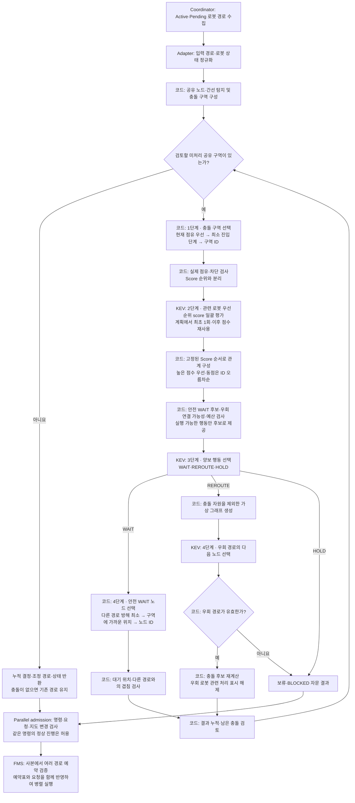
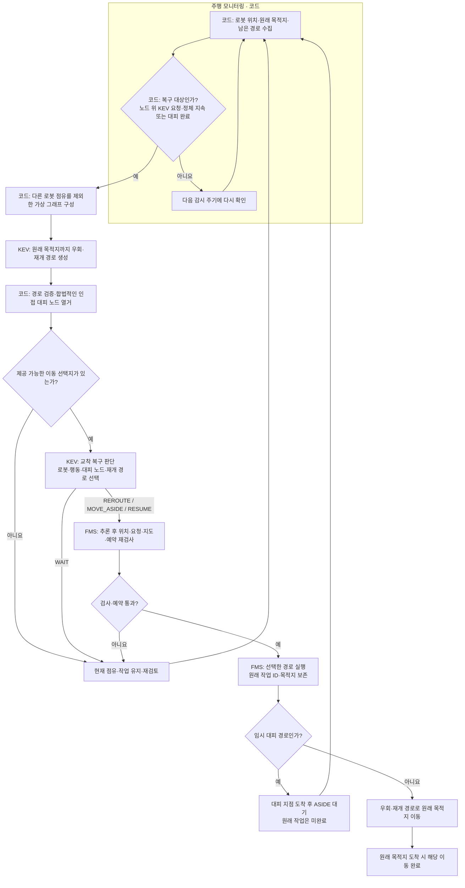
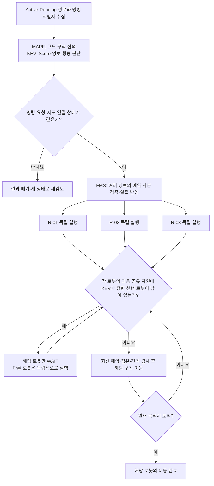
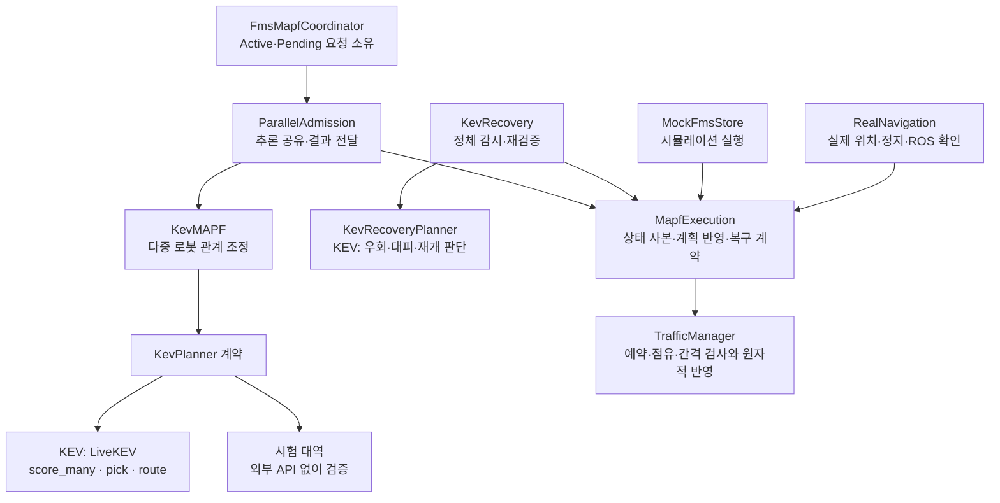

# PBS를 벤치마킹한 KEV MAPF와 주행 모니터링 구조

> 2026-10-26에 확인한 Logistics_AI 코드와 실행 설정 기준이다.
> 플로우차트에서 **KEV**라고 표시한 단계가 모델 판단을 사용하는 부분이다. **코드/FMS**는 상태 수집, 후보 구성, 검증, 예약 또는 실행을 담당한다.

## 0. 설계 의도와 계층 구분

이 프로젝트의 MAPF는 **PBS(Priority-Based Search)를 벤치마킹하여, 공유 충돌 후보의 조정 순서와 WAIT 위치는 코드가 정하고, 통과 우선순위 평가·양보 행동·우회 생성은 KEV가 담당하는 KEV 기반 MAPF**다.
문서에서 **MAPF 본체는 3번**, **주행 모니터링 및 교착 복구는 4번**을 뜻한다. 두 기능이 같은 `kev_mapf/` 폴더와 KEV 호출 클라이언트를 사용하더라도 역할은 구분한다.

| 계층                         | 담당 문제                               | KEV의 역할                                           | 주요 구현                                               |
| -------------------------- | ----------------------------------- | ------------------------------------------------- | --------------------------------------------------- |
| 개별 로봇 경로 생성                | 한 로봇이 현재 위치에서 목적지까지 갈 경로 구성         | 다음 노드 선택                                          | `iterative_route_runner.py`, `llm_route_preview.py` |
| **PBS를 벤치마킹한 KEV MAPF 본체** | 여러 로봇의 공유 구간을 누가 먼저 통과하고 누가 양보할지 조정 | Score 일괄 평가 → 양보 행동 선택 → REROUTE 경로 생성. 구역·WAIT 위치는 코드 선택 | `kev_engine.py`, `kev_conflict.py`, `kev_client.py` |
| FMS 실행·교통 제어               | 계획을 실제 이동 가능한 예약과 이동 허가로 반영         | MAPF·복구 판단 결과를 입력으로 받음                            | `traffic_manager.py`                                |
| 주행 모니터링                    | 이동 진행·정체·임시 대피 완료 감시                | 감시 주기와 정체 판별은 코드 처리                               | `main.py`, `kev_recovery.py`                        |
| KEV 기반 교착 복구               | 감시 중 발견한 정체에 대해 우회·대피·작업 재개 선택      | 이동할 로봇, 행동, 대피 위치와 재개 경로 선택                       | `kev_recovery.py`                                   |

개별 경로 생성은 MAPF에 경로를 제공하고, MAPF 본체는 **여러 로봇 사이의 관계**를 조정한다. 주행 모니터링은 실행 상태를 관찰하며, 교착 복구는 관찰 결과에 따라 다시 경로·행동을 결정하는 실행 중 보완 계층이다. 따라서 4번 전체를 단순 상태 표시라고 부르는 것도 정확하지 않다. **감시 부분과 KEV 복구 판단 부분이 함께 있다.**

## 1. 현재 실행 상태

| 항목                           | 확인한 상태                                               |
| ---------------------------- | ---------------------------------------------------- |
| 운용 모드                        | simulation / ai                                      |
| 경로 모델                        | kev-08b                                              |
| 초기 KEV 경로 생성                 | 사용                                                   |
| PBS를 벤치마킹한 KEV MAPF 출발 전 게이트 | 활성: `FMS_SIM_MAPF_ENABLED=1`, 코드 기본값도 `1`            |
| MAPF 적용 진입점                  | 실제·시뮬레이션 주문 이동 및 수동 AI 목적지 이동 모두 같은 게이트 사용              |
| MAPF 우선순위 판단                 | `FMS_MAPF_PRIORITY_MODE=score` 전용: 관련 로봇의 KEV 점수를 한 요청에서 평가·재사용 |
| 주행 모니터링 및 KEV 교착 복구          | 사용: MAPF 본체의 출발 전 게이트 설정과 별도 실행                      |
| 실로봇의 기본 주행·개별 AI 경로 | ROS 주행 연결과 KEV 개별 경로 전달 코드가 있음. 현장 운용 검증 결과는 이 문서에 없음 |
| 실로봇의 KEV MAPF·자동 교착 복구 | 공통 실행 계약으로 연결. 실제 KEV + ROS/위치 대역 재생 검증 완료, 물리 로봇 현장 시험은 미수행 |

현재 흐름은 **초기 KEV 경로 생성 → 출발 전 KEV MAPF → 여러 경로·예약 일괄 반영 → 로봇별 병렬 실행 → 필요 시 KEV 복구**다. 주문과 수동 AI 목적지 이동이 모두 `dispatch_mapf()`를 호출한다. 단독 요청이며 타 로봇 점유 문제가 없으면 모델의 다중 로봇 판단은 생략한다. 준비된 여러 요청에는 같은 KEV 판단을 함께 반영하며, 정상적으로 이동 중인 로봇도 분석에 포함한다.

현재 설정은 `/api/mode`의 `simulation_mapf_enabled=true`, `mapf_priority_mode=score`와 이동 응답의 `mapf`로 확인한다. 우선순위의 선택형 실행 분기와 프롬프트는 제거했으며 `score`만 지원한다.

실로봇 AI 이동도 `dispatch_mapf()`를 거쳐 `RealNavigation.mapf`에 연결한다. real AI 게이트는 항상 사용하며, 시뮬레이션의 명시적 비활성화 설정과 구분한다. KEV 판단 결과를 `MapfExecution`이 받아 정지·최신 위치·연결·주문 변경을 검증하고 `TrafficManager`가 예약을 검사한다. 승인된 다음 한 구간만 ROS Action으로 전달하며, 성공 결과와 실제 수신 위치가 함께 확인되어야 다음 구간으로 진행한다. 취소 중에는 기존 예약을 유지한다.

`real_available`은 ROS 노드 초기화 여부이며 모든 로봇의 준비 완료를 뜻하지 않는다. 요청마다 등록 상태와 위치 신선도를 별도로 검사한다. **실제 로봇의 현장 운용 검증은 아직 수행하지 않았다.**

## 2. 계층별 전체 플로우차트


개별 경로는 다음 노드 후보가 두 개 이상일 때 KEV를 호출한다. 후보가 한 개뿐이면 코드가 유일한 간선을 연결하므로, 경로 생성 함수를 사용했다고 매 노드에서 KEV 추론이 발생하는 것은 아니다.

전체 흐름에서 FMS의 예약·주행은 실행 계층이고, 진행 상태 갱신과 정체 확인은 모니터링 계층이다. 3번의 다중 로봇 조정과 4번의 실행 중 복구는 각각 별도의 판단 흐름이다.

## 3. PBS를 벤치마킹한 KEV MAPF 본체

### 3.1. PBS에서 참고한 개념과 KEV로 구현한 부분

PBS는 충돌을 계기로 로봇 간 부분 우선순위 관계를 확장하며 경로를 조정하는 탐색 방법이다. 원본 PBS는 우선순위 탐색 트리를 깊이 우선으로 탐색하고, 높은 우선순위 로봇의 경로를 고려해 낮은 우선순위 로봇의 경로를 재계획한다. [PBS 원 논문: Searching with Consistent Prioritization for Multi-Agent Path Finding](https://arxiv.org/html/1812.06356v1#S6)

| 구분 | PBS에서 참고한 개념 | 이 프로젝트의 KEV MAPF 구현 |
| --- | --- | --- |
| 다중 로봇 조정 | 충돌하는 로봇 사이의 통과 우선순위 관계 | 코드가 공유 노드·간선과 충돌 구역을 구성하고 점유·진입 단계·ID로 조정할 구역을 선택 |
| 우선순위 결정 | 충돌에 따라 부분 우선순위를 추가하며 탐색 | KEV의 일괄 점수로 계획 전체 순서를 고정하고 모든 선행·양보 관계에 재사용 |
| 양보 로봇 계획 | 높은 우선순위 경로와 충돌하지 않도록 재계획 | KEV가 WAIT·REROUTE·HOLD를 선택. WAIT 위치는 코드, 우회 경로는 KEV가 결정 |
| 반복 처리 | 우선순위 관계와 경로를 갱신하며 충돌 처리 | 결정·우선순위 관계를 누적하고 우회 시 공유 구역을 재계산하여 반복 |

이 표는 **벤치마킹한 개념과 현재 구현의 대응 관계**다. 구역·우선순위·양보·행동 적용의 단계 구분를 원본 PBS의 절차라고 설명하지 않는다. 현재 `KevMAPF.resolve()`는 KEV가 선택한 결과를 반복 반영하는 구조이며, 원본 PBS의 양방향 우선순위 분기·탐색 트리·백트래킹 전체를 그대로 구현한 것으로 표현하지 않는다.

따라서 문서상 명칭은 **「PBS를 벤치마킹한 KEV 기반 MAPF」**로 통일한다. 이는 설계의 출발점과 KEV가 담당하는 판단을 함께 나타낸다.

### 3.2. KEV MAPF 본체의 코드·KEV 책임 플로우차트

> 주문과 수동 AI 목적지 이동의 출발 전에 기본 활성화된 게이트의 내부 구조다. KEV가 단독 요청의 다중 로봇 판단까지 호출하는 것은 아니다.



- 충돌 후보 탐지·구역 선택·WAIT 위치 선택은 코드다. KEV는 로봇별 Score, 합법적인 양보 행동, 우회 경로를 판단한다.
- 본체는 경로의 공유 노드·간선에 따른 잠재 충돌을 조정하며, 반환값은 `time_prediction_used=False`다. 실제 시간 예약과 이동 허가는 FMS 계층에서 검사한다.
- 현재 우선순위는 `score` 전용이다. `LiveKEV.score_many()`가 관련 로봇의 점수를 한 API 요청에서 평가하며, 같은 계획의 여러 충돌 쌍에 재사용한다. 코드가 점수와 제약을 통과 관계로 변환하며 동점은 기존 로봇 ID 규칙을 사용한다. 우선순위의 `choice` 옵션과 프롬프트는 제거했다.
- 점유 상태는 Score 순서를 뒤집지 않는다. 낮은 Score 로봇이 점유 중이면 높은 Score 로봇도 실제 점유 해제 전에는 진입할 수 없다. 안전한 이탈 경로가 없으면 HOLD하며, 정체의 대피·재개는 별도 KEV 복구가 검토한다.
- 다중 점유·제3자 점유·차단 노드·최대 반복 횟수 등으로 보류될 수 있다. 고정 Score 순서에서 만드는 관계에는 우선순위 DFS 순환 검사를 중복 수행하지 않는다. FMS의 별도 대기 의존성 순환 검사는 유지한다.
- `LiveKEV.pick()`의 후보가 한 개이면 KEV API를 호출하지 않는다.
- 우회 생성 실패는 HOLD로 처리한다. 코드가 KEV의 행동을 WAIT로 바꾸지 않는다. A* 경로를 모델 결과 대신 사용하는 대체 기능은 제거된 상태다.
- 결과는 자문이며 `fms_execution_approved`는 `False`다. 실제 이동은 FMS 검사를 거쳐야 한다.

## 4. 주행 모니터링 및 KEV 기반 교착 복구

> 3번의 PBS를 벤치마킹한 MAPF 본체와 구분하는 실행 중 보완 계층이다. 실제·시뮬레이션에서 노드 위에 대기 중인 등록된 KEV 요청을 대상으로 하며, MAPF 본체의 출발 전 게이트와 독립적으로 실행된다.

### 4.1. 모니터링과 복구 판단의 경계

| 구분 | 하는 일 | 판단 주체 |
| --- | --- | --- |
| 주행 모니터링 | 위치·남은 경로·진행 변화 수집, 정체 지속 또는 임시 대피 완료 확인 | 코드 |
| 복구 후보 구성 | 점유를 제외한 가상 그래프 구성, 합법적인 대피 후보 열거 | 코드 |
| 교착 복구 판단 | 우회·재개 경로 생성, 이동할 로봇·대피 위치·재개 행동 선택 | KEV |
| 복구 실행 | 최신 상태·예약 재검사, 경로 교체와 이동 수행 | FMS |

사진 상황에서 수행한 **R-03 임시 대피 후 원래 목적지로 재개**는 이 4번 계층의 동작이다. 이를 3번 MAPF 본체의 PBS 벤치마킹 동작과 혼합해 설명하지 않는다.

### 4.2. 주행 모니터링에서 KEV 교착 복구까지의 흐름



복구 프롬프트는 `RECOVERY_INSTRUCTIONS`다. 전체 로봇의 점유, 목적지, 남은 경로와 이전 결정을 보고, 어떤 로봇을 어디로 이동시킬지 KEV가 고르게 한다. 코드가 어느 대피가 교착을 푸는지 계산해 우선순위를 정하거나 특정 로봇으로 선택을 덮어쓰지는 않는다.

다만 선택지 자체는 코드가 구성한다. 현재 임시 대피는 한 간선으로 연결된 빈 대기/통과 노드를 제공하며, 점유 노드·다른 요청의 목적지 등의 제약을 적용한다. KEV가 제한 없이 새 좌표나 임의의 전체 계획을 출력하는 구조는 아니다.

감시 주기는 0.2초, 기본 정체 판단 시간은 1초, 실패·대기 후 재검토 간격은 5초다. 예약 시간만 갱신되는 것은 물리적 진행으로 간주하지 않는다. 추론 후에는 최신 예약표로 다시 검사한다.

### 4.3. 출발 보류 요청을 복구 판단에 포함하는 연결

이미 서로의 출발 노드를 점유한 배치에서는 3번 MAPF가 전부를 보류할 수 있다. 이때 아직 FMS 주행 요청이 없어 주행 중 복구만으로는 시작할 수 없던 연결 문제를 보완했다.

`kev_admission_recovery.py`는 Pending 요청의 원래 목적지·계획 경로를 현재 로봇 상태와 함께 KEV의 복구 판단에 전달한다. 실제 FMS 상태는 선택 전까지 IDLE로 유지한다. KEV가 **PROCEED·MOVE_ASIDE·RESUME·REROUTE·WAIT** 중 주어진 행동을 선택하며, FMS는 최신 상태·요청 일치와 예약을 검증한다. 특정 로봇이나 대피 노드를 코드가 강제하지 않는다.

임시 대피는 `start_required_path_maneuver()`로 선택된 임시 경로만 예약하고 원래 목적지를 보존한다. 원래 보류 경로를 실행 허가 없이 전달하는 방식이 아니다. 출발 전 MAPF와 별도 복구 판단은 HTTP 응답의 `MIXED_ACTIVE_PENDING` 및 `KEV_PENDING_RECOVERY`로 구분되며, 후자에는 가능한 경우 직전 MAPF 보류 결과도 함께 기록한다.

## 5. 실제 KEV 서버 호출 흐름


| 계층 | 실제 판단 | 소스 위치: 저장소 기준 | 호출 형태 |
| --- | --- | --- | --- |
| 개별 경로 생성: MAPF·복구에서도 재사용 | 초기·우회·재개 경로의 다음 노드 | `backend/app/services/iterative_route_runner.py` | `selector.select_choice()` |
| 실행 중·출발 보류 교착 복구: 4번 | 로봇·행동·대피 위치·재개 선택 | `backend/app/services/kev_mapf/kev_recovery.py` | `selector.select_choice()` |
| MAPF 코드: 3번 | 충돌 구역 선택 | `backend/app/services/kev_mapf/kev_engine.py` | `_select_zone()` — KEV 호출 없음 |
| KEV MAPF 본체: 3번 | 우선순위 점수: score 전용 | `backend/app/services/kev_mapf/kev_engine.py` | `LiveKEV.score_many()` |
| KEV MAPF 본체: 3번 | 양보 행동 선택 | `backend/app/services/kev_mapf/kev_engine.py` | `LiveKEV.pick()` |
| MAPF 코드: 3번 | 대기 노드 선택 | `backend/app/services/kev_mapf/kev_engine.py` | `_wait_candidates()`·`_apply_wait()` — KEV 호출 없음 |
| 공통 KEV 클라이언트 | 실제 HTTP 전송 | `backend/app/services/route_selector/kev_selector.py` | `/v1/systemone` 요청 |

## 6. 모듈 역할

| 모듈 | 역할 |
| --- | --- |
| `kev_dispatcher.py` | 주문·수동 AI 이동 공통 경로 준비와 출발 전 MAPF 실행 게이트 |
| `kev_parallel_admission.py` | 이동 중 Active 모델링, 공통 KEV 판단의 여러 Pending 경로 일괄 반영, 명령 식별자로 추론 검증 |
| `kev_coordinator.py` | Active·Pending 경로 수집, 변경 감지, 결과 검토 |
| `kev_adapter.py` | 주문·경로 데이터를 MAPF 입력으로 변환 |
| `kev_graph.py` | 그래프 해석, 가상 그래프 구성, 경로 검사 |
| `kev_conflict.py` | 공유 자원·충돌 구역 탐지. `would_cycle()`은 외부 임의 관계 검사용 공개 유틸리티로 유지 |
| `kev_engine.py` | PBS를 벤치마킹한 MAPF 본체: 코드 구역·WAIT 선택 + KEV Score·행동·우회 |
| `kev_client.py` | 출발 전 MAPF용 KEV 클라이언트·프롬프트 |
| `kev_recovery.py` | `KevRecovery`: 정체 감시·재검증·반영, `KevRecoveryPlanner`: 별도 KEV 복구 판단 |
| `mapf_execution.py` | 실제·모의 실행 공통 계약: 상태 사본, 잠금 경계, 예약 반영, 복구 |
| `real_navigation.py` | ROS 준비·실제 위치·실제 정지 확인, 승인된 구간별 Action 실행 |
| `kev_admission_recovery.py` | MAPF 출발 보류 요청을 KEV 복구 판단에 연결하고 선택된 경로만 FMS에 반영 |
| `kev_traffic.py` | 다른 로봇의 점유·남은 경로 수집 |
| `route_selector/kev_selector.py` | 실제 KEV 서버 요청과 응답 검증 |
| `traffic_manager.py` | 예약·이동 허가·정지 후 경로 교체·도착 처리 |

운용 코드는 `backend/app/services/kev_mapf/`의 실제 모듈을 직접 참조한다. 테스트만 사용하던 이전 호환 모듈 두 개는 제거했다. `backend/app/services/kev_mapf/`에는 MAPF 본체와 실행 중 복구 모듈이 함께 들어 있다. **폴더명이 같다는 이유로 `kev_recovery.py`까지 PBS를 벤치마킹한 MAPF 본체로 분류하지 않는다.**


## 7. 코드에 남아 있는 제약과 실행 책임

KEV는 로봇별 우선순위 점수·양보 행동·우회 경로를 판단한다. 구역·WAIT 위치는 결정적인 코드 규칙으로 선택한다. 다음 처리는 코드/FMS가 담당한다.

- 공유 노드·간선 탐지, 조정할 구역·WAIT 노드 선택, 합법적인 행동 후보 구성, 정체 감지와 호출 주기 제어.
- 점유·연결·그래프 경로·FMS 대기 의존성 순환·물리 간격·예약 검사.
- KEV 점수의 비교와 기존 로봇 ID 동점 규칙 적용.
- 요청 변경·취소·지도 변경 감지와 오래된 추론 폐기.
- 여러 경로·예약의 일괄 반영, 로봇별 이동과 도착 처리.
- 배차·작업대 선택 등 기존 FMS 업무 처리.

우선순위 평가는 관련 로봇의 질문을 `score_many()` 한 요청에 묶고 같은 MAPF 계획 안에서 재사용한다. `mapf.priority_scores`로 실제 점수를, `metrics.kev_api_calls`·`kev_score_calls`·`kev_choice_calls`로 호출 수를 확인한다. 점수는 KEV가 반환한 원래 값이며 확률이나 백분율을 뜻하지 않는다.

양보 행동·경로·별도 복구 행동은 범주 후보 중 하나를 고르는 `choice`를 사용한다. 충돌 구역과 WAIT 위치에는 KEV choice 호출을 사용하지 않는다. 후보 여러 개를 한 질문에 넣는 방식이라 로봇 쌍별 우선순위 호출과 다르며, 경로와 MAPF 선택에 후보가 하나뿐이면 모델 호출을 생략한다.

따라서 **PBS를 벤치마킹한 KEV MAPF가 다중 로봇의 관계를 조정하고, FMS가 검증·실행하며, 별도 모니터링 및 KEV 교착 복구가 실행 중 정체에 대응한다.** 원본 PBS 대비 정량 성능 벤치마크나 모든 그래프에서의 교착 해소 보장은 이 문서의 검증 범위에 포함되지 않는다.

## 8. 병렬 실행과 공유 자원별 WAIT

현재는 `kev_parallel_admission.py`가 한 번의 KEV 판단에 포함된 Pending 로봇들을 함께 FMS에 등록한다. FMS 사본에서 예약을 검증하고, 기존 예약표가 바뀌지 않았을 때 경로·예약을 한 번에 반영한다. 같은 판단을 공유한 응답에는 동일한 `plan_id`, 분석 입력의 `input_paths`, `MIXED_ACTIVE_PENDING_PARALLEL`이 기록된다.

Active의 간선 진입·위치·진행 인덱스 변화는 같은 명령의 정상 진행으로 취급한다. 새 명령·취소·경로 교체·연결 상태·지도·Pending 요청 ID 변경은 계속 거부한다. 간선 위 Active는 현재 간선의 출발 노드를 기준으로 한 잔여 경로와 `occupied_edge`, `execution_committed`를 KEV에 전달하며, 실제 위치는 FMS가 최신 값으로 검증한다.

KEV가 선택한 선행·양보 관계는 `mapf_wait_for`로 실행된다. **후행 로봇의 다음 노드·간선에 대해서만 선행 로봇의 통과 여부를 검사**한다. 같은 그룹의 다른 자원을 사용하고 있거나 아직 업무 목적지에 도착하지 않았다는 이유만으로 전체 로봇을 묶어 두지 않는다. 순서 자체는 KEV 판단을 사용하고, FMS는 그 순서와 예약·점유를 검증한다.




## 9. KEV MAPF의 객체지향 책임 경계

이번 정리 범위는 KEV MAPF와 연결되는 실행 경계다. FMS 전체를 재설계한 것은 아니다.

| 객체·계약 | 소유하는 책임 | 외부에서 사용하지 않는 내부 상태 |
| --- | --- | --- |
| `KevMAPF` / `KevPlanner` | MAPF 본체와 주입된 KEV 판단 계약: `score_many`, `pick`, `route` | 엔진이 구체적인 LiveKEV/시험 대역 타입을 검사해 분기하지 않음 |
| `FmsMapfCoordinator(store)` | 주입된 실행기의 Active·Pending 요청, 등록·교체·완료 처리 | 요청 딕셔너리는 복사본으로 조회. 외부에서 직접 수정하지 않음 |
| `ParallelAdmission` | cohort 추론 단일 실행, 요청 검증 콜백, 요청별 응답·실패 재시도 상태 | dispatcher가 내부 잠금·캐시·응답 딕셔너리에 직접 접근하지 않음 |
| `KevRecovery` | 정체 시간·중복 실행 감시, 추론 전후 재검증, 복구 적용 | KEV 판단은 주입된 `KevRecoveryPlanner`에 위임 |
| `KevRecoveryPlanner` | 합법적인 후보 구성, KEV 우회·대피·재개 판단 | 로봇·예약표 변경 권한 없음. 경로 생성기·선택기를 주입해 검증 가능 |
| `MapfExecution` | 실제·모의 실행 공통의 `transaction`, `snapshot`, `wait_reservations`, `commit_routes`, `recover` | MAPF가 저장소의 로봇·TrafficManager 내부 필드에 직접 접근하지 않음 |
| `TrafficManager` | 예약표·로봇 계획 상태, 사본 예약 검증과 원자적 교체 | 예약 CAS 실패 시 로봇과 MAPF 요청 상태 모두 유지 |



- **단일 책임:** MAPF 본체, 요청 관리, 병렬 배차 상태, 정체 감시, KEV 복구 판단, 실행 반영을 구분했다.
- **의존성 역전·교체 가능성:** 코디네이터는 실행기를 주입받고, 엔진은 `KevPlanner` 계약을 사용한다. 실제·모의 실행은 같은 `MapfExecution` 연산을 사용한다. `runtime_for()`만 운용 모드에 맞는 구체 객체를 구성한다.
- **캡슐화:** 상태 사본을 수정해도 원본이 바뀌지 않으며, 실행 변경은 소유자의 메서드와 공통 잠금 경계를 거친다. 복구도 요청 상태를 공개 메서드로 교체한다.
- **필요한 계약만 유지:** 범용 플러그인 프레임워크나 새 운용 설정을 추가하지 않았다. 로봇·주문 DTO는 기존 딕셔너리 형식을 유지한다.

우선순위는 계속 KEV `score` 한 번으로 평가한다. 로봇 통과 순서는 KEV Score와 ID 규칙으로 고정한다. 현재 구조에서 MAPF 구역·WAIT 위치는 코드, 별도 교착 복구의 대피 위치는 KEV가 선택한다. 경로의 합법성·정지 확인·예약 검사는 실행기의 책임으로 유지한다.


## 10. 주문 순차 실행의 원인과 수정

앞선 OOP 정리 뒤의 주문 시험은 완료됐지만 최대 동시 이동이 1대였다. 이를 병렬 이동 검증 완료로 해석하면 안 된다. 실제 주문 경로에서 다음 두 조건이 병렬 실행을 막고 있었다.

| 원인 | 수정 | 보존한 검사 |
| --- | --- | --- |
| 픽업·작업대 도착 확인에서 수행한 정지의 `stop_requested=True`를 새 Pending 요청도 거부하는 조건으로 사용. 병렬 배차가 실패하고 개별 검토·배차로 전환됨 | 모의 로봇의 정지 명령마다 `command_epoch` 증가. 새 경로를 준비할 때 해당 번호를 `execution_epoch`로 묶고, 이미 정지가 확인된 IDLE 로봇의 새 요청은 병렬 판단에 포함 | 추론 중 추가 정지·취소가 오면 번호 변경으로 폐기. real에서는 ROS 실행 종료·정지·위치 준비 검사를 그대로 유지 |
| 픽업 목록이 겹치는 이전 주문이 `IN_PROGRESS`인 동안 다음 주문을 보류. 이전 로봇이 픽업을 떠나 작업대로 가도 계속 대기 | 픽업 단계마다 현재 픽업에 대한 작업·대기와 실제 노드 점유만 검사. 이전 주문의 작업대 작업·복귀를 기다리지 않음 | 같은 픽업 작업과 실제 노드 점유 중의 대기는 유지. 통로·노드 진입은 KEV 관계와 FMS 예약으로 검사 |

이 수정은 KEV 점수나 통과 순서를 코드로 덮어쓰지 않는다. KEV가 판단하기 전에 정상 요청을 배제하던 조건과, 관계없는 주문 단계까지 기다리던 업무 게이트를 바로잡았다.

### 10.1. 실제 KEV + 실행 중 FMS 주문 시험

| 측정 항목 | 수정 전 시험 | 수정 후 시험 |
| --- | ---: | ---: |
| 최대 동시 이동 로봇 | 1대 | 3대 |
| 2대 이상 이동 겹침 | 0.00초 | 25.08초 |
| 3대 이동 겹침 | 0.00초 | 2.09초 |
| 주문 3개 및 스테이션 복귀 | 완료 | 완료 |

세 번째 주문의 픽업 출발은 시험 시작 후 **13.02초**, 첫 주문의 작업대 작업 완료는 **20.81초**였다. 앞 주문 전체가 끝나기 전에 다음 로봇이 진행했다. 표본에서 확인한 최소 로봇 중심 간격은 **0.1461m**였다. 이 값은 표본 측정값이며 물리 장비의 안전 인증을 의미하지 않는다.

`tools/verify_kev_mapf_fms.py`는 이제 주문이 완료돼도 **2대 이상 실제 이동이 한 번도 겹치지 않으면 실패**한다. 상태 문자열만 세지 않고 연속 표본 양쪽에서 NAVIGATING이며 좌표가 변한 로봇을 센다.

## 11. 검증 범위

이 절과 13번의 151개 테스트·실측 표는 `a390096`의 기록이다. 이후 Score 일관성 개선의 최신 검증은 15번에 구분한다.

저장소의 `docs/kev_fms_validation.json`에 현재 검증 결과와 순차 실행 수정 전·후를 함께 기록했다.

| 검증 | 결과 |
| --- | --- |
| KEV MAPF·주문·실제 실행기 회귀 테스트 | 151개 통과. 기존 MQTT 콜백 API 경고 1개 |
| 정상 정지 후 새 요청 / 추론 후 반복 정지 | 정상 정지 이후 cohort를 함께 반영. stop 플래그가 이미 True여도 새 정지 명령은 준비된 요청을 무효화 |
| 픽업 게이트 | 다른 픽업·작업대 작업을 기다리지 않고, 실제 픽업 노드가 비면 진행 |
| 캡슐화·반영 실패 | 상태 사본 수정 시 원본 유지, 예약 CAS 실패 시 전체 cohort·요청 유지, 공개 실행 계약만 가진 객체로 배차 통과 |
| 실제 KEV + 실제 실행기 코드 + 제어한 ROS/AMCL 입력 | 독립 경로·공통 교차점 모두 세 대 도착. 독립 경로 ROS Action 최대 3개 동시 실행, 교차점 점수 요청 1회, Action마다 다음 한 구간만 전달 |
| 실제 FMS + 실제 KEV 시뮬레이션 | 아래 9개 경우 모두 완료. 주문 시험은 병렬 이동 조건도 통과 |
| 물리 로봇 현장·비상정지·Nav2 경로 오차·공간 보정 | 미수행. ROS/위치 대역 재생을 현장 시험으로 해석하지 않음 |

| 실제 FMS 시험 | 최대 동시 이동 대수 | 2대 이상 동시 이동 시간 | 3대 동시 이동 시간 |
| --- | ---: | ---: | ---: |
| `parallel_disjoint` | 3 | 2.31초 | 1.68초 |
| `parallel_staggered` | 3 | 1.69초 | 1.69초 |
| `three_way_n7` | 3 | 5.06초 | 0.18초 |
| `three_way_n7_rotated` | 3 | 5.05초 | 0.23초 |
| `three_way_n7_inflight` | 3 | 5.13초 | 0.22초 |
| `manual_startup` | 3 | 11.80초 | 1.89초 |
| `photo_n5_n7_n9` | 3 | 6.14초 | 1.70초 |
| `photo_n8_n9_n7` | 1 | 0.00초 | 0.00초 |
| `orders` | 3 | 25.08초 | 2.09초 |

3대 교차 세 변형은 KEV가 정한 N7 선행 관계를 지켰고, 표본에서 확인한 교차점 동시 진입 위반은 0건이었다. 세 대의 병렬 이동과 동일 교차점의 동시 점유는 구분한다. 사진의 `photo_n8_n9_n7`은 서로의 출발 노드를 막는 배치라 KEV의 대피·재개를 거쳤고, 이 시험의 최대 동시 이동은 1대였다.

## 12. 운용 설정과 실패 처리 설계

| 항목 | 설계 |
| --- | --- |
| 주문·수동 AI 목적지 이동 | `dispatch_mapf()` 공통 진입점. 현재 서버는 simulation / ai |
| 시뮬레이션 MAPF | `FMS_SIM_MAPF_ENABLED=1`이 기본. 현재 활성화 |
| 실제 AI MAPF | real AI 이동에서는 공통 MAPF 게이트 사용. 개별 로봇 ROS·위치·정지 준비는 요청마다 검사 |
| 우선순위 | `FMS_MAPF_PRIORITY_MODE=score` 전용. 한 계획의 관련 로봇 점수를 한 요청에 묶어 재사용 |
| 구역·행동·대기 노드·복구 선택 | 필요한 범주 선택은 KEV choice 유지. 후보 한 개이면 API 호출 생략 |
| 요청 수명 | 준비 당시 지도·운용 모드·로봇 명령 번호·Pending 요청 ID를 재검증. 취소·교체 후 오래된 추론으로 출발하지 않음 |
| KEV 실패·보류 | 현재 점유·작업을 보존하고 대기·재검토. A* 또는 임의 후보로 모델 판단을 대체하지 않음 |
| 예약 실패 | 예약 사본과 원자적 CAS 교체 사용. 검증 실패 시 cohort 실행 상태를 반영하지 않음 |
| 대피 | 임시 목표와 원래 업무 목적지를 구분. 대피 도착으로 주문을 완료하지 않고 KEV RESUME 후 업무 재개 |
| real 진행 확인 | 승인된 다음 한 구간만 ROS Action으로 전송. 성공 결과와 최신 실제 위치 확인 후 진행. 취소 중에는 예약 유지 |

모든 로봇은 독립 실행할 수 있으며, 동일 자원·픽업을 동시에 점유할 수 없는 경우만 해당 자원의 대기가 필요하다. 원본 PBS의 탐색 트리를 그대로 실행하는 구현이나 모든 그래프의 교착 해소 보장은 아니다. 이 설계에서 PBS를 벤치마킹한 부분은 3번 MAPF 본체의 우선순위 관계 조정이며, 4번 모니터링·복구는 별도 실행 계층이다.

## 13. 테스트 방법과 재현 절차

### 13.1. 시험 환경과 증거의 구분

- 시험 기준일: **2026-10-26**, 구현 기준 커밋: **`a390096`**.
- 실제 FMS 시험: `simulation / ai`, 로봇 `robot1`~`robot3`, `routes/test.geojson`, 실제 KEV 서버를 사용하는 `kev-08b` 설정.
- MAPF 설정: `FMS_SIM_MAPF_ENABLED=1`, `FMS_MAPF_PRIORITY_MODE=score`. 실행 중 서버의 `/api/mode` 응답에서 확인했다.
- **회귀 테스트 151개**는 MockKEV·제어한 ROS/위치 입력 등을 사용하여 코드의 동작과 실패 조건을 검사한 결과다. 151개 모두 실제 KEV 추론을 수행했다는 뜻은 아니다.
- **FMS 시뮬레이션 9종**은 실행 중 서버에 HTTP로 이동·주문을 요청하고 실제 KEV 응답과 모의 로봇의 좌표 변화를 기록한 결과다. 최신 기록은 주문 시험 1종과 수동 이동 회귀 8종을 두 번에 나누어 실행한 합본이다.
- **실제 실행기 재생 시험**은 RealNavigation 코드를 사용하지만 ROS 송수신·성공 콜백과 AMCL에 해당하는 위치 입력은 시험 코드가 제어한다. 물리 로봇이나 실제 Nav2 Action 서버의 검증과 구분한다.

### 13.2. 회귀 테스트 실행 방법

저장소 루트에서 다음 범위를 실행했다. 전체 저장소 테스트 수가 아니라 이번 변경과 관련된 범위의 결과다.

```bash
cd /home/jhlee/Logistics_AI
/home/jhlee/venv/robot/bin/python -m pytest \
  tests/test_real_kev_mapf.py \
  tests/test_kev_parallel_admission.py \
  tests/test_kev_admission_recovery.py \
  tests/test_kev_recovery.py \
  tests/test_fixed_route_reservation.py \
  tests/test_kev_mapf_integration.py \
  tests/test_fms_mapf_coordinator.py \
  tests/test_llm_goal_dispatch.py \
  tests/test_kev_traffic_route.py \
  tests/test_order_flow.py \
  tests/test_scenario_mapf.py -q
```

**기록된 결과: 151 passed, 1 warning.** 경고는 기존 Paho MQTT 콜백 API 사용 중단 예정 경고다.

| 검증 대상 | 방법·통과 기준 | 주요 테스트 파일 |
| --- | --- | --- |
| KEV 우선순위 | 관련 로봇의 `score_many` 호출 1회, 같은 계획 안에서 점수 재사용, 제거한 priority choice 설정 거부 | `test_kev_mapf_integration.py`, `test_kev_parallel_admission.py` |
| 병렬 출발·자원별 WAIT | 세 요청을 같은 계획으로 반영. 공유하지 않는 상류 구간은 진행하고 선행 로봇이 해당 자원을 비우면 업무 전체 완료 전에 재개 | `test_kev_parallel_admission.py` |
| 정상 정지와 취소 구분 | 도착 확인을 위한 기존 정지는 새 요청의 병렬 배차를 막지 않음. 이미 stop=True여도 추가 정지 시 준비 요청 무효화 | `test_kev_parallel_admission.py` |
| 픽업 대기 범위 | 다른 픽업·작업대 작업은 대기 원인에서 제외. 같은 픽업의 실제 점유 해제 전에는 기다리고 해제 후 진행 | `test_order_flow.py` |
| 상태 변경·원자성 | 취소·요청 교체·지도/모드 변경·예약 CAS 실패 시 오래된 결과를 실행하지 않고 기존 상태 보존 | `test_kev_parallel_admission.py`, `test_real_kev_mapf.py` |
| 대피·재개 | 원래 주문·목적지 보존. 임시 대피 도착으로 주문을 완료하지 않고 재개 경로로 완료 | `test_kev_recovery.py`, `test_kev_admission_recovery.py`, `test_real_kev_mapf.py` |
| 실제 실행기 연결 | 구간당 ROS Action 하나, 성공 결과만으로 진행 금지, 최신 위치 확인, 취소 종료 전 예약 유지, 준비되지 않은 ROS 로봇 거부 | `test_real_kev_mapf.py` |
| 객체 캡슐화 | 상태 사본 수정이 원본에 영향 없음. 내부 딕셔너리 없이 공개 실행 계약만 제공하는 객체로 배차 가능 | `test_kev_parallel_admission.py` |

### 13.3. 실행 중 FMS를 이용한 시험 방법

`tools/verify_kev_mapf_fms.py`는 모의 로봇의 위치를 바꾸고 시험 주문을 생성한다. 작업을 진행 중인 서버 대신 제어해도 되는 시뮬레이션 FMS에서 실행한다. 도구는 `simulation / ai / MAPF 활성` 상태를 확인하며 real 모드로 전환하지 않는다.

```bash
cd /home/jhlee/Logistics_AI
/home/jhlee/venv/robot/bin/python tools/verify_kev_mapf_fms.py \
  --url http://127.0.0.1:8000 \
  --timeout 180 \
  --output /tmp/kev-mapf-fms-validation.json
```

기본 실행은 수동 이동 8종과 주문 1종을 검사한다. `--cases orders`로 주문만, `--cases three_way_n7 three_way_n7_rotated three_way_n7_inflight`로 3대 교차만 실행할 수 있다. `--timeout 180`은 경우별 제한 시간이며 전체 9종의 총 제한 시간이 아니다.

1. 모의 로봇을 정지하고 각 시나리오의 출발 노드에 배치한다.
2. 수동 시험은 `/api/command/goal-node`에 `driving_mode=llm`, `selector=kev`, `model=kev-08b`로 목적지를 요청한다. 중도 합류 시험은 첫 로봇의 간선 진입을 확인한 뒤 나머지 요청을 제출한다.
3. `/api/robots`의 좌표·상태·점유·목적지·대피 상태·MAPF 대기 관계와 HTTP 응답을 표본으로 수집한다. 주문 시험은 `/api/orders`도 수집한다.
4. 목적지 도착, MAPF 적용, 시간 초과, 간격, KEV 선행 관계와 이동 겹침을 검사하고 JSON에 결과를 남긴다.
5. 실제 시험 종료 후에는 진행 중인 주문과 이동이 없는 것을 확인하고 세 모의 로봇을 N0·N1·N2에 돌려놓았다. 완료 주문 이력은 삭제하지 않았다. 이 복원은 도구의 기본 자동 동작과 별도로 수행했다.

노드 목록의 순서는 `robot1`, `robot2`, `robot3` 순서다.

| 시나리오 | 출발 → 목적지 | 확인하려는 동작 |
| --- | --- | --- |
| `parallel_disjoint` | `[0,1,6] → [10,9,11]` | 독립 경로 세 대의 동시 이동 |
| `parallel_staggered` | `[0,1,6] → [10,9,11]` | 첫 로봇 주행 중 다른 두 요청의 합류 |
| `three_way_n7` | `[5,6,3] → [0,1,2]` | N7을 공유하는 세 로봇의 통과 관계 |
| `three_way_n7_rotated` | `[6,3,5] → [1,2,0]` | 로봇별 출발·목적지를 바꾼 동일 교차 상황 |
| `three_way_n7_inflight` | `[5,6,3] → [0,1,2]` | 첫 로봇이 간선 위에 있을 때 두 요청 합류 |
| `manual_startup` | `[0,1,2] → [5,6,3]` | 초기 스테이션에서 수동 AI 이동 동시 요청 |
| `photo_n5_n7_n9` | `[5,7,9] → [3,1,6]` | 첫 사진 배치의 점유 충돌·출발 처리 |
| `photo_n8_n9_n7` | `[8,9,7] → [6,5,2]` | 두 번째 사진 배치에서 KEV 대피·재개 |
| `orders` | N0·N1·N2에서 시작, B 1개 / C 1개 / B·C 각 1개 주문 | 픽업·작업대·복귀 전체 흐름과 주문 간 병렬 이동 |

### 13.4. 이동·충돌 검사와 통과 기준

| 검사 | 계산·판정 방법 |
| --- | --- |
| 실제 이동 중인 로봇 | 연속 표본 양쪽에서 `NAVIGATING`이고 두 좌표의 이동 거리가 `1e-5m`보다 큰 로봇만 센다. 한 로봇 정지 직후 다른 로봇 출발을 동시 이동으로 세지 않는다 |
| 최대 동시 이동 대수 | 표본 구간마다 이동 로봇 수를 세어 최댓값을 기록 |
| 2대·3대 이동 겹침 시간 | 이동 로봇 수가 각각 2대 이상·3대인 표본 구간의 경과 시간을 합산 |
| 표본 주기 | N7 교차 시험 0.05초, 그 외 수동 이동 0.2초, 주문 0.5초. HTTP 처리 지연이 있어 실제 구간 길이는 기록된 경과 시간 차이를 사용 |
| 수동 이동 공통 통과 기준 | 제한 시간 내 세 대 모두 기대 노드 도착, `goal_node=None`, HTTP 200 및 `mapf.enabled=True`, 표본 최소 중심 간격 `0.12m - 1e-4` 이상 |
| 독립·중도 합류 시험 추가 기준 | 최대 동시 이동 3대이며 2대 이상 이동 겹침이 0.5초 이상 |
| N7 교차 추가 기준 | 세 대가 포함된 KEV WAIT 관계 존재, 세 대 모두 N7 진입 기록 존재, 선행 로봇의 최초 진입이 양보 로봇보다 빠름, 동시 진입 표본 0건 |
| N7 진입 판정 | `occupied_node=7` 또는 N7 좌표에서 0.03m 이내로 관측된 로봇. 한 표본에 두 대 이상이면 위반으로 기록 |
| 주문 통과 기준 | 세 주문 모두 status·phase가 `COMPLETED`, 세 로봇이 N0·N1·N2로 복귀하고 goal 없음. 완료하더라도 최대 동시 이동이 2대 미만이면 도구가 실패 종료 |
| 주문 간격 후분석 | 저장한 좌표 표본에서 별도로 최소 간격을 계산해 0.14608m 확인. 이 값은 주문 도구의 자동 통과 조건과 구분 |

표본 측정은 연속 시간 전체의 충돌 부재 증명과 다르다. 특히 짧은 이동 겹침 시간은 표본 주기의 영향을 받는다. 10번·11번의 수치는 실제 측정 기록이며 ETA나 예측된 작업 시간으로 계산한 값이 아니다.

### 13.5. 결과 해석과 기록 위치

- **관련 회귀 테스트 151개 통과**, 실제 KEV를 사용하는 FMS 시험 **9종 통과**.
- 주문 시험: 최대 **3대** 동시 이동, 2대 이상 **25.08초**, 세 대 **2.09초** 겹침. 세 번째 주문 출발 13.02초는 첫 주문 작업 완료 20.81초보다 빨랐다.
- N7 교차 세 변형: KEV 선행 관계 준수, 표본 동시 진입 위반 **0건**. 경우별 수치는 11번 결과표에 있다.
- 두 번째 사진 배치는 KEV 대피·재개를 거쳐 완료됐고 최대 동시 이동은 1대였다. 모든 배치에서 세 대가 함께 움직였다는 결과로 해석하지 않는다.
- 저장소에 남긴 요약·응답·판단 근거: `docs/kev_fms_validation.json`. 수정 전·후 주문 비교는 `parallel_order_regression`, FMS 경우별 결과는 `live_simulation.results`, 실제 실행기 재생은 `real_executor_controlled_replay`에 있다.
- 시험 당시 원시 표본: `/tmp/kev-parallel-orders-fix-validation.json`, `/tmp/kev-parallel-fix-regression.json`. `/tmp` 파일은 임시 자료이므로 장기 보존·동기화를 보장하지 않는다.

### 13.6. 실제 실행기 재생 시험과 미검증 범위

`tests/test_real_kev_mapf.py`의 별도 그래프에서 출발 N0·N1·N2, 목적지 N3·N4·N5로 독립 경로와 N7 공유 경로를 만들었다. 공개 MAPF 계획 함수에 실제 `LiveKEV`를 연결하고 RealNavigation에 계획을 반영한 뒤, 시험 코드가 위치 갱신과 ROS 성공 콜백을 제공하여 세 대의 완료를 확인했다.

독립 경로는 충돌 판단이 필요 없어 KEV API 호출 0회였고 ROS Action 세 개가 함께 실행됐다. 공유 교차점은 KEV API 4회 중 점수 평가 1회·범주 선택 3회였으며, 전달한 각 Action은 다음 한 구간만 포함했다. 두 경우 모두 N3·N4·N5 도착을 확인했다. 이 추가 재생은 임시 검증 스크립트로 실행했으며, 저장소에 반복 실행 가능한 실제 실행기 회귀 검사는 위 pytest 파일에 있다.

물리 로봇 주행, 실제 ROS/Nav2 송수신·통신 장애, 비상정지 장비, 위치 오차·제동 거리·현장 공간 보정, 대규모 장시간 부하, 모든 지도에서의 교착 해소, 원본 PBS 대비 성능 벤치마크는 이번 결과로 검증하지 않았다. 이번 문서 보완에서는 주행 시험을 다시 실행하지 않고 저장된 기록과 검사 코드를 대조했다.

## 14. MAPF 본체의 ETA 제외 원칙

**KEV MAPF 본체는 ETA를 계산·전달하거나 ETA로 우선순위를 정하지 않는다.** 입력은 현재 노드·점유, 순서가 있는 경로, 목표, 공유 구간, 작업 우선순위와 이미 실행 중인지에 대한 정보다. KEV는 이 정보를 이용해 점수와 양보 행동을 판단한다.

| 구분 | 시간의 용도 | MAPF의 ETA인가? |
| --- | --- | --- |
| MAPF 본체: `kev_engine.py`, `kev_adapter.py`, `kev_traffic.py` | 도착 예정 시간·속도로 충돌 시각이나 선행 순서를 계산하지 않음. 모델 상태 `eta_available=False`, 결과 `time_prediction_used=False` | 아니요. ETA를 사용하지 않음 |
| 그래프 거리·가중치 | 그래프 연결·경로 비용 정보. 속도로 나누어 도착 시간을 구하지 않음 | ETA가 아님 |
| FMS: `traffic_manager.py`, `pathfinding.py`의 예약·주행 검사 | 출발·예약 구간과 `expected_arrival_at`을 이용하여 실제 구간 진입 가능 여부 검사 | 별도 FMS 실행 계층의 시간 계산. MAPF의 우선순위 입력에 전달하지 않음 |
| 상태 재검증: coordinator | FMS의 출발 일정 변경을 상태 변경 감지에 포함할 수 있음 | 선행 순서 판단용 ETA가 아님 |
| 정체 감시·타임아웃·호출 통계 | 정체 지속·재시도·요청 제한 시간, KEV 추론 소요 시간 측정 | ETA가 아님 |
| 검증 결과의 이동 시간 | 관측 좌표로 실제 이동 겹침 시간 집계 | 관측 결과이며 ETA가 아님 |

문서 보완 시 공개 진입점 `plan_mapf_from_route_results()`의 요청에 ETA·예상 도착·속도·출발 일정 필드를 추가한 검사를 별도로 수행했다. KEV 대역이 받은 **모델 입력 상태 4개**를 재귀 검사하여 `eta_seconds`, `arrival_times`, `expected_arrival_at`, `speed_mps`, `segment_departures` 등의 필드가 전달되지 않는 것을 확인했고, 결과의 `time_prediction_used=False`도 확인했다. 이 검사는 실제 KEV의 추가 추론이나 FMS 주행 시험이 아니라 **MAPF 입력 경계의 코드 검사**다.


## 15. Score 우선순위 일관성 개선

### 15.1. 호출 관계와 데이터 계약

`dispatch_mapf()` → `ParallelAdmission.admit()` → `plan_mapf_from_route_results()` → `KevMAPF.resolve()`가 자문 계획을 만든다. 실행 가능 자문은 `ParallelAdmission.apply()` → `MapfExecution.commit_routes()` → `TrafficManager`의 점유·예약·CAS 검사를 거친다. 오래된 상태나 실행 중인 로봇의 승인 경로 변경은 기존대로 거부한다.

| 소유 객체 | 이번 변경의 책임 | 유지한 계약 |
| --- | --- | --- |
| `KevMAPF` | 점수 검증, 계획 전체 순서 고정, 구역마다 같은 순서 적용 | `priority_scores`, `global_priority_relations`, `required_paths`, `time_prediction_used=False`, `fms_execution_approved=False` |
| `ParallelAdmission` / coordinator | Active·Pending 수집, 명령 번호·지도·최신 상태 재검증, 자문 적용 | 동일 cohort의 `plan_id`, `mapf_wait_for` 및 대기 자원·명령 ID |
| `MapfExecution` / `TrafficManager` | 실제 점유·구간 진입·예약 CAS·로봇 간격 검사 | 모델의 높은 Score가 이동 허가를 대체하지 않음 |
| `KevRecoveryPlanner` / `KevRecovery` | 물리적인 상호 길막힘의 별도 KEV 우회·대피·재개 | 업무 목적지 보존·정지 확인·추론 후 재검증 |

새 범용 클래스나 설정을 추가하지 않고 기존 엔진의 `_priority_rank`가 순서만 소유하도록 했다. 실행기 내부 딕셔너리를 MAPF에서 직접 수정하지 않는 경계는 유지한다.

### 15.2. 전체 순서와 순환 검사 정리

1. 최초 우선순위 판단 시 계획에 포함된 모든 로봇을 `score_many()` 한 요청으로 평가한다. 처음에는 공유 구간이 없던 로봇도 우회 후 충돌할 수 있으므로 함께 평가한다.
2. 반환 점수의 로봇 집합 일치와 유한한 숫자 여부를 검사한다. 누락·추가·NaN·무한대·bool 점수는 실행 가능한 계획으로 사용하지 않는다.
3. `(-score, robot_id)`로 정렬하여 계획 동안 바뀌지 않는 rank를 만든다. 높은 Score가 먼저이고 동점은 ID 오름차순이다. 모든 충돌 쌍은 이 rank로만 선행·양보를 정한다. 우회 후에도 재평가하지 않는다.
4. `self.priorities`에는 실제 WAIT 관계를 계속 저장하고 `global_priority_relations`로 내보낸다. 모든 관계가 같은 rank의 앞→뒤 방향이므로 이 관계 집합의 순환은 생길 수 없다. 전체 순서의 모든 쌍을 출력하는 것으로 기존 계약을 바꾸지는 않았다.
5. `_resolve_priority()`의 `would_cycle()` 후보 필터와 `resolve()`의 `PRIORITY_CYCLE_DETECTED` 중복 분기를 제거했다. 점유자가 선행하도록 고정하던 예외와, 우회 비활성 상태에서 대기 가능한 반대 순서를 택하던 예외도 제거했다.

`would_cycle()` 함수와 공개 export는 임의의 외부 우선순위 관계를 검사하는 유틸리티·호환 계약으로 유지한다. 엔진은 이를 호출하지 않는다. FMS `dispatch_order()`의 대기 의존성 순환 거부, 실제 점유·역방향 간선·차단 노드·예약 충돌·교착 복구는 별개이므로 유지했다.

### 15.3. 점유를 이유로 순위를 뒤집지 않는 처리

| 상황 | 처리 |
| --- | --- |
| 낮은 Score 로봇이 구역 안에 있고 검증 가능한 이탈·우회가 있음 | Score의 high·low는 유지. 낮은 Score 로봇의 우회 경로를 KEV가 생성하고 코드가 검사. 높은 Score 로봇의 `priority_robot_action=WAIT`로 점유 해제를 기다리도록 표시 |
| 점유자가 출발 노드를 떠나는 기존 경로가 있고 정면 교행이 아님 | 기존 vacating 경로 인식을 유지. 실제 점유 해제·진입 여부는 FMS가 확인하며, 이것을 낮은 Score의 우선순위 승격으로 표현하지 않음 |
| 점유자가 안전한 경로로 비울 수 없음 | HOLD/BLOCKED. 높은 Score 로봇도 `priority_robot_action=HOLD`이며 무단 진입 후보로 광고하지 않음 |
| 낮은 Score Active가 간선 중간에 있음 | 이미 지난 상류 노드에서 WAIT하거나 간선 중간에서 REROUTE하는 후보를 제공하지 않음. 필요한 경우 새 자문은 HOLD하고 이미 승인된 주행은 실행기에서 관리 |
| 우회가 불가하며 낮은 Score 로봇에게 안전 대기 노드도 없음 | 순서를 반대로 바꾸지 않고 HOLD |
| 우회로 경로가 바뀜 | 공유 구간을 다시 생성하고, 경로가 바뀐 로봇이 포함된 처리 이력을 무효화하여 충돌을 재검사. 점수·rank는 유지 |

`priority_robot_action`은 기존 PROCEED 외에 실제 대기·보류를 나타내는 WAIT/HOLD도 반환한다. `proceed_robots` 역시 대기·보류 대상인 높은 Score 로봇을 포함하지 않는다. 자문 정보가 실제 이동 허가라는 뜻은 아니며, FMS 점유·예약 검사는 항상 적용한다.

### 15.4. 검증 명령과 결과

```bash
/home/jhlee/venv/robot/bin/python -m pytest tests/test_kev_score_priority.py -q

/home/jhlee/venv/robot/bin/python -m pytest \
  tests/test_kev_score_priority.py tests/test_real_kev_mapf.py \
  tests/test_kev_parallel_admission.py tests/test_kev_admission_recovery.py \
  tests/test_kev_recovery.py tests/test_fixed_route_reservation.py \
  tests/test_kev_mapf_integration.py tests/test_fms_mapf_coordinator.py \
  tests/test_llm_goal_dispatch.py tests/test_kev_traffic_route.py \
  tests/test_order_flow.py tests/test_scenario_mapf.py -q
```

- 새 Score 검증: **10 PASS**.
- 동일한 새 검증을 참고 커밋 `a390096`의 엔진으로 실행한 대조: **7 FAIL / 3 PASS**. 임시 모듈로 이전 엔진만 주입했으며 작업 트리 코드는 바꾸지 않았다. 이 실패는 수정 전 문제의 재현 결과다.
- 수정본의 관련 전체 회귀: **163 PASS / 0 FAIL**, 기존 MQTT 콜백 API 경고 1개.

| 필수 요구                    | 확인한 테스트                                                                                                                |
| ------------------------ | ---------------------------------------------------------------------------------------------------------------------- |
| R1(90) > R2(70) > R3(50) | 두 충돌 구역·입력 순서 6가지·구역 선택 방향 2가지에서 모든 관계 동일, 점수 호출 1회                                                                    |
| 낮은 Score 점유자 때문에 역전하지 않음 | 정차 점유자·역방향 간선·검증된 이탈 경로 경우의 high·low 유지                                                                                |
| 높은 Score 무단 진입 방지        | 실제 TrafficManager에서 낮은 Score 점유자를 예약 출발 시각 이후 10초 동안 움직이지 않게 해도 높은 Score가 구역에 진입하지 않음. 점유자 이동 재개 후 양쪽 목적지 도착, 표본 간격 유지 |
| 대기·우회 불가 시 HOLD          | 낮은 Score에 대기 노드가 없고 우회 예산 0인 경우 반대 순서 대신 HOLD                                                                          |
| 동점 ID 규칙                 | 입력 순서 6가지에서 동일한 ID 순서                                                                                                  |
| 우회 후 새 충돌 검사             | 처음에는 충돌하지 않던 R3와 새 공유 노드가 생기면 최초 점수로 R2 > R3 적용, 추가 score 호출 없음                                                        |
| 별도 물리 교착 복구              | 기존 두 사진의 대피·재개, 작업 보존, 취소·지도 변경·점유 경로 거부 회귀 유지                                                                         |
| Active/Pending 및 실행 회귀   | 중도 합류·정상 진행 허용·예약 CAS 실패 보존·real 구간별 실행·외부의 순환 WAIT 거부 검사 유지                                                           |

높은 Score의 물리적 우선 진입을 강제하지 않으므로, 기존에 점유자 예외로 즉시 출발하던 일부 상황은 WAIT/HOLD 또는 별도 KEV 복구가 필요할 수 있다. 이는 Score의 순위를 바꿔 해결하지 않는다. 순위는 계획 안에서 고정되며, 최신 상태로 만드는 다음 계획은 새로운 KEV 점수를 사용할 수 있다. MAPF 본체의 ETA 미사용 원칙은 그대로다.


### 15.5. 실제 KEV + FMS 회귀 결과

```bash
/home/jhlee/venv/robot/bin/python tools/verify_kev_mapf_fms.py \
  --output /tmp/kev-consistent-score-fms-validation.json
```

**9종 PASS.** 3대 교차 세 변형의 표본 동시 진입 위반은 0건이며 선행 관계 검사를 통과했다. 수동 이동 응답의 관계 47개를 추가 대조해 각 계획의 `(-score, robot_id)` 순서에 맞는 것을 확인했다. 같은 cohort의 여러 로봇 응답에 반복된 관계도 포함한 검사 수다.

| 시나리오 | 완료 | 최대 동시 이동 | 2대 이상 이동 겹침 | 3대 이동 겹침 |
| --- | --- | ---: | ---: | ---: |
| `parallel_disjoint` | PASS | 3대 | 2.31초 | 1.88초 |
| `parallel_staggered` | PASS | 3대 | 1.69초 | 1.69초 |
| `three_way_n7` | PASS | 3대 | 5.12초 | 0.16초 |
| `three_way_n7_rotated` | PASS | 3대 | 5.04초 | 0.23초 |
| `three_way_n7_inflight` | PASS | 3대 | 5.01초 | 0.15초 |
| `manual_startup` | PASS | 3대 | 11.83초 | 1.90초 |
| `photo_n5_n7_n9` | PASS | 3대 | 6.12초 | 1.68초 |
| `photo_n8_n9_n7` | PASS | 1대 | 0.00초 | 0.00초 |
| `orders` | PASS | 3대 | 27.00초 | 1.03초 |

실제 KEV를 연결한 제어 ROS/위치 입력 재생 2종도 세 로봇 모두 도착했다. 물리 장비 주행 검증은 아니다.

현재 증거는 `docs/kev_fms_validation.json`의 `score_priority_consistency`, `live_simulation`, `real_executor_controlled_replay`에 기록했다. 이전 `a390096`의 151개 테스트와 이동 겹침 요약은 `baseline_a390096`에 보존했다. 이번 원시 FMS 표본은 `/tmp/kev-consistent-score-fms-validation.json`, 테스트 로그는 `/tmp/kev-consistent-score-unit-tests.log`, 이전 엔진 대조 로그는 `/tmp/kev-score-priority-baseline-tests.log`다.

이 결과는 선택한 시나리오의 정상·실패 경계를 확인한 것이며, 모든 지도·부하에서의 교착 해소나 물리 로봇 안전을 보장하지 않는다. Score가 다른 점유자의 물리적 퇴거보다 무조건 먼저 이동해야 한다는 뜻도 아니다.


## 16. 구역·WAIT 선택 코드화와 KEV 역할 최적화 (2026-10-26)

### 16.1. 실제 책임과 데이터 계약

| 처리 | 담당 | 구현·규칙 |
| --- | --- | --- |
| 잠재 충돌 탐지·구역 구성 | 코드 | `zone_candidates()`·`group_conflict_zones()` |
| 조정할 충돌 구역 선택 | 코드 | `_select_zone()`: 점유 관련 우선 → 참여 로봇 중 최소 진입 단계 → 구역 ID. 경로 단계는 시간·ETA·통과 순위가 아님 |
| 로봇별 우선순위 평가 | KEV + 코드 | `score_many()`로 최초 1회 모든 계획 로봇 평가. 코드가 `(-score, robot_id)` 전체 순서를 고정. 충돌 없는 계획은 평가 호출 0회 |
| 양보 행동 | KEV | `action_wait`·`action_reroute`·`action_hold` 중 제공된 합법 후보만 선택. 후보 1개이면 기존 `pick()` 정책대로 API 생략 |
| WAIT 위치 | 코드 | `_wait_candidates()` 기존 필터 재사용. 다른 경로와의 중첩 수 최소 → 구역 전 경로 인덱스 최대 → 노드 ID. 빈 후보 임의 대체 없음 |
| 우회 가능성 | 코드 | `_reroute_constraints()`와 `_can_reroute()`가 제외 자원·유향 연결 가능성·재시도 예산·간선 위 이동 여부 검사. 도달 가능 여부만 판단하며 대체 경로를 생성하지 않음 |
| 우회 경로 생성 | KEV | `_reroute()`가 기존 `LiveKEV.route()` 호출. 목적지·작업·selector·model 유지, 간선·제외 자원 검사. 실패하면 HOLD |
| 실제 이동 승인 | 코드/FMS | 최신 상태·실점유·예약 CAS·구간 진입 허가 유지. 순위는 이동 허가가 아님 |

WAIT는 충돌 구역 이전의 경로 노드, 허용 정책, 타 로봇 점유·현재 위치·예약, 차단 여부, 이미 배정된 대기 노드를 모두 검사한다. 선행 로봇의 경로를 막는 WAIT 후보는 제외한다. 그 밖의 다른 경로와 겹침이 남으면 기존 `REVIEW_REQUIRED`와 FMS 검증 요구를 유지한다.

`TrafficManager.planning_wait_reservations()` → `MapfExecution.wait_reservations()`는 **노드별 예약 소유자만 복사**한다. 시간표·ETA는 MAPF에 전달하지 않는다. Parallel admission과 기존 혼합 계획 호출부가 이 정보를 전달하며, 반영 직전 선택한 WAIT 노드의 최신 예약 소유자를 다시 검사한다. `(robots, paths, protected)` 스냅샷과 `global_priority_relations`, `mapf_wait_for`, 예약 CAS 데이터 계약은 유지한다.

처리한 `(zone, robot_a, robot_b)`는 재선택하지 않는다. 출발 노드를 비우는 쌍을 건너뛰더라도 같은 구역의 다른 접근 쌍은 계속 검사한다. 우회 후에는 충돌 후보를 다시 계산하고 우회 로봇에 대한 처리 표시만 해제한다. 최초 Score 순서는 그대로 재사용한다.

### 16.2. 제거·유지한 호출과 검사

- 제거: `_select_zone()`의 KEV `pick()`, `_apply_wait()`의 KEV `pick()`, 사용처가 사라진 `KEV_ZONE_INSTRUCTIONS`·`KEV_WAIT_INSTRUCTIONS`와 패키지 export.
- 유지: Score `score_many()`, 양보 행동 `pick()`, 우회 경로 `route()`. 별도 주행 교착 복구의 로봇·행동·대피 노드 선택은 변경하지 않음.
- 기존 Score 일관성 수정 유지: 점유자 우선 역전 예외 제거. 모든 우선순위 관계는 같은 전체 순서의 앞→뒤로만 연결되므로 엔진의 `would_cycle()` 중복 호출·`PRIORITY_CYCLE_DETECTED` 분기는 불필요.
- 공개 `would_cycle()` 유틸리티와 외부 임의 관계 테스트, FMS `dispatch_order()`의 별도 대기 의존성 순환 검사, 점유·상호 길막힘 감지·대피/재개 복구는 유지.
- 동작 변경: 우회 불가를 사전에 알 수 있으면 REROUTE를 후보로 주지 않음. KEV가 선택한 우회 생성이 실패하면 코드가 WAIT로 바꾸던 동작 대신 HOLD. 예약 소유자·선행 경로 필터는 더 보수적인 WAIT/HOLD를 만들 수 있음.

### 16.3. 시험 명령·범위

```bash
/home/jhlee/venv/robot/bin/python -m pytest tests/test_kev_code_selection.py tests/test_kev_score_priority.py tests/test_real_kev_mapf.py tests/test_kev_parallel_admission.py tests/test_kev_admission_recovery.py tests/test_kev_recovery.py tests/test_fixed_route_reservation.py tests/test_kev_mapf_integration.py tests/test_fms_mapf_coordinator.py tests/test_llm_goal_dispatch.py tests/test_kev_traffic_route.py tests/test_order_flow.py tests/test_scenario_mapf.py tests/test_order_stress_test.py -q
/home/jhlee/venv/robot/bin/python tools/verify_kev_mapf_fms.py --output /tmp/kev-code-selection-final-fms.json
npm --prefix frontend run build
npm --prefix frontend run typecheck
```

단위·연동 시험은 0/1/다중 충돌 구역, 순서 결정성, 3대의 고정 Score·동점·낮은 Score 점유자, WAIT 0/1/다중 후보·경로 방해·예약 필터, 우회 성공/실패·새 충돌, 점유가 예약 시각을 넘어 유지되는 경우, Active/Pending·예약 CAS·외부 순환 의존성을 검사한다. 스트레스 시험 코드는 실제 배차 없이 대역과 HTTP 시험으로 시작·중지·보충·집계·파일 보존을 검사한다.

- 관련 회귀: **184 PASS / 0 FAIL**, 4.19초, 기존 Paho MQTT 경고 1개.
- 화면 빌드: **PASS**. 전체 TypeScript 검사는 기존 `WarehouseMap.tsx:88`의 `MapInfoDto.resolution` 타입 누락 1건으로 **FAIL**. 이 필드는 기준 커밋의 DTO에도 없고 이번 UI 변경에서 새로 발생한 오류가 아니다.
- `python -m pytest tests -q` 전체 수집은 기존 selector latency 벤치마크의 그래프 입력에서 `Route graph에 Point 노드가 없습니다`로 **수집 ERROR**. 관련 회귀 184개 통과와 저장소 전체 통과는 구분한다. 이 작업에서 해당 벤치마크 그래프를 수정하지 않았다.

아래 FMS 시험은 실제 KEV 서버와 실행 중인 **시뮬레이션**에 명시적으로 수행했다. 무작위 장기 시험을 에이전트가 시작한 결과가 아니다.

| 고정 FMS 시나리오 | 결과 | 최대 동시 이동 | 2대 이상 이동 시간 | 3대 이동 시간 |
| --- | --- | ---: | ---: | ---: |
| `parallel_disjoint` | PASS | 3 | 2.31s | 1.68s |
| `parallel_staggered` | PASS | 3 | 1.68s | 1.68s |
| `three_way_n7` | PASS | 3 | 4.98s | 0.25s |
| `three_way_n7_rotated` | PASS | 3 | 5.13s | 0.22s |
| `three_way_n7_inflight` | PASS | 3 | 4.90s | 0.20s |
| `manual_startup` | PASS | 3 | 11.96s | 1.69s |
| `photo_n5_n7_n9` | PASS | 3 | 6.26s | 1.68s |
| `photo_n8_n9_n7` | PASS | 1 | 0.00s | 0.00s |
| `orders` | PASS | 3 | 26.55s | 1.59s |

N7 3방향 사례는 세 로봇의 도착, Score 관계에 따른 최초 진입 순서와 N7 중복 점유 없음도 확인했다. 수동 이동 사례의 최소 표본 간격은 0.136m다. 두 번째 사진은 이 시험에서 병렬 이동 표본이 0초였지만 모두 도착했다. 모든 상황에서 세 로봇을 동시에 움직이도록 강제하지 않는다. 주문 3건은 픽업·작업·복귀까지 완료했다.

실제 KEV + RealNavigation의 ROS/AMCL 대역 재생은 독립 경로·공유 교차로 **2/2 PASS**, 실제 로봇 현장 시험은 미수행이다. 별도 실제 KEV 우회 시험도 `REROUTE` 후 유효 경로 반환을 확인했다.

### 16.4. 변경 전후 KEV 호출·시간

비교 기준은 `a390096`에 기존 Score 일관성 미커밋 변경을 적용한 작업 트리의 **이번 코드 선택 최적화 직전 스냅샷**이다. 같은 요청 경로·허용 대기 노드·`max_reroutes=0`·실제 KEV 서버로 사례당 3회씩 측정했다. Score는 양쪽 모두 실제 서버 결과를 사용했으며 강제로 고정하지 않았다. 초기 개별 경로 생성·FMS 실행 시간은 이 표에 포함하지 않는다.

| 사례 | 실제 API 호출/계획 (전→후) | Score 호출/계획 (전→후) | 전체 계획 시간 중앙값 (전→후) |
| --- | ---: | ---: | ---: |
| 단일 구역·복수 WAIT 후보 | 2 → 1 | 1 → 1 | 0.18365s → 0.08757s |
| 두 구역·복수 WAIT 후보 | 3 → 1 | 1 → 1 | 0.29413s → 0.09876s |

단일 구역 사례의 최초 경로는 `a=[0,10,3,4]`, `b=[1,2,3,5]`, 다중 구역은 `a=[0,10,3,4,7,8]`, `b=[1,2,3,5,6,7,9]`다. 허용 대기 노드는 해당 그래프에 있는 `{0,1,2,4,5,6,10}`의 원소다. 실제 측정 원본과 결정 결과는 `docs/kev_fms_validation.json`의 `code_selection_optimization`에 보존했다. 3회 중앙값은 제한된 사례의 관측치이며 일반적인 지연시간·처리량 개선을 보장하지 않는다. 양보·우회 후보 수와 경로 길이에 따라 호출 수는 달라진다.

## 17. 사람이 실행하는 무작위 주문 스트레스 시나리오

### 17.1. 시작·배차·중지

1. FMS를 **시뮬레이션 · AI**로 두고 기존 주문·복귀가 끝나 모든 로봇이 IDLE인지 확인한다.
2. 시나리오 목록에서 **[AI/MAPF] 무작위 주문 연속 배차**를 선택하고 **테스트 실행**을 누른다. 에이전트가 자동으로 시작하지 않는다.
3. 주문당 총수량은 **1~5개**다. **N5만 방문(A/B), N6만 방문(C/D), 둘 다 방문**을 3건마다 한 번씩 넣고 순서를 무작위로 섞는다. 둘 다 방문하는 주문은 두 픽업의 품목을 적어도 1개씩 포함한다. 품목과 수량도 유형 안에서 무작위다.
4. 접수·처리·복귀 중인 미완료 주문을 최대 **6건**으로 유지한다. 주문이 끝나면 새 주문을 채운다. 10분·20분 제한 없이 사람이 중지할 때까지 계속한다. 기존 OrderManager → KEV MAPF → FMS 실행 경로를 그대로 사용한다.
5. **자동배차 취소**를 누르면 종료 시점의 기록을 확정하고 브라우저 다운로드로 JSON을 저장한 뒤 시험 상태·카운터를 초기화한다. 다운로드 요청이 실패하면 결과를 유지하며 다시 받을 수 있다. 브라우저가 별도 저장 위치 확인을 요구하면 그 설정을 따른다.

시험 기록은 **시작부터 중지한 시점까지**다. 접수된 주문은 중지 후에도 기존 FMS에서 마무리하지만 그 이후 결과를 종료된 시험 기록에 추가하지 않는다. 진행 중이었던 주문을 성공 또는 실패로 임의 집계하지 않는다. 시험 상태 초기화는 과거 기록이나 기존 주문 이력을 삭제하지 않는다. 화면의 집계 패널과 안내는 해당 시험이 실행 중일 때만 표시하며, 종료 후에는 숨긴다. 다운로드 실패 시에만 재시도 안내를 남긴다.

### 17.2. 필요한 기록만 저장

- 요약: **총 주문 수, 성공 수, 실패 수**, 중지 시 미완료 수와 시험 시작/끝·경과 시간.
- 실패한 주문만: **주문 ID, 로봇 ID, 실패 단계, 노드/간선 위치, 당시 목적지, 실패 사유·시각**. 실패 당시 저장된 위치를 우선 사용한다.
- 저장 파일: 시험 시작 시각을 **한국 시간(Asia/Seoul)** 으로 표시한 `logs/scenarios/자동배차테스트[2026-10-26 17-30-00].json` 형식의 파일 하나를 원자적으로 교체하여 갱신하고 종료 시 고정한다. 정상 주문의 단계별 로그나 주기적 로봇 위치·그래프·모든 주문 스냅샷은 이 시험 기록에 쓰지 않는다.
- 서버 파일명과 브라우저 다운로드명은 동일하다. 같은 초에 이름이 겹치면 소수점 시간을 붙여 기존 기록을 덮어쓰지 않는다. 내부 시험 ID와 다운로드 API의 ID는 유지한다.
- `/api/scenarios/records`에서 과거 시험을 조회하고 `/api/scenarios/records/<run_id>`에서 JSON을 내려받는다. 서버를 다시 시작해도 파일은 보존되며, 비정상 종료 시 마지막 집계가 남는다.

`ScenarioManager`가 실행·중지·초기화를 소유하고, `OrderStressTest`는 무작위 품목·집계·파일만 담당한다. 운용 배차·경로·예약 판단을 시험 기록 객체로 옮기지 않았다. 활성 시험 ID로 생성한 주문만 시나리오 잠금을 통과하며 수동 주문·모드 변경·중복 시험은 기존 보호를 받는다.

### 17.3. 적용·검증 한계

MAPF 구조 최적화는 실행 서버에 반영한 후 고정 9종을 검증했다. 사용자가 직접 시작한 이전 스트레스 시험이 진행 중일 때는, 이후 추가한 **3유형 균등 무작위 편성·간소화 JSON 기록·다운로드 후 초기화**를 코드와 대역 시험으로 먼저 검증했다. 진행 중인 시험과 주문을 에이전트가 강제로 중단하지 않았다. 사용자가 시험을 중지하고 미완료 주문을 취소하여 로봇이 모두 IDLE인 것을 확인한 뒤, 후속 변경을 재시작으로 적용했다. 이 후속 변경의 실제 무작위 시험은 자동으로 시작하지 않는다.

이전 상세 JSONL 기록은 과거 시험 자료로 남기며 새 간소화 기록에 추가하지 않는다. 장기간 무정지 성공 여부는 사람이 실행하는 시험 결과로 판단해야 한다. 현재 대역 시험 통과나 고정 9종 통과를 10~20분 이상의 스트레스 시험 완료로 표현하지 않는다.
