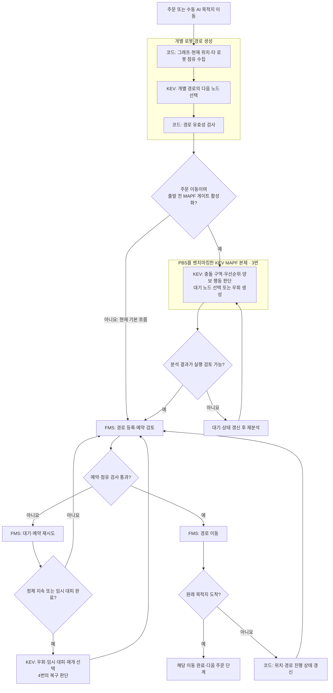
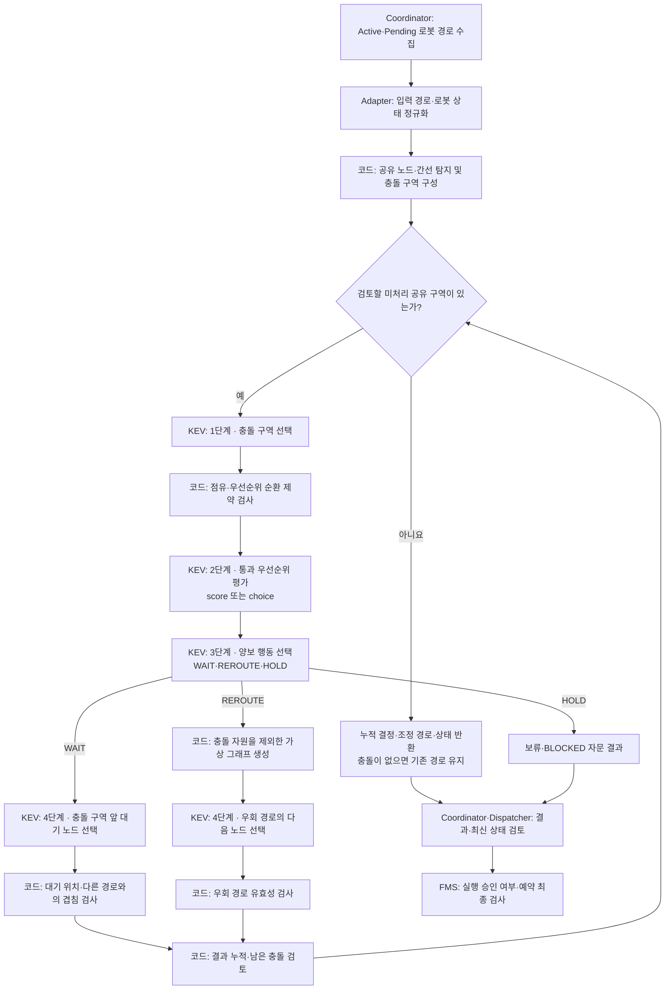
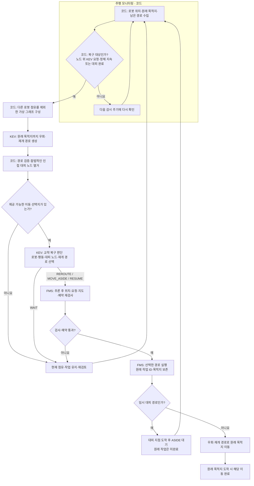

# PBS를 벤치마킹한 KEV MAPF와 주행 모니터링 구조

> 2026-10-26에 확인한 Logistics_AI 코드와 실행 설정 기준이다.
> 플로우차트에서 **KEV**라고 표시한 단계가 모델 판단을 사용하는 부분이다. **코드/FMS**는 상태 수집, 후보 구성, 검증, 예약 또는 실행을 담당한다.

## 0. 설계 의도와 계층 구분

이 프로젝트의 MAPF는 **PBS(Priority-Based Search)를 벤치마킹하여, 다중 로봇의 충돌 구역·통과 우선순위·양보 행동을 KEV가 판단하도록 구성한 KEV 기반 MAPF**다. PBS를 벤치마킹했다는 설계 의도는 사용자 설명에 근거하며, 아래 구현 구분은 실제 코드를 기준으로 한다.

문서에서 **MAPF 본체는 3번**, **주행 모니터링 및 교착 복구는 4번**을 뜻한다. 두 기능이 같은 `kev_mapf/` 폴더와 KEV 호출 클라이언트를 사용하더라도 역할은 구분한다.

| 계층 | 담당 문제 | KEV의 역할 | 주요 구현 |
| --- | --- | --- | --- |
| 개별 로봇 경로 생성 | 한 로봇이 현재 위치에서 목적지까지 갈 경로 구성 | 다음 노드 선택 | `iterative_route_runner.py`, `llm_route_preview.py` |
| **PBS를 벤치마킹한 KEV MAPF 본체** | 여러 로봇의 공유 구간을 누가 먼저 통과하고 누가 양보할지 조정 | 충돌 구역 선택 → 우선순위 평가 → 양보 행동 선택 → 대기 노드 선택 또는 우회 생성 | `kev_engine.py`, `kev_conflict.py`, `kev_client.py` |
| FMS 실행·교통 제어 | 계획을 실제 이동 가능한 예약과 이동 허가로 반영 | MAPF·복구 판단 결과를 입력으로 받음 | `traffic_manager.py` |
| 주행 모니터링 | 이동 진행·정체·임시 대피 완료 감시 | 감시 주기와 정체 판별은 코드 처리 | `main.py`, `kev_recovery.py` |
| KEV 기반 교착 복구 | 감시 중 발견한 정체에 대해 우회·대피·작업 재개 선택 | 이동할 로봇, 행동, 대피 위치와 재개 경로 선택 | `kev_recovery.py` |

개별 경로 생성은 MAPF에 경로를 제공하고, MAPF 본체는 **여러 로봇 사이의 관계**를 조정한다. 주행 모니터링은 실행 상태를 관찰하며, 교착 복구는 관찰 결과에 따라 다시 경로·행동을 결정하는 실행 중 보완 계층이다. 따라서 4번 전체를 단순 상태 표시라고 부르는 것도 정확하지 않다. **감시 부분과 KEV 복구 판단 부분이 함께 있다.**

## 1. 현재 실행 상태

| 항목 | 확인한 상태 |
| --- | --- |
| 운용 모드 | simulation / ai |
| 경로 모델 | kev-08b |
| 초기 KEV 경로 생성 | 사용 |
| PBS를 벤치마킹한 KEV MAPF 본체의 주문 출발 전 게이트 | 확인 당시 비활성: `FMS_SIM_MAPF_ENABLED` 미설정, 기본값 `0` |
| 주행 모니터링 및 KEV 교착 복구 | 사용: MAPF 본체의 출발 전 게이트 설정과 별도 실행 |

현재는 **초기 경로 생성 → FMS 실행 → 정체 발생 시 KEV 복구**가 주요 실행 흐름이다. 출발 전 4단계 MAPF 코드는 구현되어 있지만, 주문 이동에서 설정을 `1`로 켜야 해당 게이트를 거친다. 수동 AI 목적지 이동은 이 주문용 게이트를 거치지 않는다.

**MAPF를 KEV로 설계·구현했다는 사실과, 현재 실행 요청이 그 MAPF 본체를 거치는지는 별도 항목이다.** 게이트가 꺼진 상태에서 교착 복구가 성공한 결과만으로 PBS를 벤치마킹한 MAPF 본체가 실행·검증되었다고 설명하지 않는다.

## 2. 계층별 전체 플로우차트

개별 경로는 다음 노드 후보가 두 개 이상일 때 KEV를 호출한다. 후보가 한 개뿐이면 코드가 유일한 간선을 연결하므로, 경로 생성 함수를 사용했다고 매 노드에서 KEV 추론이 발생하는 것은 아니다.

전체 흐름에서 FMS의 예약·주행은 실행 계층이고, 진행 상태 갱신과 정체 확인은 모니터링 계층이다. 3번의 다중 로봇 조정과 4번의 실행 중 복구는 각각 별도의 판단 흐름이다.

## 3. PBS를 벤치마킹한 KEV MAPF 본체

### 3.1. PBS에서 참고한 개념과 KEV로 구현한 부분

PBS는 충돌을 계기로 로봇 간 부분 우선순위 관계를 확장하며 경로를 조정하는 탐색 방법이다. 원본 PBS는 우선순위 탐색 트리를 깊이 우선으로 탐색하고, 높은 우선순위 로봇의 경로를 고려해 낮은 우선순위 로봇의 경로를 재계획한다. [PBS 원 논문: Searching with Consistent Prioritization for Multi-Agent Path Finding](https://arxiv.org/html/1812.06356v1#S6)

| 구분 | PBS에서 참고한 개념 | 이 프로젝트의 KEV MAPF 구현 |
| --- | --- | --- |
| 다중 로봇 조정 | 충돌하는 로봇 사이의 통과 우선순위 관계 | 코드가 공유 노드·간선과 충돌 구역을 구성하고 KEV가 처리할 구역을 선택 |
| 우선순위 결정 | 충돌에 따라 부분 우선순위를 추가하며 탐색 | KEV의 점수 또는 선택 응답으로 선행·양보 로봇 결정, 코드가 순환 제약 검사 |
| 양보 로봇 계획 | 높은 우선순위 경로와 충돌하지 않도록 재계획 | KEV가 WAIT·REROUTE·HOLD를 선택하고 대기 노드 또는 우회 경로 결정 |
| 반복 처리 | 우선순위 관계와 경로를 갱신하며 충돌 처리 | 결정·우선순위 관계를 누적하고 우회 시 공유 구역을 재계산하여 반복 |

이 표는 **벤치마킹한 개념과 현재 구현의 대응 관계**다. WAIT·REROUTE·HOLD의 4단계 질의를 원본 PBS의 절차라고 설명하지 않는다. 현재 `KevMAPF.resolve()`는 KEV가 선택한 결과를 반복 반영하는 구조이며, 원본 PBS의 양방향 우선순위 분기·탐색 트리·백트래킹 전체를 그대로 구현한 것으로 표현하지 않는다.

따라서 문서상 명칭은 **「PBS를 벤치마킹한 KEV 기반 MAPF」**로 통일한다. 이는 설계의 출발점과 KEV가 담당하는 판단을 함께 나타낸다.

### 3.2. KEV MAPF 본체의 4단계 판단 플로우차트

> 현재 주문 출발 전에 연결되는 선택적 게이트의 내부 구조다. 확인 당시 해당 게이트는 비활성이므로 실행 중인 모든 요청이 이 흐름을 거치는 것은 아니다.

- 충돌 탐지와 후보 구성은 코드다. KEV는 주어진 구역·로봇·행동·대기 노드 선택지에서 판단한다.
- 본체는 경로의 공유 노드·간선에 따른 잠재 충돌을 조정하며, 반환값은 `time_prediction_used=False`다. 실제 시간 예약과 이동 허가는 FMS 계층에서 검사한다.
- 기본 `score` 방식에서는 KEV가 로봇별 점수를 반환하고 코드가 점수에 따라 우선순위를 정한다. 동점 처리 등에는 코드 규칙이 남아 있다.
- 충돌 구역을 이미 점유한 로봇이 있으면 코드가 가능한 선행·양보 관계를 제한한다. 따라서 모든 상황에서 우선순위의 양방향 선택을 KEV에 제공하는 것은 아니다.
- 점유 충돌, 우선순위 순환, 최대 반복 횟수 등으로 모델 호출 전에 보류될 수 있다.
- `LiveKEV.pick()`의 후보가 한 개이면 KEV API를 호출하지 않는다.
- 우회 생성 실패 시 가능한 대기 또는 보류로 처리할 수 있다. A* 경로를 모델 결과 대신 사용하는 대체 기능은 제거된 상태다.
- 결과는 자문이며 `fms_execution_approved`는 `False`다. 실제 이동은 FMS 검사를 거쳐야 한다.

## 4. 주행 모니터링 및 KEV 기반 교착 복구

> 3번의 PBS를 벤치마킹한 MAPF 본체와 구분하는 실행 중 보완 계층이다. 시뮬레이션에서 노드 위에 대기 중인 등록된 KEV 요청을 대상으로 하며, MAPF 본체의 출발 전 게이트와 독립적으로 실행된다.

### 4.1. 모니터링과 복구 판단의 경계

| 구분 | 하는 일 | 판단 주체 |
| --- | --- | --- |
| 주행 모니터링 | 위치·남은 경로·진행 변화 수집, 정체 지속 또는 임시 대피 완료 확인 | 코드 |
| 복구 후보 구성 | 점유를 제외한 가상 그래프 구성, 합법적인 대피 후보 열거 | 코드 |
| 교착 복구 판단 | 우회·재개 경로 생성, 이동할 로봇·대피 위치·재개 행동 선택 | KEV |
| 복구 실행 | 최신 상태·예약 재검사, 경로 교체와 이동 수행 | FMS |

사진 상황에서 수행한 **R-03 임시 대피 후 원래 목적지로 재개**는 이 4번 계층의 동작이다. 이를 3번 MAPF 본체의 PBS 벤치마킹 동작과 혼합해 설명하지 않는다.

### 4.2. 주행 모니터링에서 KEV 교착 복구까지의 흐름

복구 프롬프트는 `RECOVERY_INSTRUCTIONS`다. 전체 로봇의 점유, 목적지, 남은 경로와 이전 결정을 보고, 어떤 로봇을 어디로 이동시킬지 KEV가 고르게 한다. 코드가 어느 대피가 교착을 푸는지 계산해 우선순위를 정하거나 특정 로봇으로 선택을 덮어쓰지는 않는다.

다만 선택지 자체는 코드가 구성한다. 현재 임시 대피는 한 간선으로 연결된 빈 대기/통과 노드를 제공하며, 점유 노드·다른 요청의 목적지 등의 제약을 적용한다. KEV가 제한 없이 새 좌표나 임의의 전체 계획을 출력하는 구조는 아니다.

감시 주기는 0.2초, 기본 정체 판단 시간은 1초, 실패·대기 후 재검토 간격은 5초다. 예약 시간만 갱신되는 것은 물리적 진행으로 간주하지 않는다. 추론 후에는 최신 예약표로 다시 검사한다.

## 5. 실제 KEV 서버 호출 흐름

| 계층 | 실제 판단 | 소스 위치: 저장소 기준 | 호출 형태 |
| --- | --- | --- | --- |
| 개별 경로 생성: MAPF·복구에서도 재사용 | 초기·우회·재개 경로의 다음 노드 | `backend/app/services/iterative_route_runner.py:200` | `selector.select_choice()` |
| 실행 중 교착 복구: 4번 | 로봇·행동·대피 위치·재개 선택 | `backend/app/services/kev_mapf/kev_recovery.py:204` | `selector.select_choice()` |
| KEV MAPF 본체: 3번 | 충돌 구역 선택 | `backend/app/services/kev_mapf/kev_engine.py:251` | `LiveKEV.pick()` |
| KEV MAPF 본체: 3번 | 우선순위 점수 | `backend/app/services/kev_mapf/kev_engine.py:322` | `LiveKEV.score_many()` |
| KEV MAPF 본체: 3번 | 우선순위 직접 선택 | `backend/app/services/kev_mapf/kev_engine.py:328` | `LiveKEV.pick()` |
| KEV MAPF 본체: 3번 | 양보 행동 선택 | `backend/app/services/kev_mapf/kev_engine.py:513` | `LiveKEV.pick()` |
| KEV MAPF 본체: 3번 | 대기 노드 선택 | `backend/app/services/kev_mapf/kev_engine.py:354` | `LiveKEV.pick()` |
| 공통 KEV 클라이언트 | 실제 HTTP 전송 | `backend/app/services/route_selector/kev_selector.py:120` | `/v1/systemone` 요청 |

## 6. 모듈 역할

| 모듈 | 역할 |
| --- | --- |
| `kev_dispatcher.py` | 주문의 경로 준비·출발 전 MAPF 실행 게이트 |
| `kev_coordinator.py` | Active·Pending 경로 수집, 변경 감지, 결과 검토 |
| `kev_adapter.py` | 주문·경로 데이터를 MAPF 입력으로 변환 |
| `kev_graph.py` | 그래프 해석, 가상 그래프 구성, 경로 검사 |
| `kev_conflict.py` | 공유 자원·충돌 구역·우선순위 순환 검사 |
| `kev_engine.py` | PBS를 벤치마킹한 KEV MAPF 본체: 4단계 다중 로봇 조정 |
| `kev_client.py` | 출발 전 MAPF용 KEV 클라이언트·프롬프트 |
| `kev_recovery.py` | 주행 모니터링 및 별도 KEV 교착 복구: 정체 감시·임시 대피·재개 연결 |
| `kev_traffic.py` | 다른 로봇의 점유·남은 경로 수집 |
| `route_selector/kev_selector.py` | 실제 KEV 서버 요청과 응답 검증 |
| `traffic_manager.py` | 예약·이동 허가·정지 후 경로 교체·도착 처리 |

`kev_mapf_standalone.py`와 `fms_mapf_coordinator.py`는 기존 import 경로를 유지하는 호환용 창구다. `backend/app/services/kev_mapf/`에는 MAPF 본체와 실행 중 복구 모듈이 함께 들어 있다. **폴더명이 같다는 이유로 `kev_recovery.py`까지 PBS를 벤치마킹한 MAPF 본체로 분류하지 않는다.**

## 7. 코드에 남아 있는 판단과 검증 범위

현재 시스템 전체가 KEV 추론만으로 동작하는 것은 아니다. 다음은 코드에 남아 있다.

- 복구 대상 판별, 정체 감지와 호출 시간 제어.
- 대피 노드 범위와 인접 노드 제한, 점유·목적지 제외, 그래프 연결 검사.
- FMS의 작업 우선순위·접수 순서에 따른 예약 재시도 순서와 시간표 작성.
- 충돌 검사, 요청 변경·취소 검사, 실제 이동 허가와 도착 처리.
- 배차·작업대 선택 등 이번 교착 복구 변경 범위 밖의 기존 기능.

따라서 전체 구조는 **PBS를 벤치마킹한 KEV MAPF가 다중 로봇의 우선순위·양보 계획을 조정하고, FMS가 검증·실행하며, 별도 주행 모니터링 및 KEV 교착 복구가 실행 중 정체에 대응하는 구조**다. 코드에 상태 수집·제약 검사·실행 처리가 있다는 사실과, MAPF의 의사결정에 KEV를 사용한다는 사실은 함께 기술한다.

실제 `kev-08b`로 두 사진의 배치와 추가 3대 순환 교착을 독립 시뮬레이션에서 검증했으며 모두 원래 목적지에 도착했다. 관련 테스트 84개가 통과했다. 이는 해당 배치의 검증 결과이며 모든 그래프에서의 교착 해소나 최적성을 보장하는 결과는 아니다.

이 중 사진 배치의 실제 KEV 대피·재개 기록은 **4번 실행 중 교착 복구의 검증 근거**다. 84개는 MAPF·예약·주문·복구를 포함한 관련 테스트 묶음이며, 이를 3번 MAPF 본체만의 실제 KEV 검증 건수나 PBS 대비 성능 벤치마크로 해석하지 않는다. PBS 원 알고리즘과의 정량 성능 비교 결과는 이 문서의 검증 자료에 포함되어 있지 않다.

- 검증 실행: `tools/verify_kev_recovery.py`
- 모델 입력·프롬프트·실제 선택 기록: `docs/kev_prompt_validation.json`
- 자동 테스트: `tests/test_kev_recovery.py`
