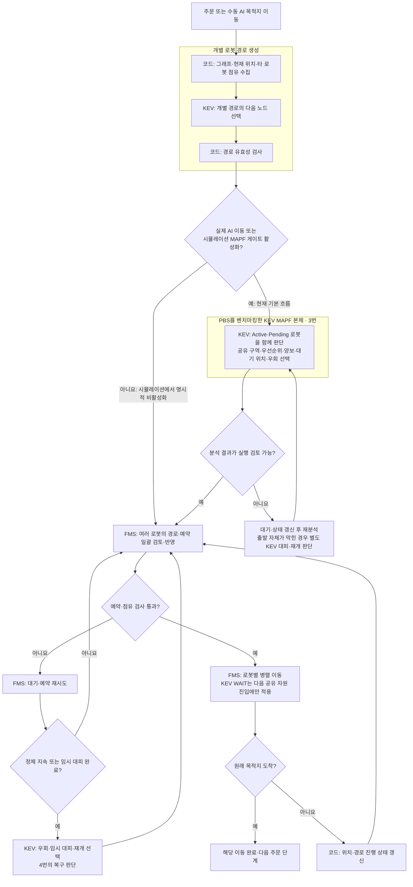
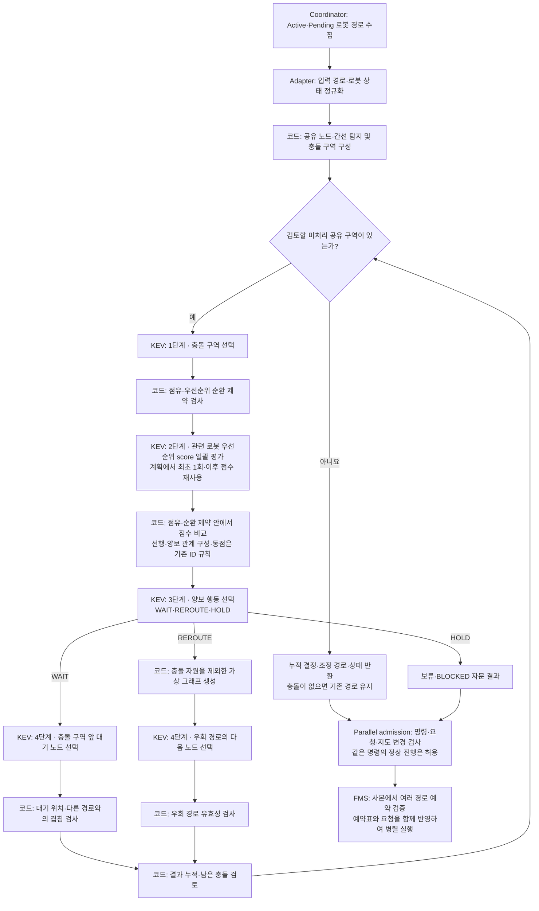
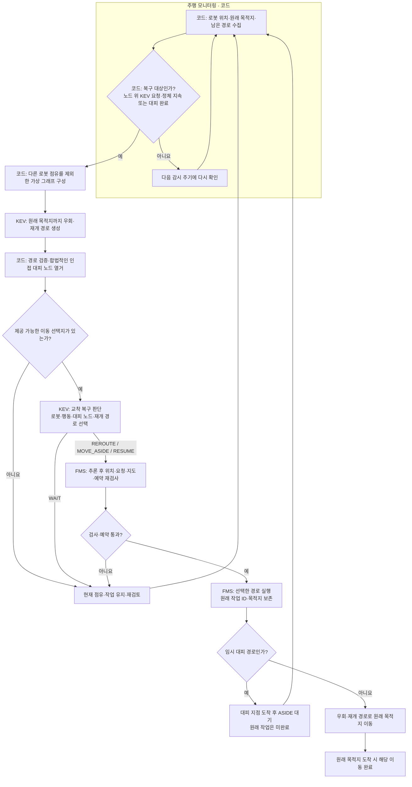
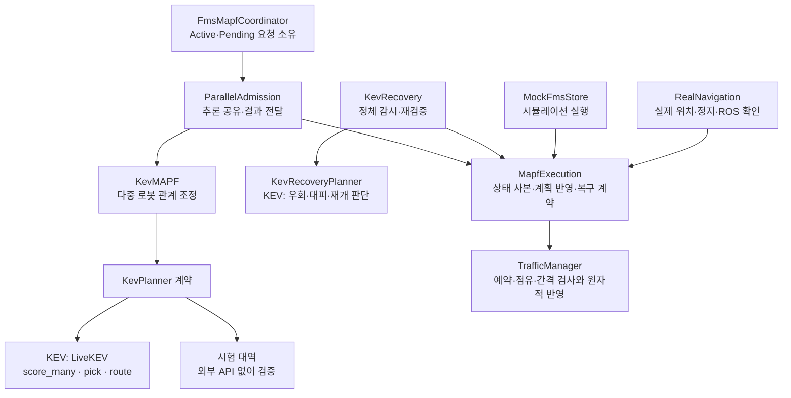

# PBS를 벤치마킹한 KEV MAPF와 주행 모니터링 구조

> 2026-10-26에 확인한 Logistics_AI 코드와 실행 설정 기준이다.
> 플로우차트에서 **KEV**라고 표시한 단계가 모델 판단을 사용하는 부분이다. **코드/FMS**는 상태 수집, 후보 구성, 검증, 예약 또는 실행을 담당한다.

## 0. 설계 의도와 계층 구분

이 프로젝트의 MAPF는 **PBS(Priority-Based Search)를 벤치마킹하여, 다중 로봇의 충돌 구역·통과 우선순위·양보 행동을 KEV가 판단하도록 구성한 KEV 기반 MAPF**다.
문서에서 **MAPF 본체는 3번**, **주행 모니터링 및 교착 복구는 4번**을 뜻한다. 두 기능이 같은 `kev_mapf/` 폴더와 KEV 호출 클라이언트를 사용하더라도 역할은 구분한다.

| 계층                         | 담당 문제                               | KEV의 역할                                           | 주요 구현                                               |
| -------------------------- | ----------------------------------- | ------------------------------------------------- | --------------------------------------------------- |
| 개별 로봇 경로 생성                | 한 로봇이 현재 위치에서 목적지까지 갈 경로 구성         | 다음 노드 선택                                          | `iterative_route_runner.py`, `llm_route_preview.py` |
| **PBS를 벤치마킹한 KEV MAPF 본체** | 여러 로봇의 공유 구간을 누가 먼저 통과하고 누가 양보할지 조정 | 충돌 구역 선택 → 우선순위 평가 → 양보 행동 선택 → 대기 노드 선택 또는 우회 생성 | `kev_engine.py`, `kev_conflict.py`, `kev_client.py` |
| FMS 실행·교통 제어               | 계획을 실제 이동 가능한 예약과 이동 허가로 반영         | MAPF·복구 판단 결과를 입력으로 받음                            | `traffic_manager.py`                                |
| 주행 모니터링                    | 이동 진행·정체·임시 대피 완료 감시                | 감시 주기와 정체 판별은 코드 처리                               | `main.py`, `kev_recovery.py`                        |
| KEV 기반 교착 복구               | 감시 중 발견한 정체에 대해 우회·대피·작업 재개 선택      | 이동할 로봇, 행동, 대피 위치와 재개 경로 선택                       | `kev_recovery.py`                                   |

개별 경로 생성은 MAPF에 경로를 제공하고, MAPF 본체는 **여러 로봇 사이의 관계**를 조정한다. 주행 모니터링은 실행 상태를 관찰하며, 교착 복구는 관찰 결과에 따라 다시 경로·행동을 결정하는 실행 중 보완 계층이다. 따라서 4번 전체를 단순 상태 표시라고 부르는 것도 정확하지 않다. **감시 부분과 KEV 복구 판단 부분이 함께 있다.**

## 1. 현재 실행 상태

| 항목                           | 확인한 상태                                               |
| ---------------------------- | ---------------------------------------------------- |
| 운용 모드                        | simulation / ai                                      |
| 경로 모델                        | kev-08b                                              |
| 초기 KEV 경로 생성                 | 사용                                                   |
| PBS를 벤치마킹한 KEV MAPF 출발 전 게이트 | 활성: `FMS_SIM_MAPF_ENABLED=1`, 코드 기본값도 `1`            |
| MAPF 적용 진입점                  | 실제·시뮬레이션 주문 이동 및 수동 AI 목적지 이동 모두 같은 게이트 사용              |
| MAPF 우선순위 판단                 | `FMS_MAPF_PRIORITY_MODE=score` 전용: 관련 로봇의 KEV 점수를 한 요청에서 평가·재사용 |
| 주행 모니터링 및 KEV 교착 복구          | 사용: MAPF 본체의 출발 전 게이트 설정과 별도 실행                      |
| 실로봇의 기본 주행·개별 AI 경로 | ROS 주행 연결과 KEV 개별 경로 전달 코드가 있음. 현장 운용 검증 결과는 이 문서에 없음 |
| 실로봇의 KEV MAPF·자동 교착 복구 | 공통 실행 계약으로 연결. 실제 KEV + ROS/위치 대역 재생 검증 완료, 물리 로봇 현장 시험은 미수행 |

현재 흐름은 **초기 KEV 경로 생성 → 출발 전 KEV MAPF → 여러 경로·예약 일괄 반영 → 로봇별 병렬 실행 → 필요 시 KEV 복구**다. 주문과 수동 AI 목적지 이동이 모두 `dispatch_mapf()`를 호출한다. 단독 요청이며 타 로봇 점유 문제가 없으면 모델의 다중 로봇 판단은 생략한다. 준비된 여러 요청에는 같은 KEV 판단을 함께 반영하며, 정상적으로 이동 중인 로봇도 분석에 포함한다.

현재 설정은 `/api/mode`의 `simulation_mapf_enabled=true`, `mapf_priority_mode=score`와 이동 응답의 `mapf`로 확인한다. 우선순위의 선택형 실행 분기와 프롬프트는 제거했으며 `score`만 지원한다.

실로봇 AI 이동도 `dispatch_mapf()`를 거쳐 `RealNavigation.mapf`에 연결한다. real AI 게이트는 항상 사용하며, 시뮬레이션의 명시적 비활성화 설정과 구분한다. KEV 판단 결과를 `MapfExecution`이 받아 정지·최신 위치·연결·주문 변경을 검증하고 `TrafficManager`가 예약을 검사한다. 승인된 다음 한 구간만 ROS Action으로 전달하며, 성공 결과와 실제 수신 위치가 함께 확인되어야 다음 구간으로 진행한다. 취소 중에는 기존 예약을 유지한다.

`real_available`은 ROS 노드 초기화 여부이며 모든 로봇의 준비 완료를 뜻하지 않는다. 요청마다 등록 상태와 위치 신선도를 별도로 검사한다. **실제 로봇의 현장 운용 검증은 아직 수행하지 않았다.**

## 2. 계층별 전체 플로우차트

개별 경로는 다음 노드 후보가 두 개 이상일 때 KEV를 호출한다. 후보가 한 개뿐이면 코드가 유일한 간선을 연결하므로, 경로 생성 함수를 사용했다고 매 노드에서 KEV 추론이 발생하는 것은 아니다.

전체 흐름에서 FMS의 예약·주행은 실행 계층이고, 진행 상태 갱신과 정체 확인은 모니터링 계층이다. 3번의 다중 로봇 조정과 4번의 실행 중 복구는 각각 별도의 판단 흐름이다.

## 3. PBS를 벤치마킹한 KEV MAPF 본체

### 3.1. PBS에서 참고한 개념과 KEV로 구현한 부분

PBS는 충돌을 계기로 로봇 간 부분 우선순위 관계를 확장하며 경로를 조정하는 탐색 방법이다. 원본 PBS는 우선순위 탐색 트리를 깊이 우선으로 탐색하고, 높은 우선순위 로봇의 경로를 고려해 낮은 우선순위 로봇의 경로를 재계획한다. [PBS 원 논문: Searching with Consistent Prioritization for Multi-Agent Path Finding](https://arxiv.org/html/1812.06356v1#S6)

| 구분 | PBS에서 참고한 개념 | 이 프로젝트의 KEV MAPF 구현 |
| --- | --- | --- |
| 다중 로봇 조정 | 충돌하는 로봇 사이의 통과 우선순위 관계 | 코드가 공유 노드·간선과 충돌 구역을 구성하고 KEV가 처리할 구역을 선택 |
| 우선순위 결정 | 충돌에 따라 부분 우선순위를 추가하며 탐색 | KEV의 일괄 점수 응답으로 선행·양보 로봇 결정, 코드가 순환 제약 검사 |
| 양보 로봇 계획 | 높은 우선순위 경로와 충돌하지 않도록 재계획 | KEV가 WAIT·REROUTE·HOLD를 선택하고 대기 노드 또는 우회 경로 결정 |
| 반복 처리 | 우선순위 관계와 경로를 갱신하며 충돌 처리 | 결정·우선순위 관계를 누적하고 우회 시 공유 구역을 재계산하여 반복 |

이 표는 **벤치마킹한 개념과 현재 구현의 대응 관계**다. WAIT·REROUTE·HOLD의 4단계 질의를 원본 PBS의 절차라고 설명하지 않는다. 현재 `KevMAPF.resolve()`는 KEV가 선택한 결과를 반복 반영하는 구조이며, 원본 PBS의 양방향 우선순위 분기·탐색 트리·백트래킹 전체를 그대로 구현한 것으로 표현하지 않는다.

따라서 문서상 명칭은 **「PBS를 벤치마킹한 KEV 기반 MAPF」**로 통일한다. 이는 설계의 출발점과 KEV가 담당하는 판단을 함께 나타낸다.

### 3.2. KEV MAPF 본체의 4단계 판단 플로우차트

> 주문과 수동 AI 목적지 이동의 출발 전에 기본 활성화된 게이트의 내부 구조다. KEV가 단독 요청의 다중 로봇 판단까지 호출하는 것은 아니다.

- 충돌 탐지와 후보 구성은 코드다. KEV는 주어진 구역·로봇·행동·대기 노드 선택지에서 판단한다.
- 본체는 경로의 공유 노드·간선에 따른 잠재 충돌을 조정하며, 반환값은 `time_prediction_used=False`다. 실제 시간 예약과 이동 허가는 FMS 계층에서 검사한다.
- 현재 우선순위는 `score` 전용이다. `LiveKEV.score_many()`가 관련 로봇의 점수를 한 API 요청에서 평가하며, 같은 계획의 여러 충돌 쌍에 재사용한다. 코드가 점수와 제약을 통과 관계로 변환하며 동점은 기존 로봇 ID 규칙을 사용한다. 우선순위의 `choice` 옵션과 프롬프트는 제거했다.
- 충돌 구역을 이미 점유한 로봇이 있으면 코드가 가능한 선행·양보 관계를 제한한다. 따라서 모든 상황에서 우선순위의 양방향 선택을 KEV에 제공하는 것은 아니다.
- 점유 충돌, 우선순위 순환, 최대 반복 횟수 등으로 모델 호출 전에 보류될 수 있다.
- `LiveKEV.pick()`의 후보가 한 개이면 KEV API를 호출하지 않는다.
- 우회 생성 실패 시 가능한 대기 또는 보류로 처리할 수 있다. A* 경로를 모델 결과 대신 사용하는 대체 기능은 제거된 상태다.
- 결과는 자문이며 `fms_execution_approved`는 `False`다. 실제 이동은 FMS 검사를 거쳐야 한다.

## 4. 주행 모니터링 및 KEV 기반 교착 복구

> 3번의 PBS를 벤치마킹한 MAPF 본체와 구분하는 실행 중 보완 계층이다. 실제·시뮬레이션에서 노드 위에 대기 중인 등록된 KEV 요청을 대상으로 하며, MAPF 본체의 출발 전 게이트와 독립적으로 실행된다.

### 4.1. 모니터링과 복구 판단의 경계

| 구분 | 하는 일 | 판단 주체 |
| --- | --- | --- |
| 주행 모니터링 | 위치·남은 경로·진행 변화 수집, 정체 지속 또는 임시 대피 완료 확인 | 코드 |
| 복구 후보 구성 | 점유를 제외한 가상 그래프 구성, 합법적인 대피 후보 열거 | 코드 |
| 교착 복구 판단 | 우회·재개 경로 생성, 이동할 로봇·대피 위치·재개 행동 선택 | KEV |
| 복구 실행 | 최신 상태·예약 재검사, 경로 교체와 이동 수행 | FMS |

사진 상황에서 수행한 **R-03 임시 대피 후 원래 목적지로 재개**는 이 4번 계층의 동작이다. 이를 3번 MAPF 본체의 PBS 벤치마킹 동작과 혼합해 설명하지 않는다.

### 4.2. 주행 모니터링에서 KEV 교착 복구까지의 흐름

복구 프롬프트는 `RECOVERY_INSTRUCTIONS`다. 전체 로봇의 점유, 목적지, 남은 경로와 이전 결정을 보고, 어떤 로봇을 어디로 이동시킬지 KEV가 고르게 한다. 코드가 어느 대피가 교착을 푸는지 계산해 우선순위를 정하거나 특정 로봇으로 선택을 덮어쓰지는 않는다.

다만 선택지 자체는 코드가 구성한다. 현재 임시 대피는 한 간선으로 연결된 빈 대기/통과 노드를 제공하며, 점유 노드·다른 요청의 목적지 등의 제약을 적용한다. KEV가 제한 없이 새 좌표나 임의의 전체 계획을 출력하는 구조는 아니다.

감시 주기는 0.2초, 기본 정체 판단 시간은 1초, 실패·대기 후 재검토 간격은 5초다. 예약 시간만 갱신되는 것은 물리적 진행으로 간주하지 않는다. 추론 후에는 최신 예약표로 다시 검사한다.

### 4.3. 출발 보류 요청을 복구 판단에 포함하는 연결

이미 서로의 출발 노드를 점유한 배치에서는 3번 MAPF가 전부를 보류할 수 있다. 이때 아직 FMS 주행 요청이 없어 주행 중 복구만으로는 시작할 수 없던 연결 문제를 보완했다.

`kev_admission_recovery.py`는 Pending 요청의 원래 목적지·계획 경로를 현재 로봇 상태와 함께 KEV의 복구 판단에 전달한다. 실제 FMS 상태는 선택 전까지 IDLE로 유지한다. KEV가 **PROCEED·MOVE_ASIDE·RESUME·REROUTE·WAIT** 중 주어진 행동을 선택하며, FMS는 최신 상태·요청 일치와 예약을 검증한다. 특정 로봇이나 대피 노드를 코드가 강제하지 않는다.

임시 대피는 `start_required_path_maneuver()`로 선택된 임시 경로만 예약하고 원래 목적지를 보존한다. 원래 보류 경로를 실행 허가 없이 전달하는 방식이 아니다. 출발 전 MAPF와 별도 복구 판단은 HTTP 응답의 `MIXED_ACTIVE_PENDING` 및 `KEV_PENDING_RECOVERY`로 구분되며, 후자에는 가능한 경우 직전 MAPF 보류 결과도 함께 기록한다.

## 5. 실제 KEV 서버 호출 흐름

| 계층 | 실제 판단 | 소스 위치: 저장소 기준 | 호출 형태 |
| --- | --- | --- | --- |
| 개별 경로 생성: MAPF·복구에서도 재사용 | 초기·우회·재개 경로의 다음 노드 | `backend/app/services/iterative_route_runner.py` | `selector.select_choice()` |
| 실행 중·출발 보류 교착 복구: 4번 | 로봇·행동·대피 위치·재개 선택 | `backend/app/services/kev_mapf/kev_recovery.py` | `selector.select_choice()` |
| KEV MAPF 본체: 3번 | 충돌 구역 선택 | `backend/app/services/kev_mapf/kev_engine.py` | `LiveKEV.pick()` |
| KEV MAPF 본체: 3번 | 우선순위 점수: score 전용 | `backend/app/services/kev_mapf/kev_engine.py` | `LiveKEV.score_many()` |
| KEV MAPF 본체: 3번 | 양보 행동 선택 | `backend/app/services/kev_mapf/kev_engine.py` | `LiveKEV.pick()` |
| KEV MAPF 본체: 3번 | 대기 노드 선택 | `backend/app/services/kev_mapf/kev_engine.py` | `LiveKEV.pick()` |
| 공통 KEV 클라이언트 | 실제 HTTP 전송 | `backend/app/services/route_selector/kev_selector.py` | `/v1/systemone` 요청 |

## 6. 모듈 역할

| 모듈 | 역할 |
| --- | --- |
| `kev_dispatcher.py` | 주문·수동 AI 이동 공통 경로 준비와 출발 전 MAPF 실행 게이트 |
| `kev_parallel_admission.py` | 이동 중 Active 모델링, 공통 KEV 판단의 여러 Pending 경로 일괄 반영, 명령 식별자로 추론 검증 |
| `kev_coordinator.py` | Active·Pending 경로 수집, 변경 감지, 결과 검토 |
| `kev_adapter.py` | 주문·경로 데이터를 MAPF 입력으로 변환 |
| `kev_graph.py` | 그래프 해석, 가상 그래프 구성, 경로 검사 |
| `kev_conflict.py` | 공유 자원·충돌 구역·우선순위 순환 검사 |
| `kev_engine.py` | PBS를 벤치마킹한 KEV MAPF 본체: 4단계 다중 로봇 조정 |
| `kev_client.py` | 출발 전 MAPF용 KEV 클라이언트·프롬프트 |
| `kev_recovery.py` | `KevRecovery`: 정체 감시·재검증·반영, `KevRecoveryPlanner`: 별도 KEV 복구 판단 |
| `mapf_execution.py` | 실제·모의 실행 공통 계약: 상태 사본, 잠금 경계, 예약 반영, 복구 |
| `real_navigation.py` | ROS 준비·실제 위치·실제 정지 확인, 승인된 구간별 Action 실행 |
| `kev_admission_recovery.py` | MAPF 출발 보류 요청을 KEV 복구 판단에 연결하고 선택된 경로만 FMS에 반영 |
| `kev_traffic.py` | 다른 로봇의 점유·남은 경로 수집 |
| `route_selector/kev_selector.py` | 실제 KEV 서버 요청과 응답 검증 |
| `traffic_manager.py` | 예약·이동 허가·정지 후 경로 교체·도착 처리 |

운용 코드는 `backend/app/services/kev_mapf/`의 실제 모듈을 직접 참조한다. 테스트만 사용하던 이전 호환 모듈 두 개는 제거했다. `backend/app/services/kev_mapf/`에는 MAPF 본체와 실행 중 복구 모듈이 함께 들어 있다. **폴더명이 같다는 이유로 `kev_recovery.py`까지 PBS를 벤치마킹한 MAPF 본체로 분류하지 않는다.**

## 7. 코드에 남아 있는 제약과 실행 책임

KEV는 우선순위 점수와 구역·행동·대기 위치·경로를 판단한다. 다음 처리는 코드/FMS가 담당한다.

- 공유 노드·간선 탐지, 합법적인 후보 구성, 정체 감지와 호출 주기 제어.
- 점유·연결·그래프 경로·우선순위 순환·물리 간격·예약 검사.
- KEV 점수의 비교와 기존 로봇 ID 동점 규칙 적용.
- 요청 변경·취소·지도 변경 감지와 오래된 추론 폐기.
- 여러 경로·예약의 일괄 반영, 로봇별 이동과 도착 처리.
- 배차·작업대 선택 등 기존 FMS 업무 처리.

우선순위 평가는 관련 로봇의 질문을 `score_many()` 한 요청에 묶고 같은 MAPF 계획 안에서 재사용한다. `mapf.priority_scores`로 실제 점수를, `metrics.kev_api_calls`·`kev_score_calls`·`kev_choice_calls`로 호출 수를 확인한다. 점수는 KEV가 반환한 원래 값이며 확률이나 백분율을 뜻하지 않는다.

구역·양보 행동·대기 위치·경로·복구 행동은 범주 후보 중 하나를 고르는 `choice`를 사용한다. 후보 여러 개를 한 질문에 넣는 방식이라 로봇 쌍별 우선순위 호출과 다르며, 경로와 MAPF 선택에 후보가 하나뿐이면 모델 호출을 생략한다.

따라서 **PBS를 벤치마킹한 KEV MAPF가 다중 로봇의 관계를 조정하고, FMS가 검증·실행하며, 별도 모니터링 및 KEV 교착 복구가 실행 중 정체에 대응한다.** 원본 PBS 대비 정량 성능 벤치마크나 모든 그래프에서의 교착 해소 보장은 이 문서의 검증 범위에 포함되지 않는다.

## 8. 병렬 실행과 공유 자원별 WAIT

현재는 `kev_parallel_admission.py`가 한 번의 KEV 판단에 포함된 Pending 로봇들을 함께 FMS에 등록한다. FMS 사본에서 예약을 검증하고, 기존 예약표가 바뀌지 않았을 때 경로·예약을 한 번에 반영한다. 같은 판단을 공유한 응답에는 동일한 `plan_id`, 분석 입력의 `input_paths`, `MIXED_ACTIVE_PENDING_PARALLEL`이 기록된다.

Active의 간선 진입·위치·진행 인덱스 변화는 같은 명령의 정상 진행으로 취급한다. 새 명령·취소·경로 교체·연결 상태·지도·Pending 요청 ID 변경은 계속 거부한다. 간선 위 Active는 현재 간선의 출발 노드를 기준으로 한 잔여 경로와 `occupied_edge`, `execution_committed`를 KEV에 전달하며, 실제 위치는 FMS가 최신 값으로 검증한다.

KEV가 선택한 선행·양보 관계는 `mapf_wait_for`로 실행된다. **후행 로봇의 다음 노드·간선에 대해서만 선행 로봇의 통과 여부를 검사**한다. 같은 그룹의 다른 자원을 사용하고 있거나 아직 업무 목적지에 도착하지 않았다는 이유만으로 전체 로봇을 묶어 두지 않는다. 순서 자체는 KEV 판단을 사용하고, FMS는 그 순서와 예약·점유를 검증한다.

## 9. KEV MAPF의 객체지향 책임 경계

이번 정리 범위는 KEV MAPF와 연결되는 실행 경계다. FMS 전체를 재설계한 것은 아니다.

| 객체·계약 | 소유하는 책임 | 외부에서 사용하지 않는 내부 상태 |
| --- | --- | --- |
| `KevMAPF` / `KevPlanner` | MAPF 본체와 주입된 KEV 판단 계약: `score_many`, `pick`, `route` | 엔진이 구체적인 LiveKEV/시험 대역 타입을 검사해 분기하지 않음 |
| `FmsMapfCoordinator(store)` | 주입된 실행기의 Active·Pending 요청, 등록·교체·완료 처리 | 요청 딕셔너리는 복사본으로 조회. 외부에서 직접 수정하지 않음 |
| `ParallelAdmission` | cohort 추론 단일 실행, 요청 검증 콜백, 요청별 응답·실패 재시도 상태 | dispatcher가 내부 잠금·캐시·응답 딕셔너리에 직접 접근하지 않음 |
| `KevRecovery` | 정체 시간·중복 실행 감시, 추론 전후 재검증, 복구 적용 | KEV 판단은 주입된 `KevRecoveryPlanner`에 위임 |
| `KevRecoveryPlanner` | 합법적인 후보 구성, KEV 우회·대피·재개 판단 | 로봇·예약표 변경 권한 없음. 경로 생성기·선택기를 주입해 검증 가능 |
| `MapfExecution` | 실제·모의 실행 공통의 `transaction`, `snapshot`, `commit_routes`, `recover` | MAPF가 저장소의 로봇·TrafficManager 내부 필드에 직접 접근하지 않음 |
| `TrafficManager` | 예약표·로봇 계획 상태, 사본 예약 검증과 원자적 교체 | 예약 CAS 실패 시 로봇과 MAPF 요청 상태 모두 유지 |

- **단일 책임:** MAPF 본체, 요청 관리, 병렬 배차 상태, 정체 감시, KEV 복구 판단, 실행 반영을 구분했다.
- **의존성 역전·교체 가능성:** 코디네이터는 실행기를 주입받고, 엔진은 `KevPlanner` 계약을 사용한다. 실제·모의 실행은 같은 `MapfExecution` 연산을 사용한다. `runtime_for()`만 운용 모드에 맞는 구체 객체를 구성한다.
- **캡슐화:** 상태 사본을 수정해도 원본이 바뀌지 않으며, 실행 변경은 소유자의 메서드와 공통 잠금 경계를 거친다. 복구도 요청 상태를 공개 메서드로 교체한다.
- **필요한 계약만 유지:** 범용 플러그인 프레임워크나 새 운용 설정을 추가하지 않았다. 로봇·주문 DTO는 기존 딕셔너리 형식을 유지한다.

우선순위는 계속 KEV `score` 한 번으로 평가한다. 이 구조 변경이 로봇 통과 순서·대피 위치를 코드로 정하게 만드는 것은 아니다. 경로의 합법성·정지 확인·예약 검사는 실행기의 책임으로 유지한다.

## 10. 주문 순차 실행의 원인과 수정

앞선 OOP 정리 뒤의 주문 시험은 완료됐지만 최대 동시 이동이 1대였다. 이를 병렬 이동 검증 완료로 해석하면 안 된다. 실제 주문 경로에서 다음 두 조건이 병렬 실행을 막고 있었다.

| 원인 | 수정 | 보존한 검사 |
| --- | --- | --- |
| 픽업·작업대 도착 확인에서 수행한 정지의 `stop_requested=True`를 새 Pending 요청도 거부하는 조건으로 사용. 병렬 배차가 실패하고 개별 검토·배차로 전환됨 | 모의 로봇의 정지 명령마다 `command_epoch` 증가. 새 경로를 준비할 때 해당 번호를 `execution_epoch`로 묶고, 이미 정지가 확인된 IDLE 로봇의 새 요청은 병렬 판단에 포함 | 추론 중 추가 정지·취소가 오면 번호 변경으로 폐기. real에서는 ROS 실행 종료·정지·위치 준비 검사를 그대로 유지 |
| 픽업 목록이 겹치는 이전 주문이 `IN_PROGRESS`인 동안 다음 주문을 보류. 이전 로봇이 픽업을 떠나 작업대로 가도 계속 대기 | 픽업 단계마다 현재 픽업에 대한 작업·대기와 실제 노드 점유만 검사. 이전 주문의 작업대 작업·복귀를 기다리지 않음 | 같은 픽업 작업과 실제 노드 점유 중의 대기는 유지. 통로·노드 진입은 KEV 관계와 FMS 예약으로 검사 |

이 수정은 KEV 점수나 통과 순서를 코드로 덮어쓰지 않는다. KEV가 판단하기 전에 정상 요청을 배제하던 조건과, 관계없는 주문 단계까지 기다리던 업무 게이트를 바로잡았다.

### 10.1. 실제 KEV + 실행 중 FMS 주문 시험

| 측정 항목 | 수정 전 시험 | 수정 후 시험 |
| --- | ---: | ---: |
| 최대 동시 이동 로봇 | 1대 | 3대 |
| 2대 이상 이동 겹침 | 0.00초 | 25.08초 |
| 3대 이동 겹침 | 0.00초 | 2.09초 |
| 주문 3개 및 스테이션 복귀 | 완료 | 완료 |

세 번째 주문의 픽업 출발은 시험 시작 후 **13.02초**, 첫 주문의 작업대 작업 완료는 **20.81초**였다. 앞 주문 전체가 끝나기 전에 다음 로봇이 진행했다. 표본에서 확인한 최소 로봇 중심 간격은 **0.1461m**였다. 이 값은 표본 측정값이며 물리 장비의 안전 인증을 의미하지 않는다.

`tools/verify_kev_mapf_fms.py`는 이제 주문이 완료돼도 **2대 이상 실제 이동이 한 번도 겹치지 않으면 실패**한다. 상태 문자열만 세지 않고 연속 표본 양쪽에서 NAVIGATING이며 좌표가 변한 로봇을 센다.

## 11. 검증 범위

저장소의 `docs/kev_fms_validation.json`에 현재 검증 결과와 순차 실행 수정 전·후를 함께 기록했다.

| 검증 | 결과 |
| --- | --- |
| KEV MAPF·주문·실제 실행기 회귀 테스트 | 151개 통과. 기존 MQTT 콜백 API 경고 1개 |
| 정상 정지 후 새 요청 / 추론 후 반복 정지 | 정상 정지 이후 cohort를 함께 반영. stop 플래그가 이미 True여도 새 정지 명령은 준비된 요청을 무효화 |
| 픽업 게이트 | 다른 픽업·작업대 작업을 기다리지 않고, 실제 픽업 노드가 비면 진행 |
| 캡슐화·반영 실패 | 상태 사본 수정 시 원본 유지, 예약 CAS 실패 시 전체 cohort·요청 유지, 공개 실행 계약만 가진 객체로 배차 통과 |
| 실제 KEV + 실제 실행기 코드 + 제어한 ROS/AMCL 입력 | 독립 경로·공통 교차점 모두 세 대 도착. 독립 경로 ROS Action 최대 3개 동시 실행, 교차점 점수 요청 1회, Action마다 다음 한 구간만 전달 |
| 실제 FMS + 실제 KEV 시뮬레이션 | 아래 9개 경우 모두 완료. 주문 시험은 병렬 이동 조건도 통과 |
| 물리 로봇 현장·비상정지·Nav2 경로 오차·공간 보정 | 미수행. ROS/위치 대역 재생을 현장 시험으로 해석하지 않음 |

| 실제 FMS 시험 | 최대 동시 이동 대수 | 2대 이상 동시 이동 시간 | 3대 동시 이동 시간 |
| --- | ---: | ---: | ---: |
| `parallel_disjoint` | 3 | 2.31초 | 1.68초 |
| `parallel_staggered` | 3 | 1.69초 | 1.69초 |
| `three_way_n7` | 3 | 5.06초 | 0.18초 |
| `three_way_n7_rotated` | 3 | 5.05초 | 0.23초 |
| `three_way_n7_inflight` | 3 | 5.13초 | 0.22초 |
| `manual_startup` | 3 | 11.80초 | 1.89초 |
| `photo_n5_n7_n9` | 3 | 6.14초 | 1.70초 |
| `photo_n8_n9_n7` | 1 | 0.00초 | 0.00초 |
| `orders` | 3 | 25.08초 | 2.09초 |

3대 교차 세 변형은 KEV가 정한 N7 선행 관계를 지켰고, 표본에서 확인한 교차점 동시 진입 위반은 0건이었다. 세 대의 병렬 이동과 동일 교차점의 동시 점유는 구분한다. 사진의 `photo_n8_n9_n7`은 서로의 출발 노드를 막는 배치라 KEV의 대피·재개를 거쳤고, 이 시험의 최대 동시 이동은 1대였다.

## 12. 운용 설정과 실패 처리 설계

| 항목 | 설계 |
| --- | --- |
| 주문·수동 AI 목적지 이동 | `dispatch_mapf()` 공통 진입점. 현재 서버는 simulation / ai |
| 시뮬레이션 MAPF | `FMS_SIM_MAPF_ENABLED=1`이 기본. 현재 활성화 |
| 실제 AI MAPF | real AI 이동에서는 공통 MAPF 게이트 사용. 개별 로봇 ROS·위치·정지 준비는 요청마다 검사 |
| 우선순위 | `FMS_MAPF_PRIORITY_MODE=score` 전용. 한 계획의 관련 로봇 점수를 한 요청에 묶어 재사용 |
| 구역·행동·대기 노드·복구 선택 | 필요한 범주 선택은 KEV choice 유지. 후보 한 개이면 API 호출 생략 |
| 요청 수명 | 준비 당시 지도·운용 모드·로봇 명령 번호·Pending 요청 ID를 재검증. 취소·교체 후 오래된 추론으로 출발하지 않음 |
| KEV 실패·보류 | 현재 점유·작업을 보존하고 대기·재검토. A* 또는 임의 후보로 모델 판단을 대체하지 않음 |
| 예약 실패 | 예약 사본과 원자적 CAS 교체 사용. 검증 실패 시 cohort 실행 상태를 반영하지 않음 |
| 대피 | 임시 목표와 원래 업무 목적지를 구분. 대피 도착으로 주문을 완료하지 않고 KEV RESUME 후 업무 재개 |
| real 진행 확인 | 승인된 다음 한 구간만 ROS Action으로 전송. 성공 결과와 최신 실제 위치 확인 후 진행. 취소 중에는 예약 유지 |

모든 로봇은 독립 실행할 수 있으며, 동일 자원·픽업을 동시에 점유할 수 없는 경우만 해당 자원의 대기가 필요하다. 원본 PBS의 탐색 트리를 그대로 실행하는 구현이나 모든 그래프의 교착 해소 보장은 아니다. 이 설계에서 PBS를 벤치마킹한 부분은 3번 MAPF 본체의 우선순위 관계 조정이며, 4번 모니터링·복구는 별도 실행 계층이다.
