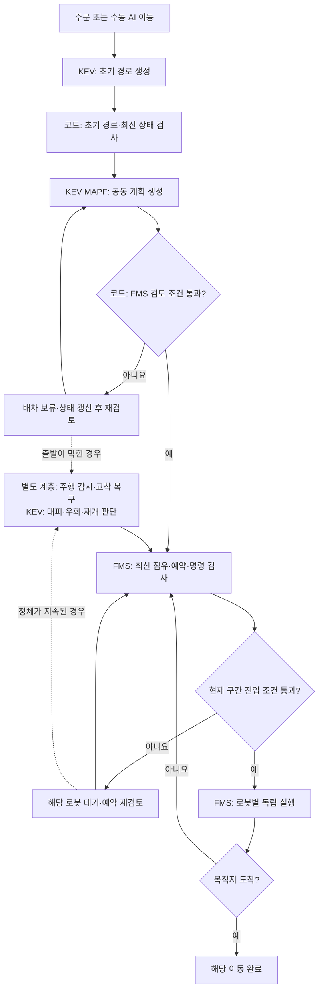
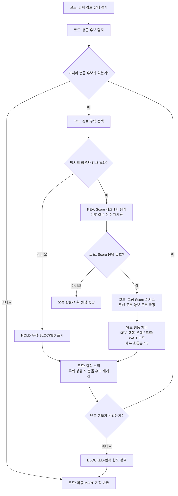
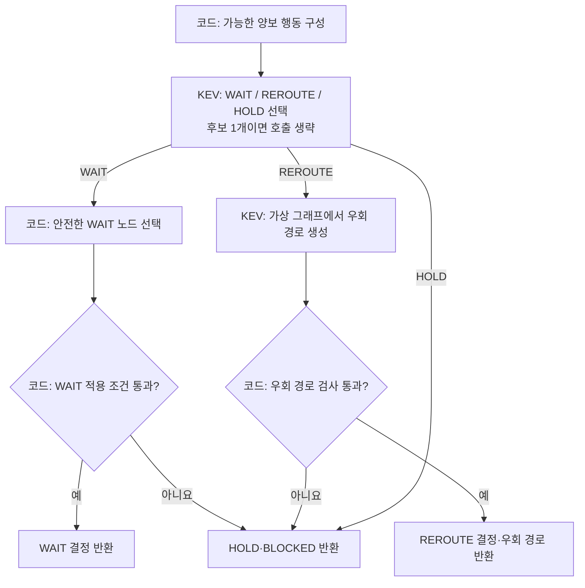
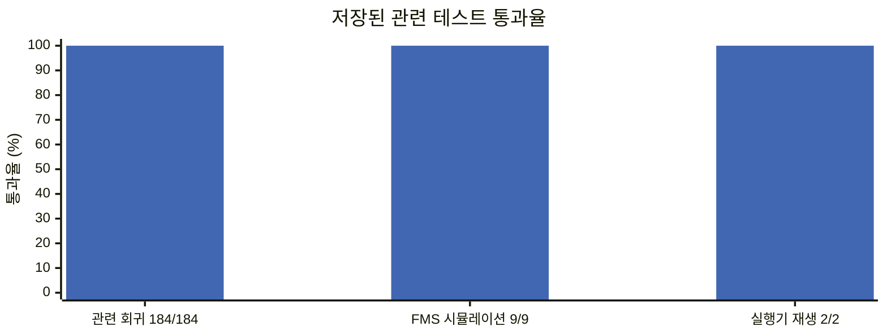
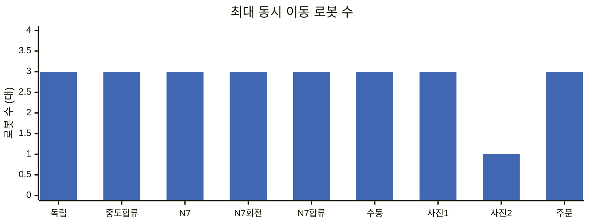
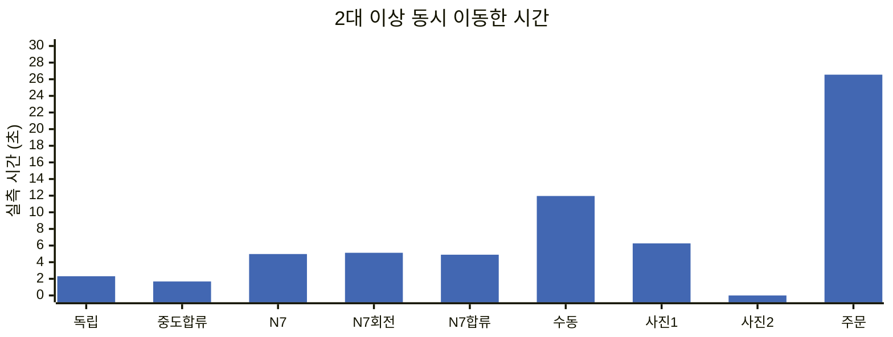
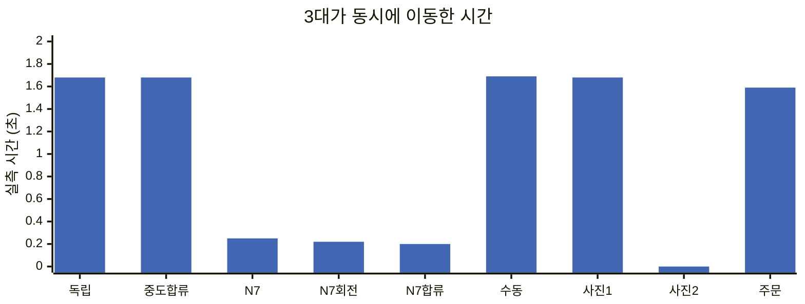
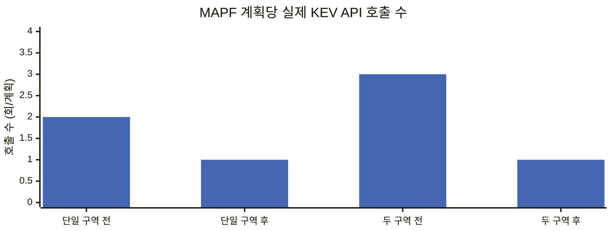
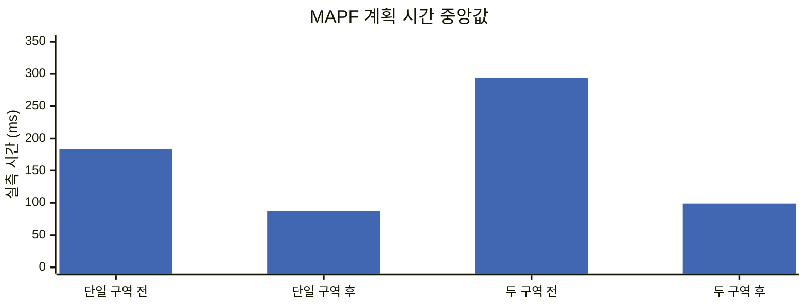

# KEV MAPF 전체 구조

> 구현 기준: Logistics_AI `4ee9d80`. 테스트 그래프는 2026-10-26 저장 결과를 사용한다. 이번 문서 정리에서 주행 테스트를 새로 실행하지 않았다.

## 1. 목적과 용어

**KEV MAPF**는 PBS에서 참고한 우선순위 기반 충돌 조정 개념을 KEV로 구현한 다중 로봇 경로 조정 기능이다. 코드는 충돌 구역과 WAIT 노드를 선택하고, KEV는 Score·양보 행동·우회 경로를 결정한다. 원본 PBS의 우선순위 탐색 트리·양방향 분기·백트래킹 전체를 구현한 구조는 아니다.

이 문서는 **KEV MAPF의 구조·판단 조건·FMS 연동·테스트 결과**를 다룬다. FMS 업무 처리, ROS 내부 절차, 자동배차 화면·다운로드 사용법은 상세 설명에서 제외한다.

### 1.1. 통일 용어

아래 용어를 본문·표·플로우차트에서 동일하게 사용한다. 코드 식별자와 응답 문자열은 원문을 유지한다.

| 통일 용어 | 의미·코드 대응 |
| --- | --- |
| KEV MAPF | 다중 로봇의 경로·통과 우선순위·양보 행동을 조정하는 본체. `KevMAPF` |
| MAPF 계획 | 동일한 입력 상태에서 생성하는 한 번의 조정 결과. Score 재사용의 범위 |
| 충돌 자원 | 로봇들이 경로에서 공유하는 노드 또는 물리 간선. 반대 방향 간선도 같은 물리 자원 |
| 충돌 구역 | 같은 참여 로봇이 공유하는 연결된 충돌 자원 또는 단일 충돌 자원. `zone` |
| 충돌 후보 | 아직 검토하지 않은 충돌 구역과 로봇 쌍. 동시 도착이 예측됐다는 뜻이 아님 |
| Score | KEV가 반환한 로봇별 우선순위 점수. 확률·백분율이 아님 |
| 우선 로봇 | 같은 충돌 후보에서 고정 Score 순서가 앞서는 로봇. `priority_robot`, `high` |
| 양보 로봇 | 같은 충돌 후보에서 고정 Score 순서가 뒤서는 로봇. `yield_robot`, `low` |
| WAIT | 충돌 구역 진입 전 WAIT 노드에서 기다리는 양보 행동 |
| REROUTE | 원래 목적지를 유지하고 KEV가 우회 경로를 생성하는 양보 행동 |
| HOLD | 안전하게 실행할 계획을 만들 수 없거나 보류가 필요할 때의 실행 보류 행동 |
| WAIT 노드 | WAIT 시 정지할 경로상의 노드. 지도·입력에 허용됐다는 사실과 현장 안전성은 별도 |
| 실행 중 로봇(Active) | FMS에 현재 이동 명령이 등록된 로봇. 실제 이동 중뿐 아니라 예약 대기 상태도 포함 |
| 배차 대기 로봇(Pending) | 초기 경로가 준비됐지만 FMS 실행 반영 전인 로봇. 물리 상태 WAITING과 구분 |
| 명령 번호 | 명령 변경을 식별하는 `command_epoch`. 준비 요청의 `execution_epoch`와 비교 |
| 공동 계획 | Active와 Pending의 경로를 함께 검토하는 MAPF 계획. `cohort`는 코드상 공동 처리 단위 |
| 초기 경로 / 우회 경로 / 최종 경로 | MAPF 입력 경로 / REROUTE 결과 / FMS 검사에 전달할 경로 |
| 점유 / 예약 | 현재 물리 자원 사용 / FMS가 확보한 자원 사용 시간표. 서로 대체하지 않음 |
| 주행 감시·교착 복구 | 실행 상태를 감시하고 KEV로 대피·재개를 판단하는 별도 계층. KEV MAPF 본체와 구분 |

### 1.2. 결과 상태와 이동 허가

| 상태·필드 | 의미 | 실제 이동 허가인가? |
| --- | --- | --- |
| `PROPOSED` | MAPF 계획 제안 | 아니요 |
| `REVIEW_REQUIRED` | MAPF 계획에 추가 검토 필요 | 아니요 |
| `BLOCKED` | 현재 조건에서 MAPF 계획 차단 | 아니요 |
| `REVIEW_ONLY` | FMS 검사 대상으로 분류됨 | 아니요 |
| `fms_execution_approved=False` | MAPF 결과는 이동 승인 권한이 없음 | 아니요 |
| `allowed / reserved` | FMS의 현재 구간 진입 검사 통과 | 현재 구간에 대한 허가 |

**HOLD는 행동, BLOCKED는 계획 상태**다. 후보 채택 → MAPF 계획 제안 → FMS 검토 → 예약 확정 → 현재 구간 이동 허가는 서로 다른 단계다. 앞 단계를 통과했다고 뒤 단계까지 통과한 것으로 해석하지 않는다.

## 2. 처리 범위와 책임

### 2.1. 전체 연결



실제 모드의 AI 이동은 MAPF 진입 절차를 항상 사용한다. 시뮬레이션은 `FMS_SIM_MAPF_ENABLED=1`이 기본이며, 명시적으로 끄면 MAPF 단계를 사용하지 않는다. 주문 이동과 수동 AI 이동은 `dispatch_mapf()`를 공통으로 호출한다. 이 설명은 코드의 기본 동작이며 현재 실행 서버 설정을 실시간 조회한 결과는 아니다.

### 2.2. 코드와 KEV의 역할

| 단계 | 담당 | 구현 |
| --- | --- | --- |
| 충돌 후보 탐지·충돌 구역 구성 | 코드 | `zone_candidates()`, `group_conflict_zones()` |
| 충돌 구역 선택 | 코드 | `_select_zone()`; KEV 호출 없음 |
| Score 평가 | **KEV** | `score_many()`; 필요 시 MAPF 계획당 최초 1회 |
| 통과 우선순위 확정 | 코드 | `(-score, robot_id)` 순서 고정 |
| 가능한 양보 행동 구성 | 코드 | 안전한 WAIT 후보·우회 연결 가능성·시도 한도 검사 |
| WAIT / REROUTE / HOLD 선택 | **KEV** | `pick()`; 후보 1개이면 호출 생략 |
| WAIT 노드 선택 | 코드 | `_wait_candidates()`, `_apply_wait()`; KEV 호출 없음 |
| 우회 경로 생성 | **KEV** | `route()`; 다음 노드 선택 반복 |
| 경로·점유·예약 검사와 실제 이동 | 코드/FMS | MAPF 결과 검사, 예약 CAS, 구간 진입 검사 |

실제 입력 프롬프트·상태·질문 형식은 **4.8절**, 별도 교착 복구 프롬프트는 **5.4절**에 정리했다.

초기 경로와 우회 경로는 다음 노드 후보가 여러 개일 때 KEV를 호출한다. 후보가 하나뿐이면 유일한 간선을 사용하므로 모든 노드마다 추론 호출이 발생하는 것은 아니다. KEV 응답은 `KevSelector`를 통해 `POST /v1/systemone`으로 요청·수신한다.

### 2.3. ETA를 사용하지 않는 범위

KEV MAPF는 ETA·속도·예상 도착 시각으로 충돌 시각이나 통과 우선순위를 계산하지 않는다. `eta_available=False`, `time_prediction_used=False`를 유지한다. 충돌 구역까지의 **경로 인덱스**는 노드 순서이며 ETA가 아니다.

FMS는 별도 실행 계층에서 예약 시간표와 `expected_arrival_at`을 사용한다. MAPF에는 WAIT 노드별 예약 **소유자**만 전달한다. 테스트의 계획 시간·이동 겹침 시간도 실측 결과이며 MAPF 입력 ETA가 아니다.

## 3. 객체와 데이터 계약

소스 경로의 공통 기준은 `backend/app/services/`다. `kev_mapf/` 폴더에는 본체와 별도 복구 코드가 함께 있지만 담당 문제는 구분한다.

| 객체·모듈 | 소유하는 책임 | 경계 |
| --- | --- | --- |
| `kev_dispatcher.py` | 초기 경로 준비·주문 유효성·MAPF 진입 절차 | 실제/시뮬레이션 실행기 선택을 구성부에서 처리 |
| `FmsMapfCoordinator` | Active·Pending 요청 수집·등록·교체·결과 분류 | 요청 상태는 복사본으로 조회하고 공개 메서드로 변경 |
| `ParallelAdmission` | 공동 계획의 중복 추론 방지·여러 Pending 일괄 반영 | 내부 잠금·캐시·응답 저장 상태를 외부가 직접 수정하지 않음 |
| `kev_adapter.py`, `Graph` | 입력 정규화·유향 경로 검사·가상 그래프 구성 | FMS DTO의 불필요한 필드를 모델 입력으로 전달하지 않음 |
| `kev_conflict.py` | 충돌 후보 탐지·충돌 구역 구성·진입 인덱스 | 경로 단계만 사용, 충돌 시각 예측 없음 |
| `KevMAPF` | 충돌 구역 조정·고정 Score 순서·양보 행동 적용 | 실행기나 예약표를 직접 변경하지 않고 계획 반환 |
| `KevPlanner` / `LiveKEV` | `score_many`, `pick`, `route` 계약 / 실제 KEV 호출 | 엔진은 구체 클라이언트 대신 계약에 의존. 테스트 대역 주입 가능 |
| `MapfExecution` | 상태 조회·공통 잠금·계획 반영·복구 계약 | 실제/시뮬레이션 실행기에 동일한 연산 제공 |
| `TrafficManager` | 예약 사본 검사·예약 CAS·구간 진입 허가 | 점수 순위와 실제 이동 허가 분리 |
| `KevRecovery` / `KevRecoveryPlanner` | 주행 감시·최신성 재검사 / KEV 복구 계획 | 본체 밖의 별도 책임. 복구 계획 객체는 상태 변경 권한 없음 |

| 주요 데이터 | 의미·유지 조건 |
| --- | --- |
| `paths`, `required_paths` | 로봇별 최종 경로. FMS 전달용 노드 ID 형식은 기존 계약 유지 |
| `priority_scores` | 계획 내 모든 로봇의 KEV 점수. 우회 후에도 재사용 |
| `global_priority_relations` | WAIT의 우선 로봇 → 양보 로봇 관계 |
| `decisions` | 충돌 구역·로봇 쌍·행동·WAIT 노드 또는 우회 경로 |
| `mapf_wait_for` | FMS가 다음 충돌 자원에서만 적용하는 WAIT 의존성. 로봇 ID·주행 ID·자원 포함 |
| `plan_id`, `input_paths` | 같은 공동 계획의 응답 식별자와 분석 입력 |
| `wait_node_reservations` | WAIT 노드별 예약 소유자. 시간표는 포함하지 않음 |
| `metrics` | KEV API·Score·행동 선택 호출 수와 실제 계획 시간 |

단일 책임은 계획·요청 관리·KEV 호출·실행 반영을 나누는 데 적용한다. 상태 변경은 소유 객체의 메서드와 공통 잠금 안에서 수행한다. 기존 주문·로봇 DTO는 유지하며 이 문서가 FMS 전체의 객체지향 설계를 보장한다는 의미는 아니다.

## 4. KEV MAPF 플로우차트와 통과 조건

### 4.1. 본체 플로우차트



아래 표는 실행 결과를 바꾸는 조건문을 기준으로 한다. 별도 표시가 없으면 한 칸의 조건은 **모두 충족(AND)** 해야 한다. 조건 불충족은 후보 제외·계획 차단·오류·재검토로 구분하며, 아무 경우나 이동 허가로 해석하지 않는다.

### 4.2. 입력·초기 경로 준비

근거: `backend/app/services/kev_mapf/kev_adapter.py`의 `parse_robot_state()`, `plan_mapf_from_route_results()`, `kev_graph.py`의 `Graph.check_path()`, `kev_dispatcher.py`의 `prepare_order_route()`, `validate_prepared_order_route()`.

| 검사 | 통과 조건 | 통과하지 못하면 |
| --- | --- | --- |
| MAPF 사용 여부 | 실제 모드의 AI 이동은 항상 MAPF 진입 절차 사용. 시뮬레이션은 `FMS_SIM_MAPF_ENABLED`가 활성화되어야 사용하며 기본값은 `1` | 시뮬레이션에서 명시적으로 비활성화한 경로는 MAPF 진입 절차를 사용하지 않음. MAPF가 안전 승인했다는 뜻이 아님 |
| 로봇 입력 | MAPF 계획에 로봇이 1대 이상 있고 ID가 중복되지 않음. 현재·목적지 노드가 그래프에 존재 | `ValueError`; 계획 생성 중단 |
| 제공 경로 | `path` / `route_result` / `result` 중 공급 방식이 하나 이하이며, 공급한 경로가 비어 있지 않은 리스트 | `ValueError`. 일반 파서는 경로를 생략하면 KEV 경로 생성 가능하지만, 주문용 어댑터는 이미 생성한 결과를 입력받음 |
| 경로 유효성 | 시작=현재 노드, 끝=목적지. 모든 노드·유향 간선이 존재하고 거리 검사 통과. 같은 유향 간선 재사용 없음, 각 노드 방문 최대 2회 | 잘못된 경로 거부. 단순히 목적지 노드가 포함되어 있다는 것만으로 통과하지 않음 |
| 설정 | `priority_mode="score"`, `max_rounds ≥ 1`, `max_reroutes ≥ 0`. 설정 한도는 int 변환 후 범위를 검사. 지정한 WAIT 허용 노드가 모두 그래프에 존재. 주문별 selector/model이 비어 있지 않음 | 잘못된 설정 거부. `choice` 우선순위 모드로 전환하지 않음 |
| 주문 초기 경로 생성 전 | 요청 모드가 현재 모드와 같고 AI 경로 기능 사용. 현재 노드 확인, 주문 유효 콜백 통과. 로봇의 준비 상태 사본 status가 `IDLE` 또는 미지정(None)이고 목적지·경로가 없으며 출발 노드를 점유하고 간선 위가 아님 | 초기 경로 준비 거부. KEV 실패를 알고리즘 경로로 대체하여 실행하지 않음 |
| 추론 후 최신성 | 모드·지도·주문 유효성이 유지되고, 추론 전후 상태·연결·정지 요청·점유·목적지·주행 ID·경로·명령 번호·실행 차단 정보가 동일 | 오래된 결과 폐기, 해당 준비 요청 거부 |
| 준비 결과 재사용 | 로봇 ID·selector·model·현재 노드·목적지·경로가 요청 및 등록된 Pending과 일치. 여전히 출발 노드에서 정지 준비 상태이며 명령 번호도 일치 | 이전 경로를 새 명령에 사용하지 않음. 배차 검사에서 재검토/오류 처리 |

주문 배차의 준비 상태와 실제 모드의 `TASK_ASSIGNED` 허용 여부는 검사 계층이 다르다. 실제 이동 직전에는 5.3의 실제 로봇 검사도 통과해야 한다.

### 4.3. 충돌 후보·충돌 구역 선택 조건

근거: `kev_conflict.py`의 `zone_candidates()`, `group_conflict_zones()`, `first_zone_index()`와 `kev_engine.py`의 `_pair_for()`, `_is_vacating_pair()`, `_select_zone()`, `resolve()`.

| 분기 | 선택·통과 기준 | 반대 조건의 처리 |
| --- | --- | --- |
| 충돌 후보 존재 | 서로 다른 로봇 2대 이상이 경로에 같은 노드 또는 같은 물리 간선을 포함. 간선은 양방향을 같은 자원으로 봄 | 충돌 후보가 없으면 조정 루프 종료. 이때 Score·양보 선택 호출이 없어도 정상 |
| 후보 그룹화 | 참여 로봇 집합이 같고 자원이 연결되어 있음. 노드끼리만 직접 묶지는 않고 노드/간선 연결을 따라 그룹 구성 | 조건이 다르면 독립 구역으로 유지 |
| 미처리 로봇 쌍 | `(구역 ID, 로봇 A, 로봇 B)`가 `processed`에 없음 | 처리한 쌍은 재선택하지 않음. 해당 구역에 남은 쌍이 없으면 후보에서 제외 |
| 출발 노드를 비우는 쌍 | **단일 노드 구역**에서 한 로봇의 경로가 그 노드에서 시작해 밖으로 나가고, 다른 로봇은 다른 곳에서 시작하며 첫 간선의 직접 맞교환이 아님 | 이 조건을 만족하면 해당 쌍을 처리 완료로 넘김. 만족하지 않으면 일반 충돌 조정. 실제 점유 해제·후속 진입 허가는 계속 FMS가 검사 |
| 다음 처리 구역 선택 | `(현재 점유와 무관한가, 참여 로봇들의 최소 최초 진입 인덱스, 구역 ID)`가 가장 작은 구역. 즉 점유 관련 우선 → 경로 단계가 가까운 구역 → ID 순 | 나머지는 이후 반복에서 처리. 이 정렬은 검토 순서이며 Score 통과 순위나 도착 시각 예측이 아님 |
| 명시적 점유자 복수 | 구역 자원에 등록된 점유자가 0~1대여야 일반 우선순위 판단으로 진행 | 2대 이상이면 `HOLD`, `BLOCKED` (`multiple occupants`) |
| 점유자가 현재 쌍에 속함 | 점유자가 없거나 현재 조정하는 A/B 중 하나 | 다른 로봇이 점유하면 해당 쌍 `HOLD`, `BLOCKED` (`occupied by ...`) |
| 우회로 경로 변경 | 유효한 REROUTE 결과가 생성됨 | 성공 시 전체 경로에서 충돌 후보를 다시 계산하고 우회 로봇 관련 처리 표시 해제. 실패하면 HOLD |

`first_zone_index()`는 노드면 그 노드의 첫 인덱스, 간선이면 첫 통과 간선의 **출발 노드 인덱스**, 그룹이면 포함 노드/간선의 첫 인덱스 중 최솟값이다. 시간·속도를 사용하지 않는다.

점유 관련 **처리 순서**는 현재 노드/간선 정보도 참고한다. 반면 위 표의 점유자 복수·제3자 판정은 `zone_occupancy`로 명시적으로 제공된 자원을 조회한다. 이 둘을 실제 전체 점유 검사가 완료됐다는 의미로 합치면 안 된다.

### 4.4. Score 우선순위 확정

근거: `kev_engine.py`의 `_resolve_priority()`, `kev_client.py`의 `LiveKEV.score_many()`.

| 검사 | 통과 조건·결정 기준 | 통과하지 못하면 |
| --- | --- | --- |
| Score가 필요한가 | 일반 우선순위 조정을 처음 수행하고 아직 고정 순위가 없음 | 이미 순위가 있으면 재평가 없이 재사용. 충돌이 없거나 점유 문제만으로 먼저 HOLD되면 Score 호출 0회 가능 |
| Score 응답 | MAPF 계획에 포함된 **모든 로봇**의 ID가 정확히 한 번씩 존재. 값은 bool을 제외한 유한한 int/float | 누락·추가 ID, NaN/무한대 등은 오류로 거부. 임의 점수나 점유자 우선으로 보정하지 않음 |
| 높은 우선순위 | `(-score, robot_id)` 오름차순. 높은 Score 우선, 동점은 로봇 ID 문자열 오름차순 | 모든 구역·우회 후 새 충돌에도 같은 순서 재사용. ID는 자연수 정렬이 아니므로 `R-10`과 `R-2`도 문자열 기준 |
| 낮은 Score 로봇이 점유 | Score 순위는 그대로 유지 | 양보 로봇이 점유 중이면 진입 전 WAIT를 후보에 넣지 않음. 안전한 REROUTE/HOLD 판단으로 진행하고 우선 로봇도 대기 |
| 논리적 순환 | 모든 WAIT 관계는 고정된 순위의 high → low로만 생성 | 이 성질로 MAPF 내부의 중복 `would_cycle()`/`PRIORITY_CYCLE_DETECTED` 분기는 제거됨. 외부 임의 의존성 검사는 유지 |

한 계획의 Score 평가는 필요할 때 `score_many()` **1회**이며, 관련 호출에서 전체 로봇 질문을 묶는다. 이후 새로운 계획을 시작하면 다시 평가할 수 있다. 점유·예약 때문에 높은 Score 로봇이 기다리는 것은 점수 순위를 뒤집는 것과 다르다.

### 4.5. WAIT 후보와 WAIT 노드 선택

근거: `kev_engine.py`의 `_wait_candidates()`, `_apply_wait()`, `resolve()`.

아래 후보 조건은 **모두** 만족해야 한다. 하나라도 어기면 그 노드를 제외하며, 낮은 Score 로봇이 구역 점유자이거나 간선 위에 있으면 노드별 검사를 시작하기 전에 WAIT를 행동 후보에서 제외한다.

| 조건 | 후보에 포함되는 기준 | 제외되는 사례 |
| --- | --- | --- |
| 구역 앞에 위치 | `first_zone_index()`가 존재하고, 해당 인덱스 **미만**의 경로 노드 | 충돌 구역 자체, 구역 이후, 최초 진입 인덱스가 0이어서 진입 전 노드가 없음 |
| 차단·정책 | `blocked_nodes`에 없고, WAIT 정책이 있으면 `certified_wait`에 포함 | 차단 노드, 미허용 노드. `wait_allowed_nodes=[]`를 명시하면 허용 후보가 0개이며 무제한 허용이 아님 |
| 명시 점유·다른 현재 위치 | 해당 노드의 명시적 점유자가 없거나 자기 자신이고, 다른 로봇의 현재 노드가 아님 | 다른 로봇이 점유 중 |
| FMS 예약 | `wait_node_reservations`에서 자기 이외의 예약 소유자가 없음 | 다른 로봇 예약 존재. 이 입력은 소유자 집합이며 MAPF가 예약 시각/ETA를 비교하지 않음 |
| 우선 로봇 경로 | 우선 로봇의 경로에 해당 노드가 없음 | 우선 로봇이 지나야 하는 길에 멈추는 경우 |
| 같은 계획 내 중복 배정 | 내부 WAIT 예약이 비어 있거나 자기 소유. 이미 자기에게 배정된 WAIT 노드가 있으면 동일 노드 | 다른 로봇 WAIT 예약, 자기에게 서로 다른 WAIT 노드를 중복 지시 |

| 적용 분기 | 통과·선택 기준 | 실패/추가 검토 |
| --- | --- | --- |
| 후보 1개 이상 | 다른 로봇 경로에 포함되는 횟수 최소 → 경로 인덱스가 큰 노드(구역에 가까움) → 노드 ID 순으로 하나 선택 | 다른 로봇의 경로와 겹칠 수는 있으나 방해를 최소화. 우선 로봇 경로 중첩은 앞에서 이미 제외 |
| 후보 없음 | WAIT를 KEV 행동 후보에 넣지 않음 | KEV가 가능한 REROUTE/HOLD 중 판단. `_apply_wait()`에 빈 후보가 들어오더라도 `NO_SAFE_WAIT_NODE`로 HOLD/BLOCKED |
| 적용 직전 일관성 | 선택 노드가 후보 안에 있고 내부 예약/기배정과 충돌하지 않음 | `WAIT_NODE_RESERVATION_CONFLICT`로 HOLD/BLOCKED |
| WAIT 허용 정책 확인 | 선택 노드가 `certified_wait`에 포함되어 `wait_node_verified=True` | 정책 자체가 없어서 허용 정책 미확인 노드가 후보가 된 경우 `REVIEW_REQUIRED` + 허용 정책 미확인 경고. 현재 자동 FMS 검토 조건은 이 경고를 허용하지 않음 |
| 다른 로봇 경로 중첩 | 중첩이 없으면 PROPOSED. 중첩이 있으면 허용 정책이 확인된 WAIT도 FMS 예약 추가 검토 필요 | `REVIEW_REQUIRED` + `FMS traffic reservation verification required` 경고. 실제 허용 여부는 후속 검사가 판단 |

여기서 `certified_wait`는 **입력/지도 정책에 등록되었다**는 코드상 의미다. 차체 크기·센서·현장 공간이 자동으로 검사됐다는 의미는 아니다. FMS 공동 계획 반영은 별도로 WAIT 노드가 양보 로봇(Pending)의 **현재 노드**일 것도 요구한다(5.1).

### 4.6. 양보 행동·우회 경로·최종 계획 상태



근거: `kev_engine.py`의 `_can_reroute()`, `_reroute_constraints()`, `_reroute()`, `resolve()`와 `kev_client.py`의 `LiveKEV.pick()`.

| 분기 | 통과·후보 조건 | 통과하지 못하면 |
| --- | --- | --- |
| WAIT 행동 제공 | 4.5의 안전 후보가 1개 이상 | WAIT 제외 |
| REROUTE 행동 제공 | MAPF 계획 전체 우회 시도 횟수 `< max_reroutes`, 간선 위가 아님. 제외 자원을 적용해도 현재→목적지의 유향 연결이 존재 | REROUTE 제외. Python의 연결성 검사는 가능 여부만 확인하고 대체 경로를 생성하지 않음 |
| 우회 제외 자원 구성 | 차단 노드와 타 로봇 목적지(자기 현재/목적지 제외)를 제거. 노드 충돌이면 해당 노드, 간선 충돌이면 양방향, 그룹이면 포함 노드·양방향 간선 제외 | 단일 충돌 노드가 자기 현재/목적지여서 제거할 수 없거나 차단 때문에 시작/끝이 제거되면 우회 불가. 그룹 노드에서는 자기 현재/목적지를 남김 |
| HOLD 행동 제공 | `allow_proactive_hold=True` **또는** WAIT/REROUTE가 모두 불가능 | 가능한 다른 행동이 있고 proactive HOLD가 꺼져 있으면 HOLD는 선택지에 없음 |
| KEV 행동 선택 | 후보 ID 중 하나를 반환. 후보가 2개 이상이면 KEV 호출 | 후보 1개는 강제 선택으로 HTTP 호출 생략. 응답이 후보 밖이거나 호출 실패면 오류이며 임의 행동으로 실행하지 않음 |
| KEV가 HOLD 선택 | 후보에 포함된 HOLD를 선택 | `KEV_SELECTED_HOLD` → BLOCKED, 우선 로봇도 HOLD. 실행 보류 후 새 MAPF 계획/복구 검토 |
| KEV 우회 결과 | 원래 현재→원래 목적지 경로이고 Graph 검사 통과. 금지 노드·금지 유향 간선을 지나지 않음 | `REROUTE_FAILED` → HOLD/BLOCKED. 생성 실패를 WAIT나 알고리즘 경로로 자동 대체하지 않음 |
| 금지 간선 끝점 추가 검사 | 자기 현재/목적지가 아닌 금지 간선 양 끝점을 새 경로에 동시에 포함하지 않음 | 양 끝점을 비연속적으로 방문해도 거부하는 보수적 정책. 단순 연결성 검사 통과만으로 우회 승인되지 않음 |
| 우회 성공 후 | 경로 교체, 충돌 후보 재계산, 해당 로봇의 처리 표시 해제. Score는 유지 | 새로 생긴 충돌도 반복 검토. 기존 목적지·작업 정보는 유지 |
| 반복 종료 | 미처리 충돌 쌍이 없어 `break`로 종료 | 반복 한도 소진 시 `BLOCKED`, `max_rounds=... reached` 경고. 마지막 반복에서 조정했어도 다음 무충돌 종료 확인이 없으면 보수적으로 BLOCKED |
| 최종 MAPF 계획 | HOLD가 없고 최종 경로에 명시적 차단 노드가 없음 | HOLD 1건 또는 차단 노드 사용 1건이라도 `BLOCKED`. 허용 정책 미확인/중첩 WAIT는 `REVIEW_REQUIRED` 가능 |

`proceed_robots`에서는 WAIT/HOLD 양보 로봇과 `priority_robot_action=WAIT/HOLD`인 우선 로봇을 제외한다. 이 목록에 들어가도 실제 구간 이동 승인은 아직 아니다. KEV의 HOLD는 실행 보류이며, 기존 물리 점유를 지우거나 주문이 완료됐다고 간주하지 않는다.

### 4.7. 조건문의 판단 방식 — 어떤 데이터를 어떻게 비교하는가

4.2~4.6은 **통과 조건과 조건 불충족 시 처리**, 이 절은 **판단에 쓰는 입력과 연산**을 설명한다. 코드의 조건식과 KEV에 전달하는 판단 지침을 구분한다. 코드의 결정적 규칙은 같은 입력에서 같은 선택을 만들지만, KEV 추론 결과까지 동일하다고 보장하지는 않는다.

| 판단 대상 | 입력 | 판단 방식 | 담당·근거 |
| --- | --- | --- | --- |
| 충돌 후보 여부 | 로봇별 경로의 노드·연속 간선 | 같은 노드 또는 방향을 제거한 같은 물리 간선을 사용하는 **서로 다른 로봇 수가 2 이상**인지 집합으로 검사 | 코드: `zone_candidates()` |
| 충돌 구역 묶기 | 충돌 자원별 참여 로봇 집합·연결 관계 | 참여 로봇 집합이 같고 자원이 연결된 후보를 그룹화. 노드끼리만 직접 묶지는 않음 | 코드: `group_conflict_zones()` |
| 처리할 충돌 구역 | 현재 점유 자원, 각 경로의 최초 진입 인덱스, 구역 ID | `(점유와 무관한가, 최소 진입 인덱스, 구역 ID)`를 사전식 비교하여 최솟값 선택. 앞 항목이 같을 때만 다음 항목 비교 | 코드: `_select_zone()` |
| 명시적 점유 문제 | `zone_occupancy`의 해당 구역/포함 자원 소유자 | 점유자 집합의 크기가 2 이상인지, 1명이면 현재 조정하는 로봇 쌍에 속하는지 검사. 문제 있으면 Score 비교 전에 HOLD | 코드: `_zone_occupants()`, `resolve()` |
| 로봇별 Score 산출 | 현재 위치·경로 진행·작업 우선순위·점유·충돌 구역·`execution_committed` | 모든 로봇에 같은 기준으로 우선순위를 평가하라는 지침과 5단계 기준을 전달. 모델이 반환한 유한한 수치 사용. Python의 고정 가중합으로 계산하지 않음 | **KEV**: `KEV_PRIORITY_SCORE_INSTRUCTIONS`, `score_many()` |
| 우선 로봇 확정 | 유효한 `priority_scores`, 로봇 ID | `(-score, robot_id)` 오름차순으로 전체 순위 생성. 두 로봇 중 앞선 로봇이 우선 로봇. 점유 때문에 순위 변경하지 않음 | 코드: `_resolve_priority()` |
| WAIT 후보 허용 | 구역 진입 이전 경로, WAIT 정책, 점유·예약 소유자, 우선 로봇 경로, 기배정 WAIT 노드 | 4.5의 제외 조건을 **OR**로 묶어 하나라도 참이면 후보 제외. 남은 후보가 1개 이상일 때만 WAIT 행동 제공 | 코드: `_wait_candidates()`, `resolve()` |
| WAIT 노드 확정 | 허용 후보별 다른 경로 중첩 수·경로 인덱스·노드 ID | `(다른 로봇 경로에 포함되는 수, -경로 인덱스, 노드 ID)` 최솟값 선택. 방해 최소 → 충돌 구역에 가까운 후보 → ID 순 | 코드: `_apply_wait()` |
| REROUTE 제공 가능성 | 제외 노드·간선, 현재/목적지, 간선 점유, 우회 시도 횟수 | 시도 한도와 정지 조건 통과 후 제외 자원을 적용한 유향 그래프를 순회하여 목적지 **도달 가능 여부만** 검사. 탐색 결과를 실행 경로로 사용하지 않음 | 코드: `_reroute_constraints()`, `_can_reroute()` |
| 양보 행동 선택 | 실제로 제공된 행동 ID, 로봇 상태·충돌 구역·점유·기존 관계·WAIT 후보 | 허용된 후보 중 1개 선택. 프롬프트는 허용 정책이 확인된 진입 전 WAIT를 우선 고려하고, WAIT가 없으면 제공된 REROUTE를 고려하며, 근거상 불가능/위험할 때 제공된 HOLD 선택을 지시 | **KEV**: `KEV_ACTION_INSTRUCTIONS`, `pick()` |
| 우회 경로 생성 | 충돌 자원을 제외한 가상 그래프·저장 가중치·현재/목적지·방문 이력·교통 정보 | 제공된 연결 후보 중 다음 노드를 반복 선택. 프롬프트는 목적지까지 총 가중치를 고려하고 사용 간선·방문 상한을 지키도록 지시. 코드는 생성 경로의 연결·금지 자원·시작/끝을 별도로 검사 | **KEV + 코드**: `route()`, `iterative_route_policy.py`, `_reroute()` |
| 최종 계획 상태 | 누적 행동·경고·최종 경로·반복 종료 방식 | HOLD 포함/차단 노드 사용/반복 한도 소진이면 BLOCKED. WAIT 정책 미확인 또는 경로 중첩이면 추가 검토 필요. 이외에는 기존 PROPOSED 유지 | 코드: `resolve()`, `_apply_wait()` |

**Score의 판단 지침:** `Very low priority` → `Low priority` → `Medium priority` → `High priority` → `Very high priority`의 5단계 기준을 사용한다. 위치·작업 우선순위 등에 적용할 숫자 가중치는 현재 프롬프트에 고정되어 있지 않다. 이미 실행 중인 로봇을 간선 중간에서 정지/우회시키지 말 것, 도착 시각·점유를 만들어내지 말 것, Score를 이동 허가로 해석하지 말 것도 지시한다. 이는 모델에 대한 지침이며 물리 안전성은 코드/FMS 검사로 확인한다.

**행동 후보의 판단과 행동 선택은 별개다.** 코드는 가능한 행동을 좁히고 KEV가 그 안에서 선택한다. 후보가 1개면 추론 없이 그 행동을 사용한다. HOLD는 `allow_proactive_hold=True`이거나 다른 행동이 없을 때만 제공한다. KEV가 안전하다고 답해도 후보 제외·경로·점유·예약 조건을 우회하지 못한다.

예를 들어 점수가 `{R1: 90, R2: 70, R3: 70}`이면 순서는 `R1 > R2 > R3`다. **90점 이상이면 이동 허가** 같은 절대 임계값은 없다. R2가 충돌 구역을 점유하면 R1이 우선 로봇인 상태로 기다리며, R2가 안전하게 비울 방법을 별도로 검토한다. WAIT 후보 노드 4/2의 키가 각각 `(1, -4, 4)`, `(0, -2, 2)`라면 노드 2가 구역에서 더 멀어도 다른 경로 방해가 적어 선택된다.

근거: `kev_engine.py`의 후보·정렬·검사 함수, `kev_client.py`의 Score/행동 프롬프트와 호출, `iterative_route_policy.py`의 다음 노드 선택 지침. 모델 내부에서 실제로 어떤 가중치나 추론 과정을 사용했는지까지 이 코드로 확인할 수 있는 것은 아니다.

### 4.8. KEV 입력 프롬프트와 요청 구조

아래는 **현재 코드에 들어 있는 실제 지침**이다. 개선용으로 새로 제안한 프롬프트가 아니다. 영문 원문은 코드의 문자열을 그대로 사용하고 줄바꿈만 읽기 좋게 조정했다. `<robot_id>` 등은 실행 때 채워지는 값이며, 요청/응답 예시는 구조 설명용으로 실제 실행 로그가 아니다. 인증 헤더·접속 비밀값은 문서에 포함하지 않는다.

#### 4.8.1. 사용 지점과 공통 요청 형식

| 사용 지점 | 계층 | 질문 ID·유형 | 실제 프롬프트 |
| --- | --- | --- | --- |
| 로봇별 Score 평가 | KEV MAPF 본체 | `priority_score_<robot_id>` / `score` | `KEV_PRIORITY_SCORE_INSTRUCTIONS` + 로봇 ID 접두문 |
| WAIT / REROUTE / HOLD 선택 | KEV MAPF 본체 | `action_<it>` / `choice` | `KEV_ACTION_INSTRUCTIONS` |
| REROUTE의 다음 노드 선택 | KEV MAPF 본체가 경로 생성기에 위임 | `route_<start>_<target>_step_<step>` / `choice` | `NEXT_NODE_INSTRUCTIONS` + 조건부 방향·교통 지침 |
| 초기 경로의 다음 노드 선택 | MAPF 입력을 만드는 경로 생성기 | 위와 동일 | REROUTE와 동일한 공통 지침 |
| 복구용 우회·재개 경로의 다음 노드 선택 | 별도 교착 복구 계층 | 위와 동일 | REROUTE와 동일한 공통 지침 |
| 이동할 로봇·대피/재개 행동 선택 | 별도 교착 복구 계층 | `deadlock_recovery` / `choice` | `RECOVERY_INSTRUCTIONS` — 5.4절 |

**충돌 구역 선택과 WAIT 노드 선택에는 KEV 프롬프트가 없다.** 두 단계는 각각 `_select_zone()`, `_apply_wait()`의 코드 규칙을 사용한다. 우선순위 `choice` 모드도 없으며, 위 표의 `choice`는 양보 행동·다음 노드·별도 복구 행동 선택이다.

공통 전송은 `KevSelector.decide()` → `POST /v1/systemone`이다. 요청은 `model`, `state`, `questions`로 구성하며, 각 질문에 `type`, `instructions`, `criteria`가 들어간다. 일반 채팅의 system/user 메시지 배열로 보내는 구조가 아니다.

| 필드 | Score 요청 | 선택 요청 |
| --- | --- | --- |
| `model` | 클라이언트가 해석한 API 모델 식별자 | 동일 |
| `state` | 계획 전체 그래프·로봇·충돌·점유 정보 | 단계별 상태와 후보를 판단할 근거 |
| `questions` | 모든 로봇의 Score 질문을 **한 요청**에 묶음 | 해당 단계의 선택 질문 1개 |
| `type` | `score` | `choice` |
| `instructions` | 아래 4.8.2의 실제 지침 | 4.8.3·4.8.4 또는 5.4의 실제 지침 |
| `criteria` | 우선순위 5단계 문자열 리스트 | `{후보 ID: 후보 설명}` 객체 |
| 코드가 읽는 응답 | `answers[question_id].score` | `answers[question_id].choice` |

#### 4.8.2. KEV: 로봇별 Score 평가

- 호출: `KevMAPF._resolve_priority()` → `LiveKEV.score_many()` → `KevSelector.decide()`.
- 입력 상태: `route_graph`, 전체 `robots`와 로봇별 `available_edges`, `conflict_zones`, `current_occupancy`, `eta_available=False`. 로봇에는 현재/목적지·경로·상태·작업 우선순위·기존 실행 여부·점유 간선 등이 포함된다.
- `scoring_robot`은 이 호출의 별도 state 필드가 아니라 **각 질문의 지침 접두문**으로 지정한다. 질문 ID는 `priority_score_<robot_id>`다.
- 한국어 의미: 같은 기준으로 전체 로봇의 상대적 통과 우선순위를 평가하되, 이미 승인된 실행·점유를 고려하고 도착 시각을 만들어내지 말라는 지침이다. 높은 Score는 순위가 높다는 뜻이며 이동 허가가 아니다.

**실제 instructions 원문 — 로봇 ID 접두문 포함:**

```text
For this question, scoring_robot is <robot_id>. Evaluate the priority of scoring_robot relative to
other robots in the current MAPF state. Consider current position, route progress, task priority,
occupancy, and shared conflict zones. Use the same evaluation criteria for every robot. Higher
scores indicate higher priority to proceed. Robots marked execution_committed are already following
an approved route; consider that a yielding plan must not stop or reroute them mid-edge. Do not
invent arrival times or occupancy. Do not treat the score as movement permission.
```

**실제 criteria:**

```json
[
  "Very low priority",
  "Low priority",
  "Medium priority",
  "High priority",
  "Very high priority"
]
```

**응답 구조 예:**

```json
{"answers":{"priority_score_robot1":{"type":"score","score":1.8}}}
```

코드는 모든 계획 로봇의 유한한 점수를 확인한 후 `(-score, robot_id)`로 순위를 고정한다. `1.8`은 형식 설명용 값이며 합격 임계값이나 백분율이 아니다. 충돌이 없거나 Score 평가 전에 점유 문제로 HOLD되면 이 호출은 없을 수 있다.

#### 4.8.3. KEV: 양보 행동 선택

- 호출: `KevMAPF.resolve()` → `LiveKEV.pick()` → `KevSelector.select_choice()`.
- 입력 상태: 공통 그래프·로봇 정보에 `shared_resource`, `shared_resource_details`, `occupant`, `occupants`, `participant_ids`, `known_priority_constraints`, `safe_wait_nodes_verified`, `yield_robot`, `candidate_wait_nodes`를 추가한다. `eta_available=False`다.
- 우선·양보 로봇은 이미 코드가 고정 Score 순서로 결정한다. 이 질문은 **제공된 양보 행동 중 선택**하는 질문이다. `priority_scores`를 별도 필드로 다시 전달하거나 Score를 재평가하는 호출이 아니다.
- 한국어 의미: 허용 정책이 확인된 진입 전 WAIT를 우선 고려하고, WAIT가 없으면 제공된 REROUTE를 고려한다. 근거상 위험/불가능하면 제공된 HOLD를 선택한다. WAIT는 해당 충돌 구역에만 적용하며 우선 로봇의 작업 전체 완료까지 기다리는 뜻이 아니다.

**실제 instructions 원문:**

```text
Select exactly one supplied MAPF action ID. WAIT: Prefer this when a verified upstream wait node
exists. REROUTE: Prefer this when WAIT is unavailable and action_reroute is offered. REROUTE only
attempts to generate a new path; it does not move a robot. HOLD: Choose when supplied evidence
indicates the available alternatives are infeasible or unsafe. Do not assume rerouting is impossible
without evidence. The controller validates all generated paths and falls back to HOLD if rerouting
fails. All movement needs independent FMS permission. WAIT applies only at the selected shared zone,
not until the priority robot completes its entire job. Unrelated robots may proceed in parallel.
Return only a supplied action ID.
```

**criteria 후보 설명 원문 — 코드가 가능한 항목만 포함:**

```json
{
  "action_wait": "WAIT: Stop at a permitted upstream node and allow the priority robot to proceed.",
  "action_reroute": "REROUTE: Attempt to generate a valid alternative route around the shared zone.",
  "action_hold": "HOLD: Do not dispatch this robot. Require a new planning or safety review."
}
```

**응답 구조 예:**

```json
{"answers":{"action_0":{"type":"choice","choice":"action_wait"}}}
```

WAIT는 유효 WAIT 후보가 있어야, REROUTE는 연결 가능성·시도 한도를 통과해야 제공한다. HOLD 제공 조건은 4.6절과 같다. 후보가 1개이면 `pick()`은 API를 호출하지 않는다. 반환한 ID가 후보 밖이면 오류다.

#### 4.8.4. KEV: 우회 경로·초기 경로·복구 경로의 다음 노드 선택

- MAPF 우회 호출: `_reroute()` → `LiveKEV.route()` → `preview_llm_route()` → `run_selected_route()` → `KevSelector.select_choice()`.
- 초기 경로는 `prepare_order_route()`에서, 복구용 우회·재개 경로는 `KevRecoveryPlanner.plan()`에서 `preview_llm_route()`를 호출한다. **서로 다른 전용 경로 프롬프트를 추가한 구조가 아니라 같은 생성기를 재사용**한다.
- MAPF 우회에서는 충돌 자원을 제거한 가상 그래프를 입력한다. 복구 경로에서는 현재 타 로봇 점유를 제외한 가상 그래프를 사용한다. 원래 목적지를 유지하며 `node_<node_id>` 후보 중 다음 노드 하나씩 고른다.

| 입력 상태 | 내용 |
| --- | --- |
| 기본 | `route_graph`, `current_node`, `previous_node`, `target_node`, `visited_nodes` |
| 방문·비용 | `visit_counts`, `max_visits_per_node`, `used_edges`, `backtrack_allowed`, `accumulated_distance` |
| 인접 후보 | 현재 경로 생성 설정의 `available_edges`; 저장 가중치와 사용 가능한 연결 정보 |
| 방향 정보 — 좌표 사용 시 | `target_distance`, `target_direction`, 후보 간선의 `dist_to_target`, `progress`, `direction` |
| 교통 정보 — traffic 제공 시 | `other_robots`: 로봇 ID·점유 노드·남은 경로. 후보의 `shared_with`도 선택 근거로 사용 |

한국어 의미는 ‘바로 다음 간선의 비용만 보지 말고 목적지까지 총 가중치를 고려하며, 제공된 유향 연결 후보와 방문 제한 안에서 다음 노드를 선택하라’다. 여기서 remaining cost는 그래프 비용이며 ETA가 아니다. 최단 경로를 요구하는 **지침**과 최단성 **보장**은 구분한다.

**실제 기본 instructions 원문 — `NEXT_NODE_INSTRUCTIONS`:**

```text
Select exactly one next node for the minimum-total-weight directed route from current_node to
target_node. Consider the estimated total remaining cost to the target, not merely the weight of the
next edge. Use CompactAdjacencyGraph weights exactly as stored. The selected node must be connected
by one directed edge from current_node and must be one of the supplied criteria. If available_edges
is present, choose only a node listed there; it contains the exact outgoing edges and stored
weights. Never reuse an edge in used_edges. Respect max_visits_per_node. Do not return to
previous_node unless backtrack_allowed is true. Older nodes may be revisited within those limits.
Return only the selected criteria ID.
```

**방향 정보가 사용될 때 뒤에 붙는 원문 — `DIRECTION_INSTRUCTIONS`:**

```text
Use dist_to_target, progress (positive moves closer to target_node), and direction (compare with
target_direction) to estimate remaining cost.
```

**traffic이 제공될 때 뒤에 붙는 원문 — `TRAFFIC_INSTRUCTIONS`:**

```text
Other robots are shown in other_robots. Minimize total weight first; when candidates are similar,
prefer a node whose shared_with is empty.
```

지침은 **기본 → 방향(조건부) → 교통(조건부)** 순서로 공백을 두고 연결한다. 기본 경로 미리보기는 `include_direction=True`이며 유효 좌표가 있을 때 방향 지침을 붙인다. 방향/교통 정보가 없는 호출에는 해당 지침을 붙이지 않는다.

**criteria·응답 구조 예 — 실제 후보는 현재 노드마다 다름:**

```json
{"node_7":"Node 7","node_11":"Node 11"}
```

```json
{"answers":{"route_5_3_step_1":{"type":"choice","choice":"node_7"}}}
```

목적지에 도착할 때까지 다음 노드를 반복 선택한다. 후보 1개이면 그 단계의 API 호출은 생략한다. 최종 경로는 코드가 다시 검사하며, MAPF 우회 실패는 HOLD로 처리한다. 생성 후의 `baseline_path`는 비교용 결과이며 모델에 정답 경로를 공급하거나 실패한 KEV 경로를 대신 실행하는 입력이 아니다.

현재 활성 경로 생성은 위 지침을 `select_choice()`에 전달한다. `KevSelector.ROUTE_INSTRUCTIONS`와 `select_route()`도 코드에 있지만, 위 호출 경로의 실제 지침과 혼동하여 적지 않는다.

## 5. FMS 연동 조건

### 5.1. 공동 계획 반영 조건

근거: `kev_coordinator.py`의 `is_fms_reviewable_advisory()`, `kev_parallel_admission.py`의 `fleet_snapshot()`, `ParallelAdmission.admit()/apply()`, `dispatch_order()`와 `kev_dispatcher.py`의 `dispatch_mapf()`.

| 검사 | 다음 단계로 넘어가는 조건 | 거부·대기 처리 |
| --- | --- | --- |
| MAPF 계획 상태 | `PROPOSED`면 검토 대상으로 접수. `REVIEW_REQUIRED`는 결정/경고가 비어 있지 않고 모든 결정이 허용 정책이 확인된 WAIT 또는 REROUTE이며, 모든 경고가 정확히 WAIT 경로 중첩의 FMS 검토 경고 형식 | BLOCKED·HOLD·허용 정책 미확인 WAIT 경고·다른 경고는 자동 검토 불가. PROPOSED 접수 후에도 아래 검사는 생략하지 않음 |
| Pending 상태 사본 | IDLE, 목적지·경로 없음, 실행 차단 없음, ONLINE, 간선 위 아님, 실제 노드=요청 출발 노드, 명령 번호 일치. 실제 모드는 정지 요청도 없어야 함 | 한 로봇이라도 조건 불충족이면 공동 상태 사본 생성 실패. 시뮬레이션만 이전 정지 요청 흔적을 허용 |
| Active 상태 사본 | 등록된 현재 요청과 경로가 있고 정지 요청·대피 동작이 없으며 ONLINE. 현재 남은 경로가 등록 경로의 끝까지 이어지는 잔여 경로(suffix) | 미등록/변경 경로·복구 중 상태면 공동 계획을 그대로 적용하지 않음. 임의의 부분 경로를 잔여 경로로 인정하지 않음 |
| 다른 IDLE 로봇 | 현재 점유 노드를 `blocked_nodes`로 계획에 전달 | 작업이 없다고 사라진 로봇으로 간주하지 않음 |
| 계획 결과 범위 | 결과 경로 ID 집합=전체 Active+Pending 요청 ID 집합. 각 경로 현재/목적지·연결 검사 통과 | 누락/추가 로봇 또는 잘못된 경로 거부 |
| 변경 가능한 로봇 | 모든 양보 결정이 Pending에 대한 WAIT/REROUTE. Active 경로는 입력 경로 그대로 | Active의 승인된 명령 변경 또는 HOLD 포함 결과는 병렬 적용 거부. 별도 복구로 검토 |
| 병렬 WAIT의 정지 위치 | 양보 로봇(Pending)의 현재 노드=WAIT 노드이고 우선 로봇 경로에 포함되지 않음 | 미래의 대기 지점까지 먼저 이동해야 하는 제안은 이 병렬 적용 경로에서 거부 |
| 추론 중 이동/명령 변경 | 모드·지도 유지, 최신 상태 사본의 identity와 protected가 기존과 동일 | Active의 정상적인 경로 진행만으로는 무효화하지 않음. 반면 새 명령·주행 ID·목적지·Pending 변경·IDLE 점유·보호 정보 변경은 결과 폐기 |
| WAIT 최신 예약 | 재검사한 WAIT 노드 예약 소유자가 없거나 양보 로봇 자신뿐 | 다른 소유자 존재 시 거부. 추론 전 예약만 보고 확정하지 않음 |
| 주문 유효성·의존성 | 각 주문 유효 콜백 통과. Pending WAIT 의존성을 위상 정렬할 때 매 단계 준비된 로봇이 존재 | 콜백 실패/예외는 거부. 외부 순환 관계는 `KEV priority relations form a cycle`로 거부 |
| 확정 | 위 조건과 5.2의 예약 일괄 반영 성공 | 실패 시 기존 승인 상태 유지, 배차 루프가 재검토/복구. 실패한 공동 계획을 강제 이동으로 처리하지 않음 |
| 단일 요청 처리 | 공동 상태가 정확히 Pending 1대이고 Active가 없을 때 단일 경로 처리 가능 | 다중 로봇 상태면 단일 무충돌로 축소하여 승인하지 않음. 단일도 준비 결과·FMS 예약 검사 필요 |
| 배차 대기 한도 | 주문 유효, 모드 유지, 현재 시각이 대기 마감 이내 | `FMS_SIM_MAPF_MAX_WAIT` 기본 180초 이후 오류. 이름에 SIM이 있지만 이 dispatch 대기 설정은 공통 함수에서 읽음. 복구 재시도는 기본 2초 간격 |

공동 계획 반영이 성립하지 않은 뒤 사용하는 **혼합 요청 개별 검토 절차**에는 다음 조건도 있다. 근거는 `classify_mixed_pending_advisory()`와 `review_prepared_mapf_candidate()`다. 두 적용 경로를 같은 검사로 간주하지 않는다.

| 검사 | 통과 조건 | 거부 사유·처리 |
| --- | --- | --- |
| 혼합 계획의 출처·최신성 | 검토 가능한 상태, `analysis_source=MIXED_ACTIVE_PENDING`, `fms_execution_approved=False`. 계획 생성 당시 FMS/Pending/Active 상태와 현재 상태가 같고 입력이 READY이며 요청 목록도 동일 | `MAPF_ADVISORY_NOT_READY`, `MIXED_ANALYSIS_STALE`, `MIXED_INPUT_NOT_READY`, `MIXED_INPUT_CHANGED` |
| 참여 집합·행동 | Active/Pending 겹침 없음, 개수/ID 집합 일치. 결정 리스트가 유효하고 양보 대상이 참여 로봇이며 Active에 대한 행동 변경이 아님 | `MIXED_ROBOT_SET_MISMATCH`, `MAPF_DECISIONS_INVALID`, `UNSUPPORTED_MAPF_DECISION`, `ACTIVE_ROBOT_ACTION_REQUIRES_STOP` |
| 경로 계약 | 전체 경로가 있고, 우회는 결정의 new_path와 일치하며 시작/끝도 유지. 비우회 경로는 입력 경로와 동일 | `MAPF_REQUIRED_PATHS_INVALID`, `MAPF_REROUTE_PATH_INVALID`, `MAPF_REROUTE_PATH_MISMATCH`, `MAPF_PATH_CHANGE_NEEDS_REVIEW` |
| 중첩 WAIT 추가 검토 | REVIEW_REQUIRED이면 WAIT는 현재 노드여야 하고, Active 경로는 보류 로봇의 주차 노드와 겹치지 않아야 함. Pending 출발 후보도 주차 노드를 지나는 로봇은 제외 | `WAIT_NODE_REQUIRES_MOVEMENT`, `ACTIVE_ROUTE_OVERLAPS_WAIT_NODE`; WAIT/HOLD 대상은 deferred로 유지 |
| 개별 최종 검토 | 분류 결과 REVIEW_ONLY, 해당 로봇이 Pending 및 `fms_check_candidates`에 포함. 준비 경로 재검사 통과, 우회는 Graph 검사도 통과, 검토 중 상태 불변 | `ROBOT_NOT_PENDING`, `MAPF_ROBOT_DEFERRED`, `PREPARED_ROUTE_INVALID`, `MAPF_PREPARED_PATH_MISMATCH`, `MAPF_REROUTE_PATH_INVALID`, `STATE_CHANGED_DURING_REVIEW` 등. 분류 중 상태 변경도 `STATE_CHANGED_DURING_CLASSIFICATION`으로 거부 |

위상 정렬은 **예약 반영 순서**를 정한다. 모든 로봇이 앞선 로봇의 작업 전체를 끝낼 때까지 기다리게 하는 순차 작업표가 아니다. 실제 대기는 `mapf_wait_for`의 해당 구간에서만 작동한다.

### 5.2. 예약 확정과 구간 진입 조건

근거: `mapf_execution.py`의 `MapfExecution.commit_routes()`, `traffic_manager.py`의 `commit_required_routes()`, `_try_schedule()`, `_mapf_zone_waiting()`, `check_segment_permission()` 및 `reservation.py`의 `compare_and_replace()`.

| 검사 | 통과 조건 | 거부 시 처리 |
| --- | --- | --- |
| 시간표 구성 | MAPF 구간 대기 중이 아니고 대피 ASIDE 상태가 아님. 지정 경로를 유지하는 시간표 생성 가능, 보호·점유·예약 제약을 만족하여 예약 교체 성공 | 예약 대기. FMS 시간표 계산은 MAPF의 ETA 없는 Score 평가와 별도 계층 |
| 예약 CAS | 실제 예약표가 계획 복사본 작성 전의 `expected`와 **정확히 동일**. 새 예약끼리 다른 로봇·동일 자원·시간 중첩 없음 | False, 복사본의 변경을 실제 예약표/로봇에 반영하지 않음 |
| 예약 시간 중첩 | 같은 자원에서 `a.start < b.end AND b.start < a.end`가 **거짓**이면 비중첩 | 참이면 충돌. 끝과 다음 시작이 정확히 같은 경계는 비중첩. 반대 방향 간선도 동일 물리 자원 |
| 구간 WAIT 해제 | 다음 노드/간선이 의존 자원과 무관하거나, 유효한 우선 로봇의 남은 자원이 더 이상 그 다음 자원과 겹치지 않음 | 유효한 우선 로봇이 아직 해당 자원을 사용할 예정이거나 남은 경로를 확인할 수 없으면 대기 |

`_mapf_zone_waiting()`은 **True가 진입 거부**다. 다음 구간이 의존 자원과 겹치는지 먼저 확인하고, 우선 로봇이 존재하며 주행 ID가 같고 목적지가 남아 있는 의존성만 적용한다. 우선 로봇의 주행이 끝나거나 ID가 바뀐 의존성을 무시해도 아래 실제 점유·예약 검사는 남는다. 구간 WAIT 해제는 우선 로봇의 주문 전체 완료를 요구하지 않는다.

`check_segment_permission()`은 아래 순서대로 검사하고 **먼저 걸린 이유 하나**를 반환한다. 따라서 뒤쪽 조건도 어겼더라도 화면/로그에는 앞선 이유가 표시될 수 있다.

| 순서 | 통과 조건 | 거부 결과·reason |
| --- | --- | --- |
| 1 | `now`, `expected_arrival_at`이 유한한 0 이상 값 | 잘못된 값은 `ValueError` |
| 2 | `_mapf_zone_waiting(robot)`이 False | `waiting / mapf_priority_zone_not_clear` |
| 3 | 경로·출발 시간표가 있고 구간 인덱스가 유효 | `replan / missing_schedule`; 잘못된 인덱스는 `ValueError` |
| 4 | **같은 로봇·주행 ID·구간 인덱스**의 간선 예약과 도착 노드 예약이 모두 존재 | `replan / missing_reservation` |
| 5 | `now > segment_departures[index]` | `waiting / departure_time`. 출발 시각과 정확히 같아도 이 검사에서는 대기 |
| 6 | 다음 간선·도착 노드가 다른 로봇의 보호 자원이 아님 | `replan / offline_robot_route` |
| 7 | 예상 도착+안전 여유가 두 예약의 종료 시각+`1e-6` 이내 | `replan / schedule_overrun`. 실제 모드의 제한적 재검사 예외는 5.3 |
| 8 | 다른 로봇이 같은 간선을 점유하지 않음. 도착 노드 점유자가 있으면 예약 도착 노드 시작 전이며 그 로봇의 출발 시간표가 있어야 다음 검사로 진행 | `replan / occupied` |
| 9 | 진입 전 노드에서, 같은 다음 노드로 향하는 **출발 시간표가 있는** 상대와의 진입 검사 통과 | 아래 세 이유로 추가 대기 가능 |
| 9-a | 내 최종 목적지가 상대의 현재 점유 노드가 아님 | `waiting / yield_to_vacating_robot` |
| 9-b | 그 상대가 이미 간선 진입 중인 상태가 아님 | `waiting / other_on_approach` |
| 9-c | 상대의 `(task_priority, -request_order)`가 내 값보다 크지 않음(없거나 0인 접수 순서는 무한대로 취급) | `waiting / target_node_precedence`. 작업 우선순위가 높거나 동점에서 먼저 접수한 상대를 기다림 |
| 10 | 도착 노드에 남은 로봇에 대한 정차·점유 검사 통과 | `replan / target_node_parked` 또는 `waiting / target_node_occupied`. 앞의 점유 검사에서 먼저 반환될 수 있음 |
| 11 | 앞선 모든 검사 통과 | **`allowed / reserved`**. 이때 현재 구간 진입 허가 |

9번에는 **상대의 최종 목적지가 내 현재 노드이면 내가 노드를 비울 수 있도록 해당 상대와의 진입 선후 검사만 건너뛰는 분기**가 있다. 이 분기가 앞선 점유·예약·보호 검사를 생략하지는 않는다. 출발 시간표가 없는 상대의 가상 다음 노드는 접근 중인 로봇으로 취급하지 않는다.

**현재 코드의 구분점:** 9-c는 KEV의 `priority_scores`가 아니라 FMS의 `task_priority`와 접수 순서를 사용한다. KEV 전역 Score 관계를 변경하지는 않지만 실제 이동에 추가 대기를 만들 수 있다. 따라서 현재 전체 FMS의 모든 선후 판단이 KEV Score만으로 통일됐다고 표현하면 부정확하다. `replan` 또한 즉시 점유·예약 삭제가 아니라 **정지 확인 후** 시간표 재검토를 요청한다.

### 5.3. 실제 실행기와 주행 감시·교착 복구의 경계

| 연결 지점 | 통과 조건 | 조건 불충족 시 |
| --- | --- | --- |
| 실제 실행기 반영 | real 모드·ROS 준비·최신 위치·ONLINE 확인. 정지 요청/기존 실행 차단 없음, 로봇이 허용된 준비 상태에서 노드를 점유하고 간선 위가 아님 | 배차 거부. 예약 확정만으로 ROS 명령 전송 금지 |
| 실제 도착 확인 | 현재 주행 ID의 성공 결과와 경로 진행 일치, 연결 유지, 최신 실제 좌표가 목적지 허용 거리 이내 | 확인 기한 내 대기, 만료 후 정지 절차. 성공 콜백만으로 도착 처리 금지 |
| 감시 복구 시작 | KEV 등록 경로·목적지가 정합적이고 WAITING·ONLINE·노드 위. 보호/정지/실행 차단 없음. 물리 방해 또는 대피 후 재개 필요, 진행 서명 불변 기본 1초 및 재시도 기본 5초 경과 | 정상 예약 대기·간선 이동 등을 복구 대상으로 간주하지 않음 |
| 배차 보류 복구 | 준비된 Pending의 요청 정합성·주문 유효성·최신 상태 확인. dispatch의 별도 재시도 기본 2초 | 일반 감시의 정체 타이머와 별도로 처리. 적용 조건 불충족이면 보류 유지 |
| 복구 반영 | KEV가 유효한 대피/우회/재개 경로 선택, 모드·지도 유지, 잠금 안에서 최신 진행 서명 일치, FMS 예약 검사 성공 | 오래된 결과 폐기. 기존 점유·목적지 보존. 임의 경로나 점유 해제로 해결하지 않음 |

근거: `real_navigation.py`, `kev_recovery.py`, `kev_admission_recovery.py`. 대피 노드 도착은 원래 작업 완료가 아니다. 이 기능들은 KEV MAPF가 정한 Score 순서를 대신 계산하는 단계가 아니라 실행 계층의 보완 기능이다.

실제 실행기에는 `schedule_overrun`에 대한 제한적 재검사도 있다. 자기 구간의 간선·도착 노드 예약이 있고 다른 실제 점유가 없으며, 다른 로봇의 해당 자원 예약이 `start ≤ arrival + margin AND end > now`에 해당하지 않아야 `allowed / real_schedule_delay`로 진행한다. 다른 이유의 거부를 이 예외로 해제하지 않는다.

### 5.4. 별도 교착 복구의 KEV 입력 프롬프트

이 절은 **KEV MAPF 본체의 우선순위/양보 프롬프트가 아니라 실행 계층의 복구 프롬프트**다. 출발이 막힌 Pending 복구와 주행 감시 복구가 같은 `KevRecoveryPlanner.plan()`을 사용한다.

- 호출: `KevRecoveryPlanner.plan()` → `KevSelector.select_choice(..., question_id="deadlock_recovery")`.
- 먼저 복구용 목적지 경로 후보를 KEV로 생성·검사한다(4.8.4). 인접 대피 후보는 코드가 구성한다. 그 후 아래 질문으로 **어느 로봇이 어떤 경로/대피 노드를 사용할지** KEV가 선택한다.
- 한국어 의미: 서로 막는 로봇 중 실제로 막힘을 풀 로봇을 선택하고, 원래 작업을 보존하며 불필요한 반복 대피를 피하라는 지침이다. 가능한 재개 경로가 있으면 추가 대피보다 RESUME을 우선 고려한다. 안전성은 FMS가 별도로 검사한다.

| 입력 state | 내용 |
| --- | --- |
| 정체 근거 | `all_robots_stationary`, `waiting_will_clear_blockage=False`, `blocked_by` |
| 전체 로봇 상태 | `robots`: ID·현재 노드·원래 목적지·남은 경로·대피 상태·Pending 여부 |
| 유효 복구 후보 | `valid_maneuvers`: 후보 ID·로봇·경로·원래 목적지·행동, 유향 경로/현재 점유 제외 검사 결과 |
| 이전 결과 | `previous_decisions`, `full_detours_available`, `rejected_attempts` |

**실제 instructions 원문 — `RECOVERY_INSTRUCTIONS`:**

```text
You are the fleet recovery planner. Decide WHICH robot should move and WHERE it should go using the
supplied current nodes, original goals and remaining paths. Infer which robots block one another.
Prefer releasing a node needed by another robot in a mutual blockage. Moving a follower that blocks
nobody may leave the actual deadlock unresolved. MOVE_ASIDE selects a temporary neighboring node and
preserves the task. PROCEED starts a pending request on its validated original-goal path. REROUTE
follows a new route to the original goal. All supplied actions are topologically valid and avoid
current occupancy, but their usefulness is YOUR decision. Compare them using the full fleet state.
Avoid repeating unproductive maneuvers shown in previous_decisions. RESUME completes a temporary
maneuver by following a validated path to the original goal. Prefer RESUME over further displacement
when its path is available. A temporary stop is not task completion. Waiting cannot free stationary
mutual blockers. FMS checks reservations and collision safety before execution. Return one supplied
action ID.
```

**criteria 생성 형식:**

| 후보 ID | 후보 설명 형식·용도 |
| --- | --- |
| `move_aside_<robot_id>_<node_id>` | `MOVE_ASIDE <robot_id> via <path>; original goal=<goal>` — 원래 작업을 보존하는 인접 대피 |
| `proceed_<robot_id>` | `PROCEED <robot_id> via <path>; original goal=<goal>` — Pending의 원래 목적지 경로 시작 |
| `reroute_<robot_id>` | `REROUTE <robot_id> via <path>; original goal=<goal>` — 새 경로로 원래 목적지 이동 |
| `resume_<robot_id>` | `RESUME <robot_id> via <path>; original goal=<goal>` — 대피 후 원래 목적지로 재개 |
| `wait` | `Wait without moving; the mutual blockage remains.` |

**응답 구조 예:**

```json
{"answers":{"deadlock_recovery":{"type":"choice","choice":"move_aside_robot3_11"}}}
```

위 예시는 후보 ID 형식이며 R-03/N11을 고정 선택하는 규칙이 아니다. 실행 때는 **실제로 구성한 유효 후보만** 전달한다. 유효 이동 후보가 하나도 없으면 이 선택 호출 없이 복구를 보류한다. 유효 이동 후보가 있으면 `wait`도 추가하므로 복구 선택은 후보 2개 이상이며, MAPF `pick()`의 단일 후보 호출 생략과 구분한다. `wait`를 선택하면 이동을 적용하지 않고, 다른 선택도 최신 상태·점유·예약 재검사를 통과해야 실행한다.

근거: `kev_mapf/kev_recovery.py`의 `RECOVERY_INSTRUCTIONS`, `KevRecoveryPlanner.plan()`·`_aside_candidates()`와 `kev_admission_recovery.py`. 이 지침에 ‘모든 후보가 유효’라고 적혀 있어도 전체 현장 안전성을 모델이 인증했다는 뜻은 아니다.

## 6. MAPF 테스트 방법과 결과 그래프

### 6.1. 기록 기준과 테스트 범위

아래 그래프의 원본은 `Logistics_AI/docs/kev_fms_validation.json`이다. 관련 회귀는 `unit_and_integration_tests`, FMS 결과는 `live_simulation.results`, 실제 실행기 재생은 `real_executor_controlled_replay`, 호출·시간 비교는 `code_selection_optimization.benchmark`를 사용한다. 151개·163개 등 이전 단계의 중복 결과는 본문에서 제외하고 원본 JSON의 과거 기록으로 구분한다.

| 테스트 | 방법·통과 기준 |
| --- | --- |
| 충돌 후보·선택 결정성 | 충돌 후보 0/1/복수, 입력 순서 변경, 처리한 쌍 재선택 방지, 출발 노드 이탈 분기 검사 |
| Score 일관성 | R1(90) > R2(70) > R3(50), 동점 ID, 낮은 Score 점유자, 우회로 새 충돌이 생겨도 동일 순서·Score 호출 1회 |
| WAIT·REROUTE·HOLD | WAIT 후보 0/1/복수·예약·점유·다른 경로 방해 검사, 유효 우회·실패·충돌 재탐지, 안전한 행동이 없으면 HOLD |
| 공동 계획·예약 | Active/Pending 혼합, 정상 경로 진행 허용, 명령/지도/취소 변경 결과 폐기, 예약 CAS 실패 시 상태 보존, 외부 순환 의존성 거부 |
| FMS 시뮬레이션 | 실제 KEV + 모의 로봇 3대. 제한 시간 내 도착, MAPF 응답, 표본 간격·충돌 자원 진입 순서·병렬 이동 검사 |
| 실제 실행기 재생 | 실제 KEV + RealNavigation, ROS/AMCL 입력은 테스트 코드로 제어. 다음 한 구간만 전달, 성공 결과와 실제 좌표 확인 후 진행 |

관련 회귀 184개에는 주문·시나리오·실행기 연동 테스트도 포함된다. 184개 모두 실제 KEV를 호출한 결과나 순수 MAPF 단위 테스트만의 개수로 표현하지 않는다.

### 6.2. 저장된 테스트 통과율



관련 회귀 실행 시간은 **4.19초**, 기존 Paho MQTT 경고 1건이다. FMS 시뮬레이션과 실행기 재생은 서로 다른 환경이며 합산한 단일 테스트 수로 표시하지 않는다.

| 그래프에 합산하지 않은 검사 | 기록된 결과 |
| --- | --- |
| 화면 빌드 | PASS |
| 전체 TypeScript 검사 | FAIL: 기존 `WarehouseMap.tsx:88`의 `MapInfoDto.resolution` 누락 |
| 저장소 전체 pytest 수집 | ERROR: 기존 selector latency 테스트 입력에 Point 노드 없음 |
| 물리 로봇 현장 / 장시간 무정지 테스트 | 미수행. 그래프에서 0% 실패로 표시하지 않음 |

### 6.3. FMS 시나리오별 병렬 이동

| 그래프 표기 | 시나리오 ID | 테스트 상황 |
| --- | --- | --- |
| 독립 | `parallel_disjoint` | 독립 경로 3대 |
| 중도합류 | `parallel_staggered` | 첫 로봇 실행 중 2대 합류 |
| N7 | `three_way_n7` | N7을 공유하는 3대 |
| N7회전 | `three_way_n7_rotated` | 출발·목적지를 바꾼 N7 교차 |
| N7합류 | `three_way_n7_inflight` | 첫 로봇 간선 진입 후 합류 |
| 수동 | `manual_startup` | 수동 AI 목적지 3건 |
| 사진1 | `photo_n5_n7_n9` | N5·N7·N9 점유 배치 |
| 사진2 | `photo_n8_n9_n7` | N8·N9·N7 점유 배치 |
| 주문 | `orders` | 주문 3건의 픽업·작업·복귀 |







‘2대 이상’ 시간에는 3대 이동 시간도 포함되므로 두 그래프를 합산하지 않는다. 사진2는 최대 1대·병렬 이동 0초였지만 세 로봇 모두 도착했다. 안전 제약 때문에 모든 배치에서 3대 동시 이동을 강제하지 않는다.

이동 로봇은 연속 표본 양쪽에서 NAVIGATING이고 좌표 이동이 `1e-5m`를 초과한 경우만 센다. 표본 주기는 N7 0.05초, 다른 수동 이동 0.2초, 주문 0.5초이며 실제 기록된 시간 차로 합산한다. 수동 이동의 표본 중심 간격 기준은 `0.12m - 1e-4` 이상이다. N7은 KEV 우선순위 관계에 따른 최초 진입 순서를 확인하고, `occupied_node=7` 또는 N7에서 0.03m 이내인 로봇의 중복 표본이 없어야 한다. 주문은 완료·복귀뿐 아니라 최대 동시 이동 2대 이상도 요구한다.

저장된 N7 3종은 진입 순서와 중복 점유 검사에 통과했다. 최신 수동 이동의 최소 표본 중심 간격은 0.136m다. 표본 기반 결과는 연속 시간 전체의 충돌 부재 증명이나 물리 로봇 안전 인증과 구분한다.

### 6.4. 충돌 구역·WAIT 노드 코드 선택 적용 전후 비교

비교 대상은 `a390096` 기반의 **Score 일관성 변경이 반영된 최적화 직전 코드 상태**과 충돌 구역·WAIT 노드 코드 선택 적용 후다. 동일 경로·허용 WAIT 노드·`max_reroutes=0`, 실제 KEV로 각 사례를 3회 실행했다. 초기 경로 생성·FMS 실행은 측정에서 제외했다.





전체 API 호출은 단일 구역 **2 → 1회**, 두 구역 **3 → 1회**이며, **Score 호출은 두 사례 모두 전후 1회**다. 계획 시간 중앙값은 각각 **183.65 → 87.57ms**, **294.13 → 98.76ms**다. 제거한 호출은 충돌 구역·WAIT 노드 선택이며 Score·양보 행동·우회 생성 호출은 유지한다.

단일 구역 입력은 `a=[0,10,3,4]`, `b=[1,2,3,5]`, 두 구역 입력은 `a=[0,10,3,4,7,8]`, `b=[1,2,3,5,6,7,9]`다. 허용 WAIT 노드는 그래프에 존재하는 `{0,1,2,4,5,6,10}`이다. 3회 중앙값은 제한된 사례의 관측치이며 모든 상황의 성능 개선을 보장하지 않는다.

### 6.5. 재현 명령과 장시간 테스트 구분

저장된 관련 회귀 범위의 재현 명령이다. 아래 명령을 이번 문서 수정 중 새로 실행한 것은 아니다.

```bash
/home/jhlee/venv/robot/bin/python -m pytest \
  tests/test_kev_code_selection.py tests/test_kev_score_priority.py \
  tests/test_real_kev_mapf.py tests/test_kev_parallel_admission.py \
  tests/test_kev_admission_recovery.py tests/test_kev_recovery.py \
  tests/test_fixed_route_reservation.py tests/test_kev_mapf_integration.py \
  tests/test_fms_mapf_coordinator.py tests/test_llm_goal_dispatch.py \
  tests/test_kev_traffic_route.py tests/test_order_flow.py \
  tests/test_scenario_mapf.py tests/test_order_stress_test.py -q
```

FMS 시뮬레이션 재현 도구는 모의 로봇 위치를 바꾸고 주문을 생성한다. 작업 중인 서버가 아닌 테스트용 `simulation / ai / MAPF 활성` 환경에서 실행한다. `--timeout`은 시나리오별 제한이다.

```bash
/home/jhlee/venv/robot/bin/python tools/verify_kev_mapf_fms.py \
  --url http://127.0.0.1:8000 --timeout 180 \
  --output /tmp/kev-mapf-fms-validation.json
```

사람이 실행하는 무작위 자동배차는 **주문당 1~5개, 미완료 최대 6건, 수동 중지까지 보충**하는 별도 장시간 테스트다. N5만/N6만/두 곳 방문을 섞고 기존 주문 → KEV MAPF → FMS 경로를 사용한다. 시작~중지 구간의 주문 총수·성공·실패·실패 위치를 기록한다. 이 기능의 코드 테스트와 10~20분 이상 실제 무정지 결과를 혼동하지 않으며, 현재 저장 자료에 장시간 완료 결과는 없다.

## 7. 해석 예·한계·개선 방향

### 7.1. 조건 해석 예

- **R1=90, R2=70이고 R2가 충돌 구역 점유:** 순서는 R1 > R2로 유지한다. R2에게 불가능한 진입 전 WAIT를 지시하지 않고 REROUTE/HOLD를 판단한다. R1도 점유 해제와 FMS 검사를 통과해야 진입한다.
- **가장 가까운 WAIT 노드가 타 로봇 예약:** 거리와 관계없이 후보 제외. 다른 후보가 없으면 WAIT를 제공하지 않는다.
- **MAPF 제안의 WAIT 노드가 Pending의 미래 노드:** 엔진 제안이 있어도 현재 공동 계획 반영 조건에서 거부한다. 현재 노드 WAIT와 예약 검사까지 충족해야 한다.
- **Score 관계가 정상인데 `target_node_precedence`로 대기:** MAPF 순환이 아니라 FMS의 별도 작업 우선순위/접수 순서 검사다.

### 7.2. 현재 구현의 한계

아래는 **현재 코드의 범위와 그로부터 발생할 수 있는 제약**이다. 가능성이 있다는 설명을 실제 테스트에서 발생한 장애로 해석하지 않는다. 테스트로 확인한 결과는 6절과 구분한다.

| 한계 | 현재 구현 근거 | 영향 |
| --- | --- | --- |
| 그래프 밖의 물리 충돌 | 충돌 후보는 같은 노드·물리 간선을 기준으로 구성. `safety.geometric_intersections`도 그래프에 모델링되지 않은 교차는 검사하지 않는다고 표시 | 차체 크기·기하학적 교차·제동 거리·센서 오차는 MAPF 본체만으로 보장할 수 없음 |
| 논리 순위와 물리 교착의 차이 | 고정 Score 순서는 우선순위 관계의 순환만 방지. 점유를 비울 경로나 WAIT 노드가 생긴다는 보장은 없음 | 순위가 일관돼도 서로 막거나 목적지가 점유되면 HOLD/복구 대기 가능. 모든 지도의 교착 해소·해 발견 보장 없음 |
| Score 설명·재현성 | KEV 평가 기준은 프롬프트와 5단계 기준이며 항목별 고정 가중합은 없음. 한 계획에서는 점수를 고정하지만 다음 계획은 다시 평가 가능 | 왜 특정 수치가 나왔는지 코드식으로 완전히 설명할 수 없음. 계획 간 동일 순서·장기 대기 방지 보장도 없음 |
| WAIT의 보수적 허용 | 다른 예약 소유자가 있으면 제외하며 MAPF는 예약 시간표를 받지 않음. FMS 공동 반영은 Pending의 현재 노드 WAIT만 허용 | 시간표상 나중에 사용할 수 있는 노드나 미래 WAIT 노드까지 배제될 수 있어 병렬성·진행 가능성 제한 |
| Active 경로 변경 제한 | 공동 반영은 Active 경로 유지, 양보 행동은 Pending에만 적용. 간선 위 정지·우회 금지 | Active 경로를 바꿔야 해결되는 배치는 공동 반영만으로 처리 불가. 정지 확인 후 별도 복구 필요 |
| 우회 가능성과 생성 성공의 차이 | 도달 가능성 검사 통과 후에도 KEV 경로 생성·방문 상한·금지 자원 검사를 통과해야 함. 금지 간선 양 끝점을 비연속 방문해도 거부하는 추가 정책 존재 | 연결은 있어도 생성 실패/HOLD 가능. 최단·최소 비용·해 발견을 보장하지 않음 |
| 유한한 조정 한도 | `max_rounds`, 계획 전체 `max_reroutes` 제한. 우회 후 같은 Score로 새 충돌 검사 | 처리 후보가 많거나 반복 우회가 필요하면 아직 해결 가능성이 있어도 BLOCKED로 종료 가능 |
| MAPF와 FMS의 우선순위 기준 차이 | MAPF는 Score·ID, FMS `target_node_precedence`는 `task_priority`·접수 순서 사용 | 논리 순위는 유지돼도 실행에서 추가 대기 가능. 전체 FMS 판단이 Score 하나로 통일된 구조는 아님 |
| 테스트 범위 제한 | 저장 결과는 관련 회귀·9종 FMS 시뮬레이션·2종 실행기 재생. 실제 ROS/AMCL 입력은 재생에서 제어 | 물리 로봇 현장·대규모 장시간·통신 장애 전반·모든 지도·원본 PBS 대비 성능은 미검증 |

### 7.3. 개선 방향과 확인할 기준

**아래는 미구현 개선 제안이며 이번 문서 수정으로 기능을 변경한 것이 아니다.** 적용 순서는 관측 근거 확보 → 판단/실행 기준 정합성 → 진행 가능성 확대 → 장시간·현장 확인으로 제안한다. 구역·WAIT 노드 선택은 코드, Score·양보 행동·우회 생성은 KEV라는 현재 책임과 MAPF의 ETA 미사용 원칙을 유지한다.

| 순서 | 개선 방향 | 책임·변경 범위 | 완료 판단 기준 |
| --- | --- | --- | --- |
| 1 | 판단을 재현할 수 있는 최소 기록 보강 | MAPF 입력 식별자·모델/프롬프트 버전·Score·허용/제외 행동과 이유·최종 거부 단계 기록. 기존 `decisions`/`metrics`를 우선 재사용. 상세 기록은 진단용으로 한정하고 주문 스트레스 요약은 간소하게 유지 | 같은 입력과 응답을 재생하면 코드의 구역·WAIT 선택·거부 단계가 동일. KEV 재호출까지 같은 점수라고 요구하지 않음 |
| 2 | Score와 FMS 진입 판단의 정합성 정리 | 우선순위 관계가 있는 충돌 자원에서 FMS 작업 우선순위 검사와 충돌하는 사례부터 재현. Score 관계 적용 범위와 점유·예약·비상정지 차단 사유를 명확히 분리 | R1 > R2 > R3 관계를 유지하고 무단 진입 0건. 작업 우선순위에 의한 불필요 대기 재현 사례가 해소되며 기존 점유·CAS·병렬 회귀 통과 |
| 3 | KEV 평가 기준의 일관성·장기 대기 대응 검토 | 위치·작업·진행·기존 실행 정보의 프롬프트 기준과 버전 관리. 필요하면 반복 양보 횟수 등 ETA 없는 근거를 추가해 KEV가 다음 계획에서 평가 | 입력 순서 변경에도 코드 정렬 동일, 계획당 Score 최대 1회 유지. 반복 배차에서 특정 로봇의 지속 배제 여부 측정. 점수를 임의로 덮어쓰는 예외로 해결하지 않음 |
| 4 | 안전한 WAIT·Active 재계획 범위 확대 검토 | 미래 WAIT 노드로 이동할 경우 정지점까지의 경로/예약을 분리하고, Active 변경은 안전 노드의 실제 정지 확인 후 KEV에 재계획 요청. 예약 시간 계산은 FMS 안에 유지 | 간선 중간 명령 교체 0건, WAIT 노드 무단 점유 0건, 기존 명령·목적지 보존. 기존보다 병렬성이 개선되는 재현 배치 확인 |
| 5 | 우회 실패 원인별 제한 재시도 검토 | 코드가 실패 자원·방문 제한·연결성 근거를 제공하고 KEV가 허용 범위에서 다시 생성. 금지 간선 끝점 정책은 실제 위험 모델과 회귀 사례를 마련한 뒤 검토 | 금지 자원·역방향 간선·잘못된 목적지 경로 거부 유지, 우회 후 새 충돌 재검사. 동일 실패의 무한 호출 없이 한도 도달 시 HOLD |
| 6 | 그래프 모델·장시간·실제 로봇 검증 확대 | 물리적으로 겹치는 통로·차체 여유를 충돌 자원/허용 WAIT 정책에 반영. 사람이 무작위 스트레스 테스트 실행 후 제한된 실제 로봇 환경에서 단계 확인 | 테스트 기간별 총 주문·성공·실패·실패 위치와 병렬 이동 결과 확인. 현장 점유·정지·도착·통신 단절 조건을 별도로 확인하며 시뮬레이션 통과로 대체하지 않음 |

개선하더라도 **물리 점유·예약·최신 상태·외부 대기 의존성 순환 검사**를 단순 삭제하지 않는다. 해결할 안전한 행동이 없으면 HOLD/BLOCKED를 유지하고, A* 등으로 KEV 판단을 대체하거나 Score 순위를 뒤집어 성공 처리하지 않는다.
