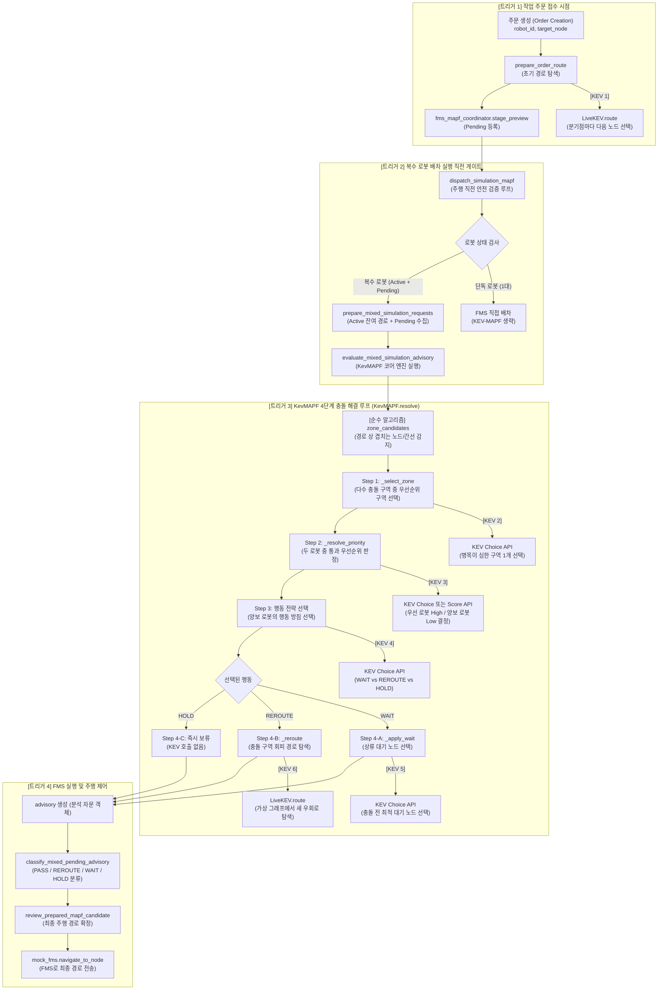
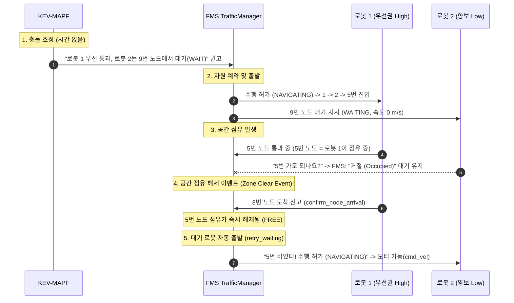

# KevMAPF 아키텍처 및 KEV 입출력 관계 종합 명세서

본 문서는 **KevMAPF** 시스템의 계층별 호출 트리거 시점, 시간/속도 개념의 부재에 따른 입출력 동작 방식, 데이터 구조의 명확한 단계별 구분(MAPF 내부 vs FMS 주행 명령), 그리고 **KEV를 사용하는 모든 기능의 입출력(Input/Output) 관계 및 기능 명세**를 코드베이스 기반으로 완전하게 기술합니다.

---

## 1. 전체 아키텍처 및 기능별 호출 트리거 시점

KevMAPF의 각 기능이 **"어떤 비즈니스/운용 상황에서 왜 호출되는지"** 전체 라이프사이클을 정리합니다.



---

## 2. 시간(Time)과 속도(Speed) 개념 부재 하의 입출력 동작 방식

### 2.1. 왜 시간/속도 개념이 없는가?
- **코드 상의 근거**:
  - `_graph_state()` 내부: `"eta_available": False` 하드코딩
  - 최종 반환값: `"time_prediction_used": False`
  - 프롬프트 지침: `"Do not invent arrival times or occupancy."` (도착 시간 상상 금지)
  - 입력 데이터 형식: 타임스탬프($t$)나 속도($v$)가 없는 순수 노드 시퀀스 리스트 (`path = [1, 2, 5, 8]`)

### 2.2. 시간/속도 없이 어떻게 입출력과 행동이 결정되는가?

1. **위상적 공간 점유 (Topological Worst-case Assumption)**:
   - 두 로봇의 이동 경로에 동일 노드나 간선이 겹치면, 몇 초에 도착하든 상관없이 **"언젠가 두 로봇이 이 구역에서 충돌할 수 있다"**고 가정합니다.
2. **시간표(Schedule) 대신 우선순위 제약(DAG) 반환**:
   - 시간에 맞춰 감속/가속하는 스케줄표 대신, **$\text{Robot A} \succ \text{Robot B}$ (Robot A가 지나가기 전까지 Robot B는 진입 금지)**라는 선후 관계를 출력합니다.
3. **공간적 정지 노드(Wait Node) 지정**:
   - "5초 동안 기다려라"가 아니라, **"충돌 구역 진입 전 $N$번 노드에 물리적으로 멈춰 서 있어라"**라는 공간 대기 명령(`action: "WAIT", wait_node: N`)을 출력합니다.

---

### 2.3. [상세 해설] "공간 점유 해제 이벤트(Zone Clear Event)"란 무엇인가?

이 개념이 헷갈리는 이유는 보통 '스케줄'이라고 하면 "3초 뒤에 출발해라" 같은 **시계(Clock) 기반**을 떠올리기 때문입니다. 하지만 물류 현장에서는 **신호등 센서 기반(Event-driven)**으로 동작합니다.

#### 🚦 직관적인 비유: '외길 터널 신호등'
- **KEV (관제사)**: 
  - "이 터널(5번 노드)은 한 대만 지나갈 수 있는 외길입니다. **로봇 1이 우선권**을 가집니다. **로봇 2는 터널 입구(9번 노드)의 빨간불에서 멈추세요(WAIT).**"
  - 관제사(KEV)는 "로봇 2는 4.5초 동안 기다려라"고 하지 않습니다. 그냥 **"로봇 1이 지나갈 때까지 서 있어라"**는 규칙만 줍니다.
- **FMS (현장 신호등 & 감지 센서)**:
  - FMS는 터널 입구에 있는 로봇 2에게 **빨간불(`status: WAITING`, 속도 `0 m/s`)**을 켜서 세워둡니다.
  - 로봇 1이 터널(5번 노드)을 통과해 터널 밖(8번 노드)으로 완전히 빠져나가 센서를 밟는 순간(`confirm_node_arrival`), FMS는 **"터널이 비었다!(Zone Clear)"**는 이벤트를 감지합니다.
  - FMS가 로봇 2 앞의 신호등을 **초록불(`status: NAVIGATING`)**로 바꾸고 바퀴 모터(`cmd_vel`)를 켭니다.
  - **이때 KEV를 다시 호출하지 않습니다!** 신호등을 바꾸고 출발시키는 것은 FMS가 센서를 보고 100% 자체적으로 수행합니다.

#### 🔄 FMS 코드 내부 동작 순서 (Step-by-Step)



1. **대기 시작 (`traffic_manager.py`)**:
   - 로봇 2가 5번 노드로 가고 싶어 하지만, 5번 노드가 로봇 1에게 묶여 있으므로 FMS가 `SegmentPermission("waiting", "occupied")`을 반환합니다.
   - 로봇 2는 9번 노드에서 멈춰 섭니다 (`status = "WAITING"`).
2. **점유 해제 순간 (`confirm_node_arrival`)**:
   - 로봇 1이 5번 노드를 지나 8번 노드에 도달하면 `confirm_node_arrival(robot_id="robot1", node_id=8)`이 호출됩니다.
   - 이 순간 5번 노드는 **빈 공간(Clear)**이 됩니다.
3. **대기 자동 재시도 루프 (`retry_waiting`)**:
   - FMS 시뮬레이션 루프(`mock_data.py: advance_mock_robot`)가 매 틱마다 `self._traffic.retry_waiting()`을 호출합니다.
   - FMS는 9번에 멈춰 있던 로봇 2의 앞길(5번 노드)이 열렸음을 확인하고, 즉시 상태를 `NAVIGATING`으로 변경하며 주행을 재개시킵니다.

#### 💡 왜 시간(초 단위 스케줄)보다 이 방식이 로봇에서 안전한가?
- **시간 기반(초 단위)의 치명적 위험**:
  - 만약 KEV가 "로봇 2는 3.5초 뒤에 출발해라"라고 시간을 정해줬다면, 로봇 1이 바닥에 미끄러져서 0.5초 늦게 통과했을 때 로봇 2가 3.5초에 바로 튀어나가 **정면충돌**합니다.
- **공간 점유 해제 방식의 안전성**:
  - 로봇 1이 빨리 가든, 천천히 가든, 심지어 중간에 고장 나서 멈춰 있든 간에, **"앞차가 교차로를 완전히 빠져나갔는가(Zone Clear)?"**라는 물리적 팩트가 확인될 때만 로봇 2가 출발하므로 **어떤 외란(지연, 미끄러짐)이 발생해도 100% 충돌이 발생하지 않습니다.**

---

## 3. 데이터 구조의 명확한 단계별 구분

많은 혼선이 발생하는 지점으로, **1) KEV-MAPF 내부 자문 결과**, **2) FMS에 보낼 때의 주행 명령**, **3) FMS 실행 응답**의 3가지 데이터 구조를 명확히 분리합니다.

```
[KEV-MAPF 엔진] ──(1. advisory 자문 반환)──> [Coordinator / Dispatcher]
                                                      │ (2. 검증 완료 후 이동 명령 전송)
                                                      ▼
[프론트엔드/상위시스템] <──(3. 명령 접수 응답)── [FMS (mock_fms)]
```

### 3.1. [데이터 1] KEV-MAPF 내부 분석 결과 자문 객체 (`advisory`)
- **생성 주체**: `KevMAPF.resolve()` ➔ `fms_mapf_coordinator.evaluate_mixed_simulation_advisory()`
- **목적**: KEV AI가 분석한 충돌 회피 전략을 Coordinator/Dispatcher에게 보고하기 위한 객체
- **구조 (`dict`)**:
```json
{
  "status": "PROPOSED",
  "robot_count": 2,
  "paths": {
    "robot_1": [1, 2, 5, 8],
    "robot_2": [10, 11, 12, 4]
  },
  "path_sources": {
    "robot_1": "original",
    "robot_2": "kev_rerouted"
  },
  "potential_shared_zones": {},
  "decisions": [
    {
      "zone": "group:node:5",
      "robots": ["robot_1", "robot_2"],
      "priority_robot": "robot_1",
      "yield_robot": "robot_2",
      "action": "REROUTE",
      "wait_node": null,
      "new_path": [10, 11, 12, 4],
      "needs_fms_approval": true,
      "priority_robot_action": "REQUEST_PROCEED_AFTER_FMS_PERMISSION"
    }
  ],
  "global_priority_relations": [["robot_1", "robot_2"]],
  "time_prediction_used": false,
  "fms_execution_approved": false,
  "metrics": {
    "kev_choice_calls": 3,
    "kev_forced_choices": 1,
    "reroutes": 1,
    "script_wall_seconds": 0.245
  }
}
```

---

### 3.2. [데이터 2] FMS에 실제로 경로를 보낼 때의 파라미터 구조
- **호출 주체**: `kev_dispatcher.py` 내 `dispatch_simulation_mapf()`
- **수신 주체**: `mock_fms.navigate_to_node(robot_id, node_id, required_path=path)`
- **데이터 필드 설명**:
  - `robot_id` (`str`): 이동할 로봇 ID (예: `"robot_2"`)
  - `node_id` (`str` | `int`): 최종 목적지 노드 ID (예: `4`)
  - `required_path` (`list[str]`): **KEV-MAPF의 검증을 거친 최종 확정 노드 경로 리스트**
    - 원본 경로가 승인되었거나 REROUTE 우회 경로로 교체된 노드 순서열
    - 예시: `["10", "11", "12", "4"]`

---

### 3.3. [데이터 3] FMS가 명령을 수락하고 반환하는 실행 응답 데이터 구조
- **생성 주체**: `mock_fms.navigate_to_node()` 반환값
- **목적**: 주행 시작 상태 및 예약 정보를 상위 시스템/UI에 알림
- **구조 (`dict`)**:
```json
{
  "success": true,
  "status": "SUCCESS",
  "robot_id": "robot_2",
  "ui_id": "AMR_02",
  "command": "goal-node",
  "message": "Mock command accepted",
  "target": {
    "node_id": 4,
    "x": 15.0,
    "y": 8.0
  },
  "route": {
    "node_ids": [10, 11, 12, 4],
    "segment_index": 0,
    "phase": "NAVIGATING",
    "departure_at": 1729328400.12,
    "segment_departures": [1729328400.12, 1729328402.50, 1729328405.00]
  }
}
```

---

## 4. KEV를 사용하는 모든 기능의 입출력 관계 전수 명세

시스템 전체에서 **KEV AI(/v1/systemone)를 실제로 호출하는 6개 기능**의 역할, 파이썬 입출력, KEV HTTP API JSON 요청/응답 페이로드를 1:1로 완전 정리합니다.

---

### 기능 1: `LiveKEV.route` (초기 경로 생성 및 REROUTE 우회로 탐색)

- **파일 위치**: [kev_client.py:170](file:///c:/project/Logistics_AI/backend/app/services/kev_mapf/kev_client.py#L170) / [llm_route_preview.py:40](file:///c:/project/Logistics_AI/backend/app/services/llm_route_preview.py#L40)
- **수행 기능**: 출발 노드에서 목표 노드까지의 경로를 탐색할 때, 갈림길(분기점)마다 KEV를 호출하여 가장 짧고 안전한 다음 노드를 반복 선택합니다. REROUTE 시에는 충돌 구역이 차단된 가상 그래프(`virtual_graph`)를 주입받아 우회로를 찾습니다.
- **호출 트리거**:
  1. 주문 접수 시 최초 AI 주행 경로를 생성할 때 (`prepare_order_route`)
  2. Step 3에서 `action_reroute`가 선택되어 우회 경로를 생성할 때 (`_reroute`)

#### 1) 파이썬 함수 입출력
- **입력 (Arguments)**:
  - `graph_data` (`dict`): GeoJSON 기반 노드 및 간선 토폴로지 데이터
  - `start` (`int`): 시작 노드 번호 (예: `10`)
  - `goal` (`int`): 목적지 노드 번호 (예: `4`)
  - `selector` (`str`): 선택기 식별자 (`"kev"`)
  - `model` (`str`): 사용할 모델 별칭 (예: `"kev-08b"`)
- **출력 (Return)**:
  - `path` (`list[int]`): 목적지까지 연결된 노드 번호 배열 (예: `[10, 11, 12, 4]`)

#### 2) KEV 서버 HTTP JSON 요청 페이로드 (`POST /v1/systemone`)
```json
{
  "model": "kev-latest",
  "state": {
    "start": 10,
    "target": 4,
    "current_node": 10,
    "history": [10],
    "available_edges": [
      {"from": 10, "to": 9, "distance": 5.0},
      {"from": 10, "to": 11, "distance": 6.2}
    ]
  },
  "questions": {
    "next_node": {
      "type": "choice",
      "instructions": "Select the valid route with the smallest total distance. Return the candidate ID only through the choice answer.",
      "criteria": {
        "node_9": "Node 9",
        "node_11": "Node 11"
      }
    }
  }
}
```

#### 3) KEV 서버 HTTP JSON 응답 페이로드
```json
{
  "model": "kev-latest",
  "latency_ms": 38.5,
  "answers": {
    "next_node": {
      "type": "choice",
      "choice": "node_11",
      "confidence": 0.94,
      "probabilities": {
        "node_9": 0.06,
        "node_11": 0.94
      }
    }
  }
}
```

---

### 기능 2: `KevMAPF._select_zone` (Step 1: 충돌 구역 우선순위 선택)

- **파일 위치**: [kev_engine.py:201](file:///c:/project/Logistics_AI/backend/app/services/kev_mapf/kev_engine.py#L201)
- **수행 기능**: 2대 이상의 로봇 경로에서 복수의 충돌 예상 구역(교차로, 정면충돌로, 병합점 등)이 발견되었을 때, 전체 흐름상 가장 먼저 해결해야 할 병목 구역 1개를 선택합니다.
- **호출 트리거**: `KevMAPF.resolve()` 루프가 시작되어 해결 가능한 충돌 구역 목록(`available_zones`)이 2개 이상 존재할 때. (1개면 API 호출 생략)

#### 1) 파이썬 함수 입출력
- **입력 (Arguments)**:
  - `it` (`int`): 현재 조정 라운드 번호 (0, 1, 2...)
  - `available_zones` (`dict[str, dict]`): 해결 대상 구역 딕셔너리 (키: 구역ID, 값: 충돌 노드/간선 및 참여 로봇 정보)
- **출력 (Return)**:
  - `(zid, info)` (`tuple[str, dict]`): KEV가 선택한 우선 해결 충돌 구역 ID와 상세 정보 딕셔너리

#### 2) KEV 서버 HTTP JSON 요청 페이로드 (`POST /v1/systemone`)
```json
{
  "model": "kev-latest",
  "state": {
    "route_graph": { ...compact_graph... },
    "robots": [
      { "id": "robot_1", "current_node": 1, "goal_node": 8, "path": [1, 2, 5, 8] },
      { "id": "robot_2", "current_node": 10, "goal_node": 4, "path": [10, 9, 5, 4] }
    ],
    "zones": {
      "group:node:5": { "kind": "node", "node": 5, "robots": ["robot_1", "robot_2"] },
      "group:edge:2-3": { "kind": "edge", "edge": [2, 3], "robots": ["robot_1", "robot_3"] }
    },
    "eta_available": false
  },
  "questions": {
    "mapf_zone_0": {
      "type": "choice",
      "instructions": "You are the MAPF conflict-zone selection component. Each candidate represents one shared resource or a connected group of shared nodes and edges. Choose ONE candidate zone to resolve first, preferably one that blocks imminent progress. Return only a supplied criteria ID.",
      "criteria": {
        "z0": "zone=group:node:5, sharing=robot_1,robot_2, occupant=FREE",
        "z1": "zone=group:edge:2-3, sharing=robot_1,robot_3, occupant=FREE"
      }
    }
  }
}
```

#### 3) KEV 서버 HTTP JSON 응답 페이로드
```json
{
  "model": "kev-latest",
  "latency_ms": 32.1,
  "answers": {
    "mapf_zone_0": {
      "type": "choice",
      "choice": "z0",
      "confidence": 0.91,
      "probabilities": { "z0": 0.91, "z1": 0.09 }
    }
  }
}
```

---

### 기능 3: `KevMAPF._resolve_priority` (Step 2: 통과 우선순위 결정)

- **파일 위치**: [kev_engine.py:219](file:///c:/project/Logistics_AI/backend/app/services/kev_mapf/kev_engine.py#L219)
- **수행 기능**: 특정 충돌 구역을 두고 다투는 두 로봇 `(Robot A, Robot B)` 중, 누가 먼저 지나갈지(High Priority)와 누가 양보할지(Low Priority)를 결정합니다.
- **호출 트리거**: 충돌 구역이 선정된 직후, 두 로봇 사이의 선후 관계를 수립할 때.
- **운용 모드**:
  - `choice` 모드: 1대 1 직접 양자택일 (`live.pick`)
  - `score` 모드: 전체 참여 로봇의 우선순위 점수를 일괄 산출 (`live.score_many`)

#### 1) 파이썬 함수 입출력
- **입력 (Arguments)**:
  - `it` (`int`): 라운드 인덱스
  - `zid` (`str`): 충돌 구역 ID (예: `"group:node:5"`)
  - `info` (`dict`): 충돌 구역 상세 정보
  - `pair` (`tuple[str, str]`): 대상 로봇 쌍 `("robot_1", "robot_2")`
  - `occupant` (`str | None`): 현재 구역을 점유 중인 로봇 ID
  - `potential_conflict_zones` (`dict`): 전체 충돌 구역 맵
- **출력 (Return)**:
  - `(high, low)` (`tuple[str, str] | None`): 먼저 갈 로봇 ID와 양보할 로봇 ID 튜플

#### 2) KEV 서버 HTTP JSON 요청 페이로드 (`POST /v1/systemone` - Choice 모드)
```json
{
  "model": "kev-latest",
  "state": {
    "shared_resource": "group:node:5",
    "shared_resource_details": { "kind": "node", "node": 5, "robots": ["robot_1", "robot_2"] },
    "occupant": null,
    "participant_ids": ["robot_1", "robot_2"],
    "known_priority_constraints": [],
    "eta_available": false
  },
  "questions": {
    "priority_0": {
      "type": "choice",
      "instructions": "You are the MAPF priority-decision component. Choose ONE robot to have priority at the indicated shared resource, considering current position, progress, task priority and occupancy. Avoid deadlocks and repeated unnecessary concessions. Return only the criteria ID.",
      "criteria": {
        "p0": "robot_1 receives priority over robot_2",
        "p1": "robot_2 receives priority over robot_1"
      }
    }
  }
}
```

#### 3) KEV 서버 HTTP JSON 응답 페이로드
```json
{
  "model": "kev-latest",
  "latency_ms": 34.0,
  "answers": {
    "priority_0": {
      "type": "choice",
      "choice": "p0",
      "confidence": 0.88,
      "probabilities": { "p0": 0.88, "p1": 0.12 }
    }
  }
}
```

---

### 기능 4: `KevMAPF.resolve` (Step 3: 양보 로봇의 행동 전략 선택)

- **파일 위치**: [kev_engine.py:447](file:///c:/project/Logistics_AI/backend/app/services/kev_mapf/kev_engine.py#L447)
- **수행 기능**: Step 2에서 양보하기로 결정된 후순위 로봇(Low)이 취할 회피 행동 방침(`WAIT`, `REROUTE`, `HOLD`)을 선택합니다.
- **호출 트리거**: 우선순위 로봇(High)과 양보 로봇(Low)이 결정된 직후.

#### 1) 파이썬 함수 입출력
- **입력 (Arguments)**:
  - `state` (`dict`): 양보 로봇 ID(`yield_robot`) 및 대기 가능 후보 노드 리스트(`candidate_wait_nodes`)가 포함된 컨텍스트
  - `action_choices` (`dict[str, str]`): 선택 가능한 행동 보기 (`action_wait`, `action_reroute`, `action_hold`)
- **출력 (Return)**:
  - `action` (`str`): 선택된 행동 키 (`"action_wait"` 또는 `"action_reroute"` 또는 `"action_hold"`)

#### 2) KEV 서버 HTTP JSON 요청 페이로드 (`POST /v1/systemone`)
```json
{
  "model": "kev-latest",
  "state": {
    "shared_resource": "group:node:5",
    "yield_robot": "robot_2",
    "candidate_wait_nodes": [10, 9],
    "participant_ids": ["robot_1", "robot_2"],
    "eta_available": false
  },
  "questions": {
    "action_0": {
      "type": "choice",
      "instructions": "Select exactly one supplied MAPF action ID. WAIT: Prefer this when a verified upstream wait node exists. REROUTE: Prefer this when WAIT is unavailable and action_reroute is offered. HOLD: Choose when supplied evidence indicates the available alternatives are infeasible or unsafe. Return only a supplied action ID.",
      "criteria": {
        "action_wait": "WAIT: Stop at a permitted upstream node and allow the priority robot to proceed.",
        "action_reroute": "REROUTE: Attempt to generate a valid alternative route around the shared zone."
      }
    }
  }
}
```

#### 3) KEV 서버 HTTP JSON 응답 페이로드
```json
{
  "model": "kev-latest",
  "latency_ms": 31.8,
  "answers": {
    "action_0": {
      "type": "choice",
      "choice": "action_wait",
      "confidence": 0.95,
      "probabilities": { "action_wait": 0.95, "action_reroute": 0.05 }
    }
  }
}
```

---

### 기능 5: `KevMAPF._apply_wait` (Step 4-A: 상류 대기 노드 선택)

- **파일 위치**: [kev_engine.py:314](file:///c:/project/Logistics_AI/backend/app/services/kev_mapf/kev_engine.py#L314)
- **수행 기능**: Step 3에서 `action_wait`가 선택되었을 때, 양보 로봇의 충돌 전 상류 경로 노드 중 다른 로봇을 방해하지 않고 안전하게 정차할 수 있는 최적의 대기 노드를 1개 선정합니다.
- **호출 트리거**: 양보 로봇의 대기 가능 노드 후보(`wait_nodes`)가 2개 이상일 때. (1개면 API 호출 생략)

#### 1) 파이썬 함수 입출력
- **입력 (Arguments)**:
  - `it` (`int`): 라운드 인덱스
  - `zid` (`str`): 충돌 구역 ID
  - `info` (`dict`): 충돌 구역 상세 정보
  - `low` (`str`): 대기할 로봇 ID (예: `"robot_2"`)
  - `wait_nodes` (`list[int]`): 대기 가능한 상류 노드 번호 배열 (예: `[10, 9]`)
- **출력 (Return)**:
  - `status` (`str`): 검증 결과 상태 (`"PROPOSED"` 또는 `"REVIEW_REQUIRED"`) 및 `result["wait_node"]` 갱신

#### 2) KEV 서버 HTTP JSON 요청 페이로드 (`POST /v1/systemone`)
```json
{
  "model": "kev-latest",
  "state": {
    "shared_resource": "group:node:5",
    "wait_robot": "robot_2",
    "wait_nodes": [10, 9],
    "safe_wait_nodes_verified": [10],
    "eta_available": false
  },
  "questions": {
    "wait_node_0": {
      "type": "choice",
      "instructions": "You are the MAPF waiting-position selection component. Choose one upstream node before the shared resource where the yielding robot should wait. Consider path continuity and whether another robot would be blocked. Return only a supplied criteria ID.",
      "criteria": {
        "w0": "Wait at node 10 (on remaining route before group:node:5)",
        "w1": "Wait at node 9 (on remaining route before group:node:5)"
      }
    }
  }
}
```

#### 3) KEV 서버 HTTP JSON 응답 페이로드
```json
{
  "model": "kev-latest",
  "latency_ms": 33.2,
  "answers": {
    "wait_node_0": {
      "type": "choice",
      "choice": "w0",
      "confidence": 0.92,
      "probabilities": { "w0": 0.92, "w1": 0.08 }
    }
  }
}
```

---

### 기능 6: `KevMAPF._resolve_priority` (Step 2 - Score 모드: 다중 로봇 우선순위 일괄 평가)

- **파일 위치**: [kev_client.py:119](file:///c:/project/Logistics_AI/backend/app/services/kev_mapf/kev_client.py#L119) / [kev_engine.py:282](file:///c:/project/Logistics_AI/backend/app/services/kev_mapf/kev_engine.py#L282)
- **수행 기능**: 복합 충돌 상황에서 1회 HTTP 요청으로 관련된 모든 로봇(`robot_ids`)의 통과 우선순위 점수(0.0~1.0)를 일괄 계산합니다. 점수가 가장 높은 로봇이 High Priority를 가져갑니다.
- **호출 트리거**: `config["priority_mode"] == "score"` 설정 시 1회 일괄 평가.

#### 1) 파이썬 함수 입출력
- **입력 (Arguments)**:
  - `state` (`dict`): 전체 그래프 및 충돌 구역 상태
  - `robot_ids` (`list[str]`): 점수를 매길 대상 로봇 ID 리스트 (예: `["robot_1", "robot_2"]`)
- **출력 (Return)**:
  - `scores` (`dict[str, float]`): 로봇 ID별 우선순위 점수 딕셔너리 (예: `{"robot_1": 0.88, "robot_2": 0.42}`)

#### 2) KEV 서버 HTTP JSON 요청 페이로드 (`POST /v1/systemone`)
```json
{
  "model": "kev-latest",
  "state": {
    "conflict_zones": {
      "group:node:5": { "robots": ["robot_1", "robot_2"] }
    },
    "current_occupancy": {},
    "eta_available": false
  },
  "questions": {
    "priority_score_robot_1": {
      "type": "score",
      "instructions": "For this question, scoring_robot is robot_1. Evaluate the priority of scoring_robot relative to other robots in the current MAPF state. Higher scores indicate higher priority to proceed.",
      "criteria": [
        "Very low priority",
        "Low priority",
        "Medium priority",
        "High priority",
        "Very high priority"
      ]
    },
    "priority_score_robot_2": {
      "type": "score",
      "instructions": "For this question, scoring_robot is robot_2. Evaluate the priority of scoring_robot relative to other robots in the current MAPF state. Higher scores indicate higher priority to proceed.",
      "criteria": [
        "Very low priority",
        "Low priority",
        "Medium priority",
        "High priority",
        "Very high priority"
      ]
    }
  }
}
```

#### 3) KEV 서버 HTTP JSON 응답 페이로드
```json
{
  "model": "kev-latest",
  "latency_ms": 42.6,
  "answers": {
    "priority_score_robot_1": {
      "type": "score",
      "score": 0.88,
      "confidence": 0.91
    },
    "priority_score_robot_2": {
      "type": "score",
      "score": 0.42,
      "confidence": 0.89
    }
  }
}
```

---

## 5. 요약: KEV 사용 기능별 종합 비교표

| 번호 | 호출 함수 | 수행 기능 및 목적 | 호출 트리거 시점 | 주요 입력 데이터 | 주요 출력 결과 |
| :---: | :--- | :--- | :--- | :--- | :--- |
| **1** | `LiveKEV.route`<br>(`preview_llm_route`) | 분기점 단위 AI 경로 생성 및 우회로 탐색 | 주문 접수 시 최초 경로 생성, 또는 Step 3 `REROUTE` 선택 시 | `start`, `goal`, 인접 간선 목록 | 목적지까지의 노드 리스트 `[10, 11, 12, 4]` |
| **2** | `KevMAPF._select_zone` | 다수 충돌 구역 중 최우선 해결 구역 1개 선정 | 충돌 조정 루프 시작 시 충돌 후보 구역 $\ge 2$개일 때 | 후보 구역 목록(`zones`), 점유 현황 | 선택된 구역 ID (`"z0"`) |
| **3** | `KevMAPF._resolve_priority`<br>(Choice 모드) | 두 로봇 중 먼저 통과할 우선 로봇(High) 결정 | 충돌 구역 선정 직후 선후 관계 결정 시 | 로봇 쌍 A, B 정보, 점유 현황 | 통과 우선권 로봇 선택 (`"p0"`) |
| **4** | `KevMAPF.resolve`<br>(Action 선택) | 양보 로봇의 회피 행동 방침 결정 | 우선순위 결정 직후 양보 로봇 대응 수립 시 | 대기 가능 노드 유무, 우회 허용 잔여 횟수 | `"action_wait"`, `"action_reroute"`, `"action_hold"` |
| **5** | `KevMAPF._apply_wait` | 충돌 전 정차할 최적 상류 대기 노드 1개 선정 | Step 3에서 WAIT 선택 후 대기 가능 노드 $\ge 2$개일 때 | 대기 가능 노드 목록(`wait_nodes`) | 선택된 대기 노드 ID (`"w0"`) |
| **6** | `KevMAPF._resolve_priority`<br>(Score 모드) | 참여 로봇 전체의 우선순위 점수 일괄 평가 | Score 모드 설정 시 다중 로봇 충돌 평가 시 | 전체 충돌 구역 및 참여 로봇 목록 | 로봇별 점수 `{"robot_1": 0.88, ...}` |
